# **TÀI LIỆU MÔ TẢ THIẾT KẾ PHẦN MỀM (SOFTWARE DESIGN DESCRIPTION - SDD)**

## **Dự án:** Hệ thống quản lý hộ gia đình, nhân khẩu và thu phí chung cư **BlueMoon** (Sprint 1)

## MỤC LỤC

1. [Tổng quan](#1-tổng-quan)
2. [Định nghĩa và thuật ngữ](#2-định-nghĩa-và-thuật-ngữ)
3. [Phân tích yêu cầu](#3-phân-tích-yêu-cầu)
4. [Use case](#4-use-case)
5. [Thiết kế kiến trúc](#5-thiết-kế-kiến-trúc)
6. [Thiết kế lớp](#6-thiết-kế-lớp)
7. [Thiết kế cơ sở dữ liệu](#7-thiết-kế-cơ-sở-dữ-liệu)
8. [Thiết kế giao diện](#8-thiết-kế-giao-diện)
9. [Activity diagram](#9-activity-diagram)
10. [Sequence diagram](#10-sequence-diagram)
11. [Thiết kế bảo mật](#11-thiết-kế-bảo-mật)
12. [Kết luận](#12-kết-luận)


## 1. TỔNG QUAN

### 1.1 Phạm vi hệ thống sprint 1

Hệ thống **Quản lý hộ gia đình, nhân khẩu và thu phí chung cư BlueMoon (Sprint 1)** là ứng dụng web quản lý nội bộ phục vụ công tác điều hành, quản trị dân cư và tính toán thu phí của Ban quản trị tòa nhà chung cư BlueMoon. Hệ thống số hóa toàn diện quy trình quản trị, thay thế hoàn toàn phương thức lưu trữ thủ công bằng giấy tờ, sổ sách hoặc các tệp tin Excel rời rạc.

Phạm vi chức năng trọng tâm trong **Sprint 1**:

* **Quản lý tài khoản, xác thực và hồ sơ cá nhân:** Đăng nhập JWT bảo mật cao, đổi mật khẩu, phân quyền quản trị theo vai trò (BQT, Kế toán, Cư dân, Cơ quan chức năng), khóa/mở khóa tài khoản, cấp lại mật khẩu tạm thời.
* **Quản lý hộ gia đình và căn hộ:** Quản lý thông tin căn hộ (số phòng, tầng, diện tích), quản lý hộ gia đình (mã hộ, chủ hộ, trạng thái hoạt động), thay đổi chủ hộ, cập nhật trạng thái hộ.
* **Quản lý nhân khẩu và biến động cư trú:** Quản lý hồ sơ nhân khẩu theo hộ và toàn chung cư; ghi nhận tiếp nhận nhân khẩu mới theo các diện (chuyển đến, sinh con, tạm trú, đã ở từ trước); quản lý trạng thái cư trú (thường trú, tạm vắng, tạm trú, chuyển đi, qua đời); ghi nhận nhật ký biến động cư trú (append-only) chống sửa/xóa; xóa mềm nhân khẩu có ràng buộc toàn vẹn.
* **Cổng cư dân và quản lý đề nghị cư trú:** Cổng thông tin cho cư dân tra cứu thông tin hộ gia đình của mình; gửi trực tuyến các đề nghị cư trú (cập nhật thông tin nhân khẩu, khai báo tạm vắng, khai báo tạm trú); theo dõi trạng thái đề nghị; cho phép Ban quản trị kiểm tra hàng đợi đề nghị, xem diff dữ liệu trước/sau để phê duyệt (tự động cập nhật hồ sơ/biến động) hoặc từ chối (bắt buộc nhập lý do).
* **Quản lý danh mục khoản thu:** Thiết lập các danh mục khoản thu bắt buộc hoặc đóng góp tự nguyện; định cấu hình phương thức tính tiền (theo diện tích căn hộ, cố định theo hộ, hoặc thu theo nhu cầu/thủ công), chu kỳ thu (hàng tháng hoặc một lần), đơn giá áp dụng và ngày đến hạn.
* **Quản lý kỳ thu phí và lập danh sách khoản phải thu:** Tạo kỳ thu phí theo tháng/năm, tính thử phí (fee calculation preview/dry-run) để kiểm tra công thức tính tiền trước khi chốt, tự động sinh danh sách khoản phải thu (receivables) cho toàn bộ hộ gia đình đang hoạt động theo các khoản thu bắt buộc còn hiệu lực.
* **Tra cứu và tìm kiếm nhanh:** Công cụ tìm kiếm nhanh toàn hệ thống theo từ khóa đa năng, hỗ trợ tìm kiếm tiếng Việt có dấu và không dấu (nhờ PostgreSQL unaccent và trigram index) cho hộ gia đình và nhân khẩu.

### 1.2 Mục đích tài liệu

Tài liệu Mô tả Thiết kế Phần mềm (SDD) này đặc tả chi tiết kiến trúc và các yêu cầu kỹ thuật của hệ thống, đóng vai trò:

* Là tài liệu cầu nối và chuẩn hóa kỹ thuật giữa tài liệu Yêu cầu phần mềm (SRS) và mã nguồn thực tế của dự án.
* Làm kim chỉ nam cho các lập trình viên Backend, Frontend và Database phát triển, đồng bộ hóa các API contract và lược đồ cơ sở dữ liệu.
* Làm căn cứ cho đội ngũ kiểm thử (QA/QC) xây dựng kịch bản kiểm thử (test cases) theo đúng luồng dữ liệu và nghiệp vụ thực tế.
* Thiết lập nền tảng kỹ thuật và kiến trúc dữ liệu chuẩn mực để sẵn sàng mở rộng cho Sprint 2 (thu tiền mặt tại quầy, quản lý nợ đọng, đợt vận động đóng góp tự nguyện, xác thực cư trú theo thẩm quyền).

### 1.3 Đối tượng sử dụng tài liệu

| Đối tượng | Cách thức sử dụng tài liệu |
| --- | --- |
| **Quản lý dự án / Product Owner** | Giám sát tiến độ, nghiệm thu tính năng và đối chiếu phạm vi thực thi Sprint 1 |
| **Lập trình viên Backend** | Triển khai kiến trúc Controller - Service - Repository, xử lý logic nghiệp vụ, bảo mật Spring Security và RESTful APIs |
| **Lập trình viên Frontend** | Triển khai giao diện React, quản lý trạng thái, routing và tích hợp API thông qua tầng HTTP client |
| **Người thiết kế & quản trị CSDL** | Xây dựng và tối ưu lược đồ PostgreSQL, các chỉ mục (indexes), hàm bất biến (`f_unaccent`) và triggers toàn vẹn dữ liệu |
| **Kiểm thử viên (QA/QC)** | Xây dựng và thực thi các bộ kiểm thử đơn vị (Unit Test), kiểm thử tích hợp (Integration Test) và kiểm thử đầu cuối (E2E) |

### 1.4 Các bên liên quan (Stakeholders)

* **Ban quản trị tòa nhà (BQT):** Chủ quản vận hành, quản lý dữ liệu cư dân, xét duyệt đề nghị cư trú và điều hành chung cư.
* **Bộ phận Kế toán (ACCOUNTANT):** Quản lý tài chính, thiết lập danh mục khoản thu, tạo kỳ thu phí và sinh công nợ phải thu.
* **Cư dân tòa nhà (RESIDENT):** Người sinh sống tại chung cư, trực tiếp tra cứu hộ gia đình và nộp các đề nghị cư trú trực tuyến.
* **Cơ quan chức năng (AUTHORITY):** Công an khu vực, chính quyền địa phương có thẩm quyền tra cứu, xác minh thông tin cư trú.
* **Đội ngũ phát triển phần mềm:** Nhóm kỹ sư phân tích, thiết kế, lập trình và vận hành hệ thống.

### 1.5 Công nghệ sử dụng

Hệ thống được xây dựng theo mô hình kiến trúc **Web Client - Server (SPA kết hợp RESTful API)**:

| Tầng / Thành phần | Công nghệ thực tế | Ghi chú & Thông số kỹ thuật |
| --- | --- | --- |
| **Frontend** | **React 18.3.1 + Vite 6.0.5** | Ứng dụng Single Page Application (SPA), React Router DOM 7.18.5 |
| **Giao diện & Icon** | **Custom CSS (`styles.css`) + Lucide React** | Hệ thống style chuẩn hóa hiện đại, bộ icon trực quan của `lucide-react` |
| **Tầng gọi API FE** | **Fetch API Native wrapper (`http.js`)** | Tự động gắn Bearer Token, chuẩn hóa phản hồi và bọc lỗi `ApiError` |
| **Backend** | **Java 21 / 25 + Spring Boot 4.x** | Spring Web MVC, Spring Data JPA, Spring Security, Spring Validation, Lombok |
| **Xác thực & Bảo mật** | **JWT (jjwt 0.12.6) + BCrypt** | Phân quyền vai trò RBAC, token thời hạn 8 giờ (28.800s), kiểm tra trạng thái tài khoản và thời điểm đổi mật khẩu |
| **Cơ sở dữ liệu** | **PostgreSQL 14+** | Port mặc định `5432`, sử dụng tiện ích mở rộng `pg_trgm` và `unaccent` hỗ trợ tìm kiếm tiếng Việt không dấu |
| **Giao thức kết nối** | **RESTful API (JSON over HTTP)** | Chuẩn hóa toàn bộ phản hồi qua Envelope: `ApiResponse<T>`, `PageResponse<T>`, `ApiErrorResponse` |
| **Quản lý mã nguồn & Build** | **Git, Maven Wrapper (`mvnw`), npm** | Backend port mặc định **8080**; Frontend Vite dev server port **5173** (proxy `/api` về port 8080) |

---

## 2. ĐỊNH NGHĨA VÀ THUẬT NGỮ

### 2.1 Thuật ngữ nghiệp vụ

| Thuật ngữ | Định nghĩa nghiệp vụ |
| --- | --- |
| **Ban quản trị (BQT)** | Cơ quan đại diện cho cư dân, có toàn quyền quản trị hệ thống, quản lý tài khoản, hộ gia đình, nhân khẩu, duyệt biến động và duyệt đề nghị cư trú. |
| **Kế toán (ACCOUNTANT)** | Bộ phận phụ trách tài chính - thu phí: quản lý danh mục khoản thu, tạo kỳ thu phí, tính thử phí và sinh danh sách khoản phải thu. |
| **Cư dân (RESIDENT)** | Người dùng đang sinh sống tại chung cư, có tài khoản được cấp liên kết 1-1 với hồ sơ nhân khẩu, có quyền tra cứu hộ gia đình của mình và gửi đề nghị cư trú. |
| **Cơ quan chức năng (AUTHORITY)** | Đơn vị quản lý nhà nước (Công an khu vực, chính quyền) có thẩm quyền tra cứu, thẩm định và xác minh thông tin cư trú của cư dân. |
| **Căn hộ (Apartment)** | Không gian nhà ở cố định trong chung cư, đặc trưng bởi số căn hộ (`apartmentNo`), tầng (`floor`) và diện tích (`area` tính theo m²). |
| **Hộ gia đình / Hộ khẩu (Household)** | Đơn vị cư trú gồm một nhóm nhân khẩu cùng chung sống tại một căn hộ, có mã hộ (`householdCode`) duy nhất và trạng thái (`ACTIVE`/`INACTIVE`). Tại một thời điểm, mỗi căn hộ chỉ có duy nhất một hộ gia đình hoạt động. |
| **Chủ hộ (Household Head)** | Nhân khẩu đại diện pháp lý cho hộ gia đình; mỗi hộ gia đình hoạt động bắt buộc có đúng 1 chủ hộ đang thường trú trong hộ. |
| **Nhân khẩu (Resident)** | Cá nhân cư trú trong hộ gia đình, có các thông tin nhân thân (họ tên, ngày sinh, giới tính, CCCD/CMND, SĐT, quan hệ với chủ hộ). |
| **Tình trạng cư trú (ResidencyStatus)** | Trạng thái hiện tại của nhân khẩu: Thường trú (`RESIDING`), Tạm vắng (`TEMPORARILY_ABSENT`), Tạm trú (`TEMPORARY_RESIDENCE`), Đã chuyển đi (`MOVED_OUT`), Đã qua đời (`DECEASED`). |
| **Biến động cư trú (Resident Movement)** | Sự kiện ghi nhận thay đổi nhân khẩu hoặc cư trú: Tiếp nhận đến (`MOVE_IN`), Chuyển đi (`MOVE_OUT`), Chuyển hộ nội bộ (`TRANSFER`), Khai sinh (`BIRTH`), Khai tử (`DEATH`), Tạm vắng (`TEMPORARY_ABSENCE`), Tạm trú (`TEMPORARY_RESIDENCE`), Trở về (`RETURN`). Bảng dữ liệu được thiết kế chỉ ghi thêm (`append-only`), chống sửa/xóa bằng database trigger. |
| **Đề nghị cư trú (Resident Request)** | Yêu cầu trực tuyến do cư dân gửi lên Ban quản trị qua Cổng cư dân: Cập nhật thông tin nhân khẩu (`PROFILE_UPDATE`), Khai báo tạm vắng (`TEMPORARY_ABSENCE`), Khai báo tạm trú cho khách (`TEMPORARY_RESIDENCE`). Trạng thái xử lý: Chờ duyệt (`PENDING`), Đã duyệt (`APPROVED`), Từ chối (`REJECTED`), Đã hủy (`CANCELLED`). |
| **Danh mục khoản thu (Fee Category)** | Khoản phí được cấu hình trên hệ thống: Khoản thu bắt buộc (`MANDATORY`) hoặc Đóng góp tự nguyện (`VOLUNTARY`). Phương thức tính: Theo diện tích (`PER_AREA`), Cố định theo hộ (`FIXED`), hoặc Nhập thủ công/tùy ý (`MANUAL`). Chu kỳ thu: Hàng tháng (`MONTHLY`) hoặc Một lần (`ONE_TIME`). |
| **Kỳ thu phí (Billing Period)** | Đợt phát động thu phí trong một khoảng thời gian nhất định (thường theo tháng/năm), có mã kỳ, tên kỳ, ngày bắt đầu, ngày kết thúc và trạng thái Mở (`OPEN`) hoặc Đóng (`CLOSED`). |
| **Khoản phải thu / Công nợ (Receivable)** | Bản ghi công nợ sinh ra cho một hộ gia đình trong một kỳ thu phí đối với một khoản thu bắt buộc; gồm số lượng/diện tích tính phí, đơn giá áp dụng, thành tiền (`amount_due`) và ngày đến hạn (`due_date`). |
| **Tính thử phí (Fee Calculation Preview)** | Chức năng tính toán trước và mô phỏng công thức số tiền phải nộp cho từng hộ theo từng khoản thu bắt buộc (chế độ Dry-run) nhằm đối soát trước khi chốt sinh công nợ chính thức. |

### 2.2 Thuật ngữ kỹ thuật

| Thuật ngữ | Định nghĩa kỹ thuật |
| --- | --- |
| **SPA** | Single Page Application – Ứng dụng web một trang xây dựng bằng React, chuyển trang mượt mà không tải lại toàn bộ trang web. |
| **RESTful API** | Giao diện lập trình ứng dụng tuân thủ chuẩn REST, sử dụng các phương thức chuẩn HTTP (GET, POST, PUT, PATCH, DELETE) và định dạng trao đổi dữ liệu JSON. |
| **API Envelope** | Cấu trúc đóng gói phản hồi chuẩn của API: luôn chứa `success`, `message`, `data` (hoặc `errors`/`details` khi thất bại) giúp Frontend xử lý đồng nhất. |
| **DTO** | Data Transfer Object – Các đối tượng truyền nhận dữ liệu giữa tầng Controller và Service, cũng như giữa Client và Server. |
| **ORM / Spring Data JPA** | Tầng trừu tượng hóa ánh xạ các thực thể Java (Entity) xuống các bảng quan hệ trong cơ sở dữ liệu PostgreSQL. |
| **Trigger Database** | Đoạn mã PL/pgSQL tự động thực thi trong PostgreSQL nhằm ép buộc toàn vẹn dữ liệu (vd: cấm sửa/xóa bảng append-only, tự động cập nhật `updated_at`). |
| **Trigram & Unaccent Index** | Các chỉ mục GIN kết hợp hàm `f_unaccent` trong PostgreSQL giúp tăng tốc độ tìm kiếm văn bản tiếng Việt gần đúng và không phân biệt dấu. |

### 2.3 Thuật ngữ bảo mật

| Thuật ngữ | Định nghĩa bảo mật |
| --- | --- |
| **JWT** | JSON Web Token – Chuỗi mã hóa stateless chứa thông tin định danh và vai trò của người dùng, được gửi kèm trong header `Authorization: Bearer <token>`. |
| **BCrypt** | Thuật toán băm mật khẩu một chiều có salt ngẫu nhiên, bảo vệ tuyệt đối mật khẩu người dùng trong CSDL. |
| **RBAC** | Role-Based Access Control – Cơ chế kiểm soát truy cập dựa trên vai trò người dùng (`BQT`, `ACCOUNTANT`, `RESIDENT`, `AUTHORITY`). |
| **Stateless Session** | Mô hình xác thực không lưu trữ trạng thái phiên trên bộ nhớ máy chủ (SessionCreationPolicy.STATELESS), tối ưu hóa khả năng mở rộng. |
| **Soft Delete** | Xóa mềm – Đánh dấu dữ liệu đã bị xóa (bằng cờ hoặc cột thời gian `deleted_at`) thay vì xóa vật lý khỏi CSDL nhằm bảo toàn toàn vẹn tham chiếu. |

---

## 3. PHÂN TÍCH YÊU CẦU

### 3.1 Actor của hệ thống

Hệ thống có đúng **4 Actor (vai trò)** tham gia vận hành:

| Actor | Tên vai trò | Mã Role (`RoleCode`) | Mô tả & Thẩm quyền chính |
| --- | --- | --- | --- |
| **Ban quản trị** | Ban quản trị tòa nhà | `BQT` | **Toàn quyền quản trị:** Quản lý tài khoản người dùng, phân quyền các vai trò; quản lý hộ gia đình, căn hộ; quản lý nhân khẩu, duyệt biến động cư trú; tiếp nhận, thẩm định và phê duyệt/từ chối các đề nghị cư trú trực tuyến từ Cư dân; đóng/mở kỳ thu phí; tra cứu và tìm kiếm nhanh toàn hệ thống. |
| **Kế toán** | Bộ phận Tài chính - Kế toán | `ACCOUNTANT` | **Quản lý thu phí & công nợ:** Quản lý danh mục khoản thu (tạo, cập nhật, kích hoạt/ngừng); quản lý các kỳ thu phí (tạo kỳ, sửa/xóa kỳ khi chưa sinh công nợ); tính thử phí (preview); tự động sinh danh sách khoản phải thu (generate receivables) cho các hộ gia đình; tra cứu dữ liệu hộ và nhân khẩu phục vụ nghiệp vụ. |
| **Cư dân** | Cư dân tòa nhà | `RESIDENT` | **Cổng dịch vụ cư dân:** Tài khoản được BQT khởi tạo và liên kết trực tiếp với 1 nhân khẩu trong hộ. Cư dân có quyền xem thông tin căn hộ và danh sách thành viên trong hộ gia đình của mình (`/me/household`); gửi các đề nghị cư trú trực tuyến (cập nhật thông tin, khai báo tạm vắng, khai báo tạm trú); theo dõi trạng thái đề nghị và hủy đề nghị khi còn ở trạng thái `PENDING`; quản lý hồ sơ cá nhân và đổi mật khẩu. |
| **Cơ quan chức năng** | Công an / Chính quyền | `AUTHORITY` | **Tra cứu theo thẩm quyền:** Tra cứu, thẩm định và xác minh thông tin cư trú, hộ gia đình, nhân khẩu và lịch sử biến động dân cư phục vụ công tác quản lý an ninh trật tự địa bàn theo đúng quy định pháp luật. |

*Lưu ý về phạm vi truy cập công khai:* Hệ thống là phần mềm nội bộ quản trị chung cư, điểm truy cập công khai duy nhất không cần xác thực là API đăng nhập (`POST /auth/login`). Toàn bộ tài khoản người dùng đều do Ban quản trị (`BQT`) tạo lập và quản lý. Hệ thống không mở đăng ký tài khoản tự do công khai để đảm bảo tính xác thực và an toàn tuyệt đối cho dữ liệu cư dân tòa nhà.

### 3.2 Danh sách module chức năng

Toàn bộ hệ thống trong Sprint 1 được phân rã thành **5 module chức năng nghiệp vụ cốt lõi**:

```
F. Hệ thống quản lý chung cư và cư dân BlueMoon (Sprint 1)
│
├── M1. Quản lý tài khoản, xác thực và hồ sơ cá nhân
│   ├── F1.1 Đăng nhập hệ thống (JWT, kiểm tra trạng thái hoạt động và hiệu lực mật khẩu)
│   ├── F1.2 Đăng xuất hệ thống (vô hiệu hóa phiên đăng nhập phía client)
│   ├── F1.3 BQT tạo tài khoản người dùng nội bộ và tài khoản cư dân
│   ├── F1.4 BQT xem danh sách tài khoản (lọc theo từ khóa, vai trò, trạng thái kích hoạt)
│   ├── F1.5 BQT xem chi tiết thông tin tài khoản
│   ├── F1.6 BQT phân quyền / cập nhật vai trò tài khoản
│   ├── F1.7 BQT khóa / mở khóa tài khoản người dùng (chặn tự khóa chính mình)
│   ├── F1.8 BQT đặt lại mật khẩu tạm thời cho tài khoản
│   ├── F1.9 Xem danh sách các vai trò hệ thống
│   ├── F1.10 Xem thông tin hồ sơ cá nhân
│   ├── F1.11 Cập nhật thông tin hồ sơ cá nhân
│   └── F1.12 Đổi mật khẩu cá nhân
│
├── M2. Quản lý hộ gia đình, nhân khẩu và biến động cư trú
│   ├── F2.1 Thêm mới hộ gia đình (thiết lập mã hộ, số căn hộ, tầng, diện tích và chủ hộ ban đầu)
│   ├── F2.2 Xem danh sách hộ gia đình (phân trang, tìm kiếm mã hộ, số căn hộ, lọc trạng thái)
│   ├── F2.3 Xem chi tiết hộ gia đình (thông tin căn hộ, chủ hộ và danh sách nhân khẩu hiện tại)
│   ├── F2.4 Chỉnh sửa thông tin hộ gia đình / căn hộ
│   ├── F2.5 Thay đổi chủ hộ gia đình
│   ├── F2.6 Cập nhật trạng thái hộ gia đình (ACTIVE / INACTIVE)
│   ├── F2.7 Thêm nhân khẩu vào hộ gia đình
│   ├── F2.8 Xem danh sách nhân khẩu theo từng hộ gia đình
│   ├── F2.9 Xem danh sách toàn bộ nhân khẩu trong chung cư
│   ├── F2.10 Xem chi tiết thông tin nhân khẩu
│   ├── F2.11 Chỉnh sửa thông tin nhân khẩu
│   ├── F2.12 Xóa mềm nhân khẩu
│   ├── F2.13 Ghi nhận biến động nhân khẩu (chuyển đi, chuyển hộ nội bộ, qua đời, tạm vắng, tạm trú, quay về)
│   ├── F2.14 Tra cứu lịch sử các lần biến động cư trú của nhân khẩu
│   ├── F2.15 Tra cứu thông tin hộ gia đình theo mã hộ, số căn hộ
│   └── F2.16 Tra cứu thông tin nhân khẩu theo họ tên
│
├── M3. Cổng cư dân và quản lý đề nghị cư trú
│   ├── F3.1 Cư dân xem thông tin hộ gia đình và danh sách thành viên trong hộ
│   ├── F3.2 Cư dân gửi đề nghị chỉnh sửa thông tin nhân khẩu
│   ├── F3.3 Cư dân gửi đề nghị khai báo tạm vắng, tạm trú
│   ├── F3.4 Cư dân theo dõi danh sách các đề nghị đã gửi
│   ├── F3.5 Cư dân xem chi tiết đề nghị (dữ liệu trước/sau thay đổi, kết quả và lý do từ chối)
│   ├── F3.6 Cư dân hủy đề nghị đang ở trạng thái PENDING
│   ├── F3.7 BQT xem danh sách hàng đợi các đề nghị từ cư dân
│   ├── F3.8 BQT xem chi tiết đề nghị và đối chiếu dữ liệu thay đổi
│   ├── F3.9 BQT phê duyệt đề nghị
│   └── F3.10 BQT từ chối đề nghị (bắt buộc nhập lý do)
│
├── M4. Quản lý khoản thu và lập danh sách khoản phải thu
│   ├── F4.1 Tạo mới danh mục khoản thu
│   ├── F4.2 Xem danh sách danh mục khoản thu
│   ├── F4.3 Xem thông tin chi tiết danh mục khoản thu
│   ├── F4.4 Chỉnh sửa danh mục khoản thu
│   ├── F4.5 Cập nhật trạng thái hoạt động / ngừng sử dụng danh mục khoản thu
│   ├── F4.6 Tạo mới kỳ thu phí
│   ├── F4.7 Xem danh sách các kỳ thu phí
│   ├── F4.8 Xem chi tiết kỳ thu phí
│   ├── F4.9 Chỉnh sửa thông tin kỳ thu phí
│   ├── F4.10 Xóa kỳ thu phí
│   ├── F4.11 Đóng / mở lại kỳ thu phí
│   ├── F4.12 Tính thử phí và xem trước công thức tính tiền cho từng hộ gia đình
│   ├── F4.13 Lập danh sách khoản phải thu tự động cho các hộ gia đình
│
└── M5. Chức năng tra cứu dùng chung
    └── F5.1 Tìm kiếm nhanh toàn hệ thống theo từ khóa (hỗ trợ tìm tiếng Việt không dấu)
```

### 3.3 Yêu cầu chức năng (Functional Requirements)

Bảng đặc tả các yêu cầu chức năng tương ứng đầy đủ với 7 module của dự án:

| Mã yêu cầu | Mô tả chi tiết yêu cầu chức năng | Module tương ứng | Vai trò áp dụng |
| --- | --- | --- | --- |
| **FR-01** | Hệ thống cho phép người dùng đăng nhập bằng tên đăng nhập và mật khẩu, kiểm tra trạng thái hoạt động của tài khoản và trả về JWT Bearer Token | M1 | Tất cả |
| **FR-02** | Hệ thống cho phép người dùng đăng xuất, xóa phiên xác thực phía client | M1 | Tất cả |
| **FR-03** | Ban quản trị có thể tạo tài khoản người dùng mới (nội bộ hoặc liên kết với nhân khẩu cư dân) và quản lý danh sách tài khoản (lọc, phân trang, xem chi tiết) | M1 | BQT |
| **FR-04** | Ban quản trị có thể phân quyền/gán vai trò (`BQT`, `ACCOUNTANT`, `RESIDENT`, `AUTHORITY`) cho tài khoản; kiểm tra tính hợp lệ khi gán vai trò `RESIDENT` phải có `residentId` | M1 | BQT |
| **FR-05** | Ban quản trị có thể khóa / mở khóa tài khoản người dùng; chặn tuyệt đối không cho quản trị viên tự khóa chính mình | M1 | BQT |
| **FR-06** | Ban quản trị có thể đặt lại mật khẩu tạm thời cho tài khoản (tự sinh mật khẩu ngẫu nhiên hoặc chỉ định, kích hoạt cờ `mustChangePassword = true`) | M1 | BQT |
| **FR-07** | Người dùng có thể xem và cập nhật thông tin hồ sơ cá nhân của mình (họ tên, email, số điện thoại) | M1 | Tất cả |
| **FR-08** | Người dùng có thể đổi mật khẩu cá nhân (xác thực mật khẩu hiện tại, mật khẩu mới không trùng mật khẩu cũ và không trùng tên đăng nhập) | M1 | Tất cả |
| **FR-09** | Ban quản trị có thể tạo mới hộ gia đình gắn với căn hộ (mã hộ duy nhất, số căn hộ duy nhất, tầng, diện tích) và chỉ định chủ hộ ban đầu | M2 | BQT |
| **FR-10** | Ban quản trị và Kế toán có thể xem danh sách hộ gia đình có phân trang, lọc theo trạng thái (`ACTIVE`, `INACTIVE`) và tìm kiếm theo mã hộ, số căn hộ | M2 | BQT, ACCOUNTANT |
| **FR-11** | Ban quản trị và Kế toán có thể xem thông tin chi tiết của hộ gia đình (thông tin căn hộ, chủ hộ, danh sách toàn bộ nhân khẩu và số nhân khẩu hiện diện) | M2 | BQT, ACCOUNTANT |
| **FR-12** | Ban quản trị có thể chỉnh sửa thông tin hộ gia đình và thông tin căn hộ (mã hộ, số phòng, tầng, diện tích) | M2 | BQT |
| **FR-13** | Ban quản trị có thể thay đổi chủ hộ gia đình bằng cách chọn nhân khẩu hợp lệ đang thường trú (`RESIDING`) trong hộ | M2 | BQT |
| **FR-14** | Ban quản trị có thể cập nhật trạng thái hoạt động của hộ gia đình (`ACTIVE` / `INACTIVE`) | M2 | BQT |
| **FR-15** | Ban quản trị có thể tiếp nhận và thêm nhân khẩu mới vào hộ theo các diện: chuyển đến (`MOVE_IN`), sinh con (`BIRTH`), tạm trú (`TEMPORARY_RESIDENCE`), đã ở từ trước (`EXISTING`) | M3 | BQT |
| **FR-16** | Ban quản trị và Kế toán có thể xem danh sách nhân khẩu theo từng hộ hoặc toàn bộ nhân khẩu trong chung cư, lọc theo tình trạng cư trú và danh sách sắp quá hạn | M3 | BQT, ACCOUNTANT |
| **FR-17** | Ban quản trị có thể xem chi tiết hồ sơ nhân khẩu và chỉnh sửa thông tin (họ tên, ngày sinh, giới tính, số CCCD, SĐT, quan hệ với chủ hộ) | M3 | BQT |
| **FR-18** | Ban quản trị có thể xóa mềm nhân khẩu; chỉ cho phép khi nhân khẩu chưa có tài khoản người dùng, chưa phát sinh biến động cư trú và không phải là chủ hộ | M3 | BQT |
| **FR-19** | Ban quản trị có thể ghi nhận biến động nhân khẩu (chuyển đi, chuyển hộ nội bộ, qua đời, tạm vắng, tạm trú, trở về) lưu vào nhật ký append-only | M3 | BQT |
| **FR-20** | Ban quản trị và Kế toán có thể tra cứu toàn bộ lịch sử biến động cư trú của từng nhân khẩu | M3 | BQT, ACCOUNTANT |
| **FR-21** | Cư dân có thể xem thông tin chi tiết căn hộ và danh sách các nhân khẩu trong hộ gia đình của chính mình thông qua Cổng cư dân (`/me/household`) | M4 | RESIDENT |
| **FR-22** | Cư dân có thể gửi đề nghị cập nhật thông tin nhân khẩu trong hộ (đối chiếu thay đổi dữ liệu) | M4 | RESIDENT |
| **FR-23** | Cư dân có thể gửi đề nghị khai báo tạm vắng cho thành viên trong hộ gia đình của mình (kèm khoảng thời gian từ ngày - đến ngày) | M4 | RESIDENT |
| **FR-24** | Cư dân có thể gửi đề nghị khai báo tạm trú cho khách hoặc nhân khẩu mới lưu trú tại căn hộ của mình | M4 | RESIDENT |
| **FR-25** | Cư dân có thể theo dõi danh sách, xem chi tiết tình trạng đề nghị của mình và hủy đề nghị khi còn ở trạng thái chờ duyệt (`PENDING`) | M4 | RESIDENT |
| **FR-26** | Ban quản trị có thể xem danh sách hàng đợi các đề nghị từ cư dân, lọc theo trạng thái (`PENDING`, `APPROVED`, `REJECTED`, `CANCELLED`), căn hộ và loại đề nghị | M4 | BQT |
| **FR-27** | Ban quản trị có thể xem chi tiết đề nghị cư dân và đối chiếu trực quan dữ liệu trước/sau thay đổi (JSON diff) | M4 | BQT |
| **FR-28** | Ban quản trị có thể phê duyệt đề nghị cư dân (`APPROVED`); hệ thống tự động cập nhật thông tin nhân khẩu hoặc tự sinh bản ghi biến động cư trú tương ứng | M4 | BQT |
| **FR-29** | Ban quản trị có thể từ chối đề nghị cư dân (`REJECTED`); bắt buộc phải nhập lý do từ chối để phản hồi lại cho cư dân | M4 | BQT |
| **FR-30** | Kế toán và BQT có thể tạo mới danh mục khoản thu với các thuộc tính: mã, tên, loại phí (`MANDATORY`/`VOLUNTARY`), phương thức tính (`PER_AREA`/`FIXED`/`MANUAL`), chu kỳ (`MONTHLY`/`ONE_TIME`), đơn giá và ngày đến hạn | M5 | ACCOUNTANT, BQT |
| **FR-31** | Kế toán và BQT có thể xem danh sách danh mục khoản thu (lọc theo loại phí, trạng thái) và xem chi tiết cấu hình khoản thu | M5 | ACCOUNTANT, BQT |
| **FR-32** | Kế toán và BQT có thể chỉnh sửa cấu hình danh mục khoản thu; hệ thống khóa sửa các trường cốt lõi nếu khoản thu đã phát sinh công nợ | M5 | ACCOUNTANT, BQT |
| **FR-33** | Kế toán và BQT có thể cập nhật trạng thái kích hoạt/ngừng sử dụng danh mục khoản thu | M5 | ACCOUNTANT, BQT |
| **FR-34** | Kế toán và BQT có thể tạo mới, chỉnh sửa hoặc xóa kỳ thu phí; việc sửa và xóa chỉ được phép khi kỳ thu chưa lập danh sách khoản phải thu | M6 | ACCOUNTANT, BQT |
| **FR-35** | Kế toán và BQT có thể xem danh sách các kỳ thu phí và xem chi tiết kỳ thu kèm các thông số tổng hợp (số hộ, số khoản thu, tổng tiền dự kiến) | M6 | ACCOUNTANT, BQT |
| **FR-36** | Ban quản trị có thể đóng kỳ thu phí (`CLOSED`) hoặc mở lại kỳ thu phí (`OPEN`) | M6 | BQT |
| **FR-37** | Kế toán và BQT có thể chạy tính thử phí (Preview) để xem trước công thức tính và bảng số liệu tiền phí của từng hộ gia đình theo từng khoản thu | M6 | ACCOUNTANT, BQT |
| **FR-38** | Kế toán và BQT có thể lập danh sách khoản phải thu tự động (Generate Receivables) cho toàn bộ hộ gia đình đang hoạt động theo các khoản thu bắt buộc còn hiệu lực | M6 | ACCOUNTANT, BQT |
| **FR-39** | Kế toán và BQT có thể xem danh sách chi tiết các khoản phải thu (Receivables) đã được sinh ra trong kỳ thu phí | M6 | ACCOUNTANT, BQT |
| **FR-40** | Người dùng có thể tìm kiếm nhanh toàn hệ thống theo từ khóa đa năng, hỗ trợ tìm kiếm tiếng Việt không phân biệt dấu | M7 | BQT, ACCOUNTANT |
| **FR-41** | Hệ thống cung cấp chức năng tra cứu nhanh thông tin hộ gia đình theo mã hộ hoặc số căn hộ | M7 | BQT, ACCOUNTANT |
| **FR-42** | Hệ thống cung cấp chức năng tra cứu nhanh thông tin nhân khẩu theo họ tên | M7 | BQT, ACCOUNTANT |

### 3.4 Yêu cầu phi chức năng (Non-Functional Requirements)

| Mã yêu cầu | Tiêu chuẩn chất lượng / Ràng buộc phi chức năng |
| --- | --- |
| **NFR-01** | **Giao diện & Ngôn ngữ:** Giao diện người dùng sử dụng hoàn toàn bằng tiếng Việt chuẩn, hỗ trợ bảng mã font Unicode UTF-8 toàn diện, bố cục responsive tương thích tối ưu trên các độ phân giải màn hình desktop và laptop làm việc tiêu chuẩn. |
| **NFR-02** | **Hiệu năng & Thời gian phản hồi:** Thời gian phản hồi trung bình của các API nghiệp vụ CRUD và tra cứu dưới 1.5 giây trong điều kiện mạng nội bộ tiêu chuẩn. |
| **NFR-03** | **Bảo mật mật khẩu:** Toàn bộ mật khẩu người dùng phải được băm một chiều an toàn bằng thuật toán **BCrypt** có salt ngẫu nhiên; tuyệt đối không lưu trữ hoặc trả về mật khẩu dạng plain text ở bất kỳ tầng nào. |
| **NFR-04** | **Bảo mật phiên làm việc (JWT):** Token JWT có thời hạn hiệu lực tối đa 8 giờ (`28800` giây). Trên mỗi request, tầng filter (`JwtAuthenticationFilter`) kiểm tra trạng thái hoạt động thực tế của tài khoản (`user.isActive`) và thời điểm đổi mật khẩu gần nhất (`passwordChangedAt`) để ngay lập tức vô hiệu hóa token cũ nếu có thay đổi. |
| **NFR-05** | **Toàn vẹn dữ liệu lịch sử:** Bảng ghi nhận biến động nhân khẩu (`resident_movement`) được thiết kế theo cơ chế ghi thêm (`append-only`). Hệ thống sử dụng PostgreSQL trigger (`forbid_modify`) chặn mọi thao tác `UPDATE` hoặc `DELETE` trên bảng này để bảo toàn lịch sử cư trú. |
| **NFR-06** | **Chính xác trong tính toán tài chính:** Toàn bộ dữ liệu tiền tệ và diện tích căn hộ được mô hình hóa bằng kiểu `BigDecimal` ở Backend và kiểu `NUMERIC(12,2)` / `NUMERIC(14,2)` trong PostgreSQL. Quy tắc làm tròn số tiền thành tiền áp dụng nguyên tắc `HALF_UP` về số nguyên VND, triệt tiêu hoàn toàn sai số làm tròn số thực dấu phẩy động. |
| **NFR-07** | **Chuẩn hóa khuôn dạng dữ liệu (API Envelope):** Tất cả các endpoint API trả về dữ liệu chuẩn hóa đồng nhất: Response thành công theo cấu trúc `ApiResponse<T>`, Response phân trang chuẩn theo `PageResponse<T>`, và Response lỗi đồng bộ theo `ApiErrorResponse` xử lý bởi `GlobalExceptionHandler`. |
| **NFR-08** | **Tối ưu hóa tìm kiếm tiếng Việt:** Cơ sở dữ liệu PostgreSQL kích hoạt các extension `pg_trgm` và `unaccent`, cài đặt hàm bất biến `f_unaccent` và tạo chỉ mục GIN trên các trường `household_code`, `apartment_no`, và `full_name` để hỗ trợ tra cứu tiếng Việt tức thì không phụ thuộc dấu. |
| **NFR-09** | **Khả năng tương thích trình duyệt:** Ứng dụng Frontend hỗ trợ tối ưu trên các trình duyệt web hiện đại phổ biến (Google Chrome, Microsoft Edge, Mozilla Firefox, Apple Safari). |
| **NFR-10** | **Sao lưu và phục hồi dữ liệu:** Cơ sở dữ liệu PostgreSQL cho phép thiết lập sao lưu định kỳ tự động (dump/restore) đảm bảo an toàn dữ liệu dân cư và công nợ khi xảy ra sự cố phần cứng. |

### 3.5 Bảng phân quyền hệ thống (RBAC Matrix)

Dưới đây là ma trận phân quyền chi tiết cho 4 vai trò của hệ thống trong Sprint 1, phản ánh chính xác cấu hình an ninh tại `SecurityConfig.java` và module phân quyền Frontend `permissions.js`:

| Module | Nhóm chức năng nghiệp vụ | BQT | Kế toán (ACCOUNTANT) | Cư dân (RESIDENT) | CQCN (AUTHORITY) |
| --- | --- | :---: | :---: | :---: | :---: |
| **M1** | Đăng nhập hệ thống (`POST /auth/login`) | ✔ | ✔ | ✔ | ✔ |
| | Đổi mật khẩu cá nhân & Xem/Sửa hồ sơ (`/me`) | ✔ | ✔ | ✔ | ✔ |
| | Quản lý người dùng (Xem danh sách, Tạo mới, Khóa/Mở khóa, Reset mật khẩu) | ✔ | ✖ | ✖ | ✖ |
| | Phân quyền vai trò người dùng (`/users/{id}/roles`) | ✔ | ✖ | ✖ | ✖ |
| | Xem danh sách các vai trò hệ thống (`/roles`) | ✔ | ✖ | ✖ | ✖ |
| **M2** | Xem danh sách & Chi tiết hộ gia đình, căn hộ | ✔ | ✔ | ✖ | Tra cứu |
| | Thêm mới, Chỉnh sửa thông tin hộ gia đình & căn hộ | ✔ | ✖ | ✖ | ✖ |
| | Thay đổi chủ hộ gia đình | ✔ | ✖ | ✖ | ✖ |
| | Cập nhật trạng thái hộ gia đình (`ACTIVE`/`INACTIVE`) | ✔ | ✖ | ✖ | ✖ |
| **M3** | Xem danh sách & Chi tiết hồ sơ nhân khẩu | ✔ | ✔ | ✖ | Tra cứu |
| | Tiếp nhận và thêm nhân khẩu vào hộ gia đình | ✔ | ✖ | ✖ | ✖ |
| | Chỉnh sửa thông tin nhân khẩu | ✔ | ✖ | ✖ | ✖ |
| | Xóa mềm nhân khẩu | ✔ | ✖ | ✖ | ✖ |
| | Ghi nhận biến động cư trú nhân khẩu | ✔ | ✖ | ✖ | ✖ |
| | Tra cứu lịch sử biến động cư trú | ✔ | ✔ | ✖ | Tra cứu |
| **M4** | Cổng cư dân: Xem thông tin hộ gia đình của mình (`GET /me/household`) | ✖ | ✖ | ✔ (Hộ mình) | ✖ |
| | Cư dân gửi đề nghị cư trú (Cập nhật nhân khẩu, Tạm vắng, Tạm trú) | ✖ | ✖ | ✔ | ✖ |
| | Cư dân theo dõi danh sách, chi tiết và hủy đề nghị `PENDING` | ✖ | ✖ | ✔ | ✖ |
| | BQT quản lý hàng đợi đề nghị (Xem danh sách, Xem diff JSON chi tiết) | ✔ | ✖ | ✖ | ✖ |
| | BQT phê duyệt đề nghị cư dân (`APPROVED`) | ✔ | ✖ | ✖ | ✖ |
| | BQT từ chối đề nghị cư dân kèm lý do (`REJECTED`) | ✔ | ✖ | ✖ | ✖ |
| **M5** | Xem danh sách & Chi tiết danh mục khoản thu | ✔ | ✔ | ✖ | ✖ |
| | Tạo mới, Cập nhật danh mục khoản thu | ✔ | ✔ | ✖ | ✖ |
| | Cập nhật trạng thái sử dụng khoản thu (`active`/`inactive`) | ✔ | ✔ | ✖ | ✖ |
| **M6** | Xem danh sách & Chi tiết kỳ thu phí | ✔ | ✔ | ✖ | ✖ |
| | Tạo mới, Chỉnh sửa, Xóa kỳ thu phí (khi chưa sinh công nợ) | ✔ | ✔ | ✖ | ✖ |
| | Tính thử phí (Preview / Dry-run calculation) | ✔ | ✔ | ✖ | ✖ |
| | Lập danh sách khoản phải thu tự động (Generate Receivables) | ✔ | ✔ | ✖ | ✖ |
| | Xem danh sách công nợ phải thu trong kỳ | ✔ | ✔ | ✖ | ✖ |
| | Đóng / Mở lại kỳ thu phí (`PATCH /billing-periods/{id}/status`) | ✔ | ✖ | ✖ | ✖ |
| **M7** | Tìm kiếm nhanh toàn hệ thống theo từ khóa (hỗ trợ không dấu) | ✔ | ✔ | ✖ | Tra cứu |
| | Tra cứu nhanh hộ gia đình theo mã hộ, số phòng | ✔ | ✔ | ✖ | Tra cứu |
| | Tra cứu nhanh nhân khẩu theo họ tên | ✔ | ✔ | ✖ | Tra cứu |

---


## 4. USE CASE DIAGRAM

### 4.1 Use Case diagram tổng quan

Hệ thống quản lý chung cư BlueMoon (Sprint 1) được thiết kế xoay quanh **4 tác nhân (Actors)** chính: **Ban quản trị (BQT)**, **Kế toán (ACCOUNTANT)**, **Cư dân (RESIDENT)** và **Cơ quan chức năng (AUTHORITY)**. 

** [`docs/UML/UseCaseDiagram.asta`](file:///d:/Users/WINDOWS/Downloads/bluemoon2/docs/UML/UseCaseDiagram.asta)


### 4.2 Đặc tả chi tiết các use case trọng điểm

#### UC-01: Đăng nhập hệ thống

| Mục | Nội dung |
| --- | --- |
| **Tên use case** | Đăng nhập hệ thống và khởi tạo phiên làm việc |
| **Actor** | Tất cả người dùng (BQT, Kế toán, Cư dân, CQCN) |
| **Mục đích** | Xác thực danh tính người dùng qua username/password và cấp token JWT |
| **Tiền điều kiện** | Người dùng đã được cấp tài khoản và tài khoản đang ở trạng thái kích hoạt (`active = true`) |
| **Hậu điều kiện** | Người dùng nhận được Bearer Token JWT (hiệu lực 8 giờ), lưu vào `sessionStorage` và chuyển hướng đến trang chủ theo vai trò |
| **Luồng chính** | 1. Người dùng nhập `username` và `password` trên trang Đăng nhập.<br/>2. Frontend kiểm tra dữ liệu đầu vào và gửi `POST /auth/login`.<br/>3. Backend tìm kiếm tài khoản theo `username` (không phân biệt hoa thường).<br/>4. Backend xác thực trạng thái tài khoản (`is_active == true`) và đối chiếu mật khẩu qua `BCryptPasswordEncoder.matches()`.<br/>5. Backend cập nhật `lastLoginAt` và sinh JWT Token chứa thông tin định danh và vai trò (`RoleCode`).<br/>6. Backend trả về `LoginResponse` (kèm token và thời hạn).<br/>7. Frontend lưu token vào `sessionStorage`, gọi `GET /me` để nạp hồ sơ đầy đủ, sau đó chuyển hướng đến trang tương ứng với vai trò. |
| **Ngoại lệ** | - Thiếu thông tin hoặc sai định dạng: Trả về `400 VALIDATION_ERROR`.<br/>- Không tìm thấy username, tài khoản bị khóa, hoặc sai mật khẩu: Đều trả về chung một mã lỗi `401 INVALID_CREDENTIALS` để bảo mật thông tin tài khoản. |

#### UC-02: Ban quản trị tạo tài khoản người dùng

| Mục | Nội dung |
| --- | --- |
| **Tên use case** | Tạo tài khoản người dùng nội bộ hoặc tài khoản cư dân |
| **Actor** | Ban quản trị (BQT) |
| **Mục đích** | Cấp tài khoản đăng nhập cho nhân sự tòa nhà hoặc cho cư dân liên kết với hồ sơ nhân khẩu |
| **Tiền điều kiện** | BQT đã đăng nhập hệ thống và có vai trò `BQT` |
| **Hậu điều kiện** | Tài khoản mới được lưu vào bảng `app_user` với trạng thái `active = true`, `mustChangePassword = true` và các vai trò tương ứng |
| **Luồng chính** | 1. BQT mở form Tạo tài khoản, nhập username, họ tên, email, số điện thoại, mật khẩu ban đầu và chọn danh sách vai trò.<br/>2. Nếu chọn vai trò `RESIDENT`, BQT tra cứu và chọn đúng `residentId` của nhân khẩu đang cư trú.<br/>3. BQT bấm "Lưu", Frontend gọi `POST /users`.<br/>4. Backend kiểm tra tính duy nhất của `username`, `email` và `residentId`.<br/>5. Backend băm mật khẩu bằng BCrypt, gán cờ `mustChangePassword = true`, lưu vào CSDL và trả về `UserResponse`.<br/>6. Frontend hiển thị thông báo thành công và tải lại danh sách tài khoản. |
| **Ngoại lệ** | - Trùng `username` hoặc `email`: Trả về `409 DUPLICATE`.<br/>- Vai trò `RESIDENT` mà không truyền `residentId`: Trả về `422 RESIDENT_LINK_REQUIRED`.<br/>- Nhân khẩu đã có tài khoản hoặc không ở trạng thái `RESIDING`: Trả về lỗi `400/409`. |

#### UC-03: Tạo hộ gia đình kèm chủ hộ

| Mục | Nội dung |
| --- | --- |
| **Tên use case** | Tạo mới hộ gia đình và chỉ định chủ hộ ban đầu |
| **Actor** | Ban quản trị (BQT) |
| **Mục đích** | Thiết lập thông tin căn hộ, mã hộ gia đình và hồ sơ nhân khẩu chủ hộ ban đầu |
| **Tiền điều kiện** | BQT đã đăng nhập hệ thống |
| **Hậu điều kiện** | Bản ghi `household`, `resident` (chủ hộ) và bản ghi biến động ban đầu `resident_movement` (loại `MOVE_IN`, `isInitial = true`) được tạo đồng thời trong một giao dịch |
| **Luồng chính** | 1. BQT nhập thông tin hộ: mã hộ, số căn hộ, tầng, diện tích.<br/>2. BQT nhập thông tin chủ hộ: họ tên, ngày sinh, giới tính, CCCD/CMND, số điện thoại.<br/>3. BQT bấm "Lưu", Frontend gọi `POST /households`.<br/>4. Backend chuẩn hóa dữ liệu (trim, uppercase), kiểm tra trùng lặp mã hộ, số căn hộ và CCCD chủ hộ.<br/>5. Trong cùng một giao dịch transactional: Backend lưu `household` (`status = ACTIVE`), lưu `resident` (`is_head = true`, `status = RESIDING`), và lưu `resident_movement` (`MOVE_IN`, `is_initial = true`).<br/>6. Backend trả về `HouseholdResponse` (`residentCount = 1`, `presentCount = 1`).<br/>7. Frontend chuyển hướng đến trang chi tiết hộ gia đình vừa tạo. |
| **Ngoại lệ** | - Trùng mã hộ hoặc số căn hộ: Trả về `409 DUPLICATE`.<br/>- Dữ liệu không hợp lệ (diện tích âm, ngày sinh trước 1900): Trả về `400 VALIDATION_ERROR`. |

#### UC-04: Ghi nhận biến động cư trú nhân khẩu

| Mục | Nội dung |
| --- | --- |
| **Tên use case** | Ghi nhận biến động nhân khẩu (chuyển đi, chuyển hộ, tạm trú, tạm vắng, qua đời, trở về) |
| **Actor** | Ban quản trị (BQT) |
| **Mục đích** | Cập nhật trạng thái cư trú của nhân khẩu và ghi nhận nhật ký pháp lý append-only |
| **Tiền điều kiện** | Nhân khẩu tồn tại và đang ở trạng thái cư trú cho phép chuyển đổi |
| **Hậu điều kiện** | Trạng thái nhân khẩu được cập nhật; bản ghi `resident_movement` được thêm mới; nếu chủ hộ chuyển đi thì yêu cầu chỉ định chủ hộ mới |
| **Luồng chính** | 1. BQT mở màn hình Ghi nhận biến động tại hồ sơ nhân khẩu, chọn loại biến động phù hợp.<br/>2. BQT nhập ngày hiệu lực, ngày bắt đầu/kết thúc (nếu tạm vắng/tạm trú), hộ đích (nếu chuyển hộ), ghi chú.<br/>3. BQT bấm "Xác nhận", Frontend gọi `POST /residents/{id}/movements`.<br/>4. Backend khóa dòng `resident` (`SELECT ... FOR UPDATE`), kiểm tra tính hợp lệ của chuyển đổi trạng thái và ngày hiệu lực.<br/>5. Nếu nhân khẩu là chủ hộ và rời hộ (`MOVE_OUT`, `TRANSFER`, `DEATH`), Backend kiểm tra ứng viên chủ hộ mới; nếu chưa có chủ hộ mới chỉ định trong request thì trả về `422 HEAD_REQUIRED` kèm danh sách ứng viên.<br/>6. Backend cập nhật trạng thái nhân khẩu, lưu bản ghi `resident_movement` mới (append-only), tự động khóa tài khoản người dùng nếu chuyển đi hoặc qua đời.<br/>7. Backend trả về `RecordMovementResponse` thành công. |
| **Ngoại lệ** | - Chuyển đổi trạng thái trái quy tắc: Trả về `422 INVALID_TRANSITION`.<br/>- Thiếu chỉ định chủ hộ thay thế: Trả về `422 HEAD_REQUIRED`. |

#### UC-05: Cư dân gửi đề nghị cư trú trực tuyến

| Mục | Nội dung |
| --- | --- |
| **Tên use case** | Cư dân gửi đề nghị cập nhật hồ sơ, tạm vắng hoặc tạm trú |
| **Actor** | Cư dân (RESIDENT) |
| **Mục đích** | Cho phép cư dân chủ động nộp yêu cầu thay đổi thông tin cư trú lên Ban quản trị |
| **Tiền điều kiện** | Cư dân đã đăng nhập, tài khoản đã gắn với nhân khẩu trong một hộ `ACTIVE` |
| **Hậu điều kiện** | Bản ghi `resident_request` được tạo ở trạng thái `PENDING` (chưa thay đổi trực tiếp hồ sơ nhân khẩu) |
| **Luồng chính** | 1. Cư dân mở trang "Hộ của tôi" (`/ho-cua-toi`), chọn loại đề nghị cần gửi.<br/>2. Với đề nghị Cập nhật thông tin: Chọn thành viên trong hộ và nhập dữ liệu mới.<br/>3. Với đề nghị Tạm vắng: Chọn thành viên, nhập khoảng thời gian từ ngày - đến ngày.<br/>4. Với đề nghị Tạm trú: Nhập thông tin khách lưu trú và thời gian lưu trú.<br/>5. Cư dân bấm "Gửi đề nghị", Frontend gọi `POST /me/resident-requests`.<br/>6. Backend kiểm tra quyền sở hữu hộ, kiểm tra tính hợp lệ và chụp lại ảnh dữ liệu hiện tại (`beforeValues`).<br/>7. Backend lưu bản ghi `resident_request` với trạng thái `PENDING` và trả về `201 Created`. |
| **Ngoại lệ** | - Đã có đề nghị cùng loại đang chờ duyệt cho nhân khẩu này: Trả về `409 PENDING_REQUEST_EXISTS`.<br/>- Không có thay đổi dữ liệu so với hiện tại: Trả về `422 NO_CHANGES`. |

#### UC-06: Ban quản trị phê duyệt / từ chối đề nghị cư trú

| Mục | Nội dung |
| --- | --- |
| **Tên use case** | Thẩm định, phê duyệt hoặc từ chối đề nghị cư trú của cư dân |
| **Actor** | Ban quản trị (BQT) |
| **Mục đích** | Xử lý các yêu cầu cư trú do cư dân gửi lên và đồng bộ dữ liệu vào hệ thống |
| **Tiền điều kiện** | Đề nghị đang ở trạng thái chờ duyệt (`status = PENDING`) |
| **Hậu điều kiện** | Nếu duyệt: Đề nghị chuyển thành `APPROVED`, tự động áp dụng thay đổi hồ sơ nhân khẩu hoặc sinh bản ghi biến động cư trú. Nếu từ chối: Đề nghị chuyển thành `REJECTED` kèm lý do bắt buộc |
| **Luồng chính** | 1. BQT vào hàng đợi đề nghị cư trú (`/yeu-cau-cu-dan`), chọn xem chi tiết đề nghị.<br/>2. Giao diện hiển thị đối chiếu trực quan dữ liệu trước và sau thay đổi (JSON diff).<br/>3. Trường hợp phê duyệt: BQT nhập ghi chú tùy chọn và bấm "Phê duyệt" (`POST /resident-requests/{id}/approve`). Backend khóa dòng đề nghị, kiểm tra dữ liệu gốc chưa bị thay đổi (`REQUEST_OUTDATED`), áp dụng cập nhật vào bảng `resident` hoặc gọi `recordMovement()` để ghi nhận biến động.<br/>4. Trường hợp từ chối: BQT nhập lý do từ chối bắt buộc và bấm "Từ chối" (`POST /resident-requests/{id}/reject`). Backend cập nhật trạng thái `REJECTED` và lưu `decisionReason`.<br/>5. Backend trả về kết quả phản hồi cập nhật. |
| **Ngoại lệ** | - Dữ liệu nhân khẩu đã bị sửa đổi trong thời gian chờ duyệt: Trả về `409 REQUEST_OUTDATED`.<br/>- Đề nghị đã được xử lý trước đó: Trả về `409 REQUEST_NOT_PENDING`. |

#### UC-07: Lập danh sách khoản phải thu cho kỳ thu (Generate Receivables)

| Mục | Nội dung |
| --- | --- |
| **Tên use case** | Lập danh sách khoản phải thu (công nợ) tự động cho các hộ gia đình trong kỳ thu |
| **Actor** | Kế toán (ACCOUNTANT), Ban quản trị (BQT) |
| **Mục đích** | Sinh dữ liệu các khoản phải nộp cho toàn bộ hộ dân đang hoạt động theo các khoản thu bắt buộc |
| **Tiền điều kiện** | Kỳ thu phí tồn tại, đang mở (`status = OPEN`) và chưa từng lập danh sách (`generated_at IS NULL`); có ít nhất 1 khoản thu bắt buộc (`MANDATORY`) đang kích hoạt |
| **Hậu điều kiện** | Kỳ thu được đánh dấu `generated_at = now`, các bản ghi công nợ được sinh hàng loạt vào bảng `receivable` |
| **Luồng chính** | 1. Người dùng mở trang Chi tiết kỳ thu phí (`/ky-thu-phi/:id`), bấm nút "Xem trước" (Dry-run).<br/>2. Frontend gọi `POST /billing-periods/{id}/generate?dryRun=true`.<br/>3. Backend tính toán thử nghiệm số khoản phải thu, tổng tiền dự kiến và danh sách các hộ bị bỏ qua (vd: thiếu diện tích) mà không ghi DB.<br/>4. Frontend hiển thị bảng xem trước tổng hợp. Người dùng kiểm tra số liệu và bấm "Xác nhận lập danh sách".<br/>5. Frontend gọi `POST /billing-periods/{id}/generate` (chế độ chính thức).<br/>6. Backend khóa dòng kỳ thu và các khoản thu bắt buộc, thực thi câu lệnh chèn hàng loạt (`INSERT ... SELECT`) vào bảng `receivable`, cập nhật `generated_at` và `generated_by`.<br/>7. Backend trả về `BillingGenerationResponse` thành công. |
| **Ngoại lệ** | - Kỳ thu đã đóng hoặc đã từng lập danh sách: Trả về lỗi `422 PERIOD_CLOSED` hoặc `409 ALREADY_GENERATED`.<br/>- Không có khoản thu bắt buộc nào đang hoạt động: Trả về `422 NO_ACTIVE_FEE`. |

---

---

## 5. THIẾT KẾ KIẾN TRÚC

### 5.1 Kiến trúc tổng quan

Hệ thống BlueMoon được thiết kế theo **kiến trúc 3 tầng (3-tier Architecture)** tiêu chuẩn cho ứng dụng web doanh nghiệp hiện đại, bao gồm:
* **Tầng Trình diễn (Presentation Layer - Frontend):** Ứng dụng Single Page Application (SPA) phát triển trên nền tảng **React 18.3.1** và build tool **Vite 6.0.5**. Frontend giao tiếp với Backend hoàn toàn thông qua giao thức **HTTP/HTTPS** và định dạng dữ liệu **JSON** (RESTful API).
* **Tầng Nghiệp vụ (Business Logic Layer - Backend):** Ứng dụng **Spring Boot 4.x** (nền tảng **Java 21/25**), tổ chức theo mô hình phân lớp (Layered Architecture: Controller - Service - Repository). Backend chịu trách nhiệm xác thực/phân quyền (Spring Security + JJWT), thực thi logic nghiệp vụ, tính toán công nợ và quản lý giao dịch CSDL.
* **Tầng Dữ liệu (Data Layer - Database):** Hệ quản trị cơ sở dữ liệu quan hệ **PostgreSQL 14+**, đảm bảo tính toàn vẹn dữ liệu (ACID), hỗ trợ các kiểu dữ liệu nâng cao (`JSONB`, `TIMESTAMPTZ`, `NUMERIC`) và khóa dòng chống xung đột ghi (`SELECT ... FOR UPDATE`).

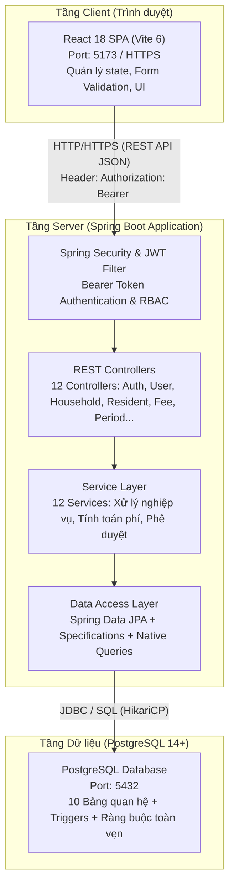

### 5.2 Sơ đồ thành phần (Component Diagram)

Sơ đồ thành phần mô tả sự phân rã kiến trúc của hệ thống thành các module logic độc lập, thể hiện rõ giao tiếp giữa các thành phần frontend, các tầng backend và hệ thống lưu trữ.

> Mô hình chi tiết được thiết kế và lưu trữ tại file: [docs/UML/Component Diagram.asta](file:///d:/Users/WINDOWS/Downloads/bluemoon2/docs/UML/Component%20Diagram.asta).


### 5.3 Sơ đồ triển khai (Deployment Diagram)

Hệ thống được thiết kế để triển khai linh hoạt trên hạ tầng máy chủ cục bộ hoặc môi trường container hóa (Docker).

> Mô hình chi tiết được thiết kế và lưu trữ tại file: [docs/UML/Deployment Diagram.asta](file:///d:/Users/WINDOWS/Downloads/bluemoon2/docs/UML/Deployment%20Diagram.asta).


### 5.4 Cấu trúc Backend (Spring Boot)

Mã nguồn backend được tổ chức theo tiêu chuẩn của kiến trúc phân lớp (Layered Architecture), đặt trong base package `com.example.bluemoon`:

```
backend/src/main/java/com/example/bluemoon/
├── BluemoonApplication.java           // Lớp khởi chạy Spring Boot
├── config/                            // Cấu hình hệ sinh thái Spring
│   ├── PasswordConfig.java            // BCryptPasswordEncoder bean (độ mạnh 10)
│   └── DatabaseSequenceSynchronizer.java // Đồng bộ sequence PostgreSQL khi khởi động
├── controller/                        // 12 REST Controller tiếp nhận request HTTP
│   ├── AuthController.java            // Đăng nhập (/auth/login)
│   ├── UserController.java            // Quản lý tài khoản (/users)
│   ├── RoleController.java            // Danh mục vai trò (/roles)
│   ├── MeController.java              // Hồ sơ cá nhân & đổi mật khẩu (/me)
│   ├── HouseholdController.java       // Hộ gia đình (/households)
│   ├── ResidentController.java        // Nhân khẩu & Biến động (/residents)
│   ├── ResidentRequestController.java // Yêu cầu cư dân (/resident-requests)
│   ├── FeeCategoryController.java     // Danh mục khoản thu (/fee-categories)
│   ├── BillingPeriodController.java   // Kỳ thu phí (/billing-periods)
│   ├── BillingGenerationController.java // Lập danh sách công nợ (/billing-periods/{id}/generate)
│   ├── FeeCalculationController.java  // Tính toán thử nghiệm phí (/fee-calculations/preview)
│   └── SearchController.java          // Tra cứu tổng hợp (/search)
├── dto/                               // 30+ Request và Response Data Transfer Objects
├── exception/                         // Xử lý ngoại lệ tập trung (GlobalExceptionHandler)
├── model/                             // 9 Entity JPA ánh xạ bảng CSDL
│   ├── AppRole.java, AppUser.java
│   ├── Household.java, Resident.java, ResidentMovement.java, ResidentRequest.java
│   ├── FeeCategory.java, BillingPeriod.java, Receivable.java
│   └── enums/                         // 13 Enum nghiệp vụ chuẩn hóa
├── repository/                        // 9 Spring Data JPA Repository
│   └── specification/                 // JPA Specification cho lọc động (User, Request)
├── response/                          // ApiResponse<T>, ApiErrorResponse chuẩn hóa
├── security/                          // Spring Security 6 & JWT 0.12.6
│   ├── JwtAuthenticationFilter.java   // Bộ lọc phân tích Bearer JWT cho mỗi request
│   ├── JwtService.java                // Sinh & xác minh JWT (HMAC-SHA256, 8 giờ)
│   └── SecurityConfig.java            // Cấu hình URL Authorization & CORS
└── service/                           // 11 Service xử lý nghiệp vụ chính
```

### 5.5 Cấu trúc Frontend (React)

Mã nguồn frontend đặt tại `frontend2/src/`, xây dựng theo mô hình module hóa giao diện người dùng:

```
frontend2/src/
├── api/
│   └── http.js                // Wrapper fetch() tập trung: cấu hình Base URL, tự động
│                              // đính kèm Bearer token, bắt lỗi 401 bắn event phiên hết hạn
├── context/
│   └── AuthContext.jsx        // Quản lý phiên: token, user, login(), signOut(),
│                              // tự động gọi GET /me xác minh tính hợp lệ của tài khoản
├── components/                // Các component giao diện tái sử dụng
│   ├── Layout.jsx             // Khung bố cục chính: Sidebar + Header + Container
│   ├── ProtectedRoute.jsx     // Chặn truy cập trái phép theo vai trò (RBAC)
│   ├── PageHeader.jsx         // Tiêu đề trang, thanh hành động (actions)
│   ├── Modal.jsx              // Hộp thoại popup chuẩn
│   ├── StatusBadge.jsx        // Hiển thị badge trạng thái màu sắc chuẩn
│   └── FeeCalculationPreviewModal.jsx // Modal xem trước danh sách lập công nợ
├── pages/                     // 15 Màn hình chức năng chính
│   ├── LoginPage.jsx, HomePage.jsx
│   ├── HouseholdsPage.jsx, HouseholdDetailPage.jsx, MyHouseholdPage.jsx
│   ├── ResidentsPage.jsx, ResidentDetailPage.jsx
│   ├── ResidentRequestsPage.jsx, ResidentRequestDetailPage.jsx
│   ├── FeesPage.jsx, PeriodsPage.jsx, PeriodDetailPage.jsx
│   ├── UsersPage.jsx, ProfilePage.jsx, SearchPage.jsx
├── App.jsx                    // Cấu hình định tuyến Route (React Router v7)
├── index.css / styles.css     // Hệ thống thiết kế CSS dùng chung (design tokens)
└── main.jsx                   // Điểm khởi đầu ứng dụng React
```

### 5.6 Quy ước REST API & Danh mục Endpoint chi tiết

* **Quy ước URL:** Mọi endpoint gọi từ frontend đều có tiền tố trực tiếp (ví dụ: `/auth/login`, `/households`, `/residents`), hỗ trợ proxy chuyển hướng `/api/*` về backend cổng 8080.
* **Xác thực:** Mọi endpoint (trừ `POST /auth/login`) bắt buộc kèm header `Authorization: Bearer <accessToken>`.
* **Cấu trúc Envelope Response:**
  * Thành công: `{ "success": true, "message": "...", "data": <T> }`
  * Phân trang: `data: { "content": [...], "page": 1, "size": 20, "totalElements": 100, "totalPages": 5 }`
  * Thất bại: `{ "success": false, "code": "ERROR_CODE", "message": "Mô tả lỗi tiếng Việt", "errors": {...} }`

#### Bảng danh mục toàn bộ REST API của hệ thống (Sprint 1)

| Nhóm | Method | Endpoint | Quyền (RBAC) | Mục đích nghiệp vụ |
| --- | --- | --- | --- | --- |
| **Xác thực** | POST | `/auth/login` | PUBLIC | Đăng nhập bằng username/password, nhận JWT token 8 giờ |
| **Tài khoản cá nhân** | GET | `/me` | Authenticated | Lấy hồ sơ tài khoản hiện tại, vai trò và thông tin hộ cư dân |
| | PUT | `/me/password` | Authenticated | Đổi mật khẩu của chính mình (yêu cầu mật khẩu cũ) |
| **Quản trị người dùng** | GET | `/users` | BQT, AUTHORITY | Danh sách tài khoản (hỗ trợ phân trang, lọc theo role, search) |
| | POST | `/users` | BQT | Tạo tài khoản mới (gán role BQT, ACCOUNTANT, AUTHORITY, RESIDENT) |
| | GET | `/users/{id}` | BQT, AUTHORITY | Xem chi tiết thông tin một tài khoản |
| | PUT | `/users/{id}` | BQT | Cập nhật thông tin cá nhân/liên hệ của tài khoản |
| | PATCH | `/users/{id}/status` | BQT | Khóa (`active = false`) hoặc Kích hoạt (`active = true`) tài khoản |
| | POST | `/users/{id}/reset-password` | BQT | Đặt lại mật khẩu mặc định (bật cờ `mustChangePassword = true`) |
| | GET | `/roles` | BQT, AUTHORITY | Lấy danh mục 4 vai trò hệ thống (`BQT`, `ACCOUNTANT`, `RESIDENT`, `AUTHORITY`) |
| **Hộ gia đình** | GET | `/households` | BQT, AUTHORITY, ACCOUNTANT | Danh sách hộ gia đình (phân trang, lọc theo tầng, số phòng, trạng thái) |
| | POST | `/households` | BQT | Tạo mới hộ gia đình (khai báo số phòng, diện tích, tạo kèm chủ hộ) |
| | GET | `/households/{id}` | BQT, AUTHORITY, ACCOUNTANT | Chi tiết hộ gia đình, danh sách thành viên và công nợ hiện hữu |
| | PUT | `/households/{id}` | BQT | Cập nhật thông tin hộ gia đình (diện tích, tầng) |
| | PATCH | `/households/{id}/head` | BQT | Thay đổi chủ hộ sang một nhân khẩu thường trú khác trong hộ |
| | GET | `/households/my` | RESIDENT | Cư dân xem thông tin hộ của mình, danh sách thành viên, công nợ |
| **Nhân khẩu & Cư trú** | GET | `/residents` | BQT, AUTHORITY | Danh sách nhân khẩu (phân trang, lọc theo trạng thái cư trú, từ khóa) |
| | POST | `/residents` | BQT | Thêm nhân khẩu vào hộ (sinh mới, chuyển đến, tạm trú) |
| | GET | `/residents/{id}` | BQT, AUTHORITY | Chi tiết nhân khẩu và lịch sử các lần biến động cư trú |
| | PUT | `/residents/{id}` | BQT | Chỉnh sửa thông tin nhân khẩu (họ tên, CCCD, ngày sinh, quan hệ) |
| | POST | `/residents/movement` | BQT | Khai báo biến động cư trú (tạm vắng, tạm trú, chuyển đi, qua đời) |
| | GET | `/residents/{id}/movements` | BQT, AUTHORITY | Tra cứu toàn bộ lịch sử biến động cư trú của một nhân khẩu |
| **Yêu cầu cư dân** | GET | `/resident-requests` | BQT, RESIDENT | Danh sách yêu cầu (cư dân chỉ xem của hộ mình, BQT xem toàn bộ) |
| | POST | `/resident-requests` | RESIDENT | Cư dân nộp yêu cầu chỉnh sửa thông tin, tạm vắng, tạm trú |
| | GET | `/resident-requests/{id}` | BQT, RESIDENT | Xem chi tiết yêu cầu, dữ liệu trước/sau và lý do phê duyệt/từ chối |
| | POST | `/resident-requests/{id}/approve` | BQT | Phê duyệt yêu cầu (tự động cập nhật hồ sơ hoặc ghi nhận biến động) |
| | POST | `/resident-requests/{id}/reject` | BQT | Từ chối yêu cầu (bắt buộc nhập lý do từ chối `decisionReason`) |
| | POST | `/resident-requests/{id}/cancel` | RESIDENT | Cư dân hủy yêu cầu đang ở trạng thái `PENDING` |
| **Khoản thu** | GET | `/fee-categories` | BQT, ACCOUNTANT | Danh sách khoản thu (phân trang, lọc bắt buộc/tự nguyện, trạng thái) |
| | POST | `/fee-categories` | BQT, ACCOUNTANT | Tạo khoản thu mới (mã, tên, cách tính PER_AREA / FIXED / MANUAL, đơn giá) |
| | GET | `/fee-categories/{id}` | BQT, ACCOUNTANT | Xem chi tiết thông tin một khoản thu |
| | PUT | `/fee-categories/{id}` | BQT, ACCOUNTANT | Sửa khoản thu (chặn sửa cách tính/loại phí nếu đã phát sinh công nợ) |
| | PATCH | `/fee-categories/{id}/status` | BQT, ACCOUNTANT | Bật/tắt trạng thái hoạt động (`isActive = true/false`) |
| **Kỳ thu phí** | GET | `/billing-periods` | BQT, ACCOUNTANT | Danh sách kỳ thu phí (phân trang, lọc theo trạng thái OPEN/CLOSED) |
| | POST | `/billing-periods` | BQT, ACCOUNTANT | Mở kỳ thu phí mới (mã kỳ, tên kỳ, ngày bắt đầu, ngày kết thúc) |
| | GET | `/billing-periods/{id}` | BQT, ACCOUNTANT | Chi tiết kỳ thu phí, thống kê tổng nợ, danh sách khoản nợ theo hộ |
| | PATCH | `/billing-periods/{id}/status` | BQT | Đóng sổ kỳ (`CLOSED` - yêu cầu đã lập công nợ) hoặc Mở lại kỳ (`OPEN`) |
| **Tính toán & Lập công nợ** | POST | `/billing-periods/{id}/generate` | BQT, ACCOUNTANT | Sinh danh sách công nợ hàng loạt (hỗ trợ `?dryRun=true` xem trước) |
| | POST | `/fee-calculations/preview` | BQT, ACCOUNTANT | Xem trước số tiền phải nộp của một hộ theo danh sách khoản thu |
| **Tra cứu tổng hợp** | GET | `/search` | BQT, AUTHORITY, ACCOUNTANT | Tìm kiếm nhanh hộ gia đình hoặc nhân khẩu theo từ khóa, số phòng |


---

## 6. THIẾT KẾ LỚP

### 6.1 Tổng quan các lớp chính

Hệ thống BlueMoon được thiết kế theo nguyên lý thiết kế hướng đối tượng (OOP) và kiến trúc phân lớp chuẩn mực của Spring Data JPA. Các lớp chính bao gồm:
* **9 Lớp Entity chính (Domain Models):** Ánh xạ trực tiếp tới 9 bảng nghiệp vụ trong PostgreSQL: `Household`, `Resident`, `AppRole`, `AppUser`, `ResidentMovement`, `FeeCategory`, `BillingPeriod`, `Receivable`, `ResidentRequest`.
* **13 Enum chuẩn hóa:** `RoleCode`, `Gender`, `HouseholdStatus`, `ResidencyStatus`, `ResidentEntryType`, `MovementType`, `SearchType`, `ResidentRequestType`, `ResidentRequestStatus`, `FeeKind`, `CalculationMethod`, `BillingCycle`, `BillingPeriodStatus`.
* **12 REST Controller:** Tiếp nhận request HTTP, kiểm tra phân quyền tiền xử lý (`@PreAuthorize`), validate dữ liệu đầu vào (`@Valid`) và chuyển giao xử lý cho tầng Service.
* **11 Service nghiệp vụ (+ JwtService):** Chứa toàn bộ quy tắc nghiệp vụ, giao dịch tính toán công nợ (`@Transactional`), phê duyệt và kiểm tra toàn vẹn dữ liệu.
* **9 Spring Data JPA Repository:** Cung cấp các thao tác CRUD, khóa dòng `SELECT ... FOR UPDATE`, và các câu truy vấn tối ưu hóa (JPA Specification, Native Queries).

---

### 6.2 Sơ đồ lớp Mô hình miền (Domain Model)

Mô hình miền thể hiện các thực thể cốt lõi của tòa nhà chung cư, các thuộc tính nghiệp vụ và mối quan hệ giữa chúng.

> Mô hình chi tiết được thiết kế và lưu trữ tại file: [docs/UML/Class Diagram/domain model.asta](file:///d:/Users/WINDOWS/Downloads/bluemoon2/docs/UML/Class%20Diagram/domain%20model.asta).


### 6.3 Sơ đồ lớp Xác thực & Phân quyền (Authentication & Authorization)

Đặc tả các lớp phụ trách tiếp nhận yêu cầu đăng nhập, xác thực thông tin, sinh Bearer JWT token và lọc phân quyền cho mọi request.

> Mô hình chi tiết được thiết kế và lưu trữ tại file: [docs/UML/Class Diagram/authentication & authorization.asta](file:///d:/Users/WINDOWS/Downloads/bluemoon2/docs/UML/Class%20Diagram/authentication%20&%20authorization.asta).


### 6.4 Sơ đồ lớp Quản lý Người dùng & Hồ sơ cá nhân (User Account & Profile Management)

Đặc tả các lớp phụ trách quản lý danh sách tài khoản, kích hoạt/khóa tài khoản, cấp lại mật khẩu và cập nhật hồ sơ cá nhân (`/me`).

> Mô hình chi tiết được thiết kế và lưu trữ tại file: [docs/UML/Class Diagram/user account & profile management.asta](file:///d:/Users/WINDOWS/Downloads/bluemoon2/docs/UML/Class%20Diagram/user%20account%20&%20profile%20management.asta).


### 6.5 Sơ đồ lớp Quản lý Hộ gia đình, Nhân khẩu & Biến động cư trú (Household & Resident Management)

Đặc tả các lớp điều phối thông tin căn hộ, hộ gia đình, nhân khẩu, quan hệ chủ hộ, tiếp nhận cư trú và lịch sử biến động.

> Mô hình chi tiết được thiết kế và lưu trữ tại file: [docs/UML/Class Diagram/household & resident & movement management.asta](file:///d:/Users/WINDOWS/Downloads/bluemoon2/docs/UML/Class%20Diagram/household%20&%20resident%20&%20movement%20management.asta).


### 6.6 Sơ đồ lớp Quản lý Yêu cầu cư dân (Resident Request Management)

Đặc tả các lớp tiếp nhận đề nghị cư trú trực tuyến từ cư dân, tính toán diff dữ liệu, phê duyệt tự động ghi nhận biến động hoặc từ chối kèm lý do.

> Mô hình chi tiết được thiết kế và lưu trữ tại file: [docs/UML/Class Diagram/resident request management.asta](file:///d:/Users/WINDOWS/Downloads/bluemoon2/docs/UML/Class%20Diagram/resident%20request%20management.asta).


### 6.7 Sơ đồ lớp Quản lý Khoản thu & Lập kỳ thu phí (Fee & Billing Management)

Đặc tả các lớp cấu hình danh mục khoản thu, tạo kỳ thu, tính toán thử nghiệm và sinh công nợ hàng loạt cho toàn bộ hộ gia đình.

> Mô hình chi tiết được thiết kế và lưu trữ tại file: [docs/UML/Class Diagram/fee & billing management.asta](file:///d:/Users/WINDOWS/Downloads/bluemoon2/docs/UML/Class%20Diagram/fee%20&%20billing%20management.asta).


## 7. THIẾT KẾ CƠ SỞ DỮ LIỆU

### 7.1 Sơ đồ thực thể quan hệ (ERD)

Cơ sở dữ liệu của hệ thống quản lý chung cư BlueMoon gồm **10 bảng quan hệ**, được chuẩn hóa ở mức 3NF, đảm bảo toàn vẹn dữ liệu và hỗ trợ xử lý giao dịch cao.

https://www.drawdb.app/editor/diagrams/1e858bde-93c7-4bbf-a25a-ad43a0800c82

### 7.2 Hệ quản trị cơ sở dữ liệu

* **Hệ quản trị CSDL:** PostgreSQL 14+ (Múi giờ lưu trữ: UTC / `TIMESTAMPTZ`, hiển thị ứng dụng: `Asia/Ho_Chi_Minh`).
* **Tiện ích mở rộng (Extensions):** `unaccent` và `pg_trgm` (hỗ trợ tìm kiếm tiếng Việt không dấu tối ưu).
* **Script khởi tạo nguồn:** [docs/Script_create_database.md](file:///d:/Users/WINDOWS/Downloads/bluemoon2/docs/Script_create_database.md).

---

### 7.3 Cấu trúc chi tiết 10 bảng dữ liệu

#### 1. Bảng `household` (Hộ gia đình)
Lưu trữ thông tin căn hộ và các hộ gia đình cư trú.

| Tên cột | Kiểu dữ liệu | Ràng buộc | Mô tả |
| --- | --- | --- | --- |
| `id` | BIGINT | PK, GENERATED ALWAYS AS IDENTITY | Khóa chính tự tăng |
| `household_code` | VARCHAR(30) | NOT NULL, UNIQUE | Mã hộ gia đình (vd: `H001`, `H002`) |
| `apartment_no` | VARCHAR(20) | NOT NULL | Số căn hộ (vd: `101`, `1204`) |
| `floor` | SMALLINT | NULL | Tầng căn hộ |
| `area` | NUMERIC(10,2) | NOT NULL, CHECK (area > 0) | Diện tích căn hộ (m²) tính phí quản lý |
| `status` | VARCHAR(20) | NOT NULL, DEFAULT 'ACTIVE' | Trạng thái: `ACTIVE`, `INACTIVE` |
| `deleted_at` | TIMESTAMPTZ | NULL | Thời điểm xóa mềm |
| `created_at` | TIMESTAMPTZ | NOT NULL, DEFAULT CURRENT_TIMESTAMP | Thời điểm tạo |
| `updated_at` | TIMESTAMPTZ | NOT NULL, DEFAULT CURRENT_TIMESTAMP | Thời điểm cập nhật |

#### 2. Bảng `resident` (Nhân khẩu)
Lưu trữ thông tin cá nhân của các cư dân trong tòa nhà.

| Tên cột | Kiểu dữ liệu | Ràng buộc | Mô tả |
| --- | --- | --- | --- |
| `id` | BIGINT | PK, GENERATED ALWAYS AS IDENTITY | Khóa chính tự tăng |
| `household_id` | BIGINT | NOT NULL, FK → household(id) | Thuộc hộ gia đình nào |
| `full_name` | VARCHAR(150) | NOT NULL | Họ và tên nhân khẩu |
| `date_of_birth` | DATE | NOT NULL | Ngày tháng năm sinh |
| `gender` | VARCHAR(10) | CHECK IN ('MALE', 'FEMALE', 'OTHER') | Giới tính |
| `identity_number` | VARCHAR(30) | NULL | Số CCCD/CMND hoặc định danh |
| `phone` | VARCHAR(20) | NULL | Số điện thoại liên hệ |
| `relationship_to_head` | VARCHAR(50) | NULL | Quan hệ với chủ hộ (Chủ hộ, Vợ, Con...) |
| `is_head` | BOOLEAN | NOT NULL, DEFAULT FALSE | Đánh dấu có phải là chủ hộ hay không |
| `residency_status` | VARCHAR(30) | NOT NULL, DEFAULT 'RESIDING' | `RESIDING`, `TEMPORARILY_ABSENT`, `TEMPORARY_RESIDENCE`, `MOVED_OUT`, `DECEASED` |
| `status_until` | DATE | NULL | Hạn tạm trú / tạm vắng |
| `move_in_date` | DATE | NULL | Ngày bắt đầu cư trú tại hộ |
| `move_out_date` | DATE | NULL | Ngày chuyển đi khỏi hộ |
| `deleted_at` | TIMESTAMPTZ | NULL | Thời điểm xóa mềm |
| `created_at` | TIMESTAMPTZ | NOT NULL, DEFAULT CURRENT_TIMESTAMP | Thời điểm tạo |
| `updated_at` | TIMESTAMPTZ | NOT NULL, DEFAULT CURRENT_TIMESTAMP | Thời điểm cập nhật |

#### 3. Bảng `app_role` (Vai trò người dùng)
Danh mục 4 vai trò cố định trong hệ thống.

| Tên cột | Kiểu dữ liệu | Ràng buộc | Mô tả |
| --- | --- | --- | --- |
| `id` | BIGINT | PK, GENERATED ALWAYS AS IDENTITY | Khóa chính |
| `code` | VARCHAR(50) | NOT NULL, UNIQUE | Mã vai trò: `BQT`, `ACCOUNTANT`, `RESIDENT`, `AUTHORITY` |
| `name` | VARCHAR(100) | NOT NULL | Tên hiển thị tiếng Việt |

#### 4. Bảng `app_user` (Tài khoản người dùng)
Tài khoản truy cập hệ thống dành cho Ban quản trị, Kế toán, Cơ quan chức năng và Cư dân.

| Tên cột | Kiểu dữ liệu | Ràng buộc | Mô tả |
| --- | --- | --- | --- |
| `id` | BIGINT | PK, GENERATED ALWAYS AS IDENTITY | Khóa chính |
| `username` | VARCHAR(100) | NOT NULL, UNIQUE | Tên đăng nhập (không phân biệt hoa thường) |
| `password_hash` | VARCHAR(255) | NOT NULL | Mật khẩu băm BCrypt |
| `full_name` | VARCHAR(150) | NOT NULL | Họ tên người dùng |
| `email` | VARCHAR(255) | NULL, UNIQUE | Email liên hệ |
| `phone` | VARCHAR(20) | NULL | Số điện thoại |
| `resident_id` | BIGINT | NULL, UNIQUE, FK → resident(id) | Liên kết 1-1 với hồ sơ nhân khẩu (nếu là cư dân) |
| `is_active` | BOOLEAN | NOT NULL, DEFAULT TRUE | Trạng thái hoạt động (khóa nếu false) |
| `last_login_at` | TIMESTAMPTZ | NULL | Lần đăng nhập thành công gần nhất |
| `password_changed_at` | TIMESTAMPTZ | NULL | Thời điểm đổi mật khẩu lần cuối (dùng invalidate token cũ) |
| `must_change_password` | BOOLEAN | NOT NULL, DEFAULT FALSE | Bắt buộc đổi mật khẩu ở lần đăng nhập tới |
| `created_at` | TIMESTAMPTZ | NOT NULL, DEFAULT CURRENT_TIMESTAMP | Thời điểm tạo |
| `updated_at` | TIMESTAMPTZ | NOT NULL, DEFAULT CURRENT_TIMESTAMP | Thời điểm cập nhật |

#### 5. Bảng `user_role` (Gán vai trò cho tài khoản)
Bảng liên kết Nhiều - Nhiều giữa tài khoản và vai trò.

| Tên cột | Kiểu dữ liệu | Ràng buộc | Mô tả |
| --- | --- | --- | --- |
| `user_id` | BIGINT | PK, FK → app_user(id) ON DELETE CASCADE | ID người dùng |
| `role_id` | BIGINT | PK, FK → app_role(id) ON DELETE RESTRICT | ID vai trò |

#### 6. Bảng `resident_movement` (Nhật ký biến động cư trú)
Bảng append-only ghi nhận toàn bộ lịch sử biến động cư trú của nhân khẩu.

| Tên cột | Kiểu dữ liệu | Ràng buộc | Mô tả |
| --- | --- | --- | --- |
| `id` | BIGINT | PK, GENERATED ALWAYS AS IDENTITY | Khóa chính |
| `resident_id` | BIGINT | NOT NULL, FK → resident(id) | Nhân khẩu xảy ra biến động |
| `movement_type` | VARCHAR(30) | NOT NULL | Loại biến động: `MOVE_IN`, `MOVE_OUT`, `TRANSFER`, `BIRTH`, `DEATH`, `TEMPORARY_ABSENCE`, `TEMPORARY_RESIDENCE`, `RETURN` |
| `old_household_id` | BIGINT | NULL, FK → household(id) | Hộ chuyển đi (khi đổi hộ) |
| `new_household_id` | BIGINT | NULL, FK → household(id) | Hộ chuyển đến (khi đổi hộ) |
| `effective_date` | DATE | NOT NULL | Ngày có hiệu lực của biến động |
| `start_date` | DATE | NULL | Ngày bắt đầu tạm trú/tạm vắng |
| `end_date` | DATE | NULL | Ngày kết thúc tạm trú/tạm vắng |
| `note` | TEXT | NULL | Ghi chú lý do biến động |
| `recorded_by` | BIGINT | NOT NULL, FK → app_user(id) | Cán bộ BQT ghi nhận |
| `recorded_at` | TIMESTAMPTZ | NOT NULL, DEFAULT CURRENT_TIMESTAMP | Thời điểm ghi nhận |

#### 7. Bảng `fee_category` (Danh mục khoản thu)
Cấu hình các loại phí quản lý, phí vệ sinh và các quỹ vận động tự nguyện.

| Tên cột | Kiểu dữ liệu | Ràng buộc | Mô tả |
| --- | --- | --- | --- |
| `id` | BIGINT | PK, GENERATED ALWAYS AS IDENTITY | Khóa chính |
| `code` | VARCHAR(30) | NOT NULL, UNIQUE | Mã khoản thu (vd: `PHI_QL`, `PHI_VS`) |
| `name` | VARCHAR(150) | NOT NULL | Tên khoản thu |
| `description` | TEXT | NULL | Mô tả chi tiết mục đích thu |
| `fee_kind` | VARCHAR(20) | NOT NULL, CHECK IN ('MANDATORY', 'VOLUNTARY') | Bắt buộc hoặc Tự nguyện |
| `calculation_method` | VARCHAR(20) | NOT NULL, CHECK IN ('PER_AREA', 'FIXED', 'MANUAL') | Theo diện tích, cố định hoặc nhập tay |
| `unit_price` | NUMERIC(14,2) | NOT NULL, DEFAULT 0, CHECK (unit_price >= 0) | Đơn giá áp dụng (VNĐ) |
| `billing_cycle` | VARCHAR(20) | NOT NULL, DEFAULT 'MONTHLY' | Chu kỳ thu: `MONTHLY`, `ONE_TIME` |
| `due_day` | SMALLINT | NULL, CHECK (due_day BETWEEN 1 AND 28) | Ngày đến hạn trong tháng |
| `is_active` | BOOLEAN | NOT NULL, DEFAULT TRUE | Đang áp dụng hay tạm ngừng |
| `created_at` | TIMESTAMPTZ | NOT NULL, DEFAULT CURRENT_TIMESTAMP | Thời điểm tạo |
| `updated_at` | TIMESTAMPTZ | NOT NULL, DEFAULT CURRENT_TIMESTAMP | Thời điểm cập nhật |

#### 8. Bảng `billing_period` (Kỳ thu phí)
Quản lý các đợt phát động thu phí theo tháng/năm.

| Tên cột | Kiểu dữ liệu | Ràng buộc | Mô tả |
| --- | --- | --- | --- |
| `id` | BIGINT | PK, GENERATED ALWAYS AS IDENTITY | Khóa chính |
| `code` | VARCHAR(30) | NOT NULL, UNIQUE | Mã kỳ thu phí (vd: `T10-2026`, `T11-2026`) |
| `name` | VARCHAR(100) | NOT NULL | Tên kỳ thu phí |
| `start_date` | DATE | NOT NULL | Ngày bắt đầu kỳ thu |
| `end_date` | DATE | NOT NULL, CHECK (end_date >= start_date) | Ngày kết thúc kỳ thu |
| `status` | VARCHAR(20) | NOT NULL, DEFAULT 'OPEN' CHECK IN ('OPEN', 'CLOSED') | Trạng thái kỳ: Mở hoặc Đã đóng sổ |
| `generated_at` | TIMESTAMPTZ | NULL | Thời điểm lập danh sách công nợ chính thức |
| `generated_by` | BIGINT | NULL, FK → app_user(id) | Người thực hiện lập danh sách |
| `closed_at` | TIMESTAMPTZ | NULL | Thời điểm đóng sổ kỳ thu |
| `closed_by` | BIGINT | NULL, FK → app_user(id) | Người thực hiện đóng sổ |

#### 9. Bảng `receivable` (Khoản phải thu / Công nợ)
Bản ghi số tiền phải nộp cụ thể của từng hộ gia đình cho từng khoản thu trong một kỳ thu phí.

| Tên cột | Kiểu dữ liệu | Ràng buộc | Mô tả |
| --- | --- | --- | --- |
| `id` | BIGINT | PK, GENERATED ALWAYS AS IDENTITY | Khóa chính |
| `household_id` | BIGINT | NOT NULL, FK → household(id) | Hộ gia đình phải nộp |
| `fee_category_id` | BIGINT | NOT NULL, FK → fee_category(id) | Thuộc khoản thu nào |
| `billing_period_id` | BIGINT | NOT NULL, FK → billing_period(id) | Thuộc kỳ thu phí nào |
| `quantity` | NUMERIC(10,2) | NULL | Số lượng/diện tích tính tiền (m²) |
| `unit_price_applied`| NUMERIC(14,2) | NOT NULL, CHECK (unit_price_applied >= 0) | Đơn giá áp dụng tại thời điểm lập |
| `amount_due` | NUMERIC(14,2) | NOT NULL, CHECK (amount_due >= 0) | Tổng tiền phải nộp (VNĐ) |
| `due_date` | DATE | NOT NULL | Hạn chót thanh toán |
| `description` | TEXT | NULL | Ghi chú diễn giải |
| `created_by` | BIGINT | NULL, FK → app_user(id) | Cán bộ khởi tạo |
| `created_at` | TIMESTAMPTZ | NOT NULL, DEFAULT CURRENT_TIMESTAMP | Thời điểm lập |
| `version` | BIGINT | NOT NULL, DEFAULT 0 | Phiên bản (Optimistic Locking) |

> **Ràng buộc duy nhất:** `UNIQUE (household_id, fee_category_id, billing_period_id)` ngăn chặn hoàn toàn việc sinh trùng công nợ cho cùng một hộ trong một kỳ thu.

#### 10. Bảng `resident_request` (Đề nghị cư trú của cư dân)
Hàng đợi tiếp nhận và xử lý các đề nghị nộp từ Cổng cư dân.

| Tên cột | Kiểu dữ liệu | Ràng buộc | Mô tả |
| --- | --- | --- | --- |
| `id` | BIGINT | PK, GENERATED ALWAYS AS IDENTITY | Khóa chính |
| `request_type` | VARCHAR(30) | NOT NULL, CHECK IN ('PROFILE_UPDATE', 'TEMPORARY_ABSENCE', 'TEMPORARY_RESIDENCE') | Loại đề nghị |
| `status` | VARCHAR(20) | NOT NULL, DEFAULT 'PENDING' CHECK IN ('PENDING', 'APPROVED', 'REJECTED', 'CANCELLED') | Trạng thái xử lý |
| `household_id` | BIGINT | NOT NULL, FK → household(id) | Hộ gia đình của cư dân gửi |
| `resident_id` | BIGINT | NULL, FK → resident(id) | Nhân khẩu liên quan |
| `submitted_by` | BIGINT | NOT NULL, FK → app_user(id) | Cư dân gửi đề nghị |
| `submitted_at` | TIMESTAMPTZ | NOT NULL, DEFAULT CURRENT_TIMESTAMP | Thời điểm gửi |
| `note` | TEXT | NULL | Lời nhắn của cư dân |
| `proposed` | JSONB | NOT NULL | Dữ liệu đề nghị thay đổi (Payload JSON) |
| `before_values` | JSONB | NULL | Dữ liệu nhân khẩu gốc trước khi thay đổi (Diff) |
| `decided_by` | BIGINT | NULL, FK → app_user(id) | Cán bộ BQT phê duyệt/từ chối |
| `decided_at` | TIMESTAMPTZ | NULL | Thời điểm ra quyết định |
| `decision_reason` | TEXT | NULL | Lý do từ chối (bắt buộc khi REJECTED) |
| `decision_note` | TEXT | NULL | Ghi chú phản hồi khi duyệt |
| `result_resident_id`| BIGINT | NULL, FK → resident(id) | Nhân khẩu mới sinh ra (nếu có) |
| `result_movement_id`| BIGINT | NULL, FK → resident_movement(id) | Bản ghi biến động cư trú sinh ra tự động |

---

### 7.4 Ràng buộc toàn vẹn & Quy tắc dữ liệu quan trọng

1. **Quan hệ 1 Căn hộ - 1 Hộ gia đình hoạt động:** Tại một thời điểm, một căn hộ chỉ có tối đa 1 hộ gia đình có `status = 'ACTIVE'`. Khi hộ chuyển đi, hộ được cập nhật `status = 'INACTIVE'`, sau đó mới gán hộ mới vào căn hộ.
2. **Quy tắc Chủ hộ:** Mỗi hộ gia đình `ACTIVE` bắt buộc có đúng 1 chủ hộ (`is_head = TRUE`) có trạng thái cư trú thường trú (`residency_status = 'RESIDING'`).
3. **Tính toàn vẹn biến động cư trú (Append-Only):** Bảng `resident_movement` có trigger chặn câu lệnh `UPDATE` và `DELETE`, đảm bảo dữ liệu lịch sử di biến động dân cư không thể bị chỉnh sửa hoặc tẩy xóa dưới bất kỳ hình thức nào.
4. **Khóa dòng chống Race Condition khi lập công nợ:** Lệnh lập danh sách công nợ sử dụng `SELECT ... FOR UPDATE` trên bảng `billing_period` và `fee_category`, khóa cứng kỳ thu để đảm bảo không có hai tiến trình chạy song song gây sinh trùng dữ liệu.
5. **Ràng buộc kiểm tra trạng thái phê duyệt đề nghị cư trú:**
   * `status = 'PENDING'` tương đương `decided_at IS NULL`.
   * `status = 'REJECTED'` bắt buộc `decision_reason` không được để trống.
   * `result_resident_id` và `result_movement_id` chỉ được phép có giá trị khi `status = 'APPROVED'`.


---

## 8. THIẾT KẾ GIAO DIỆN

### 8.1 Danh sách màn hình

Hệ thống frontend của BlueMoon (Sprint 1) bao gồm **15 màn hình giao diện**, tương ứng với 15 page component trong `frontend2/src/pages/`:

| Mã MH | Tên màn hình | Đường dẫn Route | Tệp mã nguồn | Người dùng phân quyền |
| --- | --- | --- | --- | --- |
| **SC-01** | Đăng nhập | `/login` | `LoginPage.jsx` | Mọi người dùng (chưa đăng nhập) |
| **SC-02** | Trang chủ & Điều hướng | `/` | `HomePage.jsx` | Tự động chuyển trang theo vai trò (`homeForRoles`) |
| **SC-03** | Quản lý Hộ gia đình | `/ho-gia-dinh` | `HouseholdsPage.jsx` | BQT, Kế toán, Cơ quan chức năng |
| **SC-04** | Chi tiết Hộ gia đình | `/ho-gia-dinh/:id` | `HouseholdDetailPage.jsx` | BQT, Kế toán, Cơ quan chức năng |
| **SC-05** | Hộ gia đình của tôi | `/ho-cua-toi` | `MyHouseholdPage.jsx` | Cư dân (RESIDENT) |
| **SC-06** | Quản lý Nhân khẩu | `/nhan-khau` | `ResidentsPage.jsx` | BQT, Cơ quan chức năng |
| **SC-07** | Chi tiết Nhân khẩu & Biến động | `/nhan-khau/:id` | `ResidentDetailPage.jsx` | BQT, Cơ quan chức năng |
| **SC-08** | Danh sách Yêu cầu cư dân | `/yeu-cau-cu-dan` | `ResidentRequestsPage.jsx` | BQT, Cư dân (RESIDENT) |
| **SC-09** | Chi tiết & Xử lý Yêu cầu | `/yeu-cau-cu-dan/:id` | `ResidentRequestDetailPage.jsx` | BQT, Cư dân (RESIDENT) |
| **SC-10** | Danh mục Khoản thu | `/khoan-thu` | `FeesPage.jsx` | BQT, Kế toán (ACCOUNTANT) |
| **SC-11** | Danh sách Kỳ thu phí | `/ky-thu-phi` | `PeriodsPage.jsx` | BQT, Kế toán (ACCOUNTANT) |
| **SC-12** | Chi tiết Kỳ thu & Lập công nợ | `/ky-thu-phi/:id` | `PeriodDetailPage.jsx` | BQT, Kế toán (ACCOUNTANT) |
| **SC-13** | Tra cứu tổng hợp | `/tra-cuu` | `SearchPage.jsx` | BQT, Kế toán, Cơ quan chức năng |
| **SC-14** | Quản lý Tài khoản | `/tai-khoan` | `UsersPage.jsx` | Ban quản trị (BQT), Cơ quan chức năng |
| **SC-15** | Hồ sơ cá nhân & Đổi mật khẩu | `/ho-so` | `ProfilePage.jsx` | Mọi người dùng đã đăng nhập |

---

### 8.2 Quy ước giao diện chung

* **Bố cục khung (Layout):** Khung giao diện bao gồm thanh Sidebar cố định bên trái (hiển thị menu mục theo vai trò người dùng), Header phía trên cùng (hiển thị thông tin người dùng, vai trò và nút Đăng xuất), và Vùng nội dung chính (Content Container) có thanh cuộn độc lập.
* **Quy tắc điều hướng mặc định sau đăng nhập (`homeForRoles`):**
  * `BQT` hoặc `ACCOUNTANT`: Chuyển hướng tới `/ho-gia-dinh`.
  * `RESIDENT`: Chuyển hướng tới `/ho-cua-toi`.
  * Các vai trò khác (`AUTHORITY`): Chuyển hướng tới `/ho-so`.
* **Phân trang & Tìm kiếm:** Bảng dữ liệu có phân trang chuẩn (mặc định 20 dòng/trang), hỗ trợ tìm kiếm tức thời và lọc đa tiêu chí.
* **Định dạng tiền tệ & Ngày tháng:** Số tiền luôn định dạng có dấu chấm phân cách hàng nghìn kèm hậu tố "đ" (vd: `150.000 đ`). Ngày tháng hiển thị theo định dạng `dd/MM/yyyy`.
* **Trạng thái & Màu sắc nhận diện:**
  * Xanh lục (`ACTIVE`, `APPROVED`, `OPEN`): Trạng thái hoạt động, tích cực.
  * Vàng cam (`PENDING`, `TEMPORARY_RESIDENCE`): Đang chờ duyệt, tạm thời.
  * Đỏ (`INACTIVE`, `REJECTED`, `CLOSED`, `MOVED_OUT`): Đã đóng, từ chối, chuyển đi.

---

### 8.3 Đặc tả các màn hình chức năng chính

#### SC-01 – Đăng nhập (`LoginPage.jsx`)
* **Người dùng:** Mọi người dùng truy cập hệ thống.
* **Chức năng:** Nhập tên đăng nhập và mật khẩu; kiểm tra tính hợp lệ dữ liệu tại client trước khi gọi `POST /auth/login`; lưu token và thời hạn vào `sessionStorage`; gọi tiếp `GET /me` lấy hồ sơ đầy đủ; chuyển hướng thông minh theo vai trò.
* **Xử lý lỗi:** Hiển thị thông báo "Sai tài khoản hoặc mật khẩu" đồng nhất khi không tìm thấy user, sai password hoặc tài khoản bị khóa để bảo mật tuyệt đối.

#### SC-03 & SC-04 – Quản lý & Chi tiết Hộ gia đình (`HouseholdsPage.jsx`, `HouseholdDetailPage.jsx`)
* **Người dùng:** BQT, Kế toán, Cơ quan chức năng.
* **Chức năng:**
  * Danh sách: Xem bảng hộ gia đình, lọc theo tầng, số phòng, trạng thái hoạt động; nút "Thêm hộ mới" mở modal khai báo số căn hộ, diện tích và thông tin chủ hộ ban đầu.
  * Chi tiết: Xem thông tin căn hộ (số phòng, tầng, diện tích), thông tin chủ hộ, danh sách toàn bộ nhân khẩu trong hộ, lịch sử các khoản công nợ của hộ; nút "Đổi chủ hộ" (chỉ BQT) cho phép chọn một nhân khẩu thường trú khác làm chủ hộ mới.

#### SC-05 – Hộ gia đình của tôi (`MyHouseholdPage.jsx`)
* **Người dùng:** Cư dân (RESIDENT).
* **Chức năng:** Cung cấp cổng thông tin riêng biệt cho cư dân xem thông tin hộ gia đình mình đang sinh sống, danh sách thành viên trong gia đình, lịch sử công nợ các kỳ thu phí; cung cấp các nút thao tác nhanh: "Yêu cầu sửa thông tin", "Khai báo tạm vắng", "Khai báo tạm trú cho khách".

#### SC-06 & SC-07 – Quản lý & Chi tiết Nhân khẩu (`ResidentsPage.jsx`, `ResidentDetailPage.jsx`)
* **Người dùng:** BQT, Cơ quan chức năng.
* **Chức năng:**
  * Danh sách: Xem danh sách nhân khẩu toàn tòa nhà, lọc theo tình trạng cư trú (`RESIDING`, `TEMPORARILY_ABSENT`, `TEMPORARY_RESIDENCE`, `MOVED_OUT`), tìm kiếm theo họ tên, CCCD/CMND; nút "Tiếp nhận nhân khẩu" mở form thêm cư dân mới vào hộ.
  * Chi tiết: Xem hồ sơ cá nhân hoàn chỉnh, lịch sử toàn bộ các lần biến động cư trú (chuyển đến, tạm vắng, tạm trú, chuyển đi); nút "Ghi nhận biến động" (dành riêng cho BQT) để cập nhật trạng thái cư trú.

#### SC-08 & SC-09 – Danh sách & Chi tiết Yêu cầu cư dân (`ResidentRequestsPage.jsx`, `ResidentRequestDetailPage.jsx`)
* **Người dùng:** BQT, Cư dân (RESIDENT).
* **Chức năng:**
  * Cư dân: Nộp yêu cầu thay đổi thông tin cá nhân, tạm trú, tạm vắng; theo dõi trạng thái đề nghị (`PENDING`, `APPROVED`, `REJECTED`); có thể hủy yêu cầu khi đang ở trạng thái `PENDING`.
  * Ban quản trị: Tiếp nhận hàng đợi đề nghị cư trú; mở trang chi tiết xem giao diện so sánh đối chiếu (Diff Viewer) dữ liệu trước và sau thay đổi; thực hiện "Phê duyệt" (hệ thống tự động cập nhật vào hồ sơ nhân khẩu và sinh biến động cư trú) hoặc "Từ chối" (bắt buộc nhập lý do từ chối để phản hồi cư dân).

#### SC-10 – Danh mục Khoản thu (`FeesPage.jsx`)
* **Người dùng:** BQT, Kế toán (ACCOUNTANT).
* **Chức năng:** Xem danh sách các khoản thu bắt buộc và quỹ tự nguyện; nút "Tạo khoản thu mới" mở modal nhập mã, tên, loại khoản thu (`MANDATORY`/`VOLUNTARY`), phương thức tính (`PER_AREA`, `FIXED`, `MANUAL`), đơn giá, ngày đến hạn; bật/tắt trạng thái hoạt động; chặn sửa phương thức tính hoặc loại phí nếu khoản thu đã phát sinh dữ liệu trong kỳ thu phí.

#### SC-11 & SC-12 – Quản lý Kỳ thu phí & Lập công nợ (`PeriodsPage.jsx`, `PeriodDetailPage.jsx`)
* **Người dùng:** BQT, Kế toán (ACCOUNTANT).
* **Chức năng:**
  * Danh sách: Xem các đợt phát động thu phí theo tháng/năm, trạng thái `OPEN` hoặc `CLOSED`.
  * Chi tiết & Lập công nợ: Xem thống kê tổng nợ, danh sách chi tiết từng hộ gia đình; nút "Xem trước" (Dry-run) mở modal `FeeCalculationPreviewModal` hiển thị bảng tổng hợp dự kiến số tiền, số hộ nộp và cảnh báo các hộ bị bỏ qua (vd: thiếu diện tích); nút "Lập danh sách" chính thức khóa dòng CSDL và sinh hàng loạt bản ghi công nợ vào bảng `receivable`; nút "Đóng sổ" (dành riêng cho BQT) khi kỳ đã hoàn tất.

#### SC-13 – Tra cứu tổng hợp (`SearchPage.jsx`)
* **Người dùng:** BQT, Kế toán, Cơ quan chức năng.
* **Chức năng:** Ô tìm kiếm tức thời hỗ trợ tiếng Việt có dấu/không dấu; cho phép tìm kiếm linh hoạt theo số căn hộ, mã hộ, tên cư dân, số CCCD/CMND; hiển thị kết quả phân tách rõ ràng theo nhóm Hộ gia đình và nhóm Nhân khẩu kèm liên kết điều hướng trực tiếp tới trang chi tiết.

#### SC-14 – Quản lý Tài khoản & Phân quyền (`UsersPage.jsx`)
* **Người dùng:** Ban quản trị (BQT), Cơ quan chức năng (chỉ xem).
* **Chức năng:** Xem bảng tài khoản người dùng, lọc theo vai trò (`BQT`, `ACCOUNTANT`, `AUTHORITY`, `RESIDENT`), tìm kiếm theo username, họ tên, email; chức năng "Tạo tài khoản" gán vai trò tương ứng; thao tác "Khóa/Kích hoạt tài khoản"; chức năng "Đặt lại mật khẩu" cấp mật khẩu mặc định và bật cờ `mustChangePassword = true`.

#### SC-15 – Hồ sơ cá nhân & Đổi mật khẩu (`ProfilePage.jsx`)
* **Người dùng:** Mọi người dùng đã đăng nhập.
* **Chức năng:** Xem thông tin tài khoản hiện tại, vai trò, thông tin nhân khẩu liên kết; form "Đổi mật khẩu" yêu cầu nhập mật khẩu hiện tại, mật khẩu mới (tối thiểu 6 ký tự) và xác nhận mật khẩu; sau khi đổi thành công tự động cập nhật token và tắt cờ `mustChangePassword`.


---

## 9. ACTIVITY DIAGRAM

Phần này mô tả chi tiết luồng hoạt động (Activity Diagrams) cho 19 ca sử dụng và nghiệp vụ trọng yếu của hệ thống BlueMoon (Sprint 1), được mô hình hóa bằng Mermaid Flowchart.
Mỗi sơ đồ thể hiện rõ luồng chính, các nhánh kiểm tra điều kiện tại giao diện và máy chủ, luồng ngoại lệ và mã trạng thái HTTP trả về.

### 9.1 Đăng nhập và khởi tạo phiên

*Mã nguồn:* LoginPage.jsx · AuthContext.login() · AuthController.login() · AuthService.login() · JwtService.generateToken() · UserService.getMe()

Ba trường hợp sai (không có user, tài khoản bị khóa, sai mật khẩu) đều trả cùng một lỗi INVALID_CREDENTIALS để không lộ thông tin tài khoản. Token chỉ nằm trong sessionStorage của trình duyệt, backend không lưu phiên (STATELESS).

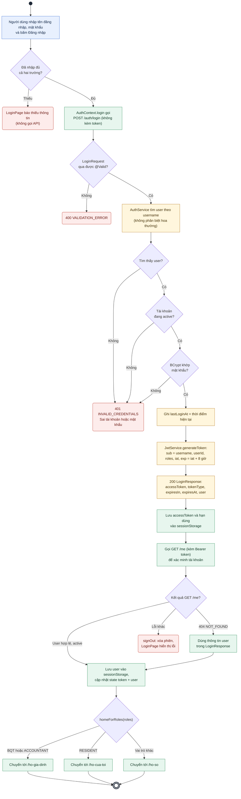

### 9.2 Xác thực JWT và phân quyền cho mỗi request

*Mã nguồn:* api/http.js request() · JwtAuthenticationFilter.doFilterInternal() · SecurityConfig.securityFilterChain() · GlobalExceptionHandler · AuthContext (sự kiện bluemoon:session-expired)

Đây là luồng dùng chung: mọi sơ đồ còn lại đều giả định request đã đi qua luồng này. Vai trò được đọc lại từ DB ở mỗi request nên việc khóa tài khoản, đổi vai trò hay đổi mật khẩu có hiệu lực ngay, không cần chờ token hết hạn.

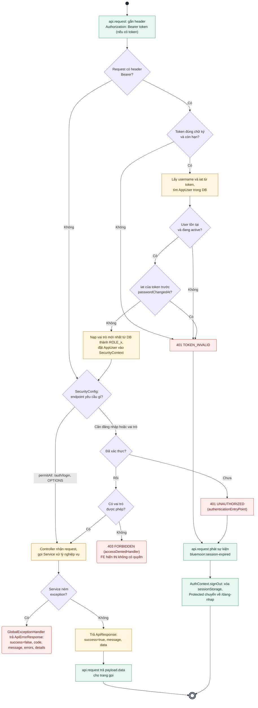

### 9.3 Tạo tài khoản người dùng

*Mã nguồn:* UserForm.jsx · UserController.createUser() · UserService.createUser() — chỉ vai trò BQT

Tài khoản mới luôn có active = true và mustChangePassword = true. Tài khoản có vai trò RESIDENT bắt buộc gắn với một nhân khẩu đang cư trú và mỗi nhân khẩu chỉ có tối đa một tài khoản.

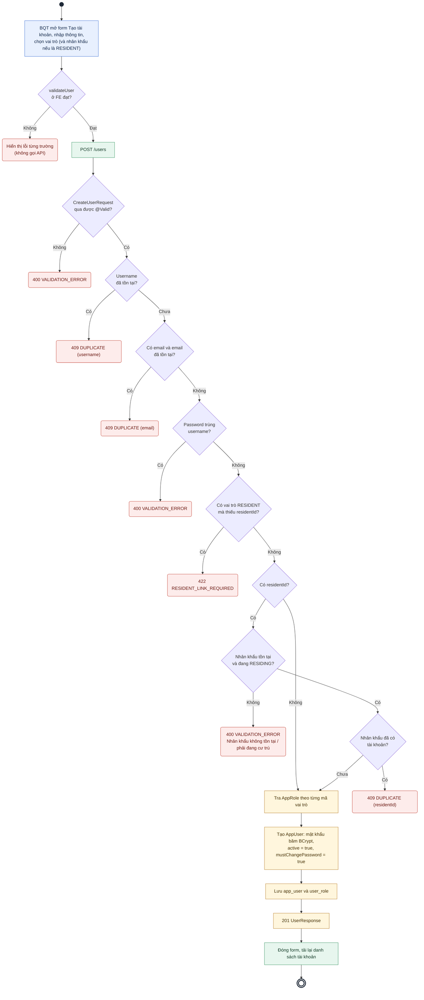

### 9.4 Quản trị tài khoản: đổi vai trò, khóa / mở khóa, đặt lại mật khẩu

*Mã nguồn:* UsersPage.jsx · UserController · UserService.updateUserRoles() / updateUserStatus() / resetPassword() — chỉ vai trò BQT


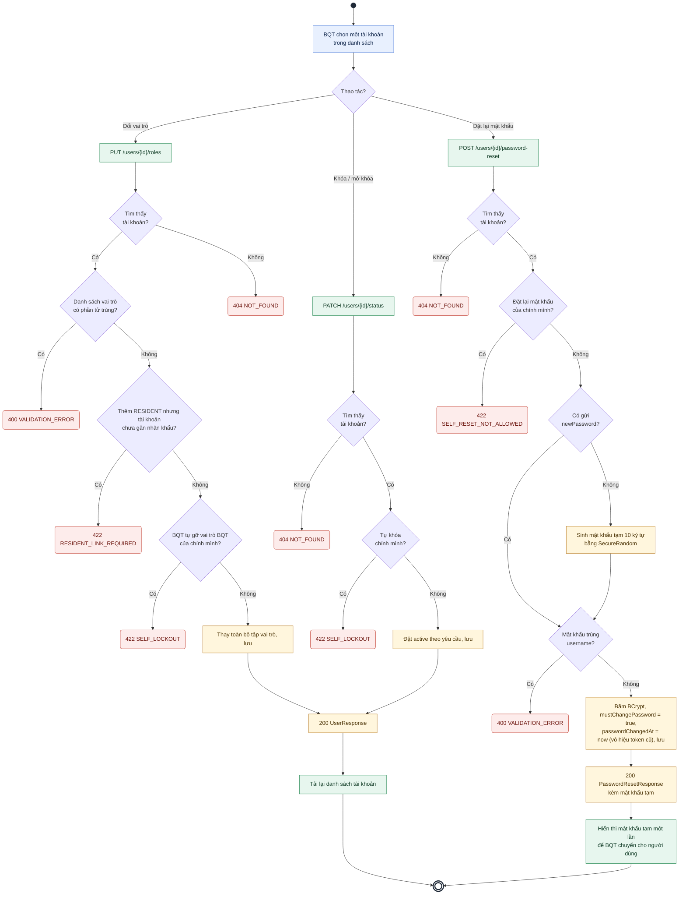

### 9.5 Đổi mật khẩu

*Mã nguồn:* ProfilePage.jsx · MeController.changePassword() · MeService.changePassword()

Sau khi đổi, passwordChangedAt được cập nhật nên mọi token phát hành trước đó bị JwtAuthenticationFilter từ chối. FE chủ động đăng xuất để người dùng đăng nhập lại bằng mật khẩu mới.

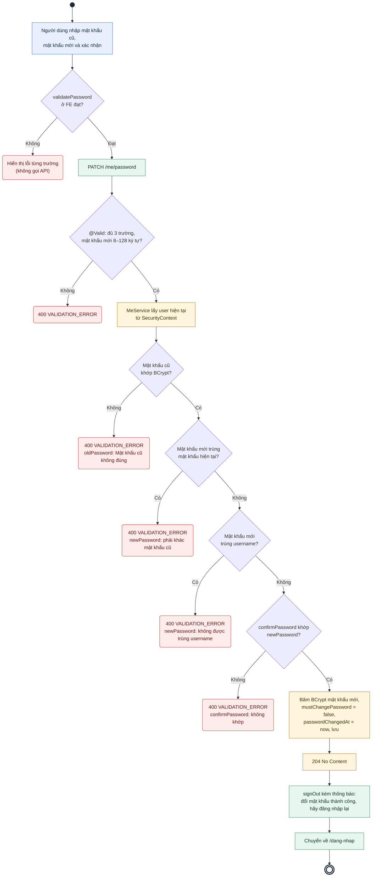

### 9.6 Tạo hộ gia đình kèm chủ hộ

*Mã nguồn:* HouseholdForm.jsx · HouseholdController.createHousehold() · HouseholdService.createHousehold() — chỉ vai trò BQT

Ba bản ghi (household, resident chủ hộ, resident_movement MOVE_IN ban đầu) được tạo trong cùng một transaction: lỗi ở bất kỳ bước nào sẽ rollback toàn bộ.

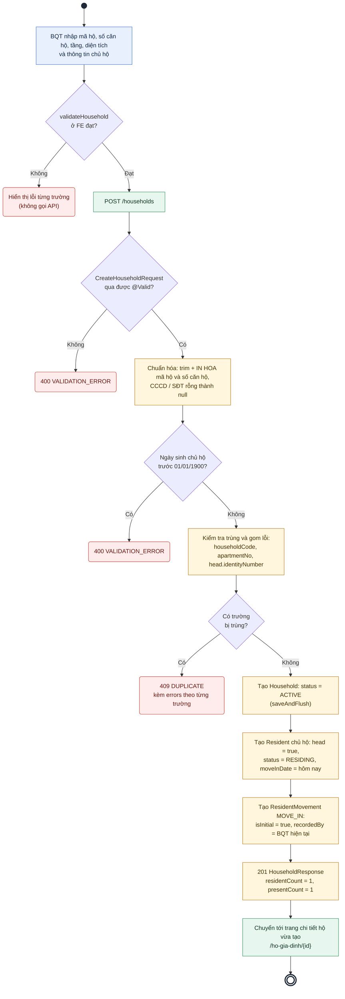

### 9.7 Đổi chủ hộ

*Mã nguồn:* HouseholdDetailPage.jsx · HouseholdController.changeHouseholdHead() · HouseholdService.changeHouseholdHead() — chỉ vai trò BQT

Chủ hộ cũ được bỏ cờ head và flush trước khi gán chủ hộ mới để không vi phạm ràng buộc "mỗi hộ một chủ hộ" trong DB.

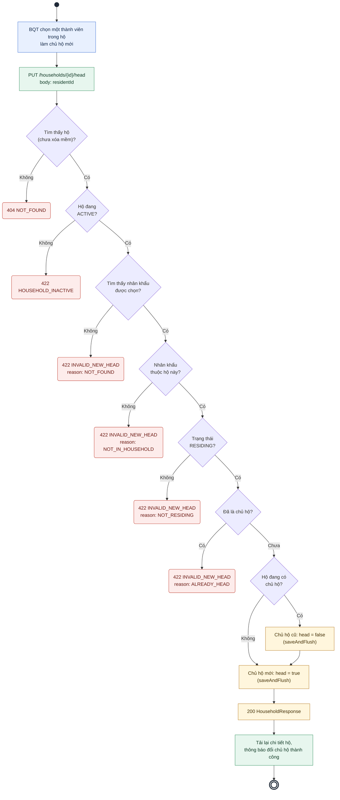

### 9.8 Thêm nhân khẩu vào hộ

*Mã nguồn:* ResidentForm.jsx · ResidentController.createResident() · ResidentService.createResident() — chỉ vai trò BQT

Endpoint này không bao giờ tạo chủ hộ (head luôn = false). Hình thức EXISTING dùng để nhập người đã ở sẵn nên không sinh bản ghi biến động.

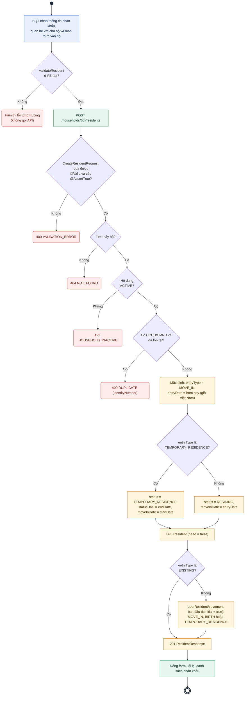

### 9.9 Xóa nhân khẩu (xóa mềm)

*Mã nguồn:* ResidentDetailPage.jsx · ResidentController.deleteResident() · ResidentService.deleteResident() — chỉ vai trò BQT

Chỉ xóa được nhân khẩu nhập nhầm: chưa là chủ hộ, chưa có tài khoản và chưa có biến động nào ngoài bản ghi ban đầu. Các trường hợp khác phải ghi nhận biến động (chuyển đi, qua đời).

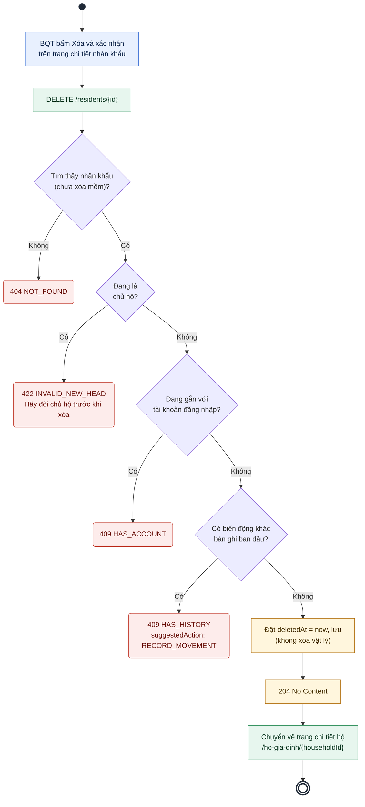

### 9.10a Ghi nhận biến động nhân khẩu — phần 1: kiểm tra hợp lệ

*Mã nguồn:* MovementPanel.jsx (MovementForm) · utils/supplement.js · ResidentController.recordMovement() · ResidentService.recordMovement() bước 1–7 — chỉ vai trò BQT

Bảng chuyển trạng thái hợp lệ: MOVE_OUT và DEATH từ RESIDING / TEMPORARILY_ABSENT / TEMPORARY_RESIDENCE · TRANSFER từ RESIDING / TEMPORARY_RESIDENCE · MOVE_IN từ MOVED_OUT · TEMPORARY_ABSENCE và TEMPORARY_RESIDENCE từ RESIDING · RETURN từ TEMPORARILY_ABSENT. BIRTH chỉ được ghi khi thêm nhân khẩu.

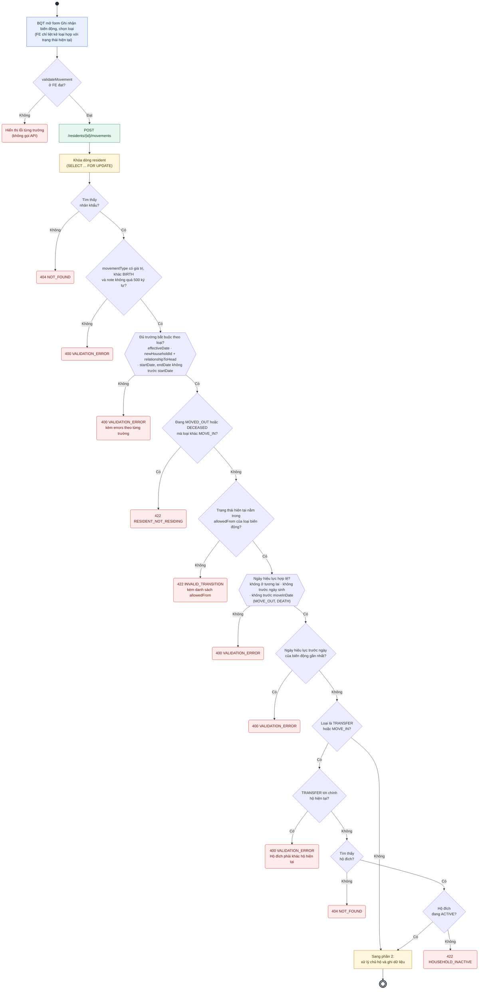

### 9.10b Ghi nhận biến động nhân khẩu — phần 2: xử lý chủ hộ và ghi dữ liệu

*Mã nguồn:* ResidentService.recordMovement() bước 8–11 · MovementPanel.jsx (xử lý HEAD_REQUIRED)

Toàn bộ nằm trong một transaction với dòng resident đã bị khóa. Bản ghi resident_movement chỉ thêm mới (append-only), không sửa hay xóa.

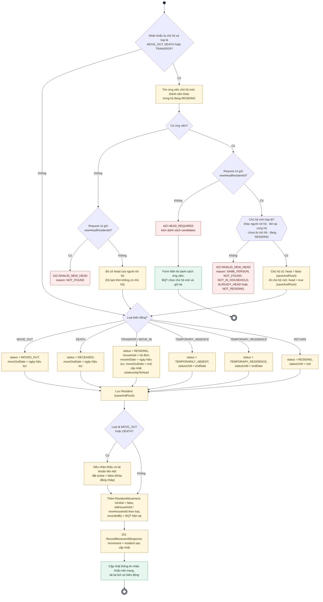

### 9.11 Tìm kiếm nhanh hộ gia đình và nhân khẩu

*Mã nguồn:* SearchPage.jsx · SearchController.search() · SearchService.search() — vai trò BQT, ACCOUNTANT

FE chờ 300 ms sau lần gõ cuối và hủy request cũ bằng AbortController. Mỗi nhóm trả tối đa limit kết quả kèm tổng số để FE biết còn kết quả hay không (hasMore).

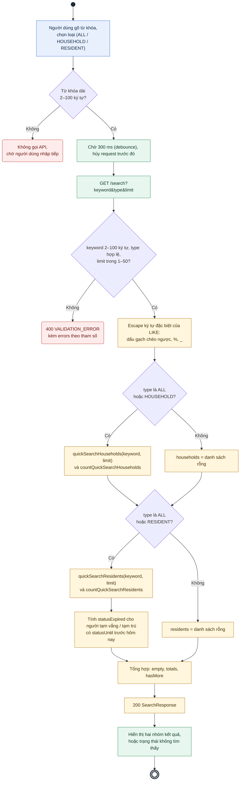

### 9.12 Cư dân gửi đề nghị (cập nhật hồ sơ, tạm vắng, tạm trú)

*Mã nguồn:* MyHouseholdPage.jsx · ResidentRequestForm.jsx · ResidentRequestController.submitRequest() · ResidentRequestService.submit() — chỉ vai trò RESIDENT

Gửi đề nghị không làm thay đổi dữ liệu nhân khẩu: chỉ tạo bản ghi resident_request ở trạng thái PENDING. Với PROFILE_UPDATE, hệ thống chụp lại giá trị hiện tại (beforeValues) để phát hiện dữ liệu đã đổi khi BQT duyệt.

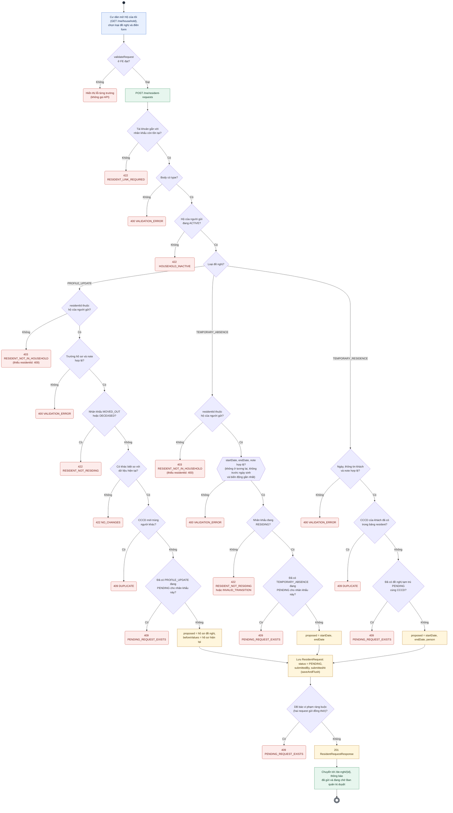

### 9.13 Ban quản trị duyệt đề nghị

*Mã nguồn:* ResidentRequestDetailPage.jsx · ResidentRequestController.approveRequest() · ResidentRequestService.approve() · ResidentService.recordMovement() / createResident() — chỉ vai trò BQT

Việc duyệt và việc áp dụng thay đổi chạy trong cùng một transaction: nếu ghi nhận tạm vắng hoặc tạo nhân khẩu tạm trú thất bại thì đề nghị vẫn giữ trạng thái PENDING.

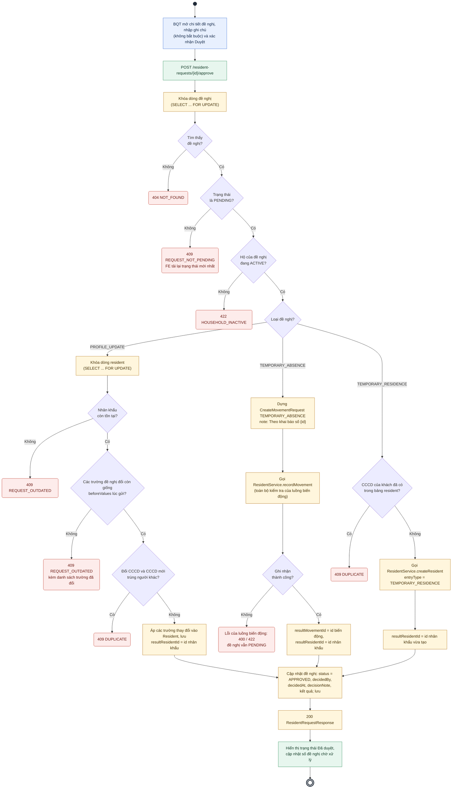

### 9.14 Từ chối đề nghị (BQT) và hủy đề nghị (cư dân)

*Mã nguồn:* ResidentRequestDetailPage.jsx · ResidentRequestService.reject() / cancel()

Cả hai thao tác đều khóa dòng đề nghị trước khi kiểm tra trạng thái, nên khi BQT duyệt và cư dân hủy cùng lúc thì chỉ một bên thành công, bên còn lại nhận REQUEST_NOT_PENDING. Cư dân truy cập đề nghị của người khác nhận 404 thay vì 403 để không lộ sự tồn tại của đề nghị.

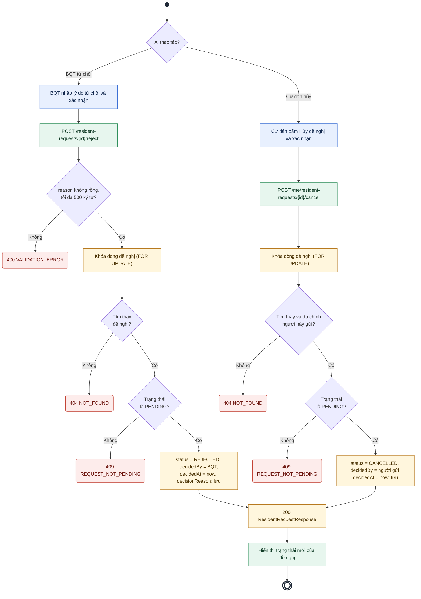

### 9.15 Tạo và cập nhật khoản thu

*Mã nguồn:* FeeForm.jsx · FeeCategoryController.create() / update() · FeeCategoryService.create() / update() — vai trò ACCOUNTANT, BQT

Khoản bắt buộc (MANDATORY) chỉ tính theo diện tích (PER_AREA) hoặc cố định (FIXED) và phải có đơn giá, chu kỳ, hạn nộp. Khoản tự nguyện (VOLUNTARY) luôn là MANUAL, hệ thống tự đặt đơn giá = 0, chu kỳ ONE_TIME, không có hạn nộp. Khi tạo mới, kiểm tra trùng mã chạy ngay sau bước kiểm tra định dạng mã, trước khi trả các lỗi validation khác.

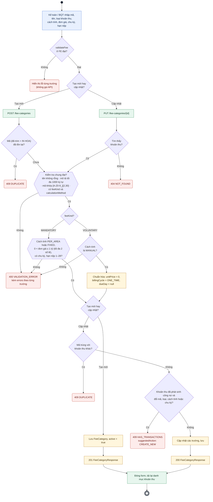

### 9.16 Tính thử phí cho một hộ

*Mã nguồn:* FeePreview.jsx · FeeCalculationController.preview() · FeeCalculationService.preview() — vai trò ACCOUNTANT, BQT

Chỉ tính và trả kết quả để xem trước, không ghi gì vào DB (transaction readOnly). Số tiền làm tròn tới đồng theo HALF_UP.

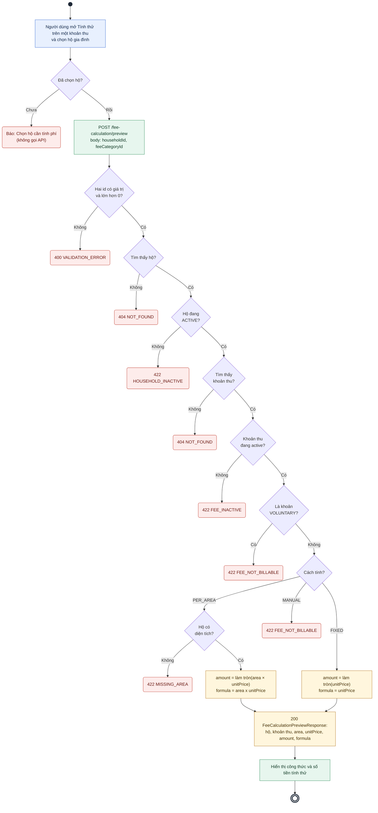

### 9.17 Quản lý kỳ thu: tạo, sửa, xóa

*Mã nguồn:* PeriodForm.jsx · PeriodDetailPage.jsx · BillingPeriodController · BillingPeriodService.create() / update() / delete() — vai trò ACCOUNTANT, BQT

Kỳ thu mới luôn ở trạng thái OPEN và chưa lập danh sách. Sau khi đã lập danh sách khoản phải thu (generatedAt khác null) thì không được sửa hay xóa kỳ nữa.

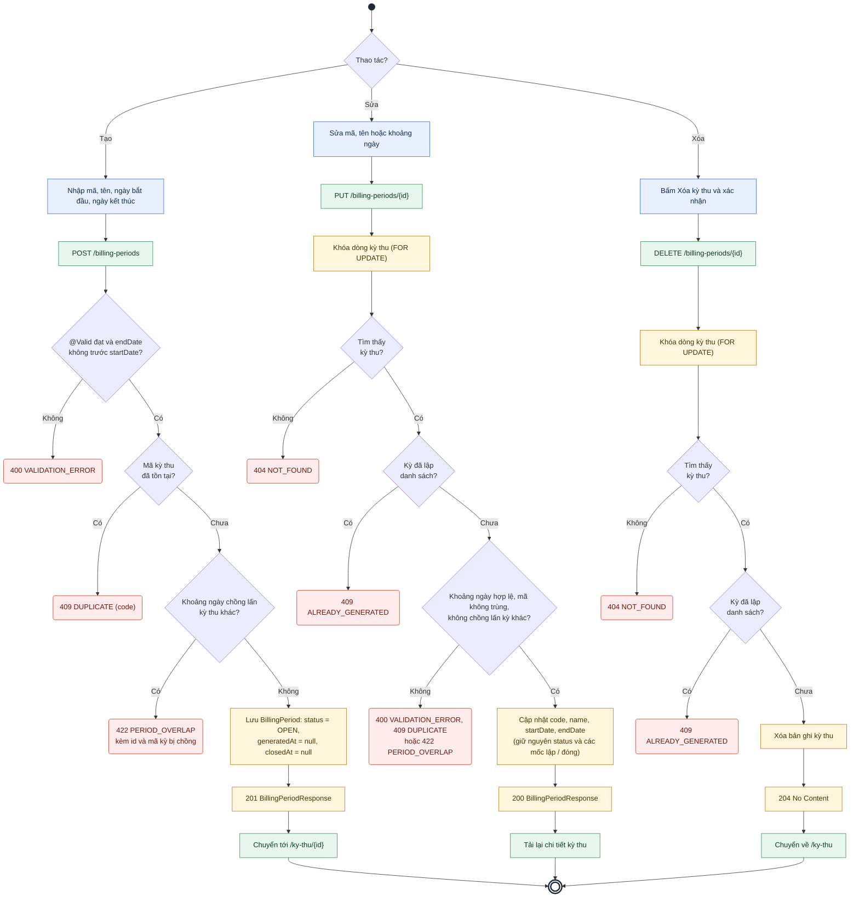

### 9.18 Lập danh sách khoản phải thu cho kỳ thu

*Mã nguồn:* PeriodDetailPage.jsx perform() · BillingGenerationController.generate() · BillingGenerationService.generate() · ReceivableRepository — vai trò ACCOUNTANT, BQT

Khoản thu đủ điều kiện: MANDATORY, đang active, chu kỳ MONTHLY hoặc ONE_TIME chưa từng phát sinh công nợ. Mỗi hộ ACTIVE nhận một khoản phải thu cho mỗi khoản thu đủ điều kiện; khoản PER_AREA bị bỏ qua với hộ chưa có diện tích (MISSING_AREA). Xem trước (dryRun) và lập thật dùng chung một đường xử lý, chỉ khác ở bước ghi.

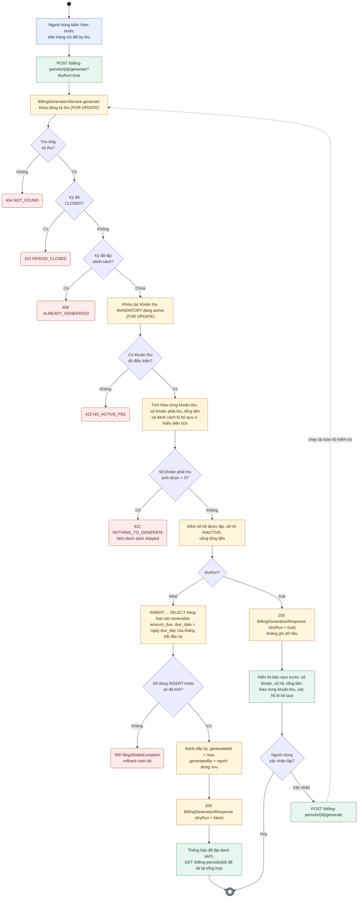

### 9.19 Đóng sổ và mở lại kỳ thu

*Mã nguồn:* PeriodDetailPage.jsx · BillingPeriodController.updateStatus() · BillingPeriodService.updateStatus() — chỉ vai trò BQT

Thao tác có tính idempotent: gửi lại trạng thái đang có sẽ trả 200 mà không thay đổi gì. Kỳ đã CLOSED thì không lập danh sách được nữa (PERIOD_CLOSED).

```mermaid
flowchart TD
    S((" ")):::start --> A1["BQT bấm Đóng sổ hoặc Mở lại<br/>và xác nhận"]:::user
    A1 --> A2["PATCH /billing-periods/{id}/status<br/>body: status = CLOSED hoặc OPEN"]:::fe
    A2 --> A3["Khóa dòng kỳ thu (FOR UPDATE)"]:::be
    A3 --> D1{"Tìm thấy<br/>kỳ thu?"}
    D1 -- "Không" --> X1("404 NOT_FOUND"):::err
    D1 -- "Có" --> D2{"Trạng thái yêu cầu trùng<br/>trạng thái hiện tại?"}
    D2 -- "Có" --> OK
    D2 -- "Không" --> D3{"Trạng thái<br/>yêu cầu?"}
    D3 -- "CLOSED" --> D4{"Kỳ đã lập<br/>danh sách?"}
    D4 -- "Chưa" --> X2("422 PERIOD_NOT_GENERATED"):::err
    D4 -- "Rồi" --> A4["status = CLOSED, closedAt = now,<br/>closedBy = BQT hiện tại"]:::be
    D3 -- "OPEN" --> A5["status = OPEN,<br/>closedAt = null, closedBy = null"]:::be
    A4 --> OK["200 BillingPeriodResponse"]:::be
    A5 --> OK
    OK --> A6["GET /billing-periods/{id},<br/>hiển thị trạng thái mới"]:::fe
    A6 --> E(((" "))):::stop
    classDef start fill:#1f2937,stroke:#1f2937,color:#ffffff
    classDef stop fill:#ffffff,stroke:#1f2937,stroke-width:3px
    classDef user fill:#e8f0fe,stroke:#3b6fd4,color:#12284d
    classDef fe fill:#e7f6ee,stroke:#2f8f5b,color:#103b25
    classDef be fill:#fff6dd,stroke:#b7791f,color:#4a3204
    classDef err fill:#fdeceb,stroke:#c0392b,color:#6e1710
```

---

## 10. SEQUENCE DIAGRAM

Phần này mô tả thứ tự trao đổi thông điệp (Sequence Diagrams) giữa Người dùng, Tầng Giao diện (React components/Context), Tầng Điều khiển (REST Controllers), Tầng Nghiệp vụ (Services), Tầng Bảo mật (Spring Security / JWT / PasswordEncoder) và Tầng Cơ sở dữ liệu (Spring Data JPA / PostgreSQL) cho 19 luồng nghiệp vụ trọng yếu của hệ thống BlueMoon (Sprint 1).

### 10.1 Đăng nhập và khởi tạo phiên

*Mã nguồn:* LoginPage.jsx · AuthContext.login() · AuthController.login() · AuthService.login() · JwtService.generateToken() · MeController.getMe() · UserService.getMe()

POST /auth/login là endpoint duy nhất permitAll. Sau khi nhận token, FE gọi thêm GET /me để lấy hồ sơ đầy đủ (kèm householdId) trước khi coi là đăng nhập thành công.

```mermaid
sequenceDiagram
    autonumber
    actor U as Người dùng
    box rgb(231,246,238) Frontend · React
        participant LP as LoginPage
        participant AC as AuthContext
    end
    box rgb(255,246,221) Backend · Spring Boot
        participant C as AuthController
        participant S as AuthService
        participant PE as PasswordEncoder<br/>(BCrypt)
        participant J as JwtService
        participant GEH as Global<br/>ExceptionHandler
        participant MC as MeController
        participant US as UserService
    end
    box rgb(241,245,249) Spring Data JPA / PostgreSQL
        participant UR as AppUserRepository
    end

    U->>LP: Nhập username, password và bấm Đăng nhập
    LP->>LP: Kiểm tra đã nhập đủ hai trường
    LP->>+AC: login(credentials)
    AC->>+C: POST /auth/login (skipAuth, không gửi token)
    Note over C: @Valid LoginRequest, sai thì 400 VALIDATION_ERROR
    C->>+S: login(request)
    S->>UR: findByUsernameIgnoreCase(username)
    UR-->>S: Optional AppUser
    break Không có user hoặc user.active = false
        S--xGEH: throw InvalidCredentialsException
        GEH-->>AC: 401 INVALID_CREDENTIALS
        AC-->>LP: throw ApiError
        LP-->>U: Sai tài khoản hoặc mật khẩu
    end
    S->>PE: matches(password, user.passwordHash)
    PE-->>S: true / false
    break Mật khẩu không khớp
        S--xGEH: throw InvalidCredentialsException
        GEH-->>AC: 401 INVALID_CREDENTIALS
        AC-->>LP: throw ApiError
        LP-->>U: Sai tài khoản hoặc mật khẩu
    end
    S->>S: user.setLastLoginAt(now)
    S->>J: generateToken(user)
    J-->>S: JWT (sub = username, userId, roles, iat, exp = iat + 28800 s)
    S-->>-C: LoginResponse(accessToken, Bearer, expiresIn, expiresAt, user)
    Note over S,UR: Kết thúc @Transactional: UPDATE app_user SET last_login_at
    C-->>-AC: 200 ApiResponse(data = LoginResponse)
    AC->>AC: sessionStorage: bluemoon_access_token, bluemoon_expires_at
    AC->>+MC: GET /me (Authorization: Bearer token)
    Note over AC,MC: Đi qua JwtAuthenticationFilter (xem SD-02)
    MC->>+US: getMe()
    US->>UR: findByUsernameIgnoreCase(principal.username)
    UR-->>US: AppUser
    US-->>-MC: UserResponse (kèm roles, residentId, householdId)
    MC-->>-AC: 200 ApiResponse(data = UserResponse)
    AC->>AC: Kiểm tra id, roles, active rồi lưu bluemoon_user, setUser, setToken
    AC-->>-LP: user
    LP->>LP: navigate(homeForRoles(user.roles))
    LP-->>U: Trang chủ theo vai trò
```

### 10.2 Xác thực JWT và phân quyền cho mỗi request

*Mã nguồn:* api/http.js request() · JwtAuthenticationFilter · JwtService · SecurityConfig · GlobalExceptionHandler · AuthContext

Sơ đồ dùng chung cho mọi API cần đăng nhập. Các sơ đồ sau chỉ ghi chú "xem SD-02" thay vì vẽ lại đoạn này.

```mermaid
sequenceDiagram
    autonumber
    box rgb(231,246,238) Frontend · React
        participant P as Trang / Component
        participant H as api/http.js
        participant AC as AuthContext
    end
    box rgb(255,246,221) Backend · Spring Boot
        participant F as JwtAuthentication<br/>Filter
        participant J as JwtService
        participant SC as SecurityFilterChain<br/>(SecurityConfig)
        participant C as Controller
        participant S as Service
        participant GEH as Global<br/>ExceptionHandler
    end
    box rgb(241,245,249) Spring Data JPA / PostgreSQL
        participant UR as AppUserRepository
    end

    P->>+H: api.get / post / put / patch / delete(path, body)
    H->>H: Đọc token từ sessionStorage, gắn Authorization: Bearer
    H->>F: HTTP request (timeout 15 s)
    alt Không có header Bearer
        F->>SC: filterChain.doFilter (chưa xác thực)
    else Có Bearer token
        F->>J: isTokenValid(token)
        J-->>F: true / false (chữ ký HMAC, hạn dùng)
        break Token sai chữ ký hoặc hết hạn
            F-->>H: 401 TOKEN_INVALID
        end
        F->>J: extractUsername(token), extractIssuedAt(token)
        J-->>F: username, iat
        F->>UR: findByUsernameIgnoreCase(username)
        UR-->>F: AppUser kèm roles (EAGER)
        break Không có user, user bị khóa, hoặc iat trước passwordChangedAt
            F-->>H: 401 TOKEN_INVALID
        end
        F->>F: SecurityContext.setAuthentication(principal = AppUser, ROLE_x)
        F->>SC: filterChain.doFilter (đã xác thực)
    end
    SC->>SC: Đối chiếu authorizeHttpRequests theo method + path
    break Endpoint cần đăng nhập nhưng chưa xác thực
        SC-->>H: 401 UNAUTHORIZED (authenticationEntryPoint)
    end
    break Không có vai trò được phép
        SC-->>H: 403 FORBIDDEN (accessDeniedHandler)
    end
    SC->>C: Gọi handler (@Valid body, @AuthenticationPrincipal AppUser)
    C->>S: Gọi nghiệp vụ (@Transactional)
    alt Xử lý thành công
        S-->>C: DTO kết quả
        C-->>H: 2xx ApiResponse(success = true, message, data)
        H-->>P: payload.data
    else Service ném exception
        S--xGEH: exception nghiệp vụ / validation
        GEH-->>H: 4xx ApiErrorResponse(code, message, errors, details)
        H-->>P: throw ApiError(code, status, fields, details)
    end
    opt Phản hồi 401 và token gửi đi vẫn là token hiện tại
        H->>AC: dispatchEvent(bluemoon:session-expired)
        AC->>AC: signOut: xóa token, hạn dùng, user khỏi sessionStorage
        AC-->>P: Protected chuyển hướng về /dang-nhap
    end
    deactivate H
```

### 10.3 Tạo tài khoản người dùng

*Mã nguồn:* UserForm.jsx · UserController.createUser() · UserService.createUser() — chỉ vai trò BQT

```mermaid
sequenceDiagram
    autonumber
    actor U as Ban quản trị
    box rgb(231,246,238) Frontend · React
        participant FE as UserForm<br/>(UsersPage)
    end
    box rgb(255,246,221) Backend · Spring Boot
        participant RC as ResidentController
        participant C as UserController
        participant S as UserService
        participant PE as PasswordEncoder
        participant GEH as Global<br/>ExceptionHandler
    end
    box rgb(241,245,249) Spring Data JPA / PostgreSQL
        participant UR as AppUserRepository
        participant RR as ResidentRepository
        participant RoR as AppRoleRepository
    end

    U->>FE: Nhập username, mật khẩu, họ tên, chọn vai trò
    opt Có chọn vai trò RESIDENT
        U->>FE: Gõ tên nhân khẩu cần liên kết
        FE->>RC: GET /residents?keyword&status=RESIDING&size=10 (debounce 300 ms)
        RC-->>FE: Danh sách nhân khẩu đang cư trú
        U->>FE: Chọn nhân khẩu (residentId)
    end
    U->>FE: Bấm Lưu
    FE->>FE: validateUser(form)
    FE->>+C: POST /users
    Note over FE,C: Bearer JWT, hasRole(BQT) — xem SD-02. @Valid CreateUserRequest, sai thì 400
    C->>+S: createUser(request)
    S->>UR: existsByUsernameIgnoreCase(username)
    UR-->>S: boolean
    break Username đã tồn tại
        S--xGEH: throw DuplicateException(username)
        GEH-->>FE: 409 DUPLICATE
    end
    opt Có email
        S->>UR: existsByEmailIgnoreCase(email)
        UR-->>S: boolean
    end
    break Email đã tồn tại
        S--xGEH: throw DuplicateException(email)
        GEH-->>FE: 409 DUPLICATE
    end
    break Password trùng username
        S--xGEH: throw IllegalArgumentException
        GEH-->>FE: 400 VALIDATION_ERROR
    end
    break Có vai trò RESIDENT nhưng residentId = null
        S--xGEH: throw ResidentLinkRequiredException
        GEH-->>FE: 422 RESIDENT_LINK_REQUIRED
    end
    opt Có residentId
        S->>RR: findById(residentId)
        RR-->>S: Optional Resident
        break Không tồn tại hoặc status khác RESIDING
            S--xGEH: throw IllegalArgumentException
            GEH-->>FE: 400 VALIDATION_ERROR
        end
        S->>UR: existsByResidentId(residentId)
        UR-->>S: boolean
        break Nhân khẩu đã có tài khoản
            S--xGEH: throw DuplicateException(residentId)
            GEH-->>FE: 409 DUPLICATE
        end
    end
    loop Với mỗi mã vai trò
        S->>RoR: findByCode(roleCode)
        RoR-->>S: AppRole
    end
    S->>PE: encode(password)
    PE-->>S: passwordHash
    S->>UR: save(AppUser: active = true, mustChangePassword = true)
    UR-->>S: AppUser đã có id
    S-->>-C: UserResponse
    C-->>-FE: 201 ApiResponse (Tạo tài khoản thành công)
    FE-->>U: Đóng form, tải lại danh sách tài khoản
```

### 10.4 Quản trị tài khoản: đổi vai trò, khóa / mở khóa, đặt lại mật khẩu

*Mã nguồn:* UsersPage.jsx · UserController · UserService.updateUserRoles() / updateUserStatus() / resetPassword() — chỉ vai trò BQT

Cả ba thao tác đều bắt đầu bằng findById (không có thì 404 NOT_FOUND). Tài khoản bị khóa hoặc bị đặt lại mật khẩu sẽ bị từ chối ngay ở request kế tiếp nhờ kiểm tra trong JwtAuthenticationFilter.

```mermaid
sequenceDiagram
    autonumber
    actor U as Ban quản trị
    box rgb(231,246,238) Frontend · React
        participant FE as UsersPage
    end
    box rgb(255,246,221) Backend · Spring Boot
        participant C as UserController
        participant S as UserService
        participant PE as PasswordEncoder
        participant GEH as Global<br/>ExceptionHandler
    end
    box rgb(241,245,249) Spring Data JPA / PostgreSQL
        participant UR as AppUserRepository
        participant RoR as AppRoleRepository
    end

    Note over FE,C: Bearer JWT, hasRole(BQT) — xem SD-02
    alt Đổi vai trò
        U->>FE: Chọn lại vai trò và lưu
        FE->>FE: canAssignRoles(current, target, roles)
        FE->>+C: PUT /users/{id}/roles
        C->>+S: updateUserRoles(id, request)
        S->>UR: findById(id)
        UR-->>S: AppUser
        break Vai trò bị lặp trong danh sách
            S--xGEH: throw IllegalArgumentException
            GEH-->>FE: 400 VALIDATION_ERROR
        end
        break Có RESIDENT nhưng user.residentId = null
            S--xGEH: throw ResidentLinkRequiredException
            GEH-->>FE: 422 RESIDENT_LINK_REQUIRED
        end
        break BQT tự gỡ vai trò BQT của chính mình
            S--xGEH: throw SelfLockoutException
            GEH-->>FE: 422 SELF_LOCKOUT
        end
        loop Với mỗi mã vai trò
            S->>RoR: findByCode(roleCode)
            RoR-->>S: AppRole
        end
        S->>UR: save(user với tập vai trò mới)
        S-->>-C: UserResponse
        C-->>-FE: 200 ApiResponse (Cập nhật vai trò thành công)
    else Khóa / mở khóa
        U->>FE: Bấm Khóa hoặc Mở khóa và xác nhận
        FE->>+C: PATCH /users/{id}/status (active)
        C->>+S: updateUserStatus(id, request)
        S->>UR: findById(id)
        UR-->>S: AppUser
        break Tự khóa chính mình
            S--xGEH: throw SelfLockoutException
            GEH-->>FE: 422 SELF_LOCKOUT
        end
        S->>UR: save(user.active = request.active)
        S-->>-C: UserResponse
        C-->>-FE: 200 ApiResponse (Cập nhật trạng thái tài khoản thành công)
    else Đặt lại mật khẩu
        U->>FE: Bấm Đặt lại mật khẩu và xác nhận
        FE->>+C: POST /users/{id}/password-reset (body rỗng)
        C->>+S: resetPassword(id, request)
        S->>UR: findById(id)
        UR-->>S: AppUser
        break Đặt lại mật khẩu của chính mình
            S--xGEH: throw SelfResetNotAllowedException
            GEH-->>FE: 422 SELF_RESET_NOT_ALLOWED
        end
        opt newPassword = null
            S->>S: generateTemporaryPassword(): 10 ký tự, SecureRandom
        end
        break Mật khẩu trùng username
            S--xGEH: throw IllegalArgumentException
            GEH-->>FE: 400 VALIDATION_ERROR
        end
        S->>PE: encode(newPassword)
        PE-->>S: passwordHash
        S->>UR: save(passwordHash, mustChangePassword = true, passwordChangedAt = now)
        S-->>-C: PasswordResetResponse(id, username, mật khẩu tạm)
        C-->>-FE: 200 ApiResponse (Đã đặt lại mật khẩu)
        FE-->>U: Hiển thị mật khẩu tạm một lần
    end
    FE-->>U: Tải lại danh sách, thông báo kết quả
```

### 10.5 Đổi mật khẩu

*Mã nguồn:* ProfilePage.jsx · MeController.changePassword() · MeService.changePassword()

```mermaid
sequenceDiagram
    autonumber
    actor U as Người dùng
    box rgb(231,246,238) Frontend · React
        participant FE as ProfilePage
        participant AC as AuthContext
    end
    box rgb(255,246,221) Backend · Spring Boot
        participant C as MeController
        participant S as MeService
        participant PE as PasswordEncoder
        participant GEH as Global<br/>ExceptionHandler
    end
    box rgb(241,245,249) Spring Data JPA / PostgreSQL
        participant UR as AppUserRepository
    end

    U->>FE: Nhập mật khẩu cũ, mật khẩu mới, xác nhận
    FE->>FE: validatePassword(form, username)
    FE->>+C: PATCH /me/password
    Note over FE,C: Bearer JWT, authenticated — xem SD-02. @Valid: newPassword 8–128 ký tự, sai thì 400
    C->>+S: changePassword(request)
    S->>UR: findByUsernameIgnoreCase(username từ SecurityContext)
    UR-->>S: AppUser
    S->>PE: matches(oldPassword, passwordHash)
    PE-->>S: true / false
    break Mật khẩu cũ không đúng
        S--xGEH: throw PasswordValidationException(oldPassword)
        GEH-->>FE: 400 VALIDATION_ERROR (errors.oldPassword)
    end
    S->>PE: matches(newPassword, passwordHash)
    PE-->>S: true / false
    break Mật khẩu mới trùng mật khẩu hiện tại
        S--xGEH: throw PasswordValidationException(newPassword)
        GEH-->>FE: 400 VALIDATION_ERROR (errors.newPassword)
    end
    break Mật khẩu mới trùng username
        S--xGEH: throw PasswordValidationException(newPassword)
        GEH-->>FE: 400 VALIDATION_ERROR (errors.newPassword)
    end
    break confirmPassword khác newPassword
        S--xGEH: throw PasswordValidationException(confirmPassword)
        GEH-->>FE: 400 VALIDATION_ERROR (errors.confirmPassword)
    end
    S->>PE: encode(newPassword)
    PE-->>S: passwordHash mới
    S->>UR: save(passwordHash, mustChangePassword = false, passwordChangedAt = now)
    S-->>-C: void
    C-->>-FE: 204 No Content
    FE->>AC: signOut(Đổi mật khẩu thành công, vui lòng đăng nhập lại)
    AC->>AC: Xóa token và user khỏi sessionStorage
    AC-->>U: Chuyển về /dang-nhap kèm thông báo
    Note over AC,UR: Token cũ có iat trước passwordChangedAt nên không còn dùng được
```

### 10.6 Tạo hộ gia đình kèm chủ hộ

*Mã nguồn:* HouseholdForm.jsx · HouseholdController.createHousehold() · HouseholdService.createHousehold() — chỉ vai trò BQT

```mermaid
sequenceDiagram
    autonumber
    actor U as Ban quản trị
    box rgb(231,246,238) Frontend · React
        participant FE as HouseholdForm<br/>(HouseholdsPage)
    end
    box rgb(255,246,221) Backend · Spring Boot
        participant C as HouseholdController
        participant S as HouseholdService
        participant GEH as Global<br/>ExceptionHandler
    end
    box rgb(241,245,249) Spring Data JPA / PostgreSQL
        participant HR as HouseholdRepository
        participant RR as ResidentRepository
        participant MR as ResidentMovement<br/>Repository
    end

    U->>FE: Nhập thông tin hộ và chủ hộ, bấm Lưu
    FE->>FE: validateHousehold(form, creating = true)
    FE->>+C: POST /households
    Note over FE,C: Bearer JWT, hasRole(BQT) — xem SD-02. @Valid CreateHouseholdRequest, sai thì 400
    C->>+S: createHousehold(request, currentUser)
    S->>S: Chuẩn hóa: trim + IN HOA householdCode, apartmentNo
    break Ngày sinh chủ hộ trước 01/01/1900
        S--xGEH: throw IllegalArgumentException
        GEH-->>FE: 400 VALIDATION_ERROR
    end
    S->>HR: existsByHouseholdCodeAndDeletedAtIsNull(code)
    HR-->>S: boolean
    S->>HR: existsByApartmentNoAndDeletedAtIsNull(apartmentNo)
    HR-->>S: boolean
    opt Chủ hộ có CCCD/CMND
        S->>RR: existsByIdentityNumberAndDeletedAtIsNull(identityNumber)
        RR-->>S: boolean
    end
    break Có ít nhất một trường bị trùng
        S--xGEH: throw HouseholdDuplicateException(errors)
        GEH-->>FE: 409 DUPLICATE (errors theo từng trường)
        FE-->>U: Đánh dấu lỗi tại các trường bị trùng
    end
    rect rgb(248,250,252)
        Note over S,MR: Cùng một @Transactional — lỗi ở bước nào cũng rollback cả ba bản ghi
        S->>HR: saveAndFlush(Household: status = ACTIVE)
        HR-->>S: Household đã có id
        S->>RR: saveAndFlush(Resident: head = true, RESIDING, moveInDate = hôm nay)
        RR-->>S: Resident đã có id
        S->>MR: save(ResidentMovement: MOVE_IN, isInitial = true, recordedBy = currentUser)
        MR-->>S: ResidentMovement
    end
    S-->>-C: HouseholdResponse(head, residentCount = 1, presentCount = 1)
    C-->>-FE: 201 ApiResponse (Tạo hộ gia đình thành công)
    FE-->>U: Chuyển tới /ho-gia-dinh/{id}
```

### 10.7 Đổi chủ hộ

*Mã nguồn:* HouseholdDetailPage.jsx · HouseholdController.changeHouseholdHead() · HouseholdService.changeHouseholdHead() — chỉ vai trò BQT

```mermaid
sequenceDiagram
    autonumber
    actor U as Ban quản trị
    box rgb(231,246,238) Frontend · React
        participant FE as HouseholdDetailPage
    end
    box rgb(255,246,221) Backend · Spring Boot
        participant C as HouseholdController
        participant S as HouseholdService
        participant GEH as Global<br/>ExceptionHandler
    end
    box rgb(241,245,249) Spring Data JPA / PostgreSQL
        participant HR as HouseholdRepository
        participant RR as ResidentRepository
    end

    U->>FE: Chọn thành viên làm chủ hộ mới, bấm Đổi chủ hộ
    FE->>+C: PUT /households/{id}/head (residentId)
    Note over FE,C: Bearer JWT, hasRole(BQT) — xem SD-02
    C->>+S: changeHouseholdHead(householdId, residentId)
    S->>HR: findByIdAndDeletedAtIsNull(householdId)
    HR-->>S: Optional Household
    break Không tìm thấy hộ
        S--xGEH: throw ResourceNotFoundException
        GEH-->>FE: 404 NOT_FOUND
    end
    break Hộ không ở trạng thái ACTIVE
        S--xGEH: throw HouseholdInactiveException
        GEH-->>FE: 422 HOUSEHOLD_INACTIVE
    end
    S->>RR: findByIdAndDeletedAtIsNull(residentId)
    RR-->>S: Optional Resident (chủ hộ mới)
    break Không tồn tại, khác hộ, không RESIDING, hoặc đã là chủ hộ
        S--xGEH: throw InvalidNewHeadException(reason)
        GEH-->>FE: 422 INVALID_NEW_HEAD (NOT_FOUND, NOT_IN_HOUSEHOLD, NOT_RESIDING, ALREADY_HEAD)
    end
    S->>RR: findByHouseholdIdAndHeadTrueAndDeletedAtIsNull(householdId)
    RR-->>S: Optional Resident (chủ hộ hiện tại)
    opt Hộ đang có chủ hộ
        S->>RR: saveAndFlush(currentHead.head = false)
    end
    S->>RR: saveAndFlush(newHead.head = true)
    S-->>-C: HouseholdResponse (head mới, residentCount, presentCount)
    C-->>-FE: 200 ApiResponse (Thay đổi chủ hộ thành công)
    FE->>C: GET /households/{id} và GET /households/{id}/residents
    C-->>FE: Chi tiết hộ và danh sách nhân khẩu
    FE-->>U: Đã đổi chủ hộ thành công
```

### 10.8 Thêm nhân khẩu vào hộ

*Mã nguồn:* ResidentForm.jsx · ResidentController.createResident() · ResidentService.createResident() — chỉ vai trò BQT

Cũng chính phương thức createResident này được ResidentRequestService.approve gọi lại khi BQT duyệt đề nghị tạm trú (xem SD-13).

```mermaid
sequenceDiagram
    autonumber
    actor U as Ban quản trị
    box rgb(231,246,238) Frontend · React
        participant FE as ResidentForm<br/>(HouseholdDetailPage)
    end
    box rgb(255,246,221) Backend · Spring Boot
        participant C as ResidentController
        participant S as ResidentService
        participant GEH as Global<br/>ExceptionHandler
    end
    box rgb(241,245,249) Spring Data JPA / PostgreSQL
        participant HR as HouseholdRepository
        participant RR as ResidentRepository
        participant MR as ResidentMovement<br/>Repository
    end

    U->>FE: Nhập thông tin nhân khẩu, hình thức vào hộ, bấm Lưu
    FE->>FE: validateResident(form, creating = true)
    FE->>+C: POST /households/{id}/residents
    Note over FE,C: Bearer JWT, hasRole(BQT) — xem SD-02. @Valid + @AssertTrue của CreateResidentRequest, sai thì 400
    C->>+S: createResident(householdId, request, currentUser)
    S->>HR: findByIdAndDeletedAtIsNull(householdId)
    HR-->>S: Optional Household
    break Không tìm thấy hộ
        S--xGEH: throw ResourceNotFoundException
        GEH-->>FE: 404 NOT_FOUND
    end
    break Hộ không ở trạng thái ACTIVE
        S--xGEH: throw HouseholdInactiveException
        GEH-->>FE: 422 HOUSEHOLD_INACTIVE
    end
    opt Có CCCD/CMND
        S->>RR: existsByIdentityNumberAndDeletedAtIsNull(identityNumber)
        RR-->>S: boolean
    end
    break CCCD/CMND đã tồn tại
        S--xGEH: throw DuplicateException(identityNumber)
        GEH-->>FE: 409 DUPLICATE
    end
    S->>S: Mặc định entryType = MOVE_IN, entryDate = hôm nay
    alt entryType = TEMPORARY_RESIDENCE
        S->>S: status = TEMPORARY_RESIDENCE, statusUntil = endDate, moveInDate = startDate
    else MOVE_IN, BIRTH, EXISTING
        S->>S: status = RESIDING, moveInDate = entryDate
    end
    S->>RR: save(Resident: head = false)
    RR-->>S: Resident đã có id
    opt entryType khác EXISTING
        S->>MR: save(ResidentMovement: loại theo entryType, isInitial = true, recordedBy)
        MR-->>S: ResidentMovement
    end
    S-->>-C: ResidentResponse
    C-->>-FE: 201 ApiResponse (Thêm nhân khẩu thành công)
    FE-->>U: Đóng form, tải lại danh sách nhân khẩu
```

### 10.9 Xóa nhân khẩu (xóa mềm)

*Mã nguồn:* ResidentDetailPage.jsx · ResidentController.deleteResident() · ResidentService.deleteResident() — chỉ vai trò BQT

```mermaid
sequenceDiagram
    autonumber
    actor U as Ban quản trị
    box rgb(231,246,238) Frontend · React
        participant FE as ResidentDetailPage
    end
    box rgb(255,246,221) Backend · Spring Boot
        participant C as ResidentController
        participant S as ResidentService
        participant GEH as Global<br/>ExceptionHandler
    end
    box rgb(241,245,249) Spring Data JPA / PostgreSQL
        participant RR as ResidentRepository
        participant UR as AppUserRepository
        participant MR as ResidentMovement<br/>Repository
    end

    U->>FE: Bấm Xóa nhân khẩu và xác nhận
    FE->>+C: DELETE /residents/{id}
    Note over FE,C: Bearer JWT, hasRole(BQT) — xem SD-02
    C->>+S: deleteResident(id)
    S->>RR: findByIdAndDeletedAtIsNull(id)
    RR-->>S: Optional Resident
    break Không tìm thấy nhân khẩu
        S--xGEH: throw ResourceNotFoundException
        GEH-->>FE: 404 NOT_FOUND
    end
    break Nhân khẩu đang là chủ hộ
        S--xGEH: throw ResidentDeleteException(INVALID_NEW_HEAD)
        GEH-->>FE: 422 INVALID_NEW_HEAD (hãy đổi chủ hộ trước khi xóa)
    end
    S->>UR: existsByResidentId(id)
    UR-->>S: boolean
    break Nhân khẩu đang gắn với tài khoản đăng nhập
        S--xGEH: throw ResidentDeleteException(HAS_ACCOUNT)
        GEH-->>FE: 409 HAS_ACCOUNT
    end
    S->>MR: countByResident_IdAndIsInitialFalse(id)
    MR-->>S: movementCount
    break movementCount lớn hơn 0
        S--xGEH: throw ResidentDeleteException(HAS_HISTORY)
        GEH-->>FE: 409 HAS_HISTORY (suggestedAction = RECORD_MOVEMENT)
        FE-->>U: Gợi ý ghi nhận biến động thay vì xóa
    end
    S->>RR: save(resident.deletedAt = now)
    S-->>-C: void
    C-->>-FE: 204 No Content
    FE-->>U: Chuyển về /ho-gia-dinh/{householdId}
```

### 10.10 Ghi nhận biến động nhân khẩu

*Mã nguồn:* MovementPanel.jsx (MovementForm) · ResidentController.recordMovement() · ResidentService.recordMovement() — chỉ vai trò BQT

Dòng resident bị khóa bằng SELECT ... FOR UPDATE suốt transaction nên hai biến động đồng thời trên cùng một người sẽ được xử lý tuần tự. Khi chủ hộ rời hộ mà chưa chọn người thay, API trả HEAD_REQUIRED kèm danh sách ứng viên để form hiển thị và gửi lại.

```mermaid
sequenceDiagram
    autonumber
    actor U as Ban quản trị
    box rgb(231,246,238) Frontend · React
        participant FE as MovementForm<br/>(MovementPanel)
    end
    box rgb(255,246,221) Backend · Spring Boot
        participant C as ResidentController
        participant S as ResidentService
        participant GEH as Global<br/>ExceptionHandler
    end
    box rgb(241,245,249) Spring Data JPA / PostgreSQL
        participant RR as ResidentRepository
        participant MR as ResidentMovement<br/>Repository
        participant HR as HouseholdRepository
        participant UR as AppUserRepository
    end

    U->>FE: Chọn loại biến động, nhập ngày và thông tin liên quan
    FE->>FE: validateMovement(form, resident, history)
    FE->>+C: POST /residents/{id}/movements
    Note over FE,C: Bearer JWT, hasRole(BQT) — xem SD-02
    C->>+S: recordMovement(id, request, currentUser)
    S->>RR: findByIdForUpdate(id) — SELECT ... FOR UPDATE
    RR-->>S: Optional Resident (đã khóa dòng)
    break Không tìm thấy nhân khẩu
        S--xGEH: throw ResourceNotFoundException
        GEH-->>FE: 404 NOT_FOUND
    end
    break Thiếu loại, loại là BIRTH, note quá 500 ký tự, hoặc thiếu trường bắt buộc theo loại
        S--xGEH: throw AppValidationException(errors)
        GEH-->>FE: 400 VALIDATION_ERROR (errors theo từng trường)
    end
    break Đang MOVED_OUT hoặc DECEASED mà loại khác MOVE_IN
        S--xGEH: throw ResidentNotResidingException
        GEH-->>FE: 422 RESIDENT_NOT_RESIDING
    end
    break Trạng thái hiện tại không thuộc allowedFrom của loại biến động
        S--xGEH: throw InvalidTransitionException(allowedFrom)
        GEH-->>FE: 422 INVALID_TRANSITION
        FE->>C: GET /residents/{id} để lấy trạng thái mới nhất
    end
    break Ngày ở tương lai, trước ngày sinh, hoặc trước moveInDate
        S--xGEH: throw AppValidationException(errors)
        GEH-->>FE: 400 VALIDATION_ERROR
    end
    S->>MR: findFirstByResident_IdOrderByEffectiveDateDesc...(id)
    MR-->>S: Optional ResidentMovement (biến động gần nhất)
    break Ngày hiệu lực trước ngày của biến động gần nhất
        S--xGEH: throw AppValidationException
        GEH-->>FE: 400 VALIDATION_ERROR
    end
    opt Loại là TRANSFER hoặc MOVE_IN
        break TRANSFER tới chính hộ hiện tại
            S--xGEH: throw AppValidationException(newHouseholdId)
            GEH-->>FE: 400 VALIDATION_ERROR
        end
        S->>HR: findByIdAndDeletedAtIsNull(newHouseholdId)
        HR-->>S: Optional Household (hộ đích)
        break Không tìm thấy hộ đích hoặc hộ đích không ACTIVE
            S--xGEH: throw ResourceNotFoundException / HouseholdInactiveException
            GEH-->>FE: 404 NOT_FOUND / 422 HOUSEHOLD_INACTIVE
        end
    end
    opt Nhân khẩu là chủ hộ và loại là MOVE_OUT, DEATH hoặc TRANSFER
        S->>RR: findCandidatesForNewHead(householdId, residentId)
        RR-->>S: Danh sách thành viên khác đang RESIDING
        alt Có ứng viên
            break Request chưa có newHeadResidentId
                S--xGEH: throw HeadRequiredException(candidates)
                GEH-->>FE: 422 HEAD_REQUIRED (details.candidates)
                FE-->>U: Hiển thị danh sách ứng viên để chọn chủ hộ mới và gửi lại
            end
            S->>RR: findByIdAndDeletedAtIsNull(newHeadResidentId)
            RR-->>S: Optional Resident (chủ hộ mới)
            break Trùng người rời hộ, không tồn tại, khác hộ, đã là chủ hộ, hoặc không RESIDING
                S--xGEH: throw InvalidNewHeadException(reason)
                GEH-->>FE: 422 INVALID_NEW_HEAD
            end
            S->>RR: saveAndFlush(resident.head = false)
            S->>RR: saveAndFlush(newHead.head = true)
        else Không có ứng viên
            break Request vẫn gửi newHeadResidentId
                S--xGEH: throw InvalidNewHeadException(NOT_FOUND)
                GEH-->>FE: 422 INVALID_NEW_HEAD
            end
            S->>RR: saveAndFlush(resident.head = false)
        end
    end
    S->>S: Cập nhật resident theo loại: status, household, statusUntil, moveInDate, moveOutDate
    S->>RR: saveAndFlush(resident)
    RR-->>S: Resident sau cập nhật
    opt Loại là MOVE_OUT hoặc DEATH
        S->>UR: findByResidentId(residentId)
        UR-->>S: Optional AppUser
        opt Có tài khoản liên kết
            S->>UR: save(user.active = false)
        end
    end
    S->>MR: save(ResidentMovement: loại, effectiveDate, old/newHousehold, isInitial = false, recordedBy)
    MR-->>S: ResidentMovement
    S-->>-C: RecordMovementResponse(movement, resident)
    C-->>-FE: 201 ApiResponse (Ghi nhận biến động thành công)
    FE-->>U: Cập nhật trạng thái nhân khẩu và lịch sử biến động
```

### 10.11 Tìm kiếm nhanh hộ gia đình và nhân khẩu

*Mã nguồn:* SearchPage.jsx · SearchController.search() · SearchService.search() — vai trò BQT, ACCOUNTANT

```mermaid
sequenceDiagram
    autonumber
    actor U as BQT / Kế toán
    box rgb(231,246,238) Frontend · React
        participant FE as SearchPage
    end
    box rgb(255,246,221) Backend · Spring Boot
        participant C as SearchController
        participant S as SearchService
        participant GEH as Global<br/>ExceptionHandler
    end
    box rgb(241,245,249) Spring Data JPA / PostgreSQL
        participant HR as HouseholdRepository
        participant RR as ResidentRepository
    end

    U->>FE: Gõ từ khóa, chọn loại tìm kiếm
    FE->>FE: Bỏ qua nếu từ khóa ngắn hơn 2 hoặc dài hơn 100 ký tự
    FE->>FE: Debounce 300 ms, abort request trước đó
    FE->>+C: GET /search?keyword&type&limit
    Note over FE,C: Bearer JWT, hasAnyRole(BQT, ACCOUNTANT) — xem SD-02
    C->>+S: search(keyword, type, limit)
    break keyword không dài 2–100 ký tự, type không hợp lệ, hoặc limit ngoài 1–50
        S--xGEH: throw AppValidationException(errors)
        GEH-->>FE: 400 VALIDATION_ERROR
    end
    S->>S: escapeSqlLike(keyword)
    opt type = ALL hoặc HOUSEHOLD
        S->>HR: quickSearchHouseholds(keyword, limit)
        HR-->>S: Danh sách hộ (mã hộ, căn hộ, tầng, trạng thái, tên chủ hộ)
        S->>HR: countQuickSearchHouseholds(keyword)
        HR-->>S: totalHouseholds
    end
    opt type = ALL hoặc RESIDENT
        S->>RR: quickSearchResidents(keyword, limit)
        RR-->>S: Danh sách nhân khẩu kèm thông tin hộ
        S->>RR: countQuickSearchResidents(keyword)
        RR-->>S: totalResidents
        S->>S: Tính statusExpired theo statusUntil và ngày hôm nay
    end
    S->>S: Tổng hợp empty, totals, hasMore
    S-->>-C: SearchResponse(empty, households, residents, totals, hasMore)
    C-->>-FE: 200 ApiResponse(data = SearchResponse)
    FE-->>U: Hiển thị hai nhóm kết quả hoặc thông báo không tìm thấy
```

### 10.12 Cư dân gửi đề nghị (cập nhật hồ sơ, tạm vắng, tạm trú)

*Mã nguồn:* MyHouseholdPage.jsx · ResidentRequestForm.jsx · MeController.getMyHousehold() · ResidentRequestController.submitRequest() · ResidentRequestService.getMyHousehold() / submit() — chỉ vai trò RESIDENT

```mermaid
sequenceDiagram
    autonumber
    actor U as Cư dân
    box rgb(231,246,238) Frontend · React
        participant MP as MyHouseholdPage
        participant FE as ResidentRequestForm
    end
    box rgb(255,246,221) Backend · Spring Boot
        participant MC as MeController
        participant C as ResidentRequest<br/>Controller
        participant S as ResidentRequest<br/>Service
        participant GEH as Global<br/>ExceptionHandler
    end
    box rgb(241,245,249) Spring Data JPA / PostgreSQL
        participant RR as ResidentRepository
        participant MR as ResidentMovement<br/>Repository
        participant QR as ResidentRequest<br/>Repository
    end

    U->>MP: Mở trang Hộ của tôi
    MP->>MC: GET /me/household
    Note over MP,MC: Bearer JWT, hasRole(RESIDENT) — xem SD-02
    MC->>S: getMyHousehold(currentUser)
    S->>RR: findByIdAndDeletedAtIsNull(currentUser.residentId)
    RR-->>S: Resident và Household của người dùng
    S->>RR: findByHousehold_IdAndDeletedAtIsNullAndStatusIn(3 trạng thái còn ở hộ)
    RR-->>S: Danh sách thành viên
    S->>QR: findByHousehold_IdAndStatus(householdId, PENDING)
    QR-->>S: Các đề nghị đang chờ
    S-->>MC: MyHouseholdResponse
    MC-->>MP: 200 household, myResidentId, residents, pendingRequests
    U->>MP: Chọn loại đề nghị (và nhân khẩu nếu cần)
    MP->>FE: Mở form theo loại
    U->>FE: Điền thông tin và bấm Gửi
    FE->>FE: validateRequest(body, resident)
    FE->>+C: POST /me/resident-requests
    C->>+S: submit(currentUser, request)
    S->>RR: findByIdAndDeletedAtIsNull(currentUser.residentId)
    RR-->>S: Optional Resident (người gửi)
    break Tài khoản chưa gắn nhân khẩu
        S--xGEH: throw ResidentLinkRequiredException
        GEH-->>FE: 422 RESIDENT_LINK_REQUIRED
    end
    break Body thiếu type
        S--xGEH: throw AppValidationException
        GEH-->>FE: 400 VALIDATION_ERROR
    end
    break Hộ của người gửi không ACTIVE
        S--xGEH: throw HouseholdInactiveException
        GEH-->>FE: 422 HOUSEHOLD_INACTIVE
    end
    alt type = PROFILE_UPDATE
        S->>RR: findByIdAndDeletedAtIsNull(residentId)
        RR-->>S: Optional Resident (đối tượng)
        break Nhân khẩu không thuộc hộ của người gửi
            S--xGEH: throw ResidentNotInHouseholdException
            GEH-->>FE: 403 RESIDENT_NOT_IN_HOUSEHOLD
        end
        S->>S: validateProfileFields (Validator + ngày sinh), sai thì 400
        break Nhân khẩu MOVED_OUT / DECEASED, hoặc không có thay đổi
            S--xGEH: throw ResidentNotResidingException / NoChangesException
            GEH-->>FE: 422 RESIDENT_NOT_RESIDING / NO_CHANGES
        end
        opt Có đổi CCCD/CMND
            S->>RR: existsByIdentityNumberAndDeletedAtIsNullAndIdNot(CCCD mới, id)
            RR-->>S: boolean
            break CCCD mới trùng người khác
                S--xGEH: throw DuplicateException
                GEH-->>FE: 409 DUPLICATE
            end
        end
        S->>QR: findFirstByResident_IdAndTypeAndStatus(id, PROFILE_UPDATE, PENDING)
        QR-->>S: Optional ResidentRequest
        S->>S: proposed = hồ sơ đề nghị, beforeValues = hồ sơ hiện tại
    else type = TEMPORARY_ABSENCE
        S->>RR: findByIdAndDeletedAtIsNull(residentId)
        RR-->>S: Optional Resident (đối tượng)
        break Nhân khẩu không thuộc hộ của người gửi
            S--xGEH: throw ResidentNotInHouseholdException
            GEH-->>FE: 403 RESIDENT_NOT_IN_HOUSEHOLD
        end
        S->>MR: findFirstByResident_IdOrderByEffectiveDateDesc...(id)
        MR-->>S: Biến động gần nhất (để kiểm tra startDate)
        S->>S: validateAbsenceDates, sai thì 400
        break Nhân khẩu không ở trạng thái RESIDING
            S--xGEH: throw ResidentNotResidingException / InvalidTransitionException
            GEH-->>FE: 422 RESIDENT_NOT_RESIDING / INVALID_TRANSITION
        end
        S->>QR: findFirstByResident_IdAndTypeAndStatus(id, TEMPORARY_ABSENCE, PENDING)
        QR-->>S: Optional ResidentRequest
        S->>S: proposed = startDate, endDate
    else type = TEMPORARY_RESIDENCE
        S->>S: validateResidenceFields (ngày + thông tin khách), sai thì 400
        S->>RR: existsByIdentityNumberAndDeletedAtIsNull(CCCD của khách)
        RR-->>S: boolean
        break CCCD của khách đã có trong hệ thống
            S--xGEH: throw DuplicateException
            GEH-->>FE: 409 DUPLICATE
        end
        S->>QR: findPendingTemporaryResidenceIdByIdentityNumber(CCCD)
        QR-->>S: Optional id
        S->>S: proposed = startDate, endDate, person
    end
    break Đã có đề nghị cùng loại đang PENDING
        S--xGEH: throw PendingRequestExistsException(requestId)
        GEH-->>FE: 409 PENDING_REQUEST_EXISTS
        FE-->>U: Đưa liên kết tới đề nghị đang chờ
    end
    S->>QR: saveAndFlush(ResidentRequest: PENDING, submittedBy, submittedAt, proposed, beforeValues)
    QR-->>S: ResidentRequest đã có id
    Note over S,QR: Nếu DB báo DataIntegrityViolation (gửi đồng thời) thì cũng trả 409 PENDING_REQUEST_EXISTS
    S-->>-C: ResidentRequestResponse
    C-->>-FE: 201 ApiResponse (Đã gửi đề nghị, đang chờ Ban quản trị duyệt)
    FE-->>U: Chuyển tới /de-nghi/{id}
```

### 10.13 Ban quản trị duyệt đề nghị

*Mã nguồn:* ResidentRequestDetailPage.jsx · ResidentRequestController.approveRequest() · ResidentRequestService.approve() · ResidentService.recordMovement() / createResident() — chỉ vai trò BQT

ResidentRequestService gọi lại ResidentService trong cùng transaction, nên việc duyệt tái sử dụng toàn bộ kiểm tra của luồng ghi nhận biến động (SD-10) và thêm nhân khẩu (SD-08).

```mermaid
sequenceDiagram
    autonumber
    actor U as Ban quản trị
    box rgb(231,246,238) Frontend · React
        participant FE as ResidentRequest<br/>DetailPage
    end
    box rgb(255,246,221) Backend · Spring Boot
        participant C as ResidentRequest<br/>Controller
        participant S as ResidentRequest<br/>Service
        participant RS as ResidentService
        participant GEH as Global<br/>ExceptionHandler
    end
    box rgb(241,245,249) Spring Data JPA / PostgreSQL
        participant QR as ResidentRequest<br/>Repository
        participant RR as ResidentRepository
    end

    U->>FE: Mở chi tiết đề nghị
    FE->>C: GET /resident-requests/{id}
    C-->>FE: 200 ResidentRequestResponse (proposed, before, changes)
    U->>FE: Nhập ghi chú (tùy chọn) và xác nhận Duyệt
    FE->>+C: POST /resident-requests/{id}/approve (note)
    Note over FE,C: Bearer JWT, hasRole(BQT) — xem SD-02
    C->>+S: approve(id, approveRequest, bqtUser)
    S->>QR: findByIdForUpdate(id) — SELECT ... FOR UPDATE
    QR-->>S: Optional ResidentRequest (đã khóa dòng)
    break Không tìm thấy đề nghị
        S--xGEH: throw ResourceNotFoundException
        GEH-->>FE: 404 NOT_FOUND
    end
    break Trạng thái khác PENDING
        S--xGEH: throw RequestNotPendingException(status)
        GEH-->>FE: 409 REQUEST_NOT_PENDING
        FE->>C: GET /resident-requests/{id} để tải trạng thái mới nhất
    end
    break Hộ của đề nghị không ACTIVE
        S--xGEH: throw HouseholdInactiveException
        GEH-->>FE: 422 HOUSEHOLD_INACTIVE
    end
    alt type = PROFILE_UPDATE
        S->>RR: findByIdForUpdate(residentId) — SELECT ... FOR UPDATE
        RR-->>S: Optional Resident (đã khóa dòng)
        S->>S: calculateChanges(before, proposed), findOutdatedFields(resident, before, changes)
        break Nhân khẩu không còn, hoặc trường cần đổi đã khác beforeValues
            S--xGEH: throw RequestOutdatedException(outdatedFields)
            GEH-->>FE: 409 REQUEST_OUTDATED
            FE-->>U: Báo dữ liệu đã thay đổi, khóa nút Duyệt
        end
        opt Có đổi CCCD/CMND
            S->>RR: existsByIdentityNumberAndDeletedAtIsNullAndIdNot(CCCD mới, id)
            RR-->>S: boolean
            break CCCD mới trùng người khác
                S--xGEH: throw DuplicateException
                GEH-->>FE: 409 DUPLICATE
            end
        end
        S->>S: applyProfileChanges(resident, proposed, changes)
        S->>RR: save(resident)
    else type = TEMPORARY_ABSENCE
        S->>S: Dựng CreateMovementRequest(TEMPORARY_ABSENCE, startDate, endDate, note)
        S->>+RS: recordMovement(residentId, movementRequest, bqtUser)
        Note over RS,RR: Chạy toàn bộ luồng SD-10: khóa resident, kiểm tra chuyển trạng thái và ngày, lưu biến động
        break recordMovement ném lỗi 400 / 422
            RS--xGEH: exception của luồng biến động
            GEH-->>FE: Lỗi tương ứng, đề nghị vẫn PENDING (rollback)
        end
        RS-->>-S: RecordMovementResponse (movement.id)
    else type = TEMPORARY_RESIDENCE
        S->>RR: existsByIdentityNumberAndDeletedAtIsNull(CCCD của khách)
        RR-->>S: boolean
        break CCCD của khách đã có trong hệ thống
            S--xGEH: throw DuplicateException
            GEH-->>FE: 409 DUPLICATE
        end
        S->>+RS: createResident(householdId, CreateResidentRequest(TEMPORARY_RESIDENCE), bqtUser)
        Note over RS,RR: Chạy luồng SD-08: tạo Resident TEMPORARY_RESIDENCE và biến động ban đầu
        RS-->>-S: ResidentResponse (id nhân khẩu mới)
    end
    S->>QR: save(status = APPROVED, decidedBy, decidedAt, decisionNote, resultResidentId, resultMovementId)
    QR-->>S: ResidentRequest
    S-->>-C: ResidentRequestResponse (decision, result)
    C-->>-FE: 200 ApiResponse (Đã duyệt đề nghị)
    FE-->>U: Hiển thị trạng thái Đã duyệt
```

### 10.14 Từ chối đề nghị (BQT) và hủy đề nghị (cư dân)

*Mã nguồn:* ResidentRequestDetailPage.jsx · ResidentRequestController.rejectRequest() / cancelMyRequest() · ResidentRequestService.reject() / cancel()

```mermaid
sequenceDiagram
    autonumber
    actor U as BQT / Cư dân
    box rgb(231,246,238) Frontend · React
        participant FE as ResidentRequest<br/>DetailPage
    end
    box rgb(255,246,221) Backend · Spring Boot
        participant C as ResidentRequest<br/>Controller
        participant S as ResidentRequest<br/>Service
        participant GEH as Global<br/>ExceptionHandler
    end
    box rgb(241,245,249) Spring Data JPA / PostgreSQL
        participant QR as ResidentRequest<br/>Repository
    end

    alt BQT từ chối
        U->>FE: Nhập lý do từ chối và xác nhận
        FE->>+C: POST /resident-requests/{id}/reject (reason)
        Note over FE,C: hasRole(BQT) — xem SD-02. @Valid RejectRequest: reason bắt buộc, tối đa 500 ký tự
        C->>+S: reject(id, rejectRequest, bqtUser)
        S->>QR: findByIdForUpdate(id) — SELECT ... FOR UPDATE
        QR-->>S: Optional ResidentRequest
        break Không tìm thấy đề nghị
            S--xGEH: throw ResourceNotFoundException
            GEH-->>FE: 404 NOT_FOUND
        end
        break Trạng thái khác PENDING
            S--xGEH: throw RequestNotPendingException(status)
            GEH-->>FE: 409 REQUEST_NOT_PENDING
        end
        S->>QR: save(status = REJECTED, decidedBy = bqtUser, decidedAt, decisionReason)
        S-->>-C: ResidentRequestResponse
        C-->>-FE: 200 ApiResponse (Đã từ chối đề nghị)
    else Cư dân hủy
        U->>FE: Bấm Hủy đề nghị và xác nhận
        FE->>+C: POST /me/resident-requests/{id}/cancel
        Note over FE,C: hasRole(RESIDENT) — xem SD-02
        C->>+S: cancel(id, currentUser)
        S->>QR: findByIdForUpdate(id) — SELECT ... FOR UPDATE
        QR-->>S: Optional ResidentRequest
        break Không tìm thấy, hoặc không phải do người này gửi
            S--xGEH: throw ResourceNotFoundException
            GEH-->>FE: 404 NOT_FOUND
        end
        break Trạng thái khác PENDING
            S--xGEH: throw RequestNotPendingException(status)
            GEH-->>FE: 409 REQUEST_NOT_PENDING
        end
        S->>QR: save(status = CANCELLED, decidedBy = currentUser, decidedAt)
        S-->>-C: ResidentRequestResponse
        C-->>-FE: 200 ApiResponse (Đã hủy đề nghị)
    end
    FE-->>U: Hiển thị trạng thái mới của đề nghị
    opt Nhận 409 REQUEST_NOT_PENDING
        FE->>C: GET lại chi tiết đề nghị
        C-->>FE: Trạng thái do bên kia vừa quyết định
    end
```

### 10.15 Tạo và cập nhật khoản thu

*Mã nguồn:* FeeForm.jsx · FeeCategoryController.create() / update() · FeeCategoryService.create() / update() — vai trò ACCOUNTANT, BQT

```mermaid
sequenceDiagram
    autonumber
    actor U as Kế toán / BQT
    box rgb(231,246,238) Frontend · React
        participant FE as FeeForm<br/>(FeesPage)
    end
    box rgb(255,246,221) Backend · Spring Boot
        participant C as FeeCategory<br/>Controller
        participant S as FeeCategory<br/>Service
        participant GEH as Global<br/>ExceptionHandler
    end
    box rgb(241,245,249) Spring Data JPA / PostgreSQL
        participant FR as FeeCategory<br/>Repository
        participant VR as ReceivableRepository
    end

    U->>FE: Nhập thông tin khoản thu và bấm Lưu
    FE->>FE: validateFee(form)
    Note over FE,C: Bearer JWT, hasAnyRole(ACCOUNTANT, BQT) — xem SD-02
    alt Tạo mới
        FE->>+C: POST /fee-categories
        C->>+S: create(request)
        S->>S: Chuẩn hóa: code trim + IN HOA, name trim
        S->>FR: existsByCode(code)
        FR-->>S: boolean
        break Mã khoản thu đã tồn tại
            S--xGEH: throw FeeCategoryDuplicateException
            GEH-->>FE: 409 DUPLICATE
        end
        S->>S: Kiểm tra theo feeKind (MANDATORY: PER_AREA/FIXED, đơn giá, chu kỳ, hạn nộp 1–28. VOLUNTARY: MANUAL)
        break Có lỗi trong map errors
            S--xGEH: throw FeeCategoryValidationException(errors)
            GEH-->>FE: 400 VALIDATION_ERROR (errors theo từng trường)
        end
        S->>FR: save(FeeCategory: active = true)
        FR-->>S: FeeCategory đã có id
        S-->>-C: FeeCategoryResponse(inUse = false)
        C-->>-FE: 201 ApiResponse (Tạo danh mục khoản thu thành công)
    else Cập nhật
        FE->>+C: PUT /fee-categories/{id}
        C->>+S: update(id, request)
        S->>FR: findById(id)
        FR-->>S: Optional FeeCategory
        break Không tìm thấy khoản thu
            S--xGEH: throw ResourceNotFoundException
            GEH-->>FE: 404 NOT_FOUND
        end
        S->>S: Chuẩn hóa và kiểm tra như khi tạo
        break Có lỗi trong map errors
            S--xGEH: throw FeeCategoryValidationException(errors)
            GEH-->>FE: 400 VALIDATION_ERROR
        end
        S->>FR: existsByCodeIgnoreCaseAndIdNot(code, id)
        FR-->>S: boolean
        break Mã trùng với khoản thu khác
            S--xGEH: throw FeeCategoryDuplicateException
            GEH-->>FE: 409 DUPLICATE
        end
        S->>VR: existsByFeeCategory_Id(id)
        VR-->>S: inUse
        break inUse và có đổi code, feeKind, calculationMethod hoặc billingCycle
            S--xGEH: throw HasTransactionsException(errors)
            GEH-->>FE: 409 HAS_TRANSACTIONS (suggestedAction = CREATE_NEW)
        end
        S->>FR: save(category với các trường mới)
        FR-->>S: FeeCategory
        S-->>-C: FeeCategoryResponse(inUse)
        C-->>-FE: 200 ApiResponse (Cập nhật khoản thu thành công)
    end
    FE-->>U: Đóng form, tải lại danh mục khoản thu
```

### 10.16 Tính thử phí cho một hộ

*Mã nguồn:* FeePreview.jsx · FeeCalculationController.preview() · FeeCalculationService.preview() — vai trò ACCOUNTANT, BQT

```mermaid
sequenceDiagram
    autonumber
    actor U as Kế toán / BQT
    box rgb(231,246,238) Frontend · React
        participant FE as FeePreview<br/>(FeesPage)
    end
    box rgb(255,246,221) Backend · Spring Boot
        participant C as FeeCalculation<br/>Controller
        participant S as FeeCalculation<br/>Service
        participant GEH as Global<br/>ExceptionHandler
    end
    box rgb(241,245,249) Spring Data JPA / PostgreSQL
        participant HR as HouseholdRepository
        participant FR as FeeCategory<br/>Repository
    end

    U->>FE: Mở Tính thử trên một khoản thu, chọn hộ
    FE->>+C: POST /fee-calculation/preview (householdId, feeCategoryId)
    Note over FE,C: Bearer JWT, hasAnyRole(ACCOUNTANT, BQT) — xem SD-02. @Valid: hai id bắt buộc và lớn hơn 0
    C->>+S: preview(request)
    S->>HR: findByIdAndDeletedAtIsNull(householdId)
    HR-->>S: Optional Household
    break Không tìm thấy hộ
        S--xGEH: throw ResourceNotFoundException
        GEH-->>FE: 404 NOT_FOUND
    end
    break Hộ không ACTIVE
        S--xGEH: throw HouseholdInactiveException
        GEH-->>FE: 422 HOUSEHOLD_INACTIVE
    end
    S->>FR: findById(feeCategoryId)
    FR-->>S: Optional FeeCategory
    break Không tìm thấy khoản thu
        S--xGEH: throw ResourceNotFoundException
        GEH-->>FE: 404 NOT_FOUND
    end
    break Khoản thu đã ngừng sử dụng
        S--xGEH: throw FeeInactiveException
        GEH-->>FE: 422 FEE_INACTIVE
    end
    break Khoản VOLUNTARY hoặc cách tính MANUAL
        S--xGEH: throw FeeNotBillableException
        GEH-->>FE: 422 FEE_NOT_BILLABLE
    end
    alt calculationMethod = PER_AREA
        break Hộ chưa có diện tích
            S--xGEH: throw MissingAreaException(householdId)
            GEH-->>FE: 422 MISSING_AREA
        end
        S->>S: amount = round(area × unitPrice, 0, HALF_UP)
    else calculationMethod = FIXED
        S->>S: amount = round(unitPrice, 0, HALF_UP)
    end
    S-->>-C: FeeCalculationPreviewResponse(area, unitPrice, amount, formula)
    C-->>-FE: 200 ApiResponse(data = preview)
    Note over S,FR: Transaction readOnly, không ghi dữ liệu
    FE-->>U: Hiển thị công thức và số tiền
```

### 10.17 Quản lý kỳ thu: tạo, sửa, xóa

*Mã nguồn:* PeriodForm.jsx · PeriodDetailPage.jsx · BillingPeriodController · BillingPeriodService.create() / update() / delete() — vai trò ACCOUNTANT, BQT

```mermaid
sequenceDiagram
    autonumber
    actor U as Kế toán / BQT
    box rgb(231,246,238) Frontend · React
        participant FE as PeriodForm /<br/>PeriodDetailPage
    end
    box rgb(255,246,221) Backend · Spring Boot
        participant C as BillingPeriod<br/>Controller
        participant S as BillingPeriod<br/>Service
        participant GEH as Global<br/>ExceptionHandler
    end
    box rgb(241,245,249) Spring Data JPA / PostgreSQL
        participant PR as BillingPeriod<br/>Repository
    end

    Note over FE,C: Bearer JWT, hasAnyRole(ACCOUNTANT, BQT) — xem SD-02
    alt Tạo kỳ thu
        U->>FE: Nhập mã, tên, ngày bắt đầu, ngày kết thúc
        FE->>FE: validatePeriod(form)
        FE->>+C: POST /billing-periods
        C->>+S: create(request)
        break endDate trước startDate
            S--xGEH: throw InvalidBillingPeriodDateRangeException
            GEH-->>FE: 400 VALIDATION_ERROR
        end
        S->>PR: existsByCode(code)
        PR-->>S: boolean
        break Mã kỳ thu đã tồn tại
            S--xGEH: throw DuplicateException(code)
            GEH-->>FE: 409 DUPLICATE
        end
        S->>PR: findFirstByStartDateLessThanEqualAndEndDateGreaterThanEqual(endDate, startDate)
        PR-->>S: Optional BillingPeriod (kỳ bị chồng lấn)
        break Khoảng ngày chồng lấn kỳ khác
            S--xGEH: throw BillingPeriodOverlapException(id, code)
            GEH-->>FE: 422 PERIOD_OVERLAP
        end
        S->>PR: save(BillingPeriod: status = OPEN, generatedAt = null)
        PR-->>S: BillingPeriod đã có id
        S-->>-C: BillingPeriodResponse
        C-->>-FE: 201 ApiResponse (Tạo kỳ thu thành công)
        FE-->>U: Chuyển tới /ky-thu/{id}
    else Sửa kỳ thu
        U->>FE: Sửa mã, tên hoặc khoảng ngày
        FE->>+C: PUT /billing-periods/{id}
        C->>+S: update(id, request)
        S->>PR: findByIdForUpdate(id) — SELECT ... FOR UPDATE
        PR-->>S: Optional BillingPeriod
        break Không tìm thấy kỳ thu
            S--xGEH: throw ResourceNotFoundException
            GEH-->>FE: 404 NOT_FOUND
        end
        break Kỳ đã lập danh sách (generatedAt khác null)
            S--xGEH: throw BillingPeriodAlreadyGeneratedException
            GEH-->>FE: 409 ALREADY_GENERATED
        end
        break endDate trước startDate
            S--xGEH: throw InvalidBillingPeriodDateRangeException
            GEH-->>FE: 400 VALIDATION_ERROR
        end
        S->>PR: existsByCodeAndIdNot(code, id)
        PR-->>S: boolean
        break Mã trùng với kỳ thu khác
            S--xGEH: throw DuplicateException(code)
            GEH-->>FE: 409 DUPLICATE
        end
        S->>PR: findOverlappingPeriod(id, startDate, endDate)
        PR-->>S: Optional BillingPeriod
        break Khoảng ngày chồng lấn kỳ khác
            S--xGEH: throw BillingPeriodOverlapException(id, code)
            GEH-->>FE: 422 PERIOD_OVERLAP
        end
        S->>S: Gán code, name, startDate, endDate (entity managed, tự UPDATE khi commit)
        S-->>-C: BillingPeriodResponse
        C-->>-FE: 200 ApiResponse (Cập nhật kỳ thu thành công)
    else Xóa kỳ thu
        U->>FE: Bấm Xóa và xác nhận
        FE->>+C: DELETE /billing-periods/{id}
        C->>+S: delete(id)
        S->>PR: findByIdForUpdate(id) — SELECT ... FOR UPDATE
        PR-->>S: Optional BillingPeriod
        break Không tìm thấy kỳ thu
            S--xGEH: throw ResourceNotFoundException
            GEH-->>FE: 404 NOT_FOUND
        end
        break Kỳ đã lập danh sách
            S--xGEH: throw BillingPeriodAlreadyGeneratedException
            GEH-->>FE: 409 ALREADY_GENERATED
        end
        S->>PR: delete(period)
        S-->>-C: void
        C-->>-FE: 204 No Content
        FE-->>U: Chuyển về /ky-thu
    end
```

### 10.18 Lập danh sách khoản phải thu cho kỳ thu

*Mã nguồn:* PeriodDetailPage.jsx perform() · BillingGenerationController.generate() · BillingGenerationService.generate() · ReceivableRepository — vai trò ACCOUNTANT, BQT

Hai lần gọi (xem trước và lập thật) đi qua cùng một phương thức generate. Khóa trên kỳ thu và trên các khoản thu MANDATORY bảo đảm hai người bấm cùng lúc không sinh trùng khoản phải thu và khoản ONE_TIME chỉ được tính một lần.

```mermaid
sequenceDiagram
    autonumber
    actor U as Kế toán / BQT
    box rgb(231,246,238) Frontend · React
        participant FE as PeriodDetailPage
    end
    box rgb(255,246,221) Backend · Spring Boot
        participant C as BillingGeneration<br/>Controller
        participant S as BillingGeneration<br/>Service
        participant GEH as Global<br/>ExceptionHandler
    end
    box rgb(241,245,249) Spring Data JPA / PostgreSQL
        participant PR as BillingPeriod<br/>Repository
        participant VR as ReceivableRepository
    end

    Note over FE,C: Bearer JWT, hasAnyRole(ACCOUNTANT, BQT) — xem SD-02
    U->>FE: Bấm Xem trước
    FE->>+C: POST /billing-periods/{id}/generate?dryRun=true
    C->>+S: generate(id, dryRun = true, currentUser)
    Note over S,VR: Chạy các bước kiểm tra và tính toán như lần lập thật bên dưới, không INSERT
    S-->>-C: BillingGenerationResponse(dryRun = true)
    C-->>-FE: 200 generatedCount, householdCount, totalAmount, byFee, skipped, inactiveHouseholdCount
    FE-->>U: Hiển thị bản xem trước và nút Xác nhận lập
    U->>FE: Xác nhận lập danh sách
    FE->>+C: POST /billing-periods/{id}/generate
    C->>+S: generate(id, dryRun = false, currentUser)
    S->>PR: findByIdForUpdate(id) — SELECT ... FOR UPDATE
    PR-->>S: Optional BillingPeriod (đã khóa dòng)
    break Không tìm thấy kỳ thu
        S--xGEH: throw ResourceNotFoundException
        GEH-->>FE: 404 NOT_FOUND
    end
    break Kỳ đã CLOSED
        S--xGEH: throw BillingPeriodClosedException
        GEH-->>FE: 422 PERIOD_CLOSED
    end
    break Kỳ đã lập danh sách
        S--xGEH: throw BillingPeriodAlreadyGeneratedException
        GEH-->>FE: 409 ALREADY_GENERATED
        FE->>C: GET /billing-periods/{id} để đồng bộ trạng thái
    end
    S->>VR: lockActiveMandatoryFeeCategories() — SELECT ... FOR UPDATE
    VR-->>S: Danh sách id khoản thu đã khóa
    S->>VR: countEligibleFees()
    VR-->>S: Số khoản thu đủ điều kiện
    break Không có khoản thu đủ điều kiện
        S--xGEH: throw NoActiveFeeException
        GEH-->>FE: 422 NO_ACTIVE_FEE
    end
    S->>VR: getGenerationAggregates()
    VR-->>S: Theo từng khoản thu: receivableCount, totalAmount
    S->>VR: getSkippedReceivables()
    VR-->>S: Các cặp hộ – khoản thu PER_AREA thiếu diện tích
    break Tổng receivableCount = 0
        S--xGEH: throw NothingToGenerateException(skipped)
        GEH-->>FE: 422 NOTHING_TO_GENERATE (details.skipped)
    end
    S->>VR: countHouseholdsToGenerate(), countInactiveHouseholds()
    VR-->>S: householdCount, inactiveHouseholdCount
    S->>VR: generateReceivables(periodId, userId) — INSERT ... SELECT hộ ACTIVE × khoản thu đủ điều kiện
    VR-->>S: insertedCount
    break insertedCount khác generatedCount
        S--xC: throw IllegalStateException (không có handler riêng)
        C-->>FE: 500 Internal Server Error, rollback toàn bộ
    end
    S->>PR: save(period.generatedAt = now, generatedBy = currentUser)
    S-->>-C: BillingGenerationResponse(dryRun = false)
    C-->>-FE: 200 ApiResponse (Lập danh sách khoản thu thành công)
    FE->>C: GET /billing-periods/{id}
    C-->>FE: BillingPeriodDetailResponse (kèm summary)
    FE-->>U: Đã lập danh sách khoản phải thu
    opt Lỗi TIMEOUT, NETWORK_ERROR hoặc 5xx ở lần lập thật
        FE->>C: GET /billing-periods/{id} (reconcile)
        C-->>FE: generated = true / false
        FE-->>U: Báo đúng tình trạng kỳ trước khi cho lập lại
    end
```

### 10.19 Đóng sổ và mở lại kỳ thu

*Mã nguồn:* PeriodDetailPage.jsx · BillingPeriodController.updateStatus() · BillingPeriodService.updateStatus() — chỉ vai trò BQT

```mermaid
sequenceDiagram
    autonumber
    actor U as Ban quản trị
    box rgb(231,246,238) Frontend · React
        participant FE as PeriodDetailPage
    end
    box rgb(255,246,221) Backend · Spring Boot
        participant C as BillingPeriod<br/>Controller
        participant S as BillingPeriod<br/>Service
        participant GEH as Global<br/>ExceptionHandler
    end
    box rgb(241,245,249) Spring Data JPA / PostgreSQL
        participant PR as BillingPeriod<br/>Repository
    end

    U->>FE: Bấm Đóng sổ hoặc Mở lại và xác nhận
    FE->>+C: PATCH /billing-periods/{id}/status (status)
    Note over FE,C: Bearer JWT, hasRole(BQT) — xem SD-02
    C->>+S: updateStatus(id, request, currentUser)
    S->>PR: findByIdForUpdate(id) — SELECT ... FOR UPDATE
    PR-->>S: Optional BillingPeriod (đã khóa dòng)
    break Không tìm thấy kỳ thu
        S--xGEH: throw ResourceNotFoundException
        GEH-->>FE: 404 NOT_FOUND
    end
    alt Trạng thái yêu cầu trùng trạng thái hiện tại
        S->>S: Không thay đổi gì
    else Yêu cầu CLOSED
        break Kỳ chưa lập danh sách (generatedAt = null)
            S--xGEH: throw PeriodNotGeneratedException
            GEH-->>FE: 422 PERIOD_NOT_GENERATED
        end
        S->>S: status = CLOSED, closedAt = now, closedBy = currentUser
    else Yêu cầu OPEN
        S->>S: status = OPEN, closedAt = null, closedBy = null
    end
    Note over S,PR: Entity đang managed nên UPDATE billing_period tự chạy khi commit
    S-->>-C: BillingPeriodResponse
    C-->>-FE: 200 ApiResponse (Cập nhật trạng thái kỳ thu thành công)
    FE->>C: GET /billing-periods/{id}
    C-->>FE: BillingPeriodDetailResponse
    FE-->>U: Hiển thị trạng thái mới của kỳ thu
```


---

## 11. THIẾT KẾ BẢO MẬT

### 11.1 Tổng quan kiến trúc bảo mật

Hệ thống BlueMoon được bảo mật toàn diện theo mô hình nhiều lớp (Defense in Depth), dựa trên nền tảng **Spring Security 6** và thư viện **JJWT 0.12.6**:

* **Mã hóa một chiều mật khẩu:** Toàn bộ mật khẩu người dùng được băm bằng thuật toán **BCrypt** với hệ số chi phí (strength) là 10 thông qua `BCryptPasswordEncoder`. Hệ thống tuyệt đối không lưu trữ hoặc ghi log mật khẩu dưới dạng văn bản rõ (plain-text).
* **Kiến trúc xác thực không trạng thái (Stateless Session):** Backend hoàn toàn không lưu trữ phiên (session) trong bộ nhớ server (`SessionCreationPolicy.STATELESS`). Trạng thái xác thực được duy trì thông qua **JSON Web Token (JWT)** được cấp phát sau khi đăng nhập thành công.
* **Thời hạn token & Thu hồi:** Token có thời hạn hiệu lực mặc định là **8 giờ** (28.800 giây). Bộ lọc bảo mật `JwtAuthenticationFilter` kiểm tra chữ ký HMAC-SHA256, thời hạn sống, và truy vấn nhanh CSDL để kiểm tra trạng thái kích hoạt tài khoản (`active = true`) cũng như so khớp thời điểm cấp token với thời điểm đổi mật khẩu lần cuối (`passwordChangedAt`) để lập tức vô hiệu hóa token khi mật khẩu bị thay đổi.
* **Phân quyền vai trò (Role-Based Access Control - RBAC):** Kiểm soát quyền truy cập chặt chẽ ở cấp độ endpoint URL trong `SecurityConfig` và kiểm soát phương thức bằng `@PreAuthorize("hasRole(...)")`.
* **Cô lập dữ liệu cư dân (Data Isolation):** Cư dân (`RESIDENT`) chỉ được phép truy vấn và nộp yêu cầu cho đúng hộ gia đình của mình. Tầng Service luôn đối chiếu `residentId` và `householdId` lấy từ thông tin xác thực đáng tin cậy của token với tài nguyên được yêu cầu.

---

### 11.2 Sơ đồ luồng xác thực và phân quyền JWT

Mỗi yêu cầu từ trình duyệt được chặn và thẩm định qua `JwtAuthenticationFilter` trước khi chuyển tiếp tới Controller:

```mermaid
sequenceDiagram
    autonumber
    actor Client as Trình duyệt (React SPA)
    participant Filter as JwtAuthenticationFilter
    participant JwtSvc as JwtService
    participant UserRepo as AppUserRepository
    participant SecCtx as SecurityContextHolder
    participant Ctrl as REST Controller

    Client->>Filter: HTTP Request + Header Authorization: Bearer <token>
    alt Endpoint công khai (/auth/login)
        Filter->>Ctrl: Cho phép đi qua (permitAll)
    else Endpoint yêu cầu xác thực
        Filter->>Filter: Trích xuất Bearer token từ header
        alt Không có token hoặc sai định dạng
            Filter->>Client: 401 UNAUTHORIZED (Thiếu Bearer token)
        else Có token
            Filter->>JwtSvc: validateToken(token)
            alt Token hết hạn hoặc sai chữ ký HMAC-SHA256
                Filter->>Client: 401 UNAUTHORIZED (Token không hợp lệ / hết hạn)
            else Token hợp lệ
                Filter->>JwtSvc: extractUsername(token)
                JwtSvc-->>Filter: username
                Filter->>UserRepo: findByUsernameIgnoreCase(username)
                UserRepo-->>Filter: Optional<AppUser>
                alt User không tồn tại hoặc is_active = false
                    Filter->>Client: 401 UNAUTHORIZED (Tài khoản đã bị khóa)
                else Token cấp trước thời điểm đổi mật khẩu (iat < passwordChangedAt)
                    Filter->>Client: 401 UNAUTHORIZED (Mật khẩu đã thay đổi, vui lòng đăng nhập lại)
                else Thông tin hợp lệ
                    Filter->>SecCtx: Đặt Authentication (UsernamePasswordAuthenticationToken + Roles)
                    Filter->>Ctrl: Chuyển tiếp request tới Controller xử lý
                    Ctrl-->>Client: 200 OK + Dữ liệu JSON
                end
            end
        end
    end
```

---

### 11.3 Chính sách mật khẩu & Đổi mật khẩu lần đầu

* **Độ phức tạp mật khẩu:** Mật khẩu bắt buộc có độ dài tối thiểu 6 ký tự.
* **Cờ `mustChangePassword`:** Khi Ban quản trị tạo mới tài khoản hoặc thực hiện đặt lại mật khẩu (`POST /users/{id}/reset-password`), hệ thống tự động gán mật khẩu tạm thời và bật cờ `mustChangePassword = true`. Khi người dùng đăng nhập, giao diện người dùng hiển thị cảnh báo yêu cầu đổi mật khẩu ngay lập tức tại màn hình Hồ sơ cá nhân (`/ho-so`).
* **Đổi mật khẩu an toàn:** Endpoint `PUT /me/password` yêu cầu cung cấp mật khẩu cũ (`currentPassword`) để so khớp qua `passwordEncoder.matches()`. Khi đổi mật khẩu thành công, trường `passwordChangedAt` được cập nhật thời điểm hiện tại và `mustChangePassword` chuyển về `false`.

---

### 11.4 Ma trận bảo vệ Endpoint theo vai trò (RBAC)

| Nhóm Endpoint | Endpoint Pattern | HTTP Method | BQT | ACCOUNTANT | RESIDENT | AUTHORITY | Ghi chú bảo mật |
| --- | --- | --- | :---: | :---: | :---: | :---: | --- |
| Xác thực | `/auth/login` | POST | ✓ | ✓ | ✓ | ✓ | Endpoint PUBLIC duy nhất |
| Cá nhân | `/me`, `/me/password` | GET, PUT | ✓ | ✓ | ✓ | ✓ | Yêu cầu đăng nhập hợp lệ |
| Tài khoản | `/users/**` | GET, POST, PUT, PATCH | ✓ | ✗ | ✗ | Xem (GET) | Chỉ BQT có quyền tạo/khóa/reset |
| Vai trò | `/roles` | GET | ✓ | ✗ | ✗ | ✓ | Danh mục vai trò |
| Hộ gia đình | `/households` | GET, POST, PUT | ✓ | Xem (GET) | ✗ | Xem (GET) | Chỉ BQT được thêm/sửa/đổi chủ hộ |
| | `/households/my` | GET | ✗ | ✗ | ✓ | ✗ | Cư dân xem thông tin hộ của mình |
| Nhân khẩu | `/residents/**` | GET, POST, PUT | ✓ | ✗ | ✗ | Xem (GET) | BQT quản lý nhân khẩu & biến động |
| Yêu cầu cư dân | `/resident-requests` | GET, POST | ✓ | ✗ | ✓ | ✗ | Cư dân gửi/hủy, BQT duyệt/từ chối |
| | `/resident-requests/{id}/approve` | POST | ✓ | ✗ | ✗ | ✗ | Chỉ BQT có quyền phê duyệt |
| | `/resident-requests/{id}/reject` | POST | ✓ | ✗ | ✗ | ✗ | Chỉ BQT có quyền từ chối |
| Khoản thu | `/fee-categories/**` | GET, POST, PUT, PATCH | ✓ | ✓ | ✗ | ✗ | BQT và Kế toán quản trị danh mục thu |
| Kỳ thu phí | `/billing-periods/**` | GET, POST | ✓ | ✓ | ✗ | ✗ | BQT và Kế toán quản lý kỳ thu |
| | `/billing-periods/{id}/status` | PATCH | ✓ | ✗ | ✗ | ✗ | Chỉ BQT có quyền đóng sổ kỳ thu |
| Lập công nợ | `/billing-periods/{id}/generate` | POST | ✓ | ✓ | ✗ | ✗ | Hỗ trợ tính thử nghiệm và chốt chính thức |
| Tra cứu | `/search` | GET | ✓ | ✓ | ✗ | ✓ | Tìm kiếm nhanh toàn hệ thống |


---

## 12. KẾT LUẬN

### 12.1 Tóm tắt kết quả thiết kế (Sprint 1)

Tài liệu Mô tả Thiết kế Phần mềm (Software Design Description - SDD) phiên bản Sprint 1 đã đặc tả đầy đủ, chi tiết và đồng bộ tuyệt đối với mã nguồn thực tế của dự án BlueMoon:

1. **4 Tác nhân (Actors) chuẩn mực:** Ban quản trị (`BQT`), Kế toán (`ACCOUNTANT`), Cư dân (`RESIDENT`), và Cơ quan chức năng (`AUTHORITY`).
2. **7 Phân hệ chức năng chính (Modules M1 - M7):**
   * M1: Quản lý Tài khoản, Xác thực & Hồ sơ cá nhân.
   * M2: Quản lý Hộ gia đình & Căn hộ.
   * M3: Quản lý Nhân khẩu & Biến động cư trú (Append-only).
   * M4: Cổng Cư dân & Đề nghị cư trú trực tuyến (Diff & Approval).
   * M5: Quản lý Danh mục Khoản thu (Bắt buộc & Đóng góp tự nguyện).
   * M6: Quản lý Kỳ thu phí, Tính thử nghiệm & Lập danh sách công nợ tự động.
   * M7: Tra cứu nhanh toàn hệ thống.
3. **Kiến trúc công nghệ 3 tầng hiện đại:**
   * Frontend: React 18.3.1 SPA, Vite 6.0.5, Lucide React, Design Tokens CSS thuần.
   * Backend: Java 21/25, Spring Boot 4.x, Spring Data JPA, Spring Security, JJWT 0.12.6.
   * Database: PostgreSQL 14+, tiện ích `pg_trgm`, `unaccent`, trigger append-only.
4. **10 Bảng cơ sở dữ liệu quan hệ** được chuẩn hóa 3NF, kiểm soát toàn vẹn khóa ngoại, chỉ mục tìm kiếm và khóa dòng chống xung đột ghi (`SELECT ... FOR UPDATE`).
5. **15 Màn hình giao diện React** đồng bộ hoàn chỉnh với luồng điều hướng theo vai trò người dùng.
6. **19 Sơ đồ hoạt động (Activity Diagrams)** và **19 Sơ đồ tuần tự (Sequence Diagrams)** được kiểm chứng thực tế và tích hợp trực tiếp từ thư mục tài liệu `docs/UML/`.

---

### 12.2 Mức độ đáp ứng yêu cầu (Compliance Matrix)

Hệ thống đáp ứng 100% các yêu cầu chức năng (từ FR-01 đến FR-42) và yêu cầu phi chức năng (từ NFR-01 đến NFR-10) đã cam kết trong phạm vi Sprint 1:

| Nhóm yêu cầu | Mã yêu cầu | Trạng thái thiết kế & Triển khai | Minh chứng kỹ thuật trong SDD |
| --- | --- | :---: | --- |
| Xác thực & Tài khoản | FR-01 đến FR-07 | Hoàn thành | Mục 3.2 (M1), Mục 5.6, Sơ đồ 9.1, 9.2, 10.1, 10.2 |
| Hộ gia đình & Căn hộ | FR-08 đến FR-13 | Hoàn thành | Mục 3.2 (M2), Bảng `household`, Sơ đồ 9.4, 9.5, 10.4, 10.5 |
| Nhân khẩu & Cư trú | FR-14 đến FR-20 | Hoàn thành | Mục 3.2 (M3), Bảng `resident`, `resident_movement`, Sơ đồ 9.6-9.9 |
| Cổng cư dân & Yêu cầu | FR-21 đến FR-28 | Hoàn thành | Mục 3.2 (M4), Bảng `resident_request`, Sơ đồ 9.10-9.14 |
| Danh mục khoản thu | FR-29 đến FR-34 | Hoàn thành | Mục 3.2 (M5), Bảng `fee_category`, Sơ đồ 9.15, 9.16, 10.15, 10.16 |
| Kỳ thu & Lập công nợ | FR-35 đến FR-40 | Hoàn thành | Mục 3.2 (M6), Bảng `billing_period`, `receivable`, Sơ đồ 9.17-9.19 |
| Tra cứu tổng hợp | FR-41 đến FR-42 | Hoàn thành | Mục 3.2 (M7), Endpoint `/search`, Sơ đồ 9.3, 10.3 |
| Phi chức năng | NFR-01 đến NFR-10 | Hoàn thành | Kiến trúc 3-tier, stateless JWT, bảo mật BCrypt, PostgreSQL indexes |

---

### 12.3 Phạm vi ranh giới Sprint 1 & Định hướng phát triển Sprint 2

Để đảm bảo chất lượng kiểm thử và sự ổn định cao nhất cho hệ thống lõi trong giai đoạn đầu, các tính năng mở rộng sau được phân định rõ ràng làm cơ sở phát triển cho **Sprint 2**:

1. **Thu tiền mặt tại quầy & Biên lai thu tiền:** Quản lý giao dịch thu nợ thực tế (`payment_receipt`), đối soát công nợ đã nộp và nợ đọng theo hộ gia đình.
2. **Tích hợp Cổng thanh toán trực tuyến (VNPay / VietQR):** Sinh mã QR động cho từng khoản công nợ của hộ gia đình, tự động gạch nợ qua IPN webhook khi cư dân chuyển khoản thành công.
3. **Trung tâm thông báo & Nhắc nợ:** Gửi thông báo tự động (qua email, SMS hoặc thông báo đẩy trong ứng dụng) khi phát động kỳ thu phí mới, khi đề nghị cư trú được duyệt, hoặc khi khoản thu sắp đến hạn.
4. **Xuất báo cáo thống kê chuyên sâu:** Xuất sổ bộ cư dân, báo cáo thu chi, danh sách nợ đọng ra định dạng Excel và PDF có chữ ký số.

---

**HẾT TÀI LIỆU**

