# **TÀI LIỆU MÔ TẢ THIẾT KẾ PHẦN MỀM (SOFTWARE DESIGN DESCRIPTION - SDD)**

## **Dự án:** Hệ thống quản lý hộ gia đình, nhân khẩu và thu phí chung cư **BlueMoon** (Sprint 1)

## MỤC LỤC

1. [Tổng quan](#1-tổng-quan)
2. [Định nghĩa và thuật ngữ](#2-định-nghĩa-và-thuật-ngữ)
3. [Phân tích yêu cầu](#3-phân-tích-yêu-cầu)
4. [Use case](#4-use-case)
5. [Thiết kế kiến trúc](#5-thiết-kế-kiến-trúc)
6. [Thiết kế lớp](#6-thiết-kế-lớp)
7. [Thiết kế cơ sở dữ liệu](#7-thiết-kế-cơ-sở-dữ-liệu)
8. [Thiết kế giao diện](#8-thiết-kế-giao-diện)
9. [Activity diagram](#9-activity-diagram)
10. [Sequence diagram](#10-sequence-diagram)
11. [Thiết kế bảo mật](#11-thiết-kế-bảo-mật)
12. [Kết luận](#12-kết-luận)


## 1. TỔNG QUAN

### 1.1 Phạm vi hệ thống sprint 1

Hệ thống **Quản lý hộ gia đình, nhân khẩu và thu phí chung cư BlueMoon (Sprint 1)** là ứng dụng web quản lý nội bộ phục vụ công tác điều hành, quản trị dân cư và tính toán thu phí của Ban quản trị tòa nhà chung cư BlueMoon. Hệ thống số hóa toàn diện quy trình quản trị, thay thế hoàn toàn phương thức lưu trữ thủ công bằng giấy tờ, sổ sách hoặc các tệp tin Excel rời rạc.

Phạm vi chức năng trọng tâm trong **Sprint 1**:

* **Quản lý tài khoản, xác thực và hồ sơ cá nhân:** Đăng nhập JWT bảo mật cao, đổi mật khẩu, phân quyền quản trị theo vai trò (BQT, Kế toán, Cư dân, Cơ quan chức năng), khóa/mở khóa tài khoản, cấp lại mật khẩu tạm thời.
* **Quản lý hộ gia đình và căn hộ:** Quản lý thông tin căn hộ (số phòng, tầng, diện tích), quản lý hộ gia đình (mã hộ, chủ hộ, trạng thái hoạt động), thay đổi chủ hộ, cập nhật trạng thái hộ.
* **Quản lý nhân khẩu và biến động cư trú:** Quản lý hồ sơ nhân khẩu theo hộ và toàn chung cư; ghi nhận tiếp nhận nhân khẩu mới theo các diện (chuyển đến, sinh con, tạm trú, đã ở từ trước); quản lý trạng thái cư trú (thường trú, tạm vắng, tạm trú, chuyển đi, qua đời); ghi nhận nhật ký biến động cư trú (append-only) chống sửa/xóa; xóa mềm nhân khẩu có ràng buộc toàn vẹn.
* **Cổng cư dân và quản lý đề nghị cư trú:** Cổng thông tin cho cư dân tra cứu thông tin hộ gia đình của mình; gửi trực tuyến các đề nghị cư trú (cập nhật thông tin nhân khẩu, khai báo tạm vắng, khai báo tạm trú); theo dõi trạng thái đề nghị; cho phép Ban quản trị kiểm tra hàng đợi đề nghị, xem diff dữ liệu trước/sau để phê duyệt (tự động cập nhật hồ sơ/biến động) hoặc từ chối (bắt buộc nhập lý do).
* **Quản lý danh mục khoản thu:** Thiết lập các danh mục khoản thu bắt buộc hoặc đóng góp tự nguyện; định cấu hình phương thức tính tiền (theo diện tích căn hộ, cố định theo hộ, hoặc thu theo nhu cầu/thủ công), chu kỳ thu (hàng tháng hoặc một lần), đơn giá áp dụng và ngày đến hạn.
* **Quản lý kỳ thu phí và lập danh sách khoản phải thu:** Tạo kỳ thu phí theo tháng/năm, tính thử phí (fee calculation preview/dry-run) để kiểm tra công thức tính tiền trước khi chốt, tự động sinh danh sách khoản phải thu (receivables) cho toàn bộ hộ gia đình đang hoạt động theo các khoản thu bắt buộc còn hiệu lực.
* **Tra cứu và tìm kiếm nhanh:** Công cụ tìm kiếm nhanh toàn hệ thống theo từ khóa đa năng, hỗ trợ tìm kiếm tiếng Việt có dấu và không dấu (nhờ PostgreSQL unaccent và trigram index) cho hộ gia đình và nhân khẩu.

### 1.2 Mục đích tài liệu

Tài liệu Mô tả Thiết kế Phần mềm (SDD) này đặc tả chi tiết kiến trúc và các yêu cầu kỹ thuật của hệ thống, đóng vai trò:

* Là tài liệu cầu nối và chuẩn hóa kỹ thuật giữa tài liệu Yêu cầu phần mềm (SRS) và mã nguồn thực tế của dự án.
* Làm kim chỉ nam cho các lập trình viên Backend, Frontend và Database phát triển, đồng bộ hóa các API contract và lược đồ cơ sở dữ liệu.
* Làm căn cứ cho đội ngũ kiểm thử (QA/QC) xây dựng kịch bản kiểm thử (test cases) theo đúng luồng dữ liệu và nghiệp vụ thực tế.
* Thiết lập nền tảng kỹ thuật và kiến trúc dữ liệu chuẩn mực để sẵn sàng mở rộng cho Sprint 2 (thu tiền mặt tại quầy, quản lý nợ đọng, đợt vận động đóng góp tự nguyện, xác thực cư trú theo thẩm quyền).

### 1.3 Đối tượng sử dụng tài liệu

| Đối tượng | Cách thức sử dụng tài liệu |
| --- | --- |
| **Quản lý dự án / Product Owner** | Giám sát tiến độ, nghiệm thu tính năng và đối chiếu phạm vi thực thi Sprint 1 |
| **Lập trình viên Backend** | Triển khai kiến trúc Controller - Service - Repository, xử lý logic nghiệp vụ, bảo mật Spring Security và RESTful APIs |
| **Lập trình viên Frontend** | Triển khai giao diện React, quản lý trạng thái, routing và tích hợp API thông qua tầng HTTP client |
| **Người thiết kế & quản trị CSDL** | Xây dựng và tối ưu lược đồ PostgreSQL, các chỉ mục (indexes), hàm bất biến (`f_unaccent`) và triggers toàn vẹn dữ liệu |
| **Kiểm thử viên (QA/QC)** | Xây dựng và thực thi các bộ kiểm thử đơn vị (Unit Test), kiểm thử tích hợp (Integration Test) và kiểm thử đầu cuối (E2E) |

### 1.4 Các bên liên quan (Stakeholders)

* **Ban quản trị tòa nhà (BQT):** Chủ quản vận hành, quản lý dữ liệu cư dân, xét duyệt đề nghị cư trú và điều hành chung cư.
* **Bộ phận Kế toán (ACCOUNTANT):** Quản lý tài chính, thiết lập danh mục khoản thu, tạo kỳ thu phí và sinh công nợ phải thu.
* **Cư dân tòa nhà (RESIDENT):** Người sinh sống tại chung cư, trực tiếp tra cứu hộ gia đình và nộp các đề nghị cư trú trực tuyến.
* **Cơ quan chức năng (AUTHORITY):** Công an khu vực, chính quyền địa phương có thẩm quyền tra cứu, xác minh thông tin cư trú.
* **Đội ngũ phát triển phần mềm:** Nhóm kỹ sư phân tích, thiết kế, lập trình và vận hành hệ thống.

### 1.5 Công nghệ sử dụng

Hệ thống được xây dựng theo mô hình kiến trúc **Web Client - Server (SPA kết hợp RESTful API)**:

| Tầng / Thành phần | Công nghệ thực tế | Ghi chú & Thông số kỹ thuật |
| --- | --- | --- |
| **Frontend** | **React 18.3.1 + Vite 6.0.5** | Ứng dụng Single Page Application (SPA), React Router DOM 7.18.5 |
| **Giao diện & Icon** | **Custom CSS (`styles.css`) + Lucide React** | Hệ thống style chuẩn hóa hiện đại, bộ icon trực quan của `lucide-react` |
| **Tầng gọi API FE** | **Fetch API Native wrapper (`http.js`)** | Tự động gắn Bearer Token, chuẩn hóa phản hồi và bọc lỗi `ApiError` |
| **Backend** | **Java 21 / 25 + Spring Boot 4.x** | Spring Web MVC, Spring Data JPA, Spring Security, Spring Validation, Lombok |
| **Xác thực & Bảo mật** | **JWT (jjwt 0.12.6) + BCrypt** | Phân quyền vai trò RBAC, token thời hạn 8 giờ (28.800s), kiểm tra trạng thái tài khoản và thời điểm đổi mật khẩu |
| **Cơ sở dữ liệu** | **PostgreSQL 14+** | Port mặc định `5432`, sử dụng tiện ích mở rộng `pg_trgm` và `unaccent` hỗ trợ tìm kiếm tiếng Việt không dấu |
| **Giao thức kết nối** | **RESTful API (JSON over HTTP)** | Chuẩn hóa toàn bộ phản hồi qua Envelope: `ApiResponse<T>`, `PageResponse<T>`, `ApiErrorResponse` |
| **Quản lý mã nguồn & Build** | **Git, Maven Wrapper (`mvnw`), npm** | Backend port mặc định **8080**; Frontend Vite dev server port **5173** (proxy `/api` về port 8080) |

---

## 2. ĐỊNH NGHĨA VÀ THUẬT NGỮ

### 2.1 Thuật ngữ nghiệp vụ

| Thuật ngữ | Định nghĩa nghiệp vụ |
| --- | --- |
| **Ban quản trị (BQT)** | Cơ quan đại diện cho cư dân, có toàn quyền quản trị hệ thống, quản lý tài khoản, hộ gia đình, nhân khẩu, duyệt biến động và duyệt đề nghị cư trú. |
| **Kế toán (ACCOUNTANT)** | Bộ phận phụ trách tài chính - thu phí: quản lý danh mục khoản thu, tạo kỳ thu phí, tính thử phí và sinh danh sách khoản phải thu. |
| **Cư dân (RESIDENT)** | Người dùng đang sinh sống tại chung cư, có tài khoản được cấp liên kết 1-1 với hồ sơ nhân khẩu, có quyền tra cứu hộ gia đình của mình và gửi đề nghị cư trú. |
| **Cơ quan chức năng (AUTHORITY)** | Đơn vị quản lý nhà nước (Công an khu vực, chính quyền) có thẩm quyền tra cứu, thẩm định và xác minh thông tin cư trú của cư dân. |
| **Căn hộ (Apartment)** | Không gian nhà ở cố định trong chung cư, đặc trưng bởi số căn hộ (`apartmentNo`), tầng (`floor`) và diện tích (`area` tính theo m²). |
| **Hộ gia đình / Hộ khẩu (Household)** | Đơn vị cư trú gồm một nhóm nhân khẩu cùng chung sống tại một căn hộ, có mã hộ (`householdCode`) duy nhất và trạng thái (`ACTIVE`/`INACTIVE`). Tại một thời điểm, mỗi căn hộ chỉ có duy nhất một hộ gia đình hoạt động. |
| **Chủ hộ (Household Head)** | Nhân khẩu đại diện pháp lý cho hộ gia đình; mỗi hộ gia đình hoạt động bắt buộc có đúng 1 chủ hộ đang thường trú trong hộ. |
| **Nhân khẩu (Resident)** | Cá nhân cư trú trong hộ gia đình, có các thông tin nhân thân (họ tên, ngày sinh, giới tính, CCCD/CMND, SĐT, quan hệ với chủ hộ). |
| **Tình trạng cư trú (ResidencyStatus)** | Trạng thái hiện tại của nhân khẩu: Thường trú (`RESIDING`), Tạm vắng (`TEMPORARILY_ABSENT`), Tạm trú (`TEMPORARY_RESIDENCE`), Đã chuyển đi (`MOVED_OUT`), Đã qua đời (`DECEASED`). |
| **Biến động cư trú (Resident Movement)** | Sự kiện ghi nhận thay đổi nhân khẩu hoặc cư trú: Tiếp nhận đến (`MOVE_IN`), Chuyển đi (`MOVE_OUT`), Chuyển hộ nội bộ (`TRANSFER`), Khai sinh (`BIRTH`), Khai tử (`DEATH`), Tạm vắng (`TEMPORARY_ABSENCE`), Tạm trú (`TEMPORARY_RESIDENCE`), Trở về (`RETURN`). Bảng dữ liệu được thiết kế chỉ ghi thêm (`append-only`), chống sửa/xóa bằng database trigger. |
| **Đề nghị cư trú (Resident Request)** | Yêu cầu trực tuyến do cư dân gửi lên Ban quản trị qua Cổng cư dân: Cập nhật thông tin nhân khẩu (`PROFILE_UPDATE`), Khai báo tạm vắng (`TEMPORARY_ABSENCE`), Khai báo tạm trú cho khách (`TEMPORARY_RESIDENCE`). Trạng thái xử lý: Chờ duyệt (`PENDING`), Đã duyệt (`APPROVED`), Từ chối (`REJECTED`), Đã hủy (`CANCELLED`). |
| **Danh mục khoản thu (Fee Category)** | Khoản phí được cấu hình trên hệ thống: Khoản thu bắt buộc (`MANDATORY`) hoặc Đóng góp tự nguyện (`VOLUNTARY`). Phương thức tính: Theo diện tích (`PER_AREA`), Cố định theo hộ (`FIXED`), hoặc Nhập thủ công/tùy ý (`MANUAL`). Chu kỳ thu: Hàng tháng (`MONTHLY`) hoặc Một lần (`ONE_TIME`). |
| **Kỳ thu phí (Billing Period)** | Đợt phát động thu phí trong một khoảng thời gian nhất định (thường theo tháng/năm), có mã kỳ, tên kỳ, ngày bắt đầu, ngày kết thúc và trạng thái Mở (`OPEN`) hoặc Đóng (`CLOSED`). |
| **Khoản phải thu / Công nợ (Receivable)** | Bản ghi công nợ sinh ra cho một hộ gia đình trong một kỳ thu phí đối với một khoản thu bắt buộc; gồm số lượng/diện tích tính phí, đơn giá áp dụng, thành tiền (`amount_due`) và ngày đến hạn (`due_date`). |
| **Tính thử phí (Fee Calculation Preview)** | Chức năng tính toán trước và mô phỏng công thức số tiền phải nộp cho từng hộ theo từng khoản thu bắt buộc (chế độ Dry-run) nhằm đối soát trước khi chốt sinh công nợ chính thức. |

### 2.2 Thuật ngữ kỹ thuật

| Thuật ngữ | Định nghĩa kỹ thuật |
| --- | --- |
| **SPA** | Single Page Application – Ứng dụng web một trang xây dựng bằng React, chuyển trang mượt mà không tải lại toàn bộ trang web. |
| **RESTful API** | Giao diện lập trình ứng dụng tuân thủ chuẩn REST, sử dụng các phương thức chuẩn HTTP (GET, POST, PUT, PATCH, DELETE) và định dạng trao đổi dữ liệu JSON. |
| **API Envelope** | Cấu trúc đóng gói phản hồi chuẩn của API: luôn chứa `success`, `message`, `data` (hoặc `errors`/`details` khi thất bại) giúp Frontend xử lý đồng nhất. |
| **DTO** | Data Transfer Object – Các đối tượng truyền nhận dữ liệu giữa tầng Controller và Service, cũng như giữa Client và Server. |
| **ORM / Spring Data JPA** | Tầng trừu tượng hóa ánh xạ các thực thể Java (Entity) xuống các bảng quan hệ trong cơ sở dữ liệu PostgreSQL. |
| **Trigger Database** | Đoạn mã PL/pgSQL tự động thực thi trong PostgreSQL nhằm ép buộc toàn vẹn dữ liệu (vd: cấm sửa/xóa bảng append-only, tự động cập nhật `updated_at`). |
| **Trigram & Unaccent Index** | Các chỉ mục GIN kết hợp hàm `f_unaccent` trong PostgreSQL giúp tăng tốc độ tìm kiếm văn bản tiếng Việt gần đúng và không phân biệt dấu. |

### 2.3 Thuật ngữ bảo mật

| Thuật ngữ | Định nghĩa bảo mật |
| --- | --- |
| **JWT** | JSON Web Token – Chuỗi mã hóa stateless chứa thông tin định danh và vai trò của người dùng, được gửi kèm trong header `Authorization: Bearer <token>`. |
| **BCrypt** | Thuật toán băm mật khẩu một chiều có salt ngẫu nhiên, bảo vệ tuyệt đối mật khẩu người dùng trong CSDL. |
| **RBAC** | Role-Based Access Control – Cơ chế kiểm soát truy cập dựa trên vai trò người dùng (`BQT`, `ACCOUNTANT`, `RESIDENT`, `AUTHORITY`). |
| **Stateless Session** | Mô hình xác thực không lưu trữ trạng thái phiên trên bộ nhớ máy chủ (SessionCreationPolicy.STATELESS), tối ưu hóa khả năng mở rộng. |
| **Soft Delete** | Xóa mềm – Đánh dấu dữ liệu đã bị xóa (bằng cờ hoặc cột thời gian `deleted_at`) thay vì xóa vật lý khỏi CSDL nhằm bảo toàn toàn vẹn tham chiếu. |

---

## 3. PHÂN TÍCH YÊU CẦU

### 3.1 Actor của hệ thống

Hệ thống có đúng **4 Actor (vai trò)** tham gia vận hành:

| Actor | Tên vai trò | Mã Role (`RoleCode`) | Mô tả & Thẩm quyền chính |
| --- | --- | --- | --- |
| **Ban quản trị** | Ban quản trị tòa nhà | `BQT` | **Toàn quyền quản trị:** Quản lý tài khoản người dùng, phân quyền các vai trò; quản lý hộ gia đình, căn hộ; quản lý nhân khẩu, duyệt biến động cư trú; tiếp nhận, thẩm định và phê duyệt/từ chối các đề nghị cư trú trực tuyến từ Cư dân; đóng/mở kỳ thu phí; tra cứu và tìm kiếm nhanh toàn hệ thống. |
| **Kế toán** | Bộ phận Tài chính - Kế toán | `ACCOUNTANT` | **Quản lý thu phí & công nợ:** Quản lý danh mục khoản thu (tạo, cập nhật, kích hoạt/ngừng); quản lý các kỳ thu phí (tạo kỳ, sửa/xóa kỳ khi chưa sinh công nợ); tính thử phí (preview); tự động sinh danh sách khoản phải thu (generate receivables) cho các hộ gia đình; tra cứu dữ liệu hộ và nhân khẩu phục vụ nghiệp vụ. |
| **Cư dân** | Cư dân tòa nhà | `RESIDENT` | **Cổng dịch vụ cư dân:** Tài khoản được BQT khởi tạo và liên kết trực tiếp với 1 nhân khẩu trong hộ. Cư dân có quyền xem thông tin căn hộ và danh sách thành viên trong hộ gia đình của mình (`/me/household`); gửi các đề nghị cư trú trực tuyến (cập nhật thông tin, khai báo tạm vắng, khai báo tạm trú); theo dõi trạng thái đề nghị và hủy đề nghị khi còn ở trạng thái `PENDING`; quản lý hồ sơ cá nhân và đổi mật khẩu. |
| **Cơ quan chức năng** | Công an / Chính quyền | `AUTHORITY` | **Tra cứu theo thẩm quyền:** Tra cứu, thẩm định và xác minh thông tin cư trú, hộ gia đình, nhân khẩu và lịch sử biến động dân cư phục vụ công tác quản lý an ninh trật tự địa bàn theo đúng quy định pháp luật. |

*Lưu ý về phạm vi truy cập công khai:* Hệ thống là phần mềm nội bộ quản trị chung cư, điểm truy cập công khai duy nhất không cần xác thực là API đăng nhập (`POST /auth/login`). Toàn bộ tài khoản người dùng đều do Ban quản trị (`BQT`) tạo lập và quản lý. Hệ thống không mở đăng ký tài khoản tự do công khai để đảm bảo tính xác thực và an toàn tuyệt đối cho dữ liệu cư dân tòa nhà.

### 3.2 Danh sách module chức năng

Toàn bộ hệ thống trong Sprint 1 được phân rã thành **5 module chức năng nghiệp vụ cốt lõi**:

```
F. Hệ thống quản lý chung cư và cư dân BlueMoon (Sprint 1)
│
├── M1. Quản lý tài khoản, xác thực và hồ sơ cá nhân
│   ├── F1.1 Đăng nhập hệ thống (JWT, kiểm tra trạng thái hoạt động và hiệu lực mật khẩu)
│   ├── F1.2 Đăng xuất hệ thống (vô hiệu hóa phiên đăng nhập phía client)
│   ├── F1.3 BQT tạo tài khoản người dùng nội bộ và tài khoản cư dân
│   ├── F1.4 BQT xem danh sách tài khoản (lọc theo từ khóa, vai trò, trạng thái kích hoạt)
│   ├── F1.5 BQT xem chi tiết thông tin tài khoản
│   ├── F1.6 BQT phân quyền / cập nhật vai trò tài khoản
│   ├── F1.7 BQT khóa / mở khóa tài khoản người dùng (chặn tự khóa chính mình)
│   ├── F1.8 BQT đặt lại mật khẩu tạm thời cho tài khoản
│   ├── F1.9 Xem danh sách các vai trò hệ thống
│   ├── F1.10 Xem thông tin hồ sơ cá nhân
│   ├── F1.11 Cập nhật thông tin hồ sơ cá nhân
│   └── F1.12 Đổi mật khẩu cá nhân
│
├── M2. Quản lý hộ gia đình, nhân khẩu và biến động cư trú
│   ├── F2.1 Thêm mới hộ gia đình (thiết lập mã hộ, số căn hộ, tầng, diện tích và chủ hộ ban đầu)
│   ├── F2.2 Xem danh sách hộ gia đình (phân trang, tìm kiếm mã hộ, số căn hộ, lọc trạng thái)
│   ├── F2.3 Xem chi tiết hộ gia đình (thông tin căn hộ, chủ hộ và danh sách nhân khẩu hiện tại)
│   ├── F2.4 Chỉnh sửa thông tin hộ gia đình / căn hộ
│   ├── F2.5 Thay đổi chủ hộ gia đình
│   ├── F2.6 Cập nhật trạng thái hộ gia đình (ACTIVE / INACTIVE)
│   ├── F2.7 Thêm nhân khẩu vào hộ gia đình
│   ├── F2.8 Xem danh sách nhân khẩu theo từng hộ gia đình
│   ├── F2.9 Xem danh sách toàn bộ nhân khẩu trong chung cư
│   ├── F2.10 Xem chi tiết thông tin nhân khẩu
│   ├── F2.11 Chỉnh sửa thông tin nhân khẩu
│   ├── F2.12 Xóa mềm nhân khẩu
│   ├── F2.13 Ghi nhận biến động nhân khẩu (chuyển đi, chuyển hộ nội bộ, qua đời, tạm vắng, tạm trú, quay về)
│   ├── F2.14 Tra cứu lịch sử các lần biến động cư trú của nhân khẩu
│   ├── F2.15 Tra cứu thông tin hộ gia đình theo mã hộ, số căn hộ
│   └── F2.16 Tra cứu thông tin nhân khẩu theo họ tên
│
├── M3. Cổng cư dân và quản lý đề nghị cư trú
│   ├── F3.1 Cư dân xem thông tin hộ gia đình và danh sách thành viên trong hộ
│   ├── F3.2 Cư dân gửi đề nghị chỉnh sửa thông tin nhân khẩu
│   ├── F3.3 Cư dân gửi đề nghị khai báo tạm vắng
│   ├── F3.4 Cư dân gửi đề nghị khai báo tạm trú cho người mới / khách
│   ├── F3.5 Cư dân theo dõi danh sách các đề nghị đã gửi
│   ├── F3.6 Cư dân xem chi tiết đề nghị (dữ liệu trước/sau thay đổi, kết quả và lý do từ chối)
│   ├── F3.7 Cư dân hủy đề nghị đang ở trạng thái PENDING
│   ├── F3.8 BQT xem danh sách hàng đợi các đề nghị từ cư dân
│   ├── F3.9 BQT xem chi tiết đề nghị và đối chiếu dữ liệu thay đổi
│   ├── F3.10 BQT phê duyệt đề nghị
│   └── F3.11 BQT từ chối đề nghị (bắt buộc nhập lý do)
│
├── M4. Quản lý khoản thu và lập danh sách khoản phải thu
│   ├── F4.1 Tạo mới danh mục khoản thu
│   ├── F4.2 Xem danh sách danh mục khoản thu
│   ├── F4.3 Xem thông tin chi tiết danh mục khoản thu
│   ├── F4.4 Chỉnh sửa danh mục khoản thu
│   ├── F4.5 Cập nhật trạng thái hoạt động / ngừng sử dụng danh mục khoản thu
│   ├── F4.6 Tạo mới kỳ thu phí
│   ├── F4.7 Xem danh sách các kỳ thu phí
│   ├── F4.8 Xem chi tiết kỳ thu phí
│   ├── F4.9 Chỉnh sửa thông tin kỳ thu phí
│   ├── F4.10 Xóa kỳ thu phí
│   ├── F4.11 Đóng / mở lại kỳ thu phí
│   ├── F4.12 Tính thử phí và xem trước công thức tính tiền cho từng hộ gia đình
│   ├── F4.13 Lập danh sách khoản phải thu tự động cho các hộ gia đình
│   └── F4.14 Chạy thử lập danh sách khoản phải thu (Dry-run mode)
│
└── Chức năng tra cứu dùng chung
    └── F5.1 Tìm kiếm nhanh toàn hệ thống theo từ khóa (hỗ trợ tìm tiếng Việt không dấu)
    ├── F5.2 Tra cứu thông tin hộ gia đình theo mã hộ, số phòng
    └── F5.3 Tra cứu thông tin nhân khẩu theo họ tên
```

### 3.3 Yêu cầu chức năng (Functional Requirements)

Bảng đặc tả các yêu cầu chức năng tương ứng đầy đủ với 7 module của dự án:

| Mã yêu cầu | Mô tả chi tiết yêu cầu chức năng | Module tương ứng | Vai trò áp dụng |
| --- | --- | --- | --- |
| **FR-01** | Hệ thống cho phép người dùng đăng nhập bằng tên đăng nhập và mật khẩu, kiểm tra trạng thái hoạt động của tài khoản và trả về JWT Bearer Token | M1 | Tất cả |
| **FR-02** | Hệ thống cho phép người dùng đăng xuất, xóa phiên xác thực phía client | M1 | Tất cả |
| **FR-03** | Ban quản trị có thể tạo tài khoản người dùng mới (nội bộ hoặc liên kết với nhân khẩu cư dân) và quản lý danh sách tài khoản (lọc, phân trang, xem chi tiết) | M1 | BQT |
| **FR-04** | Ban quản trị có thể phân quyền/gán vai trò (`BQT`, `ACCOUNTANT`, `RESIDENT`, `AUTHORITY`) cho tài khoản; kiểm tra tính hợp lệ khi gán vai trò `RESIDENT` phải có `residentId` | M1 | BQT |
| **FR-05** | Ban quản trị có thể khóa / mở khóa tài khoản người dùng; chặn tuyệt đối không cho quản trị viên tự khóa chính mình | M1 | BQT |
| **FR-06** | Ban quản trị có thể đặt lại mật khẩu tạm thời cho tài khoản (tự sinh mật khẩu ngẫu nhiên hoặc chỉ định, kích hoạt cờ `mustChangePassword = true`) | M1 | BQT |
| **FR-07** | Người dùng có thể xem và cập nhật thông tin hồ sơ cá nhân của mình (họ tên, email, số điện thoại) | M1 | Tất cả |
| **FR-08** | Người dùng có thể đổi mật khẩu cá nhân (xác thực mật khẩu hiện tại, mật khẩu mới không trùng mật khẩu cũ và không trùng tên đăng nhập) | M1 | Tất cả |
| **FR-09** | Ban quản trị có thể tạo mới hộ gia đình gắn với căn hộ (mã hộ duy nhất, số căn hộ duy nhất, tầng, diện tích) và chỉ định chủ hộ ban đầu | M2 | BQT |
| **FR-10** | Ban quản trị và Kế toán có thể xem danh sách hộ gia đình có phân trang, lọc theo trạng thái (`ACTIVE`, `INACTIVE`) và tìm kiếm theo mã hộ, số căn hộ | M2 | BQT, ACCOUNTANT |
| **FR-11** | Ban quản trị và Kế toán có thể xem thông tin chi tiết của hộ gia đình (thông tin căn hộ, chủ hộ, danh sách toàn bộ nhân khẩu và số nhân khẩu hiện diện) | M2 | BQT, ACCOUNTANT |
| **FR-12** | Ban quản trị có thể chỉnh sửa thông tin hộ gia đình và thông tin căn hộ (mã hộ, số phòng, tầng, diện tích) | M2 | BQT |
| **FR-13** | Ban quản trị có thể thay đổi chủ hộ gia đình bằng cách chọn nhân khẩu hợp lệ đang thường trú (`RESIDING`) trong hộ | M2 | BQT |
| **FR-14** | Ban quản trị có thể cập nhật trạng thái hoạt động của hộ gia đình (`ACTIVE` / `INACTIVE`) | M2 | BQT |
| **FR-15** | Ban quản trị có thể tiếp nhận và thêm nhân khẩu mới vào hộ theo các diện: chuyển đến (`MOVE_IN`), sinh con (`BIRTH`), tạm trú (`TEMPORARY_RESIDENCE`), đã ở từ trước (`EXISTING`) | M3 | BQT |
| **FR-16** | Ban quản trị và Kế toán có thể xem danh sách nhân khẩu theo từng hộ hoặc toàn bộ nhân khẩu trong chung cư, lọc theo tình trạng cư trú và danh sách sắp quá hạn | M3 | BQT, ACCOUNTANT |
| **FR-17** | Ban quản trị có thể xem chi tiết hồ sơ nhân khẩu và chỉnh sửa thông tin (họ tên, ngày sinh, giới tính, số CCCD, SĐT, quan hệ với chủ hộ) | M3 | BQT |
| **FR-18** | Ban quản trị có thể xóa mềm nhân khẩu; chỉ cho phép khi nhân khẩu chưa có tài khoản người dùng, chưa phát sinh biến động cư trú và không phải là chủ hộ | M3 | BQT |
| **FR-19** | Ban quản trị có thể ghi nhận biến động nhân khẩu (chuyển đi, chuyển hộ nội bộ, qua đời, tạm vắng, tạm trú, trở về) lưu vào nhật ký append-only | M3 | BQT |
| **FR-20** | Ban quản trị và Kế toán có thể tra cứu toàn bộ lịch sử biến động cư trú của từng nhân khẩu | M3 | BQT, ACCOUNTANT |
| **FR-21** | Cư dân có thể xem thông tin chi tiết căn hộ và danh sách các nhân khẩu trong hộ gia đình của chính mình thông qua Cổng cư dân (`/me/household`) | M4 | RESIDENT |
| **FR-22** | Cư dân có thể gửi đề nghị cập nhật thông tin nhân khẩu trong hộ (đối chiếu thay đổi dữ liệu) | M4 | RESIDENT |
| **FR-23** | Cư dân có thể gửi đề nghị khai báo tạm vắng cho thành viên trong hộ gia đình của mình (kèm khoảng thời gian từ ngày - đến ngày) | M4 | RESIDENT |
| **FR-24** | Cư dân có thể gửi đề nghị khai báo tạm trú cho khách hoặc nhân khẩu mới lưu trú tại căn hộ của mình | M4 | RESIDENT |
| **FR-25** | Cư dân có thể theo dõi danh sách, xem chi tiết tình trạng đề nghị của mình và hủy đề nghị khi còn ở trạng thái chờ duyệt (`PENDING`) | M4 | RESIDENT |
| **FR-26** | Ban quản trị có thể xem danh sách hàng đợi các đề nghị từ cư dân, lọc theo trạng thái (`PENDING`, `APPROVED`, `REJECTED`, `CANCELLED`), căn hộ và loại đề nghị | M4 | BQT |
| **FR-27** | Ban quản trị có thể xem chi tiết đề nghị cư dân và đối chiếu trực quan dữ liệu trước/sau thay đổi (JSON diff) | M4 | BQT |
| **FR-28** | Ban quản trị có thể phê duyệt đề nghị cư dân (`APPROVED`); hệ thống tự động cập nhật thông tin nhân khẩu hoặc tự sinh bản ghi biến động cư trú tương ứng | M4 | BQT |
| **FR-29** | Ban quản trị có thể từ chối đề nghị cư dân (`REJECTED`); bắt buộc phải nhập lý do từ chối để phản hồi lại cho cư dân | M4 | BQT |
| **FR-30** | Kế toán và BQT có thể tạo mới danh mục khoản thu với các thuộc tính: mã, tên, loại phí (`MANDATORY`/`VOLUNTARY`), phương thức tính (`PER_AREA`/`FIXED`/`MANUAL`), chu kỳ (`MONTHLY`/`ONE_TIME`), đơn giá và ngày đến hạn | M5 | ACCOUNTANT, BQT |
| **FR-31** | Kế toán và BQT có thể xem danh sách danh mục khoản thu (lọc theo loại phí, trạng thái) và xem chi tiết cấu hình khoản thu | M5 | ACCOUNTANT, BQT |
| **FR-32** | Kế toán và BQT có thể chỉnh sửa cấu hình danh mục khoản thu; hệ thống khóa sửa các trường cốt lõi nếu khoản thu đã phát sinh công nợ | M5 | ACCOUNTANT, BQT |
| **FR-33** | Kế toán và BQT có thể cập nhật trạng thái kích hoạt/ngừng sử dụng danh mục khoản thu | M5 | ACCOUNTANT, BQT |
| **FR-34** | Kế toán và BQT có thể tạo mới, chỉnh sửa hoặc xóa kỳ thu phí; việc sửa và xóa chỉ được phép khi kỳ thu chưa lập danh sách khoản phải thu | M6 | ACCOUNTANT, BQT |
| **FR-35** | Kế toán và BQT có thể xem danh sách các kỳ thu phí và xem chi tiết kỳ thu kèm các thông số tổng hợp (số hộ, số khoản thu, tổng tiền dự kiến) | M6 | ACCOUNTANT, BQT |
| **FR-36** | Ban quản trị có thể đóng kỳ thu phí (`CLOSED`) hoặc mở lại kỳ thu phí (`OPEN`) | M6 | BQT |
| **FR-37** | Kế toán và BQT có thể chạy tính thử phí (Preview) để xem trước công thức tính và bảng số liệu tiền phí của từng hộ gia đình theo từng khoản thu | M6 | ACCOUNTANT, BQT |
| **FR-38** | Kế toán và BQT có thể lập danh sách khoản phải thu tự động (Generate Receivables) cho toàn bộ hộ gia đình đang hoạt động theo các khoản thu bắt buộc còn hiệu lực | M6 | ACCOUNTANT, BQT |
| **FR-39** | Kế toán và BQT có thể xem danh sách chi tiết các khoản phải thu (Receivables) đã được sinh ra trong kỳ thu phí | M6 | ACCOUNTANT, BQT |
| **FR-40** | Người dùng có thể tìm kiếm nhanh toàn hệ thống theo từ khóa đa năng, hỗ trợ tìm kiếm tiếng Việt không phân biệt dấu | M7 | BQT, ACCOUNTANT |
| **FR-41** | Hệ thống cung cấp chức năng tra cứu nhanh thông tin hộ gia đình theo mã hộ hoặc số căn hộ | M7 | BQT, ACCOUNTANT |
| **FR-42** | Hệ thống cung cấp chức năng tra cứu nhanh thông tin nhân khẩu theo họ tên | M7 | BQT, ACCOUNTANT |

### 3.4 Yêu cầu phi chức năng (Non-Functional Requirements)

| Mã yêu cầu | Tiêu chuẩn chất lượng / Ràng buộc phi chức năng |
| --- | --- |
| **NFR-01** | **Giao diện & Ngôn ngữ:** Giao diện người dùng sử dụng hoàn toàn bằng tiếng Việt chuẩn, hỗ trợ bảng mã font Unicode UTF-8 toàn diện, bố cục responsive tương thích tối ưu trên các độ phân giải màn hình desktop và laptop làm việc tiêu chuẩn. |
| **NFR-02** | **Hiệu năng & Thời gian phản hồi:** Thời gian phản hồi trung bình của các API nghiệp vụ CRUD và tra cứu dưới 1.5 giây trong điều kiện mạng nội bộ tiêu chuẩn. |
| **NFR-03** | **Bảo mật mật khẩu:** Toàn bộ mật khẩu người dùng phải được băm một chiều an toàn bằng thuật toán **BCrypt** có salt ngẫu nhiên; tuyệt đối không lưu trữ hoặc trả về mật khẩu dạng plain text ở bất kỳ tầng nào. |
| **NFR-04** | **Bảo mật phiên làm việc (JWT):** Token JWT có thời hạn hiệu lực tối đa 8 giờ (`28800` giây). Trên mỗi request, tầng filter (`JwtAuthenticationFilter`) kiểm tra trạng thái hoạt động thực tế của tài khoản (`user.isActive`) và thời điểm đổi mật khẩu gần nhất (`passwordChangedAt`) để ngay lập tức vô hiệu hóa token cũ nếu có thay đổi. |
| **NFR-05** | **Toàn vẹn dữ liệu lịch sử:** Bảng ghi nhận biến động nhân khẩu (`resident_movement`) được thiết kế theo cơ chế ghi thêm (`append-only`). Hệ thống sử dụng PostgreSQL trigger (`forbid_modify`) chặn mọi thao tác `UPDATE` hoặc `DELETE` trên bảng này để bảo toàn lịch sử cư trú. |
| **NFR-06** | **Chính xác trong tính toán tài chính:** Toàn bộ dữ liệu tiền tệ và diện tích căn hộ được mô hình hóa bằng kiểu `BigDecimal` ở Backend và kiểu `NUMERIC(12,2)` / `NUMERIC(14,2)` trong PostgreSQL. Quy tắc làm tròn số tiền thành tiền áp dụng nguyên tắc `HALF_UP` về số nguyên VND, triệt tiêu hoàn toàn sai số làm tròn số thực dấu phẩy động. |
| **NFR-07** | **Chuẩn hóa khuôn dạng dữ liệu (API Envelope):** Tất cả các endpoint API trả về dữ liệu chuẩn hóa đồng nhất: Response thành công theo cấu trúc `ApiResponse<T>`, Response phân trang chuẩn theo `PageResponse<T>`, và Response lỗi đồng bộ theo `ApiErrorResponse` xử lý bởi `GlobalExceptionHandler`. |
| **NFR-08** | **Tối ưu hóa tìm kiếm tiếng Việt:** Cơ sở dữ liệu PostgreSQL kích hoạt các extension `pg_trgm` và `unaccent`, cài đặt hàm bất biến `f_unaccent` và tạo chỉ mục GIN trên các trường `household_code`, `apartment_no`, và `full_name` để hỗ trợ tra cứu tiếng Việt tức thì không phụ thuộc dấu. |
| **NFR-09** | **Khả năng tương thích trình duyệt:** Ứng dụng Frontend hỗ trợ tối ưu trên các trình duyệt web hiện đại phổ biến (Google Chrome, Microsoft Edge, Mozilla Firefox, Apple Safari). |
| **NFR-10** | **Sao lưu và phục hồi dữ liệu:** Cơ sở dữ liệu PostgreSQL cho phép thiết lập sao lưu định kỳ tự động (dump/restore) đảm bảo an toàn dữ liệu dân cư và công nợ khi xảy ra sự cố phần cứng. |

### 3.5 Bảng phân quyền hệ thống (RBAC Matrix)

Dưới đây là ma trận phân quyền chi tiết cho 4 vai trò của hệ thống trong Sprint 1, phản ánh chính xác cấu hình an ninh tại `SecurityConfig.java` và module phân quyền Frontend `permissions.js`:

| Module | Nhóm chức năng nghiệp vụ | BQT | Kế toán (ACCOUNTANT) | Cư dân (RESIDENT) | CQCN (AUTHORITY) |
| --- | --- | :---: | :---: | :---: | :---: |
| **M1** | Đăng nhập hệ thống (`POST /auth/login`) | ✔ | ✔ | ✔ | ✔ |
| | Đổi mật khẩu cá nhân & Xem/Sửa hồ sơ (`/me`) | ✔ | ✔ | ✔ | ✔ |
| | Quản lý người dùng (Xem danh sách, Tạo mới, Khóa/Mở khóa, Reset mật khẩu) | ✔ | ✖ | ✖ | ✖ |
| | Phân quyền vai trò người dùng (`/users/{id}/roles`) | ✔ | ✖ | ✖ | ✖ |
| | Xem danh sách các vai trò hệ thống (`/roles`) | ✔ | ✖ | ✖ | ✖ |
| **M2** | Xem danh sách & Chi tiết hộ gia đình, căn hộ | ✔ | ✔ | ✖ | Tra cứu |
| | Thêm mới, Chỉnh sửa thông tin hộ gia đình & căn hộ | ✔ | ✖ | ✖ | ✖ |
| | Thay đổi chủ hộ gia đình | ✔ | ✖ | ✖ | ✖ |
| | Cập nhật trạng thái hộ gia đình (`ACTIVE`/`INACTIVE`) | ✔ | ✖ | ✖ | ✖ |
| **M3** | Xem danh sách & Chi tiết hồ sơ nhân khẩu | ✔ | ✔ | ✖ | Tra cứu |
| | Tiếp nhận và thêm nhân khẩu vào hộ gia đình | ✔ | ✖ | ✖ | ✖ |
| | Chỉnh sửa thông tin nhân khẩu | ✔ | ✖ | ✖ | ✖ |
| | Xóa mềm nhân khẩu | ✔ | ✖ | ✖ | ✖ |
| | Ghi nhận biến động cư trú nhân khẩu | ✔ | ✖ | ✖ | ✖ |
| | Tra cứu lịch sử biến động cư trú | ✔ | ✔ | ✖ | Tra cứu |
| **M4** | Cổng cư dân: Xem thông tin hộ gia đình của mình (`GET /me/household`) | ✖ | ✖ | ✔ (Hộ mình) | ✖ |
| | Cư dân gửi đề nghị cư trú (Cập nhật nhân khẩu, Tạm vắng, Tạm trú) | ✖ | ✖ | ✔ | ✖ |
| | Cư dân theo dõi danh sách, chi tiết và hủy đề nghị `PENDING` | ✖ | ✖ | ✔ | ✖ |
| | BQT quản lý hàng đợi đề nghị (Xem danh sách, Xem diff JSON chi tiết) | ✔ | ✖ | ✖ | ✖ |
| | BQT phê duyệt đề nghị cư dân (`APPROVED`) | ✔ | ✖ | ✖ | ✖ |
| | BQT từ chối đề nghị cư dân kèm lý do (`REJECTED`) | ✔ | ✖ | ✖ | ✖ |
| **M5** | Xem danh sách & Chi tiết danh mục khoản thu | ✔ | ✔ | ✖ | ✖ |
| | Tạo mới, Cập nhật danh mục khoản thu | ✔ | ✔ | ✖ | ✖ |
| | Cập nhật trạng thái sử dụng khoản thu (`active`/`inactive`) | ✔ | ✔ | ✖ | ✖ |
| **M6** | Xem danh sách & Chi tiết kỳ thu phí | ✔ | ✔ | ✖ | ✖ |
| | Tạo mới, Chỉnh sửa, Xóa kỳ thu phí (khi chưa sinh công nợ) | ✔ | ✔ | ✖ | ✖ |
| | Tính thử phí (Preview / Dry-run calculation) | ✔ | ✔ | ✖ | ✖ |
| | Lập danh sách khoản phải thu tự động (Generate Receivables) | ✔ | ✔ | ✖ | ✖ |
| | Xem danh sách công nợ phải thu trong kỳ | ✔ | ✔ | ✖ | ✖ |
| | Đóng / Mở lại kỳ thu phí (`PATCH /billing-periods/{id}/status`) | ✔ | ✖ | ✖ | ✖ |
| **M7** | Tìm kiếm nhanh toàn hệ thống theo từ khóa (hỗ trợ không dấu) | ✔ | ✔ | ✖ | Tra cứu |
| | Tra cứu nhanh hộ gia đình theo mã hộ, số phòng | ✔ | ✔ | ✖ | Tra cứu |
| | Tra cứu nhanh nhân khẩu theo họ tên | ✔ | ✔ | ✖ | Tra cứu |

---


## 4\. USE CASE

### 4.1 Sơ đồ use case tổng quan

Hệ thống có **24 use case chính** (UC1 – UC24).

```mermaid
graph LR
    Admin((Admin))
    Resident((Cư dân))

    UC1\\\[Quản lý tài khoản<br/>và duyệt đăng ký]
    UC2\\\[Đăng nhập]
    UC3\\\[Đổi mật khẩu]
    UC4\\\[Quản lý căn hộ<br/>và hộ dân trong căn hộ]
    UC5\\\[Quản lý nhân khẩu]
    UC6\\\[Quản lý khoản thu]
    UC7\\\[Thu phí]
    UC8\\\[Quản lý phí gửi xe]
    UC9\\\[Cho thuê chỗ gửi xe thừa]
    UC10\\\[Quản lý phí điện/nước/internet]
    UC11\\\[Gửi khiếu nại]
    UC12\\\[Xử lý khiếu nại]
    UC13\\\[Gửi thông báo]
    UC14\\\[Xem thông báo]
    UC15\\\[Tra cứu, thống kê]
    UC16\\\[Xuất báo cáo Excel/PDF]
    UC17\\\[Xem khoản phí của hộ]
    UC18\\\[Xem trạng thái khiếu nại]
    UC19\\\[Đăng ký tài khoản]
    UC20\\\[Xác thực OTP email]
    UC21\\\[Quên mật khẩu bằng OTP]
    UC22\\\[Thanh toán online<br/>qua VNPay Sandbox]
    UC23\\\[Xem lịch sử<br/>giao dịch online]
    UC24\\\[Admin tra cứu<br/>giao dịch online]

    Admin --> UC1
    Admin --> UC2
    Admin --> UC3
    Admin --> UC4
    Admin --> UC5
    Admin --> UC6
    Admin --> UC7
    Admin --> UC8
    Admin --> UC9
    Admin --> UC10
    Admin --> UC12
    Admin --> UC13
    Admin --> UC14
    Admin --> UC15
    Admin --> UC16
    Admin --> UC24

    Resident --> UC2
    Resident --> UC3
    Resident --> UC11
    Resident --> UC14
    Resident --> UC17
    Resident --> UC18
    Resident --> UC22
    Resident --> UC23

    Resident --> UC19
    Resident --> UC20
    Resident --> UC21
```

**Phân quyền sơ đồ use case:**

* **Công khai – không cần đăng nhập:** UC19 (đăng ký tài khoản), UC20 (xác thực OTP đăng ký), UC21 (quên mật khẩu bằng OTP). Các use case này do cư dân tự thực hiện trước khi đăng nhập, không gắn với vai trò đã xác thực.
* **Resident:** UC2, UC3, UC11, UC14, UC17, UC18, UC22 (thanh toán online qua VNPay Sandbox), UC23 (xem lịch sử giao dịch online của hộ mình).
* **Admin:** UC1–UC16, UC24 (tra cứu toàn bộ giao dịch online).

### 4.2 Phân rã use case theo module

**M1 – Quản lý tài khoản và đăng nhập (kèm OTP)**

```mermaid
graph LR
    Admin((Admin))
    User(\\\["Người dùng (Admin/Cư dân)"])
    Resident((Cư dân))

    A1\\\[Tạo tài khoản]
    A2\\\[Sửa tài khoản]
    A3\\\[Khoá/mở khoá tài khoản]
    A4\\\[Đăng nhập]
    A5\\\[Đăng xuất]
    A6\\\[Đổi mật khẩu]
    A7\\\[Xem thông tin cá nhân]
    A8\\\[Đăng ký tài khoản]
    A9\\\[Gửi OTP đăng ký]
    A10\\\[Xác thực OTP đăng ký]
    A11\\\[Gửi OTP quên mật khẩu]
    A12\\\[Đặt lại mật khẩu bằng OTP]
    A13\\\[Admin duyệt tài khoản<br/>cư dân đăng ký]

    Admin --> A1
    Admin --> A2
    Admin --> A3
    Admin --> A13
    User --> A4
    User --> A5
    User --> A6
    User --> A7
    Resident --> A8
    Resident --> A9
    Resident --> A10
    Resident --> A11
    Resident --> A12
```

**M2 + M3 – Quản lý căn hộ, hộ dân và nhân khẩu**

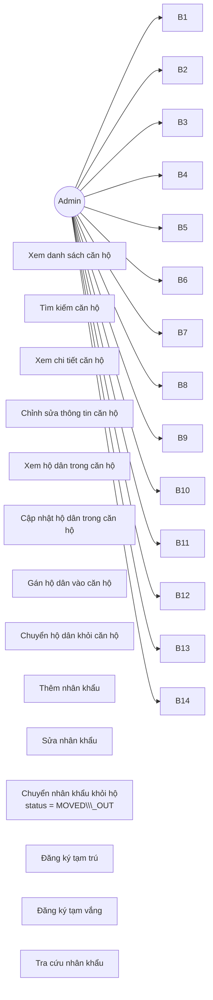

**M4 + M5 – Quản lý khoản thu, thu phí và thanh toán online**

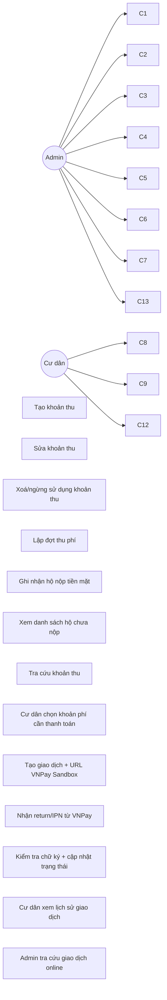

**M6 – Quản lý phí gửi xe**

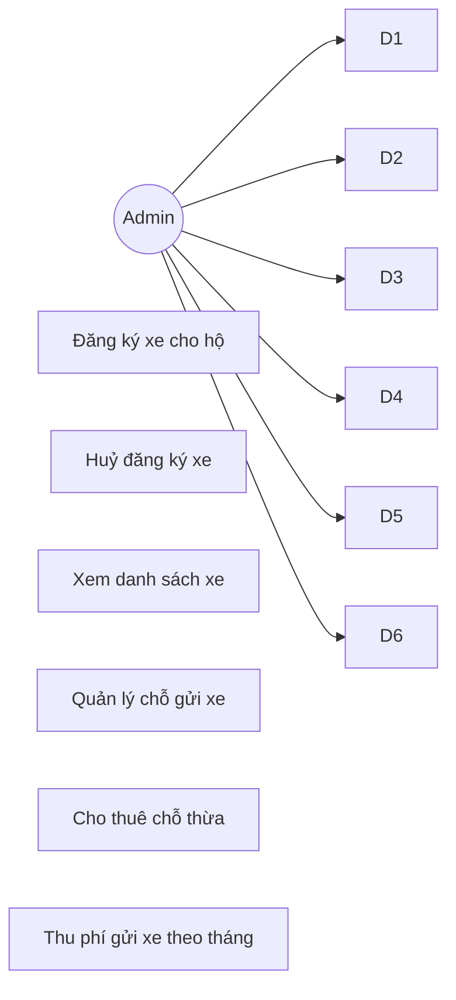

**M7 – Quản lý phí điện, nước, internet**

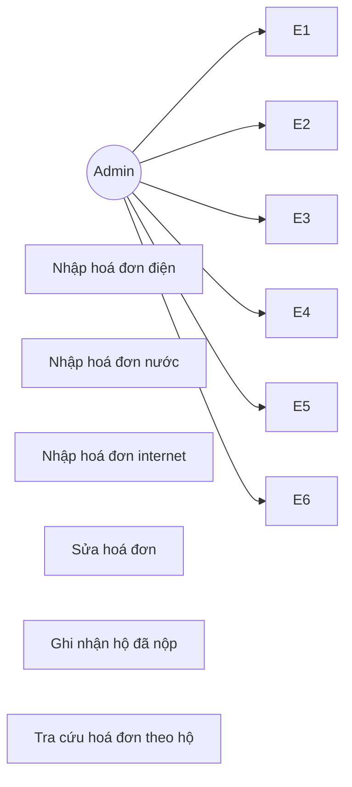

**M8 + M9 – Khiếu nại và thông báo**

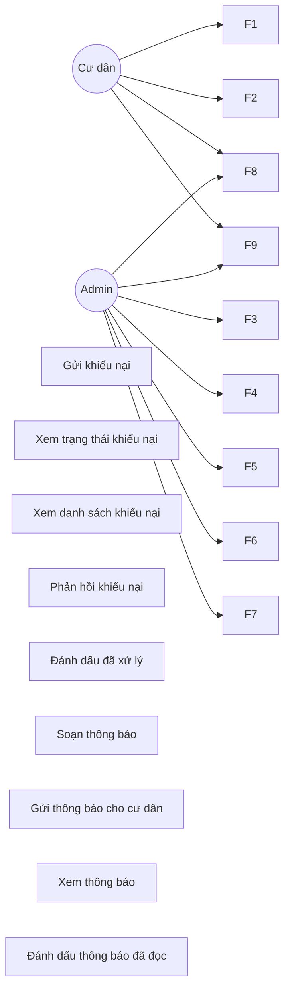

**M10 – Tra cứu, thống kê và xuất file**

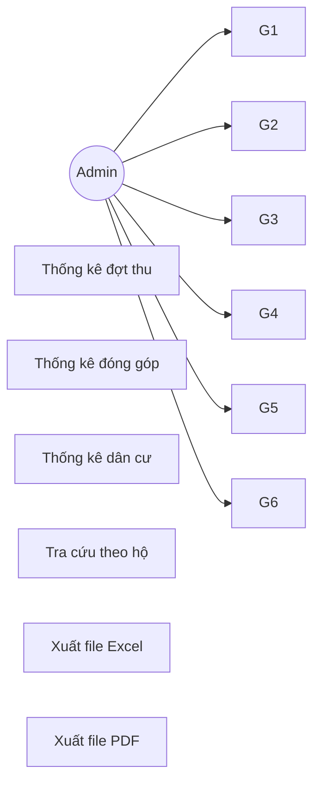

**M11 – Quản trị hệ thống (nhật ký, xoá mềm, cấu hình)**

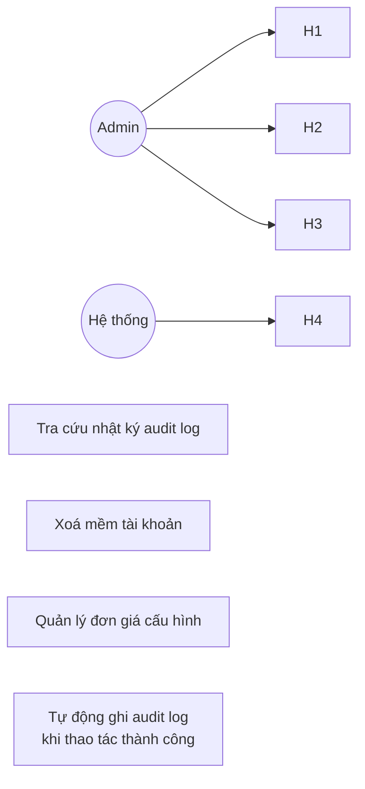

Ghi chú: H4 (ghi audit log) không phải thao tác thủ công của Admin mà do **AOP** tự sinh khi một method service gắn `@LogAdminAction` chạy thành công; do đó biểu diễn bằng tác nhân "Hệ thống".

### 4.3 Đặc tả chi tiết các use case quan trọng

#### UC-LOGIN: Đăng nhập

|Mục|Nội dung|
|-|-|
|**Tên use case**|Đăng nhập hệ thống|
|**Actor**|Admin, Cư dân|
|**Mục đích**|Xác thực người dùng và cấp JWT|
|**Tiền điều kiện**|Người dùng đã có tài khoản, tài khoản chưa bị khoá và đã được duyệt (`active = TRUE`)|
|**Hậu điều kiện**|Người dùng nhận được JWT và vào trang chính|
|**Luồng chính**|1. Người dùng nhập username + mật khẩu<br>2. Hệ thống kiểm tra username trong CSDL<br>3. Hệ thống so sánh mật khẩu băm BCrypt<br>4. Hệ thống sinh JWT chứa userId + role<br>5. Hệ thống trả JWT cho frontend<br>6. Frontend lưu JWT và chuyển sang trang chính theo role|
|**Luồng phụ**|Không có. Hệ thống không tự khoá tạm sau số lần sai mật khẩu; tài khoản chỉ bị vô hiệu khi `active = FALSE` (Admin chưa duyệt hoặc đã khoá tài khoản)|
|**Ngoại lệ**|Username không tồn tại → "Tài khoản không tồn tại"<br>Mật khẩu sai → "Mật khẩu không đúng"<br>Tài khoản bị khoá → "Tài khoản đã bị khoá"<br>`active = FALSE` → "Tài khoản chưa được duyệt"|

#### UC-REGISTER: Cư dân tự đăng ký tài khoản

|Mục|Nội dung|
|-|-|
|**Tên use case**|Cư dân tự đăng ký tài khoản (có xác thực OTP email)|
|**Actor**|Cư dân tự đăng ký (chưa đăng nhập, chưa có tài khoản)|
|**Mục đích**|Cho phép cư dân tự tạo tài khoản RESIDENT, xác thực email bằng OTP, sau đó chờ Admin duyệt|
|**Tiền điều kiện**|Người dùng chưa có tài khoản trong hệ thống|
|**Hậu điều kiện**|Tài khoản mới được tạo với role `RESIDENT`, email được xác thực, trạng thái chờ Admin duyệt (`active = FALSE`, `household\\\_id = NULL`); sau khi Admin gán hộ và kích hoạt thì cư dân mới đăng nhập được|
|**Luồng chính**|1. Người dùng (chưa đăng nhập) truy cập trang Đăng ký<br>2. Nhập: username, mật khẩu, xác nhận mật khẩu, họ tên, email, số điện thoại, mã căn hộ (`requested\\\_apartment\\\_code`)<br>3. Bấm "Gửi OTP"<br>4. Hệ thống kiểm tra dữ liệu hợp lệ, sinh OTP, hash OTP bằng BCrypt và gửi qua email (xem UC-VERIFY-OTP)<br>5. Cư dân nhập OTP nhận được<br>6. Hệ thống xác thực OTP<br>7. Hệ thống băm mật khẩu bằng BCrypt<br>8. Hệ thống lưu tài khoản với `role = RESIDENT`, `active = FALSE`, `household\\\_id = NULL`, `requested\\\_apartment\\\_code = <mã căn hộ cư dân nhập>`<br>9. Hệ thống hiển thị: "Đăng ký thành công, vui lòng chờ Ban quản trị duyệt"<br>10. Admin vào màn hình Quản lý tài khoản, xem các tài khoản chờ duyệt, gán `household\\\_id` phù hợp và bật `active = TRUE`|
|**Luồng phụ**|Bấm "Huỷ" → không tạo tài khoản, quay về trang Đăng nhập|
|**Ngoại lệ**|Username đã tồn tại; Mật khẩu và xác nhận không khớp; Mã căn hộ không tồn tại; OTP sai/hết hạn (xem UC-VERIFY-OTP)|

#### UC-VERIFY-OTP: Xác thực OTP email

|Mục|Nội dung|
|-|-|
|**Tên use case**|Xác thực email bằng mã OTP|
|**Actor**|Cư dân (trong luồng đăng ký hoặc quên mật khẩu, chưa đăng nhập)|
|**Mục đích**|Xác thực email người dùng bằng mã OTP gửi qua email|
|**Tiền điều kiện**|Người dùng đã yêu cầu gửi OTP (đăng ký, quên mật khẩu hoặc xác nhận thao tác)|
|**Hậu điều kiện**|OTP hợp lệ thì email được xác thực hoặc người dùng được phép tiếp tục thao tác (đặt lại mật khẩu)|
|**Luồng chính**|1. Người dùng nhập email<br>2. Hệ thống sinh OTP ngẫu nhiên (6 chữ số)<br>3. Hệ thống hash OTP bằng BCrypt và lưu vào CSDL (`email\\\_otps`) với `purpose`, `expired\\\_at = now + 5 phút`, `used = FALSE`, `failed\\\_attempts = 0`<br>4. Hệ thống gửi OTP về email qua `JavaMailSender`<br>5. Người dùng nhập OTP nhận được<br>6. Hệ thống kiểm tra OTP bằng `BCrypt.matches(inputOtp, otpHashFromDB)`, đồng thời kiểm tra OTP chưa hết hạn, chưa dùng, `failed\\\_attempts < 5`<br>7. Nếu hợp lệ → đặt `used = TRUE`, xác thực email hoặc cho phép đặt lại mật khẩu<br>8. Nếu sai → tăng `failed\\\_attempts`, báo lỗi|
|**Ngoại lệ**|OTP sai → "Mã OTP không đúng"<br>OTP hết hạn → "Mã OTP đã hết hạn"<br>OTP đã được sử dụng → "Mã OTP đã dùng, vui lòng yêu cầu mã mới"<br>Nhập sai quá số lần cho phép (5 lần) → khoá OTP, yêu cầu xin mã mới<br>Số lần gửi OTP vượt giới hạn (5 lần/15 phút/email) → "Vui lòng thử lại sau"|

#### UC-FORGOT-PASSWORD: Quên mật khẩu bằng OTP

|Mục|Nội dung|
|-|-|
|**Tên use case**|Quên mật khẩu – đặt lại bằng OTP gửi qua email|
|**Actor**|Cư dân (quên mật khẩu, chưa đăng nhập)|
|**Mục đích**|Cho phép người dùng đặt lại mật khẩu khi quên mật khẩu cũ|
|**Tiền điều kiện**|Người dùng có tài khoản với email đã đăng ký trong hệ thống|
|**Hậu điều kiện**|Mật khẩu được thay bằng mật khẩu mới đã băm BCrypt|
|**Luồng chính**|1. Người dùng mở trang "Quên mật khẩu"<br>2. Nhập email<br>3. Hệ thống tìm tài khoản theo email; nếu có → sinh OTP, hash bằng BCrypt, lưu vào `email\\\_otps` với `purpose = FORGOT\\\_PASSWORD`, gửi qua email<br>4. Người dùng nhập OTP + mật khẩu mới + xác nhận mật khẩu mới<br>5. Hệ thống kiểm tra OTP (xem UC-VERIFY-OTP)<br>6. Hệ thống băm mật khẩu mới bằng BCrypt và cập nhật vào bảng `users`<br>7. Hệ thống đặt OTP `used = TRUE`<br>8. Hiển thị "Đặt lại mật khẩu thành công"|
|**Ngoại lệ**|Email không tồn tại → vì lý do bảo mật, hệ thống vẫn trả "Nếu email tồn tại, OTP đã được gửi"<br>OTP sai/hết hạn (xem UC-VERIFY-OTP)<br>Mật khẩu mới không khớp xác nhận|

#### UC-CREATE-FEE: Tạo khoản thu

|Mục|Nội dung|
|-|-|
|**Tên use case**|Tạo khoản thu|
|**Actor**|Admin|
|**Mục đích**|Đăng ký một khoản thu mới vào hệ thống|
|**Tiền điều kiện**|Admin đã đăng nhập|
|**Hậu điều kiện**|Khoản thu mới được lưu vào CSDL|
|**Luồng chính**|1. Admin mở màn hình "Quản lý khoản thu"<br>2. Chọn "Tạo khoản thu mới"<br>3. Nhập: tên khoản thu, loại (bắt buộc/đóng góp), đơn giá (nếu có), đơn vị tính, ghi chú<br>4. Bấm "Lưu"<br>5. Hệ thống kiểm tra dữ liệu hợp lệ<br>6. Hệ thống lưu khoản thu và hiển thị thông báo thành công|
|**Luồng phụ**|Bấm "Huỷ" → đóng form, không lưu|
|**Ngoại lệ**|Thiếu trường bắt buộc; Tên khoản thu trùng|

#### UC-COLLECT-FEE: Xác nhận đã nộp tiền mặt

|Mục|Nội dung|
|-|-|
|**Tên use case**|Xác nhận hộ đã nộp đủ tiền mặt|
|**Actor**|Admin|
|**Mục đích**|Cho phép Admin xác nhận một phiếu nộp đã được cư dân nộp đủ bằng tiền mặt, không nhập|
|**Tiền điều kiện**|Admin đã đăng nhập; có đợt thu phí đang mở; phiếu nộp thuộc hộ cần xác nhận và đang ở trạng thái `UNPAID`|
|**Hậu điều kiện**|Phiếu nộp (`payments`) được cập nhật: `amount\\\_paid = amount\\\_due`, `status = PAID`, `payment\\\_method = CASH`, `paid\\\_date` và `paid\\\_at` được ghi nhận, `collected\\\_by` lưu Admin xác nhận|
|**Luồng chính**|1. Admin mở màn hình "Lập đợt thu / Thu phí"<br>2. Admin chọn đợt thu phí hoặc tìm kiếm hộ cần xác nhận<br>3. Hệ thống hiển thị số tiền phải nộp của phiếu nộp<br>4. Admin tích chọn hoặc bấm nút "Đã nộp tiền mặt"<br>5. Hệ thống hiển thị hộp xác nhận: "Xác nhận hộ này đã nộp đủ tiền mặt?"<br>6. Admin bấm "Xác nhận"<br>7. Hệ thống tự động đặt `amount\\\_paid = amount\\\_due`, `status = PAID`, `payment\\\_method = CASH`, `paid\\\_date = ngày hiện tại`, `paid\\\_at = thời điểm hiện tại`, `collected\\\_by = Admin hiện tại`<br>8. Hệ thống hiển thị thông báo "Xác nhận nộp tiền mặt thành công"|
|**Luồng phụ**|Admin bấm "Huỷ" ở hộp xác nhận → hệ thống không thay đổi dữ liệu|
|**Ngoại lệ**|Phiếu nộp đã `PAID` → không cho xác nhận lại<br>Phiếu nộp không tồn tại → báo lỗi<br>Admin không có quyền → 403 Forbidden|
|**Ghi chú thiết kế**|Phiên bản hiện tại không hỗ trợ nộp thiếu hoặc nộp một phần. Với thanh toán tiền mặt, hệ thống mặc định số tiền cư dân nộp luôn đúng và đủ, nên Admin chỉ xác nhận trạng thái đã nộp.|

#### UC-VNPAY-PAYMENT: Thanh toán online qua VNPay Sandbox

|Mục|Nội dung|
|-|-|
|**Tên use case**|Thanh toán online khoản phí/hoá đơn của hộ qua VNPay Sandbox|
|**Actor**|Cư dân|
|**Mục đích**|Cho phép cư dân thanh toán online một khoản phí/hoá đơn của hộ mình thông qua cổng VNPay Sandbox|
|**Tiền điều kiện**|Cư dân đã đăng nhập; tài khoản đã được gán với một household (`household\\\_id` không NULL, `active = TRUE`); có khoản phí/hoá đơn chưa thanh toán thuộc về household đó|
|**Hậu điều kiện**|- Giao dịch thành công → `payment\\\_transactions.status = SUCCESS`, khoản phí/hoá đơn tương ứng được cập nhật đã thanh toán<br>- Giao dịch thất bại/huỷ → `payment\\\_transactions.status = FAILED` hoặc `CANCELLED`, trạng thái khoản phí/hoá đơn không đổi|
|**Luồng chính**|1. Cư dân xem danh sách khoản phải nộp gồm phiếu nộp theo đợt thu và hoá đơn điện/nước/internet chưa thanh toán của hộ mình<br>2. Cư dân chọn khoản cần thanh toán → bấm "Thanh toán online"<br>3. Backend kiểm tra khoản phí thuộc household của cư dân; sinh `transaction\\\_code` duy nhất; tạo bản ghi `payment\\\_transactions` với `status = PENDING`, `target\\\_type`, `target\\\_id`, `amount`<br>4. Backend gọi `VnpayService` để tạo URL thanh toán VNPay Sandbox (ký HMAC-SHA512 trên tham số)<br>5. Backend trả `paymentUrl` về frontend<br>6. Frontend chuyển hướng cư dân sang trang thanh toán VNPay Sandbox<br>7. Cư dân thực hiện thanh toán trên VNPay Sandbox (chọn ngân hàng, nhập thông tin giả lập)<br>8. VNPay gọi IPN URL (`GET /api/payments/vnpay/ipn`) đến backend để xác nhận giao dịch; đồng thời trình duyệt cư dân được redirect về Return URL của backend (`GET /api/payments/vnpay/return`)<br>9. Backend kiểm tra chữ ký phản hồi (`vnp\\\_SecureHash`) ở cả IPN và Return; IPN là nguồn cập nhật trạng thái chính<br>10. Backend kiểm tra `transaction\\\_code`, số tiền, và `response\\\_code`<br>11. Nếu IPN hợp lệ và `vnp\\\_ResponseCode = "00"` → cập nhật `payment\\\_transactions.status = SUCCESS`, lưu `vnpay\\\_transaction\\\_no`, `vnpay\\\_bank\\\_code`, `vnpay\\\_pay\\\_date`; cập nhật bản ghi khoản phí/hoá đơn tương ứng là đã thanh toán<br>12. Backend Return URL redirect cư dân về trang kết quả thanh toán của frontend, frontend đọc trạng thái giao dịch đã lưu để hiển thị kết quả|
|**Luồng phụ**|Cư dân huỷ thanh toán trên VNPay → VNPay trả `vnp\\\_ResponseCode = "24"` → cập nhật `status = CANCELLED`|
|**Ngoại lệ**|- Thanh toán thất bại (`vnp\\\_ResponseCode ≠ "00"` và ≠ `"24"`) → `status = FAILED`<br>- Phản hồi sai chữ ký → từ chối, ghi log cảnh báo, không cập nhật<br>- Giao dịch đã được xử lý trước đó (idempotency) → bỏ qua, trả kết quả lần đầu<br>- Khoản phí/hoá đơn đã có giao dịch `PENDING` → trả lại `paymentUrl` cũ hoặc yêu cầu cư dân chờ/hủy giao dịch cũ, không tạo thêm giao dịch song song<br>- Số tiền phản hồi không khớp với `amount` hệ thống tạo → từ chối, ghi log cảnh báo<br>- `transaction\\\_code` không tồn tại trong hệ thống → từ chối<br>- Cư dân thử thanh toán khoản phí không thuộc household của mình → 403 Forbidden|

Ghi chú: Thanh toán VNPay hỗ trợ 4 loại `target\\\_type`:

* `FEE\\\_PAYMENT` — thanh toán một phiếu nộp theo đợt thu.
* `UTILITY\\\_BILL` — thanh toán một hoá đơn điện/nước/internet.
* `FEE\\\_PAYMENT\\\_BATCH` — thanh toán **gộp** nhiều phiếu nộp trong một giao dịch.
* `MIXED\\\_PAYMENT\\\_BATCH` — thanh toán **gộp** hỗn hợp cả phiếu nộp lẫn hoá đơn tiện ích trong một giao dịch.

Với các loại gộp, danh sách id và số tiền từng khoản được lưu ở `target\\\_ids` / `target\\\_amounts` / `utility\\\_bill\\\_ids`. Không thêm `PARKING\\\_FEE` làm `target\\\_type` riêng: phí gửi xe hằng tháng được tổng hợp thành một đợt thu trong `fee\\\_periods/payments` với khoản thu loại phí gửi xe (`unit = PER\\\_VEHICLE` hoặc `FIXED`). Vì vậy nếu cư dân thanh toán phí gửi xe online thì hệ thống vẫn xử lý qua `target\\\_type = FEE\\\_PAYMENT` (hoặc gộp chung trong một batch).

#### UC-VIEW-MY-PAYMENT-HISTORY: Cư dân xem lịch sử giao dịch online

|Mục|Nội dung|
|-|-|
|**Tên use case**|Cư dân xem lịch sử giao dịch thanh toán online của hộ mình|
|**Actor**|Cư dân|
|**Tiền điều kiện**|Cư dân đã đăng nhập, có `household\\\_id`|
|**Hậu điều kiện**|Cư dân thấy danh sách giao dịch online của household mình|
|**Luồng chính**|1. Cư dân vào màn hình "Lịch sử giao dịch online"<br>2. Frontend gọi `GET /api/payments/vnpay/my-history` (kèm JWT)<br>3. Backend lấy `household\\\_id` từ JWT, truy vấn `payment\\\_transactions WHERE household\\\_id = ?`<br>4. Frontend hiển thị bảng: mã giao dịch, khoản phí, số tiền, ngày, trạng thái|
|**Ngoại lệ**|Chưa có giao dịch nào → hiển thị danh sách trống|

#### UC-ADMIN-PAYMENT-LOOKUP: Admin tra cứu giao dịch online

|Mục|Nội dung|
|-|-|
|**Tên use case**|Admin tra cứu danh sách giao dịch thanh toán online|
|**Actor**|Admin|
|**Tiền điều kiện**|Admin đã đăng nhập|
|**Hậu điều kiện**|Admin xem được danh sách giao dịch online toàn hệ thống, có thể lọc theo trạng thái, hộ, khoảng thời gian|
|**Luồng chính**|1. Admin vào màn hình "Giao dịch thanh toán online"<br>2. Lọc theo trạng thái (PENDING/SUCCESS/FAILED/CANCELLED), hộ, ngày, `target\\\_type`<br>3. Frontend gọi `GET /api/admin/payment-transactions?status=…\\\&householdId=…\\\&fromDate=…\\\&toDate=…`<br>4. Backend trả danh sách `payment\\\_transactions` tương ứng (có phân trang)<br>5. Admin có thể xem chi tiết từng giao dịch|
|**Ngoại lệ**|–|

#### UC-COMPLAINT: Gửi khiếu nại

|Mục|Nội dung|
|-|-|
|**Tên use case**|Cư dân gửi khiếu nại|
|**Actor**|Cư dân|
|**Tiền điều kiện**|Cư dân đã đăng nhập|
|**Hậu điều kiện**|Khiếu nại được lưu với trạng thái "NEW"|
|**Luồng chính**|1. Cư dân vào màn hình "Khiếu nại của tôi"<br>2. Bấm "Gửi khiếu nại mới"<br>3. Nhập tiêu đề, chọn loại (FEE/SECURITY/CLEANING/OTHER), nội dung<br>4. Bấm "Gửi"<br>5. Hệ thống lưu khiếu nại và trả về mã khiếu nại<br>6. Hệ thống hiển thị thông báo "Đã gửi thành công"|
|**Ngoại lệ**|Tiêu đề hoặc nội dung trống → báo lỗi|

#### UC-HANDLE-COMPLAINT: Xử lý khiếu nại

|Mục|Nội dung|
|-|-|
|**Tên use case**|Phản hồi và đóng khiếu nại|
|**Actor**|Admin|
|**Tiền điều kiện**|Khiếu nại có trạng thái "NEW" hoặc "IN\_PROGRESS"|
|**Hậu điều kiện**|Khiếu nại có phản hồi, trạng thái cập nhật|
|**Luồng chính**|1. Admin mở danh sách khiếu nại<br>2. Chọn khiếu nại cần xử lý<br>3. Nhập nội dung phản hồi<br>4. Đổi trạng thái sang "IN\_PROGRESS" hoặc "RESOLVED"<br>5. Bấm "Lưu"<br>6. Hệ thống cập nhật khiếu nại và hiển thị phản hồi cho cư dân|

#### UC-NOTIFY: Gửi thông báo

|Mục|Nội dung|
|-|-|
|**Tên use case**|Gửi thông báo cho cư dân|
|**Actor**|Admin|
|**Tiền điều kiện**|Admin đã đăng nhập|
|**Hậu điều kiện**|Thông báo được lưu và hiển thị cho người nhận|
|**Luồng chính**|1. Admin vào màn hình "Thông báo"<br>2. Bấm "Soạn thông báo mới"<br>3. Nhập tiêu đề, nội dung<br>4. Chọn phạm vi: ALL / BY\_FLOOR / BY\_HOUSEHOLD<br>5. Bấm "Gửi"<br>6. Hệ thống tạo bản ghi notification và các bản ghi notification\_recipients tương ứng|
|**Ngoại lệ**|Không chọn người nhận → báo lỗi|

#### UC-EXPORT: Xuất báo cáo

|Mục|Nội dung|
|-|-|
|**Tên use case**|Xuất báo cáo Excel hoặc PDF|
|**Actor**|Admin|
|**Tiền điều kiện**|Đã chọn loại báo cáo và phạm vi dữ liệu|
|**Hậu điều kiện**|File Excel/PDF được tải về máy người dùng|
|**Luồng chính**|1. Admin vào màn hình "Thống kê và xuất file"<br>2. Chọn loại báo cáo (đợt thu, dân cư, đóng góp, giao dịch online…)<br>3. Chọn khoảng thời gian / phạm vi<br>4. Chọn định dạng Excel hoặc PDF<br>5. Bấm "Xuất file"<br>6. Backend sinh file, trả về frontend, trình duyệt tải về|

\---

## 5\. THIẾT KẾ KIẾN TRÚC

### 5.1 Kiến trúc tổng quan

Hệ thống thiết kế theo **kiến trúc 3 tầng (3-tier)** cho ứng dụng web, có tích hợp với hai dịch vụ ngoài: **SMTP server** (gửi email OTP) và **VNPay Sandbox** (cổng thanh toán):

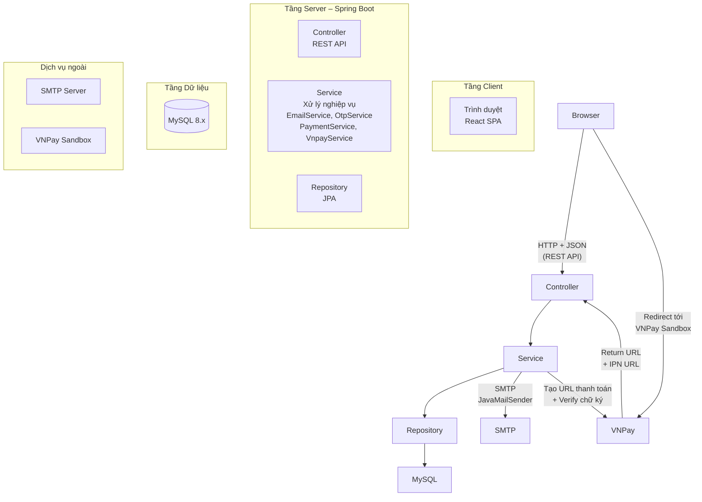

* **Tầng Client (React):** giao diện người dùng, gọi REST API. Khi thanh toán online, frontend chuyển hướng (redirect) cư dân sang trang thanh toán VNPay Sandbox.
* **Tầng Server (Spring Boot):** xử lý nghiệp vụ, phân quyền, truy xuất CSDL; gửi email OTP qua SMTP; tạo URL thanh toán VNPay Sandbox; nhận return/IPN từ VNPay và kiểm tra chữ ký.
* **Tầng Dữ liệu (MySQL):** lưu trữ dữ liệu lâu dài, bao gồm OTP đã hash và giao dịch thanh toán online.
* **Dịch vụ ngoài:**

  * **SMTP Server**: gửi email OTP (Gmail SMTP hoặc tương đương).
  * **VNPay Sandbox**: cổng thanh toán; nhận yêu cầu thanh toán, trả kết quả qua return URL và IPN URL.

### 5.2 Luồng kiến trúc cho 2 chức năng mới

**Luồng gửi/xác thực OTP qua email:**

1. Frontend gọi `POST /api/auth/send-otp` (hoặc `/forgot-password/send-otp`).
2. `OtpService` sinh OTP ngẫu nhiên 6 chữ số, hash bằng BCrypt, lưu vào `email\\\_otps`.
3. `EmailService` gọi `JavaMailSender` để gửi email OTP qua SMTP.
4. Frontend hiển thị form nhập OTP; gọi `POST /api/auth/verify-otp`.
5. `OtpService` so khớp hash, kiểm tra `expired\\\_at`, `used`, `failed\\\_attempts`.
6. Nếu hợp lệ → đánh dấu `used = TRUE`, hoàn tất xác thực; ngược lại tăng `failed\\\_attempts` và báo lỗi.

**Luồng thanh toán online qua VNPay Sandbox:**

1. Frontend gọi `POST /api/payments/vnpay/create-url` với `target\\\_type`, `target\\\_id` (hoặc danh sách khoản khi thanh toán gộp).
2. `PaymentService` kiểm tra khoản phí thuộc household của cư dân (lấy từ JWT), sinh `transaction\\\_code` duy nhất, lưu `payment\\\_transactions` với `status = PENDING`.
3. `VnpayService` xây tham số `vnp\\\_\\\*`, ký HMAC-SHA512 bằng secret key VNPay → trả về `paymentUrl`.
4. Frontend nhận `paymentUrl`, chuyển hướng cư dân sang VNPay Sandbox.
5. Cư dân thanh toán; VNPay gọi `GET /api/payments/vnpay/ipn` từ server đến server để xác nhận chính thức, đồng thời redirect trình duyệt cư dân về `GET /api/payments/vnpay/return` trên backend.
6. `VnpayService` kiểm tra `vnp\\\_SecureHash`, đối chiếu `transaction\\\_code`, `amount`, `vnp\\\_ResponseCode`.
7. Nếu hợp lệ và thành công → `PaymentService` cập nhật `payment\\\_transactions.status = SUCCESS`, cập nhật khoản phí/hoá đơn tương ứng (`payments.status = PAID` với `payment\\\_method = ONLINE`, hoặc `utility\\\_bills.status = PAID`, `payment\\\_method = ONLINE`).
8. Backend Return URL: nếu giao dịch còn `PENDING` (IPN chưa tới) thì chốt trạng thái dự phòng sau khi verify chữ ký + khớp số tiền; nếu đã ở trạng thái cuối thì chỉ đọc trạng thái. Sau đó redirect cư dân về trang kết quả của frontend; frontend chỉ hiển thị trạng thái đã lưu, không tự quyết định giao dịch thành công/thất bại.
9. Đảm bảo idempotency: một giao dịch chỉ được cập nhật một lần; IPN và Return không ghi đè lẫn nhau.

### 5.3 Kiến trúc backend – cấu trúc package

Backend áp dụng **kiến trúc phân lớp (Layered Architecture)**, base package thực tế là `org.example.backend`, với các package:

```
org.example.backend
├── controller     // 18 REST controller, xử lý HTTP request
├── service        // Logic nghiệp vụ (gồm cả EmailService, OtpService,
│   │              //   VnpayService, PaymentService, AuditLogService, ReportService...)
│   ├── mapper     // Chuyển Entity ↔ DTO thủ công (ẩn field nhạy cảm)
│   └── report     // Sinh báo cáo Excel (Apache POI) và PDF (OpenPDF)
├── repository     // Truy xuất CSDL (Spring Data JPA)
│   └── projection // Các projection cho truy vấn thống kê
├── entity         // 19 Entity ánh xạ bảng CSDL
│   └── enums      // 14 enum trạng thái/loại
├── dto            // Đối tượng truyền dữ liệu giữa FE và BE
│   ├── request    // Request DTO + Bean Validation
│   └── response   // ApiResponse<T>, PageResponse<T> và các response DTO
├── security       // JwtUtil, JwtFilter, SecurityConfig, CustomUserDetails(Service),
│                  //   CurrentUserService (JWT, BCrypt, cấu hình Spring Security)
├── aspect         // LogAdminAction, AuditAspect, AuditContext (ghi audit log qua AOP)
├── exception      // GlobalExceptionHandler, NotFoundException, BadRequestException
├── config         // CorsConfig, OpenApiConfig, VnpayConfig, InitialDataConfig,
│                  //   DatabaseInitializerConfig (CORS, Swagger, VNPay, seed data)
└── BackendApplication.java   // @SpringBootApplication, lớp main
```

Khác với bản thiết kế ban đầu, EmailService/OtpService, VnpayService/VnpayConfig và AuditLogService **không** nằm trong các package riêng `email`/`payment`/`audit`: phần gửi email và thanh toán đặt trong `service` (+ `config.VnpayConfig`), còn cơ chế audit log được tách thành package `aspect` triển khai bằng **Spring AOP** (annotation `@LogAdminAction` + `AuditAspect`) thay vì gọi `AuditLogService` thủ công ở từng nơi.

Sơ đồ package:

```mermaid
graph TB
    Controller\\\["controller — 18 REST controller<br/>AuthController, UserController, ProfileController<br/>ApartmentController, HouseholdController, ResidentController<br/>FeeController, FeePeriodController, PaymentController<br/>PaymentVnpayController, UtilityBillController<br/>ParkingController, VehicleController<br/>ComplaintController, NotificationController<br/>SystemConfigController, ReportController, AuditLogController"]
    Service\\\["service<br/>AuthService, OtpService, EmailService<br/>UserService, ApartmentService<br/>HouseholdLifecycleService, ResidentService<br/>FeeService, FeePeriodService, PaymentService<br/>VnpayService, UtilityBillService, UtilityFeeService<br/>ParkingService, ParkingFeeService, VehicleService<br/>ComplaintService, NotificationService<br/>SystemConfigService, ReportService, AuditLogService<br/>+ mapper/ + report/"]
    Repository\\\["repository<br/>UserRepository, RoleRepository, EmailOtpRepository<br/>ApartmentRepository, HouseholdRepository, ResidentRepository<br/>FeeRepository, FeePeriodRepository, PaymentRepository<br/>PaymentTransactionRepository, UtilityBillRepository<br/>ParkingSlotRepository, ParkingRegistrationRepository, VehicleRepository<br/>ComplaintRepository, NotificationRepository, NotificationRecipientRepository<br/>SystemConfigRepository, AuditLogRepository + projection/"]
    Entity\\\["entity — 19 Entity<br/>User, Role, EmailOtp<br/>Apartment, Household, Resident<br/>Fee, FeePeriod, Payment, PaymentTransaction<br/>UtilityBill, Vehicle, ParkingSlot, ParkingRegistration<br/>Complaint, Notification, NotificationRecipient<br/>SystemConfig, AuditLog + enums/"]
    DTO\\\["dto<br/>request/ — Request DTO + Bean Validation<br/>response/ — ApiResponse, PageResponse, response DTO"]
    Security\\\["security<br/>JwtUtil, JwtFilter, SecurityConfig<br/>CustomUserDetails, CustomUserDetailsService, CurrentUserService"]
    Aspect\\\["aspect<br/>@LogAdminAction<br/>AuditAspect, AuditContext"]
    Config\\\["config<br/>CorsConfig, OpenApiConfig, VnpayConfig<br/>InitialDataConfig, DatabaseInitializerConfig"]
    Exception\\\["exception<br/>GlobalExceptionHandler<br/>NotFoundException, BadRequestException"]

    Controller --> Service
    Controller --> DTO
    Service --> Repository
    Service --> Entity
    Service -.->|@LogAdminAction| Aspect
    Aspect --> Repository
    Repository --> Entity
    Controller --> Security
    Controller -.-> Exception
```

**Vai trò các service chính:**

* `EmailService`: bao bọc `JavaMailSender`, gửi email OTP qua SMTP (dev dùng Mailtrap).
* `OtpService`: sinh OTP ngẫu nhiên, hash bằng BCrypt, lưu vào `email\\\_otps`, kiểm tra OTP (hash khớp + chưa hết hạn + chưa dùng + chưa quá `failed\\\_attempts`), kiểm soát rate-limit (5 lần/15 phút/email).
* `PaymentService`: tạo `PaymentTransaction` với `status = PENDING`, sinh `transaction\\\_code` duy nhất, cập nhật trạng thái sau khi nhận kết quả VNPay, đồng thời cập nhật bản ghi khoản phí/hoá đơn tương ứng; xác nhận nộp tiền mặt.
* `VnpayService`: xây URL thanh toán VNPay Sandbox, tính `vnp\\\_SecureHash` bằng HMAC-SHA512, kiểm tra chữ ký phản hồi từ VNPay khi nhận return/IPN.
* `AuditLogService`: ghi và tra cứu bảng `audit\\\_logs`. **Việc ghi log không gọi thủ công ở từng service** mà được kích hoạt tự động qua AOP: annotation `@LogAdminAction(entity, action, description, detail)` đặt trên method service, `AuditAspect` (advice `@AfterReturning`) chỉ ghi log khi method thành công và có user đăng nhập.
* `ReportService` (+ package `service/report`): sinh báo cáo thống kê và xuất Excel (Apache POI) / PDF (OpenPDF).
* `SystemConfigService`: quản lý đơn giá cấu hình (điện, nước, internet, phí gửi xe máy/ô tô) lưu trong bảng `system\\\_configs`.

**Không thiết kế:** `PaymentGatewayService` tổng quát, `MockPaymentService`, cổng thanh toán khác ngoài VNPay Sandbox.

### 5.4 Cấu trúc frontend (React)

Frontend dùng **React 19 + Vite + Tailwind CSS 4 + react-router-dom 7 + axios**, đặt trong thư mục `Frontend/`. Cây `src/` thực tế:

```
src/
├── api/           // axiosClient.js + 15 module API theo domain (16 file)
│   ├── axiosClient.js   // instance axios: baseURL http://localhost:9090, gắn JWT,
│   │                    //   401/403 → auto logout, callApi() chuẩn hoá ApiResponse
│   ├── authApi.js, otpApi.js, apartmentApi.js, householdApi.js, residentApi.js
│   ├── feeApi.js, paymentApi.js, vnpayApi.js, utilityApi.js, vehicleApi.js
│   ├── complaintApi.js, notificationApi.js, reportApi.js
│   └── auditLogApi.js, systemConfigApi.js
├── components/
│   ├── common/index.jsx   // Button, Card, DataTable, Input, Select, Badge, StatusBadge, Pagination
│   ├── layout/Layout.jsx, layout/SectionHeader.jsx  // sidebar + header + điều hướng theo state `active`
│   └── auth/AuthShell.jsx // khung dùng chung cho các trang xác thực
├── pages/         // Mỗi màn hình một file
│   ├── LoginPage, RegisterPage, ForgotPasswordPage, OtpVerifyPage, IntroductionPage
│   ├── Dashboard, Registrations, Accounts, Profile
│   ├── Apartments, Residents
│   ├── Fees, Payments, MyFees
│   ├── Vehicles, Utilities
│   ├── Complaints, Notifications
│   ├── Statistics, AuditLogs
│   └── VnpayReturnPage
├── routes/        // AppRoutes.jsx (public/protected), ProtectedRoute.jsx, AppShell.jsx
├── context/       // AuthContext.jsx – lưu JWT + thông tin user (key localStorage `bluemoon\\\_auth`)
├── data/          // navigation.js – menu Admin/Resident
└── utils/         // helpers.js (money()), logger.js
```

Giải thích:

* `Apartments`: màn hình quản lý danh sách căn hộ, tìm kiếm/lọc và xem trạng thái; vào chi tiết để xem/cập nhật hộ dân và nhân khẩu trong căn hộ.
* `MyFees`, `VnpayReturnPage`: trang cư dân xem khoản phí của hộ và trang nhận kết quả sau khi thanh toán VNPay (`/payment-result`).
* Toàn bộ giao diện dùng **Tailwind CSS** (không CSS module/CSS-in-JS); gọi backend **chỉ qua các module trong `api/`**, không gọi axios trực tiếp.

### 5.5 Quy ước REST API

URL có dạng `/api/<tài\\\_nguyên>`, sử dụng các HTTP method:

|Method|Mục đích|Ví dụ|
|-|-|-|
|GET|Đọc dữ liệu|`GET /api/households`|
|POST|Tạo mới|`POST /api/fees`|
|PUT|Cập nhật|`PUT /api/households/{id}`|
|DELETE|Xoá|`DELETE /api/fees/{id}`|

Mỗi request (trừ các endpoint PUBLIC như `/api/auth/login`, `/api/auth/register`, `/api/auth/send-otp`, `/api/auth/verify-otp`, `/api/auth/forgot-password/\\\*`, `/api/auth/reset-password`, `/api/payments/vnpay/return`, `/api/payments/vnpay/ipn`) đều phải gửi header `Authorization: Bearer <JWT>`.

Controller không trả trực tiếp Entity JPA cho frontend. Mọi dữ liệu trả về phải được ánh xạ sang DTO để tránh vòng lặp JSON giữa các quan hệ hai chiều (`User` - `Household` - `Resident`) và tránh lộ trường nhạy cảm như `password\\\_hash`, `otp\\\_hash`.

Định dạng response thống nhất:

```json
{
  "success": true,
  "data": {},
  "message": "..."
}
```

Khi có lỗi:

```json
{
  "success": false,
  "errorCode": "FEE\\\_NOT\\\_FOUND",
  "message": "Không tìm thấy khoản thu"
}
```

### 5.6 Danh sách REST API chi tiết

**Tài khoản và xác thực:**

|Method|Endpoint|Quyền|Mục đích|
|-|-|-|-|
|POST|`/api/auth/send-otp` (≡ `/register/send-otp`)|PUBLIC|Gửi OTP đăng ký; backend cố định `purpose = REGISTER` (không lấy từ body)|
|POST|`/api/auth/verify-otp` (≡ `/register/verify-otp`)|PUBLIC|Xác thực OTP đăng ký; backend cố định `purpose = REGISTER`|
|POST|`/api/auth/register`|PUBLIC|Cư dân tự đăng ký tài khoản (sau khi OTP đăng ký đã hợp lệ)|
|POST|`/api/auth/login`|PUBLIC|Đăng nhập, trả JWT|
|POST|`/api/auth/forgot-password/send-otp`|PUBLIC|Gửi OTP cho luồng quên mật khẩu; body: `{ email }`|
|POST|`/api/auth/reset-password`|PUBLIC|Đặt lại mật khẩu sau khi OTP hợp lệ; body: `{ email, otp, newPassword }`|
|POST|`/api/users`|ADMIN|Tạo tài khoản nội bộ|
|GET|`/api/users`|ADMIN|Danh sách toàn bộ tài khoản|
|GET|`/api/users/pending`|ADMIN|Lấy danh sách tài khoản cư dân chờ duyệt|
|PUT|`/api/users/{id}`|ADMIN|Sửa thông tin tài khoản|
|PUT|`/api/users/{id}/approve`|ADMIN|Duyệt tài khoản cư dân, gán hộ, bật `active = TRUE`|
|DELETE|`/api/users/{id}/reject`|ADMIN|Từ chối tài khoản cư dân đang chờ duyệt|
|DELETE|`/api/users/{id}`|ADMIN|Xoá mềm tài khoản (đặt `deleted = TRUE`)|
|POST|`/api/users/grant-access`|ADMIN|Cấp tài khoản truy cập cho một nhân khẩu/hộ|
|PUT|`/api/users/{id}/lock`|ADMIN|Khoá tài khoản|
|PUT|`/api/users/{id}/unlock`|ADMIN|Mở khoá tài khoản|
|GET|`/api/me/profile`|ADMIN, RESIDENT|Xem hồ sơ cá nhân|
|PUT|`/api/me/profile/update`|ADMIN, RESIDENT|Cập nhật hồ sơ cá nhân|
|PUT|`/api/me/password`|ADMIN, RESIDENT|Đổi mật khẩu của chính mình|

**Căn hộ và hộ dân:**

|Method|Endpoint|Quyền|Mục đích|
|-|-|-|-|
|GET|`/api/apartments`|ADMIN|Danh sách căn hộ|
|GET|`/api/apartments/{id}`|ADMIN|Chi tiết căn hộ|
|GET|`/api/apartments/search`|ADMIN|Tìm kiếm căn hộ|
|PUT|`/api/apartments/{id}`|ADMIN|Sửa thông tin căn hộ|
|GET|`/api/apartments/{id}/household`|ADMIN|Hộ dân đang ở trong căn hộ|
|POST|`/api/apartments/{id}/household`|ADMIN|Gán hộ mới vào căn hộ trống|
|PUT|`/api/apartments/{id}/household`|ADMIN|Cập nhật/chuyển hộ trong căn hộ|
|POST|`/api/households/move-in`|ADMIN|Tạo hộ mới chuyển vào (move-in)|
|POST|`/api/households/{householdId}/members`|ADMIN|Thêm nhân khẩu (thành viên) vào hộ|
|POST|`/api/households/{householdId}/move-out`|ADMIN|Chuyển cả hộ ra (đặt `Household.status = MOVED\\\_OUT`)|
|GET|`/api/households/{householdId}/accounts`|ADMIN|Xem các tài khoản gắn với hộ|

(Không có `POST /api/apartments` và `DELETE /api/apartments/{id}` vì số căn hộ cố định. Việc tra cứu/quản lý nhân khẩu của hộ dùng các endpoint `/api/residents` bên dưới.)

**Nhân khẩu:**

|Method|Endpoint|Quyền|Mục đích|
|-|-|-|-|
|GET|`/api/residents`|ADMIN|Tra cứu danh sách nhân khẩu, lọc theo căn hộ/hộ dân/trạng thái cư trú|
|POST|`/api/residents`|ADMIN|Thêm nhân khẩu vào một Household ACTIVE|
|GET|`/api/residents/{id}`|ADMIN|Xem chi tiết nhân khẩu|
|PUT|`/api/residents/{id}`|ADMIN|Sửa thông tin nhân khẩu|
|PUT|`/api/residents/{id}/move-out`|ADMIN|Chuyển nhân khẩu khỏi hộ, cập nhật `status = MOVED\\\_OUT`, không xoá vật lý|
|PUT|`/api/residents/{id}/temporary-residence`|ADMIN|Đăng ký/cập nhật tạm trú, đặt `residency\\\_status = TEMPORARY`|
|PUT|`/api/residents/{id}/permanent-residence`|ADMIN|Chuyển về thường trú, đặt `residency\\\_status = PERMANENT`|


**Khoản thu và thu phí:**

|Method|Endpoint|Quyền|Mục đích|
|-|-|-|-|
|GET|`/api/fees`|ADMIN|Danh sách khoản thu, có phân trang/lọc|
|GET|`/api/fees/{id}`|ADMIN|Xem chi tiết khoản thu|
|GET|`/api/fees/search`|ADMIN|Tìm kiếm khoản thu theo tên, loại, trạng thái|
|POST|`/api/fees`|ADMIN|Tạo khoản thu|
|PUT|`/api/fees/{id}`|ADMIN|Sửa khoản thu|
|DELETE|`/api/fees/{id}`|ADMIN|Xoá/ngừng sử dụng khoản thu khi chưa phát sinh dữ liệu liên quan|
|GET|`/api/fee-periods`|ADMIN|Danh sách đợt thu phí|
|GET|`/api/fee-periods/{id}`|ADMIN|Xem chi tiết một đợt thu phí|
|POST|`/api/fee-periods`|ADMIN|Lập đợt thu phí (tự sinh `payments`)|
|PUT|`/api/fee-periods/{id}`|ADMIN|Cập nhật thông tin đợt thu phí|
|PUT|`/api/fee-periods/{id}/close`|ADMIN|Đóng đợt thu phí|
|GET|`/api/admin/payments`|ADMIN|Tra cứu phiếu nộp (lọc theo đợt thu/hộ/trạng thái)|
|PUT|`/api/admin/payments/{id}/confirm-cash`|ADMIN|Xác nhận phiếu nộp đã nộp đủ tiền mặt; hệ thống tự đặt `amount\\\_paid = amount\\\_due` và `status = PAID`|
|GET|`/api/payments/my-household`|RESIDENT|Cư dân xem phiếu nộp của hộ mình|
|GET|`/api/utility-bills/my-household`|RESIDENT|Cư dân xem hoá đơn điện/nước/internet của hộ mình|

**Thanh toán online qua VNPay Sandbox:**

|Method|Endpoint|Quyền|Mục đích|
|-|-|-|-|
|POST|`/api/payments/vnpay/create-url`|RESIDENT|Tạo giao dịch VNPay Sandbox và trả về `paymentUrl`. Body: `{ targetType, targetId, ... }` (hỗ trợ thanh toán gộp nhiều khoản)|
|GET|`/api/payments/vnpay/return`|PUBLIC|Return URL nhận redirect trình duyệt từ VNPay Sandbox. Backend kiểm tra chữ ký, kiểm tra khớp số tiền, và nếu giao dịch còn `PENDING` thì chốt trạng thái dự phòng (cập nhật transaction + khoản phí/hoá đơn) trong trường hợp IPN chưa tới; nếu giao dịch đã ở trạng thái cuối thì chỉ đọc trạng thái. Sau đó redirect cư dân về trang kết quả của frontend.|
|GET|`/api/payments/vnpay/ipn`|PUBLIC|Nhận thông báo IPN từ VNPay Sandbox (server-to-server). Backend kiểm tra `vnp\\\_SecureHash`; đây là nguồn xác nhận chính (server-to-server) để cập nhật trạng thái thanh toán.|
|GET|`/api/payments/vnpay/my-history`|RESIDENT|Cư dân xem lịch sử giao dịch VNPay của hộ mình|
|GET|`/api/admin/payment-transactions`|ADMIN|Admin tra cứu toàn bộ giao dịch online (có thể lọc theo `status`, `householdId`, `fromDate`, `toDate`, `targetType`)|
|GET|`/api/admin/payment-transactions/{id}`|ADMIN|Admin xem chi tiết một giao dịch online|

Ghi chú phân quyền: `POST /api/payments/vnpay/create-url` chỉ dành cho **RESIDENT** là có chủ ý. Admin không thanh toán online hộ cư dân để tránh sai lệch audit log và trách nhiệm thanh toán. Khi cần kiểm thử VNPay Sandbox hoặc khắc phục lỗi, Admin/nhóm phát triển sử dụng một tài khoản Resident test đã được gán vào Household test; Admin chỉ tra cứu/đối soát giao dịch qua các endpoint `/api/admin/payment-transactions`.

**Phương tiện, tiện ích, khiếu nại, thông báo:**

|Method|Endpoint|Quyền|Mục đích|
|-|-|-|-|
|POST|`/api/vehicles`|ADMIN|Đăng ký xe cho hộ|
|PUT|`/api/vehicles/{id}`|ADMIN|Cập nhật xe|
|DELETE|`/api/vehicles/{id}`|ADMIN|Xoá đăng ký xe|
|GET|`/api/vehicles/household/{householdId}`|ADMIN|Danh sách xe theo hộ|
|GET|`/api/vehicles/my-household`|RESIDENT|Cư dân xem xe của hộ mình|
|GET|`/api/parking-slots`|ADMIN|Danh sách chỗ gửi xe|
|GET|`/api/parking-slots/summary`|ADMIN|Thống kê chỗ gửi (tổng/đã dùng/còn trống)|
|POST|`/api/parking-registrations`|ADMIN|Đăng ký/cho thuê chỗ gửi xe|
|PUT|`/api/parking-registrations/{id}/end`|ADMIN|Kết thúc đăng ký gửi xe (`status = ENDED`)|
|POST|`/api/admin/parking-fees/generate`|ADMIN|Sinh phí gửi xe theo tháng|
|GET|`/api/parking-registrations/my-household`|RESIDENT|Cư dân xem đăng ký gửi xe của hộ|
|POST|`/api/utility-bills`|ADMIN|Tạo hoá đơn điện/nước/internet|
|POST|`/api/utility-bills/import`|ADMIN|Nhập hoá đơn hàng loạt từ file Excel|
|GET|`/api/utility-bills/import-template`|ADMIN|Tải file Excel mẫu để nhập hoá đơn|
|POST|`/api/admin/utility-fees/generate`|ADMIN|Sinh hoá đơn tiện ích theo định mức cấu hình|
|PUT|`/api/utility-bills/{id}`|ADMIN|Sửa hoá đơn|
|DELETE|`/api/utility-bills/{id}`|ADMIN|Xoá hoá đơn|
|PUT|`/api/admin/utility-bills/{id}/confirm-cash`|ADMIN|Xác nhận hoá đơn đã nộp tiền mặt; đặt `status = PAID`, `payment\\\_method = CASH`|
|GET|`/api/utility-bills`|ADMIN|Danh sách hoá đơn (lọc theo hộ/tháng)|
|GET|`/api/utility-bills/{id}`|ADMIN|Chi tiết hoá đơn|
|POST|`/api/complaints`|RESIDENT|Gửi khiếu nại|
|GET|`/api/complaints/my`|RESIDENT|Khiếu nại của tôi|
|GET|`/api/complaints/{id}`|ADMIN, RESIDENT|Chi tiết khiếu nại (RESIDENT chỉ xem khiếu nại do mình gửi)|
|GET|`/api/complaints`|ADMIN|Danh sách khiếu nại|
|PUT|`/api/complaints/{id}/response`|ADMIN|Phản hồi/đổi trạng thái khiếu nại|
|POST|`/api/notifications`|ADMIN|Gửi thông báo|
|GET|`/api/notifications/my`|ADMIN, RESIDENT|Thông báo gửi cho user hiện tại|
|GET|`/api/notifications/sent`|ADMIN|Thông báo Admin đã gửi|
|PUT|`/api/notifications/{id}/read`|ADMIN, RESIDENT|Đánh dấu đã đọc|
|PUT|`/api/notifications/{id}/unread`|ADMIN, RESIDENT|Đánh dấu chưa đọc|
|GET|`/api/system-configs`|ADMIN, RESIDENT|Xem đơn giá cấu hình (điện/nước/internet/gửi xe)|
|PUT|`/api/system-configs/{key}`|ADMIN|Cập nhật một đơn giá cấu hình|
|GET|`/api/reports/fee-periods/statistics`|ADMIN|Thống kê tình trạng các đợt thu|
|GET|`/api/reports/households/statistics`|ADMIN|Thống kê theo hộ gia đình|
|GET|`/api/reports/residents/statistics`|ADMIN|Thống kê dân cư, nhân khẩu, tạm trú/tạm vắng|
|GET|`/api/reports/fee-periods/excel` · `/pdf`|ADMIN|Xuất báo cáo đợt thu (Excel/PDF)|
|GET|`/api/reports/households/excel` · `/pdf`|ADMIN|Xuất báo cáo hộ gia đình (Excel/PDF)|
|GET|`/api/reports/residents/excel` · `/pdf`|ADMIN|Xuất báo cáo dân cư (Excel/PDF)|
|GET|`/api/reports/payment-transactions/excel` · `/pdf`|ADMIN|Xuất báo cáo giao dịch online (Excel/PDF)|
|GET|`/api/admin/audit-logs`|ADMIN|Tra cứu audit log (phân trang, mới nhất trước)|

\---

## 6\. THIẾT KẾ LỚP

### 6.1 Tổng quan các lớp chính

Hệ thống có **19 lớp Entity chính**, chia thành 9 nhóm:

|Nhóm|Lớp|
|-|-|
|Tài khoản|User, Role|
|Xác thực OTP|EmailOtp|
|Cư trú|Apartment, Household, Resident|
|Thu phí|Fee, FeePeriod, Payment|
|Giao dịch online|PaymentTransaction|
|Phương tiện và Tiện ích|Vehicle, ParkingSlot, ParkingRegistration, UtilityBill|
|Tương tác|Complaint, Notification, NotificationRecipient|
|Cấu hình hệ thống|SystemConfig|
|Nhật ký hệ thống|AuditLog|

**Nguyên tắc thiết kế:** Entity chỉ giữ dữ liệu và các hành vi đơn giản (getter/setter, hàm tiện ích). Logic xác thực, sinh danh sách phải thu, ghi nhận thanh toán, xử lý thanh toán online và ghi audit log được đặt trong các Service tương ứng (`AuthService`, `FeePeriodService`, `PaymentService`, `VnpayService`, `OtpService`, `EmailService`, `AuditLogService`).

### 6.2 Sơ đồ lớp nhóm Tài khoản, OTP và Cư trú

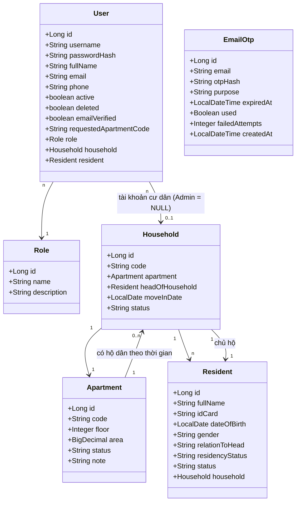

**Ràng buộc nghiệp vụ Apartment ↔ Household:** Một căn hộ có thể từng có nhiều hộ dân theo thời gian, **nhưng tại một thời điểm chỉ có tối đa một hộ dân có trạng thái ACTIVE**. Khi hộ chuyển đi, đặt `Household.status = MOVED\\\_OUT`; khi cần gán hộ mới, tạo bản ghi `Household` mới với cùng `apartment\\\_id` và `status = ACTIVE`. Không cần bảng lịch sử riêng.

**Ghi chú serialize JSON và DTO:** Quan hệ `User → Household`, `Household → Resident (headOfHousehold)` và `Resident → Household` có thể tạo vòng tham chiếu khi serialize JSON nếu Controller trả trực tiếp Entity JPA. Vì vậy Controller **không trả trực tiếp Entity** cho frontend mà phải chuyển sang DTO (`UserDTO`, `HouseholdDTO`, `ResidentDTO`, ...). Nếu trong một số trường hợp vẫn cần serialize Entity, phải chặn một chiều quan hệ bằng `@JsonIgnore`, `@JsonBackReference/@JsonManagedReference` hoặc cấu hình tương đương để tránh lỗi vòng lặp JSON và tránh lộ dữ liệu nhạy cảm như `passwordHash`.

### 6.3 Sơ đồ lớp nhóm Thu phí và Giao dịch online

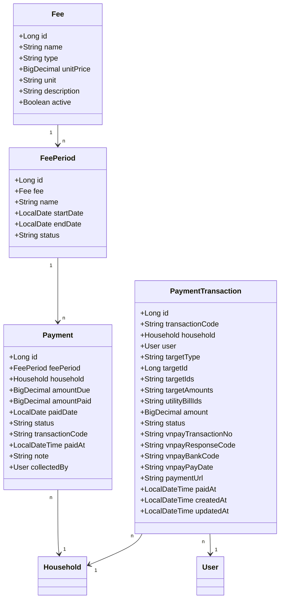

### 6.4 Sơ đồ lớp nhóm Phương tiện và Tiện ích

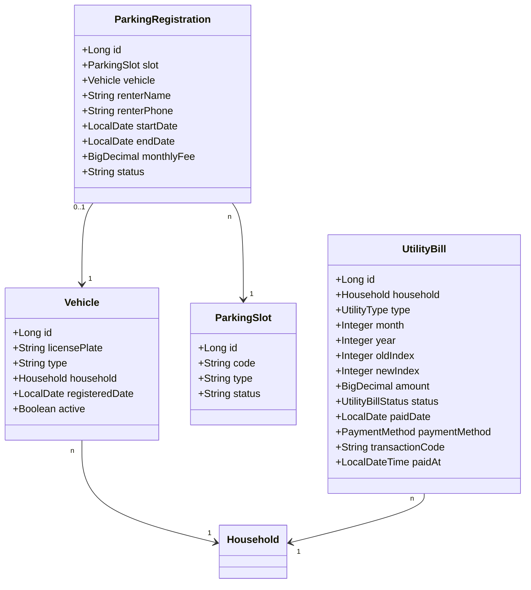

### 6.5 Sơ đồ lớp nhóm Tương tác và Nhật ký hệ thống

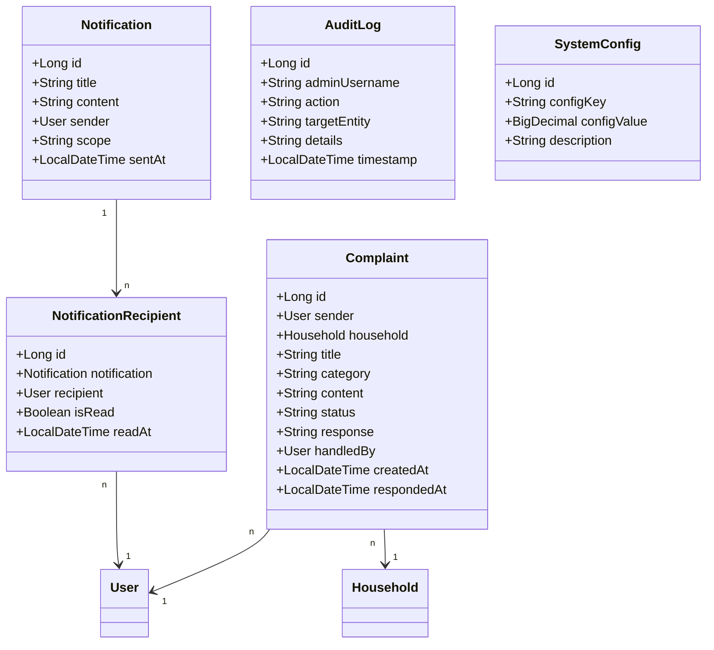

**Lưu ý về AuditLog:** khác bản thiết kế ban đầu, `AuditLog` **không** tham chiếu khoá ngoại tới `User` mà chỉ lưu `adminUsername` (chuỗi) của người thao tác. Bản ghi được sinh **tự động qua AOP** (`@LogAdminAction` + `AuditAspect`, advice `@AfterReturning`) chỉ khi method service chạy thành công và có user đăng nhập trong `SecurityContext`. `action` nhận các giá trị `CREATE`/`UPDATE`/`DELETE`; `targetEntity` là tên thực thể bị tác động (vd `User`, `Fee`, `Payment`); `details` là chuỗi mô tả (có thể lấy từ `AuditContext`, SpEL trong thuộc tính `detail`, hoặc `description` tĩnh). Không lưu IP, user-agent, OTP, mật khẩu hay `vnp\\\_SecureHash`.

### 6.6 Đặc tả chi tiết các lớp chính

**User** – Tài khoản người dùng

|Thuộc tính|Kiểu|Ý nghĩa|
|-|-|-|
|id|Long|Khoá chính|
|username|String|Tên đăng nhập (duy nhất)|
|passwordHash|String|Mật khẩu đã băm BCrypt|
|fullName|String|Họ tên|
|email|String|Email liên hệ|
|phone|String|Số điện thoại|
|active|boolean|true: đang dùng, false: bị khoá hoặc chưa duyệt (mặc định false)|
|deleted|boolean|Cờ **xoá mềm** (soft delete). `JwtFilter` từ chối mọi request của tài khoản `deleted = true`; "xoá" tài khoản chỉ đặt cờ này, không xoá vật lý|
|emailVerified|boolean|true nếu email đã xác thực qua OTP|
|requestedApartmentCode|String|Mã căn hộ cư dân khai khi tự đăng ký (chờ Admin duyệt). NULL với Admin và với tài khoản đã được duyệt|
|role|Role|Vai trò (FK `role\\\_id`)|
|household|Household|Hộ gắn với tài khoản (FK `household\\\_id`); **NULL với role ADMIN** và NULL khi cư dân mới đăng ký chưa được duyệt|
|resident|Resident|Nhân khẩu tương ứng của tài khoản cư dân (FK `resident\\\_id`), dùng khi cấp tài khoản truy cập cho một nhân khẩu; NULL nếu chưa gắn|

Trách nhiệm: lưu thông tin định danh người dùng. **Logic xác thực (`login`) và đổi mật khẩu được đặt trong `AuthService`/`ProfileController`**, không đặt trong Entity. `JwtFilter` mỗi request nạp lại User từ DB và từ chối nếu `deleted` hoặc `!active`.

**EmailOtp** – Mã OTP gửi qua email

|Thuộc tính|Kiểu|Ý nghĩa|
|-|-|-|
|id|Long|Khoá chính|
|email|String|Email nhận OTP|
|otpHash|String|OTP đã hash BCrypt (không bao giờ lưu plain)|
|purpose|String|`REGISTER`, `FORGOT\\\_PASSWORD`|
|expiredAt|LocalDateTime|Thời điểm hết hạn (= createdAt + 5 phút)|
|used|Boolean|TRUE nếu OTP đã dùng|
|failedAttempts|Integer|Số lần nhập sai (tối đa 5)|
|createdAt|LocalDateTime|Thời điểm sinh OTP|

Trách nhiệm: lưu OTP đã hash. Mọi thao tác sinh/kiểm tra OTP thuộc về `OtpService`.

**Apartment** – Căn hộ

|Thuộc tính|Kiểu|Ý nghĩa|
|-|-|-|
|id|Long|Khoá chính|
|code|String|Số căn hộ (duy nhất)|
|floor|Integer|Tầng|
|area|BigDecimal|Diện tích (m²)|
|status|ApartmentStatus|`AVAILABLE`, `OCCUPIED`|
|note|String|Ghi chú|

Trách nhiệm: lưu thông tin **cố định** của căn hộ. Số căn hộ trong chung cư là cố định, không có thêm/xoá trong vận hành thông thường. **Một căn hộ có thể từng có nhiều Household theo thời gian, nhưng tại một thời điểm chỉ có tối đa một Household ở trạng thái ACTIVE.**

**Household** – Hộ dân/Hộ khẩu trong căn hộ

|Thuộc tính|Kiểu|Ý nghĩa|
|-|-|-|
|id|Long|Khoá chính|
|code|String|Mã hộ khẩu (vd: BM-1201)|
|apartment|Apartment|Căn hộ tương ứng|
|headOfHousehold|Resident|Chủ hộ|
|moveInDate|LocalDate|Ngày chuyển đến|
|status|String|`ACTIVE`, `MOVED\\\_OUT`|

Trách nhiệm: lưu thông tin hộ dân. Tại một thời điểm, mỗi `Apartment` chỉ có tối đa một `Household` ở `status = ACTIVE`. **Logic thêm/chuyển nhân khẩu nằm trong `HouseholdService`.**

**Resident** – Nhân khẩu

|Thuộc tính|Kiểu|Ý nghĩa|
|-|-|-|
|id|Long|Khoá chính|
|fullName|String|Họ tên|
|idCard|String|CCCD/CMND|
|dateOfBirth|LocalDate|Ngày sinh|
|gender|String|MALE/FEMALE/OTHER|
|relationToHead|String|Vợ/chồng/con/bố/mẹ/khác|
|residencyStatus|String|`PERMANENT` (thường trú), `TEMPORARY` (tạm trú), `ABSENT` (tạm vắng)|
|status|String|`ACTIVE` (còn thuộc hộ), `MOVED\\\_OUT` (đã chuyển khỏi hộ)|
|household|Household|Hộ khẩu|

Trách nhiệm: lưu thông tin nhân khẩu. **`residencyStatus`** biểu diễn tình trạng cư trú (thường trú/tạm trú/tạm vắng); **`status`** biểu diễn nhân khẩu còn thuộc hộ hay đã chuyển đi. Khi chuyển nhân khẩu khỏi hộ, **không xoá vật lý** mà cập nhật `status = MOVED\\\_OUT`.

**Fee** – Khoản thu

|Thuộc tính|Kiểu|Ý nghĩa|
|-|-|-|
|id|Long|Khoá chính|
|name|String|Tên khoản thu|
|type|String|MANDATORY / DONATION|
|unitPrice|BigDecimal|Đơn giá (có thể null)|
|unit|String|PER\_M2, PER\_PERSON, PER\_HOUSEHOLD, PER\_VEHICLE, FIXED, NONE|
|description|String|Mô tả|
|active|Boolean|Khoản thu còn dùng hay không. Nếu khoản thu đã phát sinh `FeePeriod`/`Payment`, không xoá vật lý mà đặt `active = false` để ngừng sử dụng|

Trách nhiệm: lưu danh mục khoản thu. **`FeeService.deleteOrDeactivateFee(...)`** chỉ xoá vật lý khi khoản thu chưa phát sinh dữ liệu liên quan; nếu đã có `FeePeriod` hoặc `Payment`, service chuyển sang `active = false` để giữ toàn vẹn dữ liệu và lịch sử thu phí.

**FeePeriod** – Đợt thu phí

|Thuộc tính|Kiểu|Ý nghĩa|
|-|-|-|
|id|Long|Khoá chính|
|fee|Fee|Khoản thu áp dụng|
|name|String|Tên đợt|
|startDate, endDate|LocalDate|Khoảng thời gian thu|
|status|String|OPEN, CLOSED|

Trách nhiệm: lưu thông tin đợt thu. **Việc sinh danh sách phiếu nộp cho các hộ thuộc về `FeePeriodService`**, không phải method của entity. Với khoản thu `MANDATORY`, hệ thống tự sinh `payments` cho các Household ACTIVE. Với khoản thu `DONATION`, hệ thống không tạo công nợ bắt buộc cho mọi hộ; chỉ tạo/cập nhật `payments` khi hộ thực sự đóng góp, nên không đưa các hộ chưa đóng góp vào danh sách “chưa nộp”.

**Payment** – Phiếu nộp

|Thuộc tính|Kiểu|Ý nghĩa|
|-|-|-|
|id|Long|Khoá chính|
|feePeriod|FeePeriod|Đợt thu phí|
|household|Household|Hộ nộp|
|amountDue|BigDecimal|Số tiền phải nộp|
|amountPaid|BigDecimal|Số tiền đã nộp|
|paidDate|LocalDate|Ngày nộp|
|status|String|UNPAID, PAID|
|paymentMethod|String|`CASH` (Admin ghi nhận tiền mặt) hoặc `ONLINE` (qua VNPay Sandbox)|
|transactionCode|String|Mã giao dịch online (NULL nếu nộp tiền mặt). Khi VNPay thành công, copy `transaction\\\_code` từ `payment\\\_transactions`|
|paidAt|LocalDateTime|Thời điểm thanh toán hoàn tất|
|note|String|Ghi chú|
|collectedBy|User|Admin ghi nhận (NULL nếu thanh toán online)|

Trách nhiệm: lưu phiếu nộp. **`PaymentService.confirmCashPayment(...)`** xử lý xác nhận đã nộp đủ tiền mặt bằng cách đặt `amount\\\_paid = amount\\\_due` và `status = PAID`; **`PaymentService.markPaidByVnpay(transactionCode, ...)`** cập nhật khi VNPay xác nhận thành công.

**PaymentTransaction** – Giao dịch thanh toán online

|Thuộc tính|Kiểu|Ý nghĩa|
|-|-|-|
|id|Long|Khoá chính|
|transactionCode|String|Mã giao dịch duy nhất do hệ thống sinh (vd: `BM-20260527-000123`)|
|household|Household|Hộ thanh toán|
|user|User|Người thực hiện thanh toán (cư dân đăng nhập)|
|targetType|String|`FEE\\\_PAYMENT` (phiếu nộp), `UTILITY\\\_BILL` (hoá đơn điện/nước/internet)|
|targetId|Long|ID của bản ghi khoản phí/hoá đơn tương ứng|
|amount|BigDecimal|Số tiền giao dịch|
|status|String|`PENDING`, `SUCCESS`, `FAILED`, `CANCELLED`|
|vnpayTransactionNo|String|`vnp\\\_TransactionNo` do VNPay trả về|
|vnpayResponseCode|String|`vnp\\\_ResponseCode` do VNPay trả về|
|vnpayBankCode|String|`vnp\\\_BankCode`|
|vnpayPayDate|String|`vnp\\\_PayDate`|
|paymentUrl|String|URL thanh toán VNPay đã sinh|
|paidAt|LocalDateTime|Thời điểm xác nhận thành công|
|createdAt|LocalDateTime|Thời điểm tạo giao dịch|
|updatedAt|LocalDateTime|Thời điểm cập nhật cuối|

Trách nhiệm: lưu thông tin giao dịch online. Bảng này chỉ dành cho giao dịch qua VNPay Sandbox nên không cần thuộc tính `paymentMethod`; phương thức được hiểu mặc định là ONLINE. `vnp\\\_SecureHash` chỉ dùng để xác thực callback tại thời điểm nhận Return/IPN, không lưu lâu dài trong Entity. **Mọi thao tác tạo URL, kiểm tra chữ ký, cập nhật trạng thái thuộc về `PaymentService` và `VnpayService`.**

**Vehicle, ParkingSlot, ParkingRegistration** – như mô tả cũ, với `monthlyFee: BigDecimal` thay cho `Double`.

**Quy tắc tính phí gửi xe (`monthlyFee`):**

* Xe máy (MOTORBIKE): 70.000đ/xe/tháng – mặc định khi đăng ký cho hộ.
* Ô tô (CAR): 1.200.000đ/xe/tháng – mặc định khi đăng ký cho hộ.
* Cho thuê chỗ gửi xe thừa (`vehicle\\\_id = NULL`, có `renter\\\_name/renter\\\_phone`): phí thuê nhập thủ công theo thoả thuận giữa BQT và người thuê.

**UtilityBill** – Hoá đơn điện/nước/internet, với `amount: BigDecimal`, `paymentMethod`, `transactionCode`, `paidAt` để khớp luồng thanh toán online.

**AuditLog** – Nhật ký audit lưu trong CSDL

|Thuộc tính|Kiểu|Ý nghĩa|
|-|-|-|
|id|Long|Khoá chính|
|adminUsername|String|Username của người (Admin) thực hiện thao tác; lấy từ `SecurityContext`|
|action|String|Hành động: `CREATE` / `UPDATE` / `DELETE`|
|targetEntity|String|Tên thực thể bị tác động (vd `User`, `Fee`, `Payment`, `UtilityBill`...)|
|details|String|Chuỗi mô tả chi tiết thao tác (tối đa 1000 ký tự)|
|timestamp|LocalDateTime|Thời điểm ghi log (`@CreationTimestamp`)|

Trách nhiệm: lưu vết các thao tác quản trị để Admin tra cứu. **Cơ chế ghi: AOP** — gắn annotation `@LogAdminAction(entity, action, description, detail)` lên method service; `AuditAspect` dùng advice `@AfterReturning` chỉ ghi log khi method thành công và có user đăng nhập. Giá trị `details` được phân giải theo thứ tự ưu tiên: `AuditContext.consume()` (service tự set) → biểu thức SpEL trong `detail()` (tham chiếu tham số `#id`, `#dto` và kết quả `#result`) → `description()` tĩnh. AuditLog **không** lưu khoá ngoại User, không lưu IP/user-agent, không lưu mật khẩu, OTP nguyên bản, `vnp\\\_HashSecret` hay `vnp\\\_SecureHash`. ⚠️ Dự án dùng `aspectjweaver` trực tiếp thay cho `spring-boot-starter-aop`.

**Complaint, Notification, NotificationRecipient** – giữ nguyên cấu trúc, không thay đổi.

\---

## 7\. THIẾT KẾ CƠ SỞ DỮ LIỆU

### 7.1 Sơ đồ thực thể quan hệ (ERD)

```mermaid
erDiagram
    ROLES ||--o{ USERS : "có"
    USERS }o--o| HOUSEHOLDS : "thuộc hộ nếu là cư dân đã duyệt"
    APARTMENTS ||--o{ HOUSEHOLDS : "có hộ dân theo thời gian"
    HOUSEHOLDS ||--o{ RESIDENTS : "gồm"
    HOUSEHOLDS ||--o{ VEHICLES : "có"
    HOUSEHOLDS ||--o{ UTILITY\\\_BILLS : "có"
    HOUSEHOLDS ||--o{ PAYMENTS : "nộp"
    HOUSEHOLDS ||--o{ PAYMENT\\\_TRANSACTIONS : "thanh toán online"
    USERS ||--o{ PAYMENT\\\_TRANSACTIONS : "thực hiện"

    FEES ||--o{ FEE\\\_PERIODS : "có đợt thu"
    FEE\\\_PERIODS ||--o{ PAYMENTS : "sinh"

    PARKING\\\_SLOTS ||--o{ PARKING\\\_REGISTRATIONS : "được gán"
    VEHICLES ||--o{ PARKING\\\_REGISTRATIONS : "đăng ký"

    USERS ||--o{ COMPLAINTS : "gửi"
    HOUSEHOLDS ||--o{ COMPLAINTS : "thuộc hộ"
    NOTIFICATIONS ||--o{ NOTIFICATION\\\_RECIPIENTS : "gửi đến"
    USERS ||--o{ NOTIFICATION\\\_RECIPIENTS : "nhận"

    ROLES {
        BIGINT id PK
        VARCHAR name
        VARCHAR description
    }
    USERS {
        BIGINT id PK
        VARCHAR username UK
        VARCHAR password\\\_hash
        VARCHAR full\\\_name
        VARCHAR email
        VARCHAR phone
        BOOLEAN active
        BOOLEAN deleted
        BOOLEAN email\\\_verified
        VARCHAR requested\\\_apartment\\\_code
        BIGINT role\\\_id FK
        BIGINT household\\\_id FK
        BIGINT resident\\\_id FK
    }
    EMAIL\\\_OTPS {
        BIGINT id PK
        VARCHAR email
        VARCHAR otp\\\_hash
        VARCHAR purpose
        DATETIME expired\\\_at
        BOOLEAN used
        INT failed\\\_attempts
        DATETIME created\\\_at
    }
    APARTMENTS {
        BIGINT id PK
        VARCHAR code UK
        INT floor
        DECIMAL area
        VARCHAR status
        TEXT note
    }
    HOUSEHOLDS {
        BIGINT id PK
        VARCHAR code UK
        BIGINT apartment\\\_id FK
        BIGINT head\\\_resident\\\_id FK
        DATE move\\\_in\\\_date
        VARCHAR status
    }
    RESIDENTS {
        BIGINT id PK
        BIGINT household\\\_id FK
        VARCHAR full\\\_name
        VARCHAR id\\\_card UK
        DATE date\\\_of\\\_birth
        VARCHAR gender
        VARCHAR relation\\\_to\\\_head
        VARCHAR residency\\\_status
        VARCHAR status
    }
    FEES {
        BIGINT id PK
        VARCHAR name UK
        VARCHAR type
        DECIMAL unit\\\_price
        VARCHAR unit
        TEXT description
        BOOLEAN active
    }
    FEE\\\_PERIODS {
        BIGINT id PK
        BIGINT fee\\\_id FK
        VARCHAR name
        DATE start\\\_date
        DATE end\\\_date
        VARCHAR status
    }
    PAYMENTS {
        BIGINT id PK
        BIGINT fee\\\_period\\\_id FK
        BIGINT household\\\_id FK
        DECIMAL amount\\\_due
        DECIMAL amount\\\_paid
        DATE paid\\\_date
        VARCHAR status
        VARCHAR payment\\\_method
        VARCHAR transaction\\\_code
        DATETIME paid\\\_at
        TEXT note
        BIGINT collected\\\_by FK
    }
    PAYMENT\\\_TRANSACTIONS {
        BIGINT id PK
        VARCHAR transaction\\\_code UK
        BIGINT household\\\_id FK
        BIGINT user\\\_id FK
        VARCHAR target\\\_type
        BIGINT target\\\_id
        TEXT target\\\_ids
        TEXT target\\\_amounts
        TEXT utility\\\_bill\\\_ids
        DECIMAL amount
        VARCHAR status
        VARCHAR vnpay\\\_transaction\\\_no
        VARCHAR vnpay\\\_response\\\_code
        VARCHAR vnpay\\\_bank\\\_code
        VARCHAR vnpay\\\_pay\\\_date
        TEXT payment\\\_url
        DATETIME paid\\\_at
        DATETIME created\\\_at
        DATETIME updated\\\_at
    }
    AUDIT\\\_LOGS {
        BIGINT id PK
        VARCHAR admin\\\_username
        VARCHAR action
        VARCHAR target\\\_entity
        VARCHAR details
        DATETIME timestamp
    }
    SYSTEM\\\_CONFIGS {
        BIGINT id PK
        VARCHAR config\\\_key UK
        DECIMAL config\\\_value
        VARCHAR description
    }
    VEHICLES {
        BIGINT id PK
        BIGINT household\\\_id FK
        VARCHAR license\\\_plate UK
        VARCHAR type
        DATE registered\\\_date
        BOOLEAN active
    }
    PARKING\\\_SLOTS {
        BIGINT id PK
        VARCHAR code UK
        VARCHAR type
        VARCHAR status
    }
    PARKING\\\_REGISTRATIONS {
        BIGINT id PK
        BIGINT slot\\\_id FK
        BIGINT vehicle\\\_id FK
        VARCHAR renter\\\_name
        VARCHAR renter\\\_phone
        DATE start\\\_date
        DATE end\\\_date
        DECIMAL monthly\\\_fee
        VARCHAR status
    }
    UTILITY\\\_BILLS {
        BIGINT id PK
        BIGINT household\\\_id FK
        VARCHAR type
        INT month
        INT year
        INT old\\\_index
        INT new\\\_index
        DECIMAL amount
        VARCHAR status
        DATE paid\\\_date
        VARCHAR payment\\\_method
        VARCHAR transaction\\\_code
        DATETIME paid\\\_at
    }
    COMPLAINTS {
        BIGINT id PK
        BIGINT sender\\\_user\\\_id FK
        BIGINT household\\\_id FK
        VARCHAR title
        VARCHAR category
        TEXT content
        VARCHAR status
        TEXT response
        BIGINT handled\\\_by FK
        DATETIME created\\\_at
        DATETIME responded\\\_at
    }
    NOTIFICATIONS {
        BIGINT id PK
        VARCHAR title
        TEXT content
        BIGINT sender\\\_id FK
        VARCHAR scope
        DATETIME sent\\\_at
    }
    NOTIFICATION\\\_RECIPIENTS {
        BIGINT id PK
        BIGINT notification\\\_id FK
        BIGINT recipient\\\_id FK
        BOOLEAN is\\\_read
        DATETIME read\\\_at
    }
```

### 7.2 Danh sách bảng

Hệ thống gồm **19 bảng** trong MySQL:

|STT|Bảng|Mục đích|
|-|-|-|
|1|`roles`|Vai trò trong hệ thống|
|2|`users`|Tài khoản người dùng|
|3|`email\\\_otps`|OTP gửi qua email (đăng ký, quên mật khẩu, xác nhận thao tác)|
|4|`apartments`|Danh mục căn hộ (cố định, không thêm/xoá khi vận hành)|
|5|`households`|Hộ dân/Hộ khẩu sống trong căn hộ theo thời gian|
|6|`residents`|Nhân khẩu|
|7|`fees`|Danh mục khoản thu|
|8|`fee\\\_periods`|Đợt thu phí|
|9|`payments`|Phiếu nộp theo đợt thu|
|10|`payment\\\_transactions`|Giao dịch thanh toán online qua VNPay Sandbox|
|11|`audit\\\_logs`|Nhật ký audit nghiệp vụ lưu trong CSDL|
|12|`vehicles`|Xe đăng ký gửi|
|13|`parking\\\_slots`|Chỗ gửi xe|
|14|`parking\\\_registrations`|Đăng ký gửi xe / cho thuê chỗ|
|15|`utility\\\_bills`|Hoá đơn điện/nước/internet|
|16|`complaints`|Khiếu nại của cư dân|
|17|`notifications`|Thông báo|
|18|`notification\\\_recipients`|Người nhận thông báo|
|19|`system\\\_configs`|Đơn giá cấu hình (điện, nước, internet, phí gửi xe máy/ô tô)|

Ghi chú: hệ thống có **19 bảng** và **19 Entity chính**. Không thêm bảng `parking\\\_fee\\\_bills`, không thêm bảng lịch sử biến động nhân khẩu, không thêm role mới và không thêm cổng thanh toán khác ngoài VNPay Sandbox. Schema do Hibernate sinh tự động từ Entity (`spring.jpa.hibernate.ddl-auto=update`).

### 7.3 Chi tiết các bảng quan trọng

**Bảng `users`**

|Cột|Kiểu|Ràng buộc|Mô tả|
|-|-|-|-|
|id|BIGINT|PK, AUTO\_INCREMENT|Khoá chính|
|username|VARCHAR(50)|NOT NULL, UNIQUE|Tên đăng nhập|
|password\_hash|VARCHAR(255)|NOT NULL|Mật khẩu đã băm BCrypt|
|full\_name|VARCHAR(100)|NOT NULL|Họ tên|
|email|VARCHAR(100)||Email liên hệ|
|phone|VARCHAR(20)|||
|active|BOOLEAN|DEFAULT FALSE|Cư dân tự đăng ký mặc định `FALSE`, chờ Admin duyệt. Admin được tạo nội bộ với `TRUE`|
|deleted|BOOLEAN|NOT NULL, DEFAULT FALSE|Cờ **xoá mềm**; `JwtFilter` chặn tài khoản `deleted = TRUE`|
|email\_verified|BOOLEAN|DEFAULT FALSE|TRUE sau khi OTP đăng ký được xác thực|
|requested\_apartment\_code|VARCHAR(20)|NULL|Mã căn hộ cư dân khai khi tự đăng ký, chờ Admin duyệt. NULL với Admin và với tài khoản đã được duyệt|
|role\_id|BIGINT|FK → roles(id), NOT NULL|Vai trò|
|household\_id|BIGINT|FK → households(id), NULL|Hộ gắn với tài khoản. NULL với Admin; NULL với cư dân chưa được duyệt; có giá trị với cư dân đã được Admin gán hộ|
|resident\_id|BIGINT|FK → residents(id), NULL|Nhân khẩu tương ứng (khi cấp tài khoản cho một nhân khẩu); NULL nếu chưa gắn|

Giải thích `requested\\\_apartment\\\_code`:

* Khi cư dân tự đăng ký, tài khoản có `role = RESIDENT`, `active = FALSE`, `household\\\_id = NULL`, và `requested\\\_apartment\\\_code` chứa mã căn hộ cư dân khai báo.
* Sau khi Admin kiểm tra, Admin gán tài khoản vào household phù hợp (`household\\\_id = …`) và kích hoạt (`active = TRUE`); `requested\\\_apartment\\\_code` có thể giữ nguyên hoặc đặt NULL tuỳ chính sách.
* **Không tạo bảng đăng ký riêng**.

**Bảng `email\\\_otps`**

```sql
CREATE TABLE email\\\_otps (
    id BIGINT PRIMARY KEY AUTO\\\_INCREMENT,
    email VARCHAR(100) NOT NULL,
    otp\\\_hash VARCHAR(255) NOT NULL,
    purpose VARCHAR(50) NOT NULL,           -- REGISTER, FORGOT\\\_PASSWORD (String, không phải ENUM DB)
    expired\\\_at DATETIME NOT NULL,
    used BOOLEAN DEFAULT FALSE,
    failed\\\_attempts INT DEFAULT 0,
    created\\\_at DATETIME DEFAULT CURRENT\\\_TIMESTAMP,
    INDEX idx\\\_email\\\_purpose (email, purpose),
    INDEX idx\\\_created\\\_at (created\\\_at)
);
```

Quy ước:

* `otp\\\_hash`: OTP đã hash BCrypt; **không bao giờ lưu OTP plain**.
* `purpose`: phân loại mục đích OTP để tránh dùng nhầm OTP đăng ký cho việc đặt lại mật khẩu.
* `expired\\\_at = created\\\_at + 5 phút`.
* `failed\\\_attempts` tăng mỗi lần nhập sai; vượt 5 → khoá OTP, yêu cầu OTP mới.
* Rate limit: trong 15 phút, mỗi `email` chỉ được tạo tối đa 5 bản ghi (kiểm tra qua `COUNT(\\\*) WHERE email = ? AND created\\\_at > NOW() - INTERVAL 15 MINUTE`).

**Bảng `apartments`**

|Cột|Kiểu|Ràng buộc|Mô tả|
|-|-|-|-|
|id|BIGINT|PK, AUTO\_INCREMENT|Khoá chính|
|code|VARCHAR(20)|UNIQUE, NOT NULL|Số căn hộ|
|floor|INT|NOT NULL|Tầng|
|area|DECIMAL(10,2)|NOT NULL|Diện tích (m²)|
|status|VARCHAR(20)|NOT NULL, DEFAULT 'AVAILABLE'|`AVAILABLE` / `OCCUPIED` (enum `ApartmentStatus`)|
|note|TEXT||Ghi chú|

Lưu ý:

* Số căn hộ trong chung cư BlueMoon là **cố định**, không có API thêm/xoá căn hộ.
* **Một căn hộ có thể có nhiều Household theo thời gian, nhưng tại một thời điểm chỉ có tối đa một Household ở trạng thái ACTIVE.** Không cần bảng lịch sử riêng.
* Apartment ở trạng thái `AVAILABLE` không có Household ACTIVE nào.

**Bảng `households`**

|Cột|Kiểu|Ràng buộc|Mô tả|
|-|-|-|-|
|id|BIGINT|PK|Khoá chính|
|code|VARCHAR(20)|UNIQUE, NOT NULL|Mã hộ dân/hộ khẩu|
|apartment\_id|BIGINT|FK → apartments(id)|Căn hộ mà hộ dân đang/đã ở|
|head\_resident\_id|BIGINT|FK → residents(id), NULL|Chủ hộ; cho phép NULL khi vừa tạo Household rồi mới thêm Resident đầu tiên|
|move\_in\_date|DATE||Ngày chuyển vào|
|status|VARCHAR(20)|NOT NULL, DEFAULT 'ACTIVE'|`ACTIVE` / `MOVED\\\_OUT` (enum `HouseholdStatus`)|

Ràng buộc nghiệp vụ: với mỗi `apartment\\\_id`, chỉ có tối đa một dòng có `status = 'ACTIVE'`. Trong hiện thực, schema được Hibernate sinh tự động từ Entity (không có cột generated column hay partial unique index), nên ràng buộc "tối đa 1 Household ACTIVE/căn hộ" được **đảm bảo ở tầng service** (`HouseholdLifecycleService`) khi thực hiện move-in/move-out, không dựa vào ràng buộc CSDL.

Quy trình tạo Household để tránh vòng phụ thuộc với chủ hộ:

1. Tạo `Household` với `head\\\_resident\\\_id = NULL`.
2. Thêm Resident đầu tiên vào Household (qua `POST /api/households/{id}/members`).
3. Cập nhật `head\\\_resident\\\_id` bằng `id` của Resident được chọn làm chủ hộ.

**Bảng `residents`**

|Cột|Kiểu|Mô tả|
|-|-|-|
|id|BIGINT PK||
|household\_id|BIGINT FK||
|full\_name|VARCHAR(100)||
|id\_card|VARCHAR(20) UNIQUE||
|date\_of\_birth|DATE||
|gender|VARCHAR(10)|MALE/FEMALE/OTHER|
|relation\_to\_head|VARCHAR(30)||
|residency\_status|VARCHAR(20)|`PERMANENT` / `TEMPORARY` / `ABSENT` (tình trạng cư trú)|
|status|VARCHAR(20) DEFAULT 'ACTIVE'|`ACTIVE` (còn thuộc hộ) / `MOVED\\\_OUT` (đã chuyển khỏi hộ)|

Giải thích:

* `residency\\\_status`: thường trú / tạm trú / tạm vắng.
* `status`: còn thuộc hộ hay đã chuyển đi.
* Khi chuyển nhân khẩu khỏi hộ: **không xoá vật lý**, chỉ cập nhật `status = 'MOVED\\\_OUT'`. Không cần bảng lịch sử biến động nhân khẩu.

**Bảng `fees`**

|Cột|Kiểu|Mô tả|
|-|-|-|
|id|BIGINT PK||
|name|VARCHAR(100) UNIQUE|Tên khoản thu|
|type|VARCHAR(20)|MANDATORY / DONATION|
|unit\_price|DECIMAL(15,2)|Đơn giá, có thể NULL|
|unit|VARCHAR(20)|PER\_M2 / PER\_PERSON / PER\_HOUSEHOLD / PER\_VEHICLE / FIXED / NONE|
|description|TEXT||
|active|BOOLEAN DEFAULT TRUE|TRUE: còn được dùng để lập đợt thu mới; FALSE: đã ngừng sử dụng, chỉ giữ để bảo toàn dữ liệu lịch sử|

Quy tắc xoá/ngừng sử dụng:

* Nếu khoản thu chưa phát sinh `fee\\\_periods` và chưa có `payments` liên quan → cho phép xoá vật lý.
* Nếu khoản thu đã phát sinh dữ liệu liên quan → không xoá vật lý; chỉ cập nhật `active = FALSE` để ngừng sử dụng cho các đợt thu mới.
* `FeeService` phải kiểm tra ràng buộc này trước khi thực hiện `DELETE /api/fees/{id}`.

**Bảng `fee\\\_periods`**

|Cột|Kiểu|Mô tả|
|-|-|-|
|id|BIGINT PK||
|fee\_id|BIGINT FK||
|name|VARCHAR(100)||
|start\_date, end\_date|DATE||
|status|VARCHAR(20)|OPEN / CLOSED|

Quy tắc sinh phiếu nộp:

* Với `fees.type = MANDATORY`: khi lập đợt thu, hệ thống tự sinh `payments` cho các Household ACTIVE.
* Với `fees.type = DONATION`: không sinh công nợ bắt buộc cho mọi hộ. Hệ thống chỉ tạo `payments` khi Admin ghi nhận hộ có đóng góp hoặc khi cư dân chủ động thanh toán một khoản đóng góp được mở cho hộ; các hộ chưa đóng góp không bị tính là nợ/chưa nộp.
* Với phí gửi xe hằng tháng: có thể tạo một `FeePeriod` riêng cho phí gửi xe; `amount\\\_due` được tính từ các `parking\\\_registrations` ACTIVE của hộ tại tháng đó.

**Bảng `payments`**

|Cột|Kiểu|Mô tả|
|-|-|-|
|id|BIGINT PK||
|fee\_period\_id|BIGINT FK||
|household\_id|BIGINT FK||
|amount\_due|DECIMAL(15,2)|Số phải nộp|
|amount\_paid|DECIMAL(15,2) DEFAULT 0|Số đã nộp|
|paid\_date|DATE||
|status|VARCHAR(20)|UNPAID / PAID|
|payment\_method|VARCHAR(20) NULL|`CASH` / `ONLINE` (String); NULL khi khoản chưa được thanh toán|
|transaction\_code|VARCHAR(50) NULL|Mã giao dịch online (chỉ có giá trị khi `payment\\\_method = ONLINE`)|
|paid\_at|DATETIME NULL|Thời điểm thanh toán hoàn tất (đặc biệt với online)|
|note|TEXT||
|collected\_by|BIGINT FK → users(id)|NULL nếu thanh toán online|

Ràng buộc: UNIQUE (`fee\\\_period\\\_id`, `household\\\_id`).

**Bảng `payment\\\_transactions`**

```sql
CREATE TABLE payment\\\_transactions (
    id BIGINT PRIMARY KEY AUTO\\\_INCREMENT,
    transaction\\\_code VARCHAR(50) NOT NULL UNIQUE,
    household\\\_id BIGINT NOT NULL,
    user\\\_id BIGINT NOT NULL,
    -- Hibernate ánh xạ từ trường String → VARCHAR(20):
    target\\\_type VARCHAR(20) NOT NULL,   -- FEE\\\_PAYMENT, UTILITY\\\_BILL, FEE\\\_PAYMENT\\\_BATCH, MIXED\\\_PAYMENT\\\_BATCH
    target\\\_id BIGINT NOT NULL,
    target\\\_ids TEXT,                     -- danh sách id khi thanh toán gộp nhiều phiếu nộp
    target\\\_amounts TEXT,                 -- số tiền tương ứng từng id (thanh toán gộp)
    utility\\\_bill\\\_ids TEXT,               -- danh sách id hoá đơn tiện ích khi gộp
    amount DECIMAL(15,2) NOT NULL,
    status VARCHAR(20) DEFAULT 'PENDING',   -- PENDING, SUCCESS, FAILED, CANCELLED (String)
    vnpay\\\_transaction\\\_no VARCHAR(100),
    vnpay\\\_response\\\_code VARCHAR(20),
    vnpay\\\_bank\\\_code VARCHAR(50),
    vnpay\\\_pay\\\_date VARCHAR(20),
    payment\\\_url TEXT,
    paid\\\_at DATETIME,
    created\\\_at DATETIME DEFAULT CURRENT\\\_TIMESTAMP,
    updated\\\_at DATETIME DEFAULT CURRENT\\\_TIMESTAMP,
    FOREIGN KEY (household\\\_id) REFERENCES households(id),
    FOREIGN KEY (user\\\_id) REFERENCES users(id),
    INDEX idx\\\_household (household\\\_id),
    INDEX idx\\\_status (status),
    INDEX idx\\\_target (target\\\_type, target\\\_id)
);
```

Giải thích vai trò hai bảng `payments` và `payment\\\_transactions`:

* `payments` dùng để **ghi nhận khoản phải thu và khoản đã nộp** theo đợt thu phí (`fee\\\_periods`). Khi mới sinh phiếu nộp, `status = UNPAID`, `amount\\\_paid = 0`, `payment\\\_method = NULL`. Chỉ khi hộ thực sự nộp tiền thì hệ thống mới cập nhật `payment\\\_method = CASH` hoặc `ONLINE`; trường `transaction\\\_code` liên kết sang `payment\\\_transactions` nếu là online.
* `payment\\\_transactions` dùng để **theo dõi giao dịch online qua VNPay Sandbox**. Vì bảng này chỉ ghi nhận giao dịch online nên không có cột `payment\\\_method`; phương thức thanh toán được hiểu mặc định là ONLINE. Bảng cũng không lưu `vnpay\\\_secure\\\_hash`; chữ ký `vnp\\\_SecureHash` chỉ được kiểm tra tại thời điểm nhận Return/IPN rồi bỏ, không cần lưu để đối soát. `target\\\_type` nhận các giá trị:

  * `FEE\\\_PAYMENT` → liên kết tới `payments.id` (một phiếu nộp).
  * `UTILITY\\\_BILL` → liên kết tới `utility\\\_bills.id` (một hoá đơn điện/nước/internet).
  * `FEE\\\_PAYMENT\\\_BATCH` / `MIXED\\\_PAYMENT\\\_BATCH` → thanh toán **gộp** nhiều khoản trong một giao dịch; danh sách id và số tiền từng khoản lưu ở `target\\\_ids` / `target\\\_amounts` / `utility\\\_bill\\\_ids`.
* Vì `target\\\_type + target\\\_id` là liên kết đa hình, MySQL không thể tạo FK trực tiếp đến hai bảng khác nhau trên cùng một cột `target\\\_id`. Ràng buộc này phải được kiểm tra ở tầng `PaymentService`: khi `target\\\_type = FEE\\\_PAYMENT` thì `target\\\_id` bắt buộc tồn tại trong `payments`; khi `target\\\_type = UTILITY\\\_BILL` thì `target\\\_id` bắt buộc tồn tại trong `utility\\\_bills`; đồng thời `household\\\_id` của target phải khớp với `household\\\_id` của giao dịch.
* Khi giao dịch VNPay thành công (`vnp\\\_ResponseCode = "00"`, chữ ký hợp lệ), hệ thống đặt `payment\\\_transactions.status = SUCCESS` và **đồng thời cập nhật bản ghi khoản phí/hoá đơn tương ứng**:

  * Với `FEE\\\_PAYMENT` → `payments`: `status = PAID`, `amount\\\_paid = amount\\\_due`, `payment\\\_method = ONLINE`, `transaction\\\_code = <transaction\\\_code>`, `paid\\\_at`, `paid\\\_date`.
  * Với `UTILITY\\\_BILL` → `utility\\\_bills`: `status = PAID`, `payment\\\_method = ONLINE`, `transaction\\\_code = <transaction\\\_code>`, `paid\\\_at`, `paid\\\_date`.
* Không tạo `target\\\_type = PARKING\\\_FEE` riêng. Phí gửi xe hằng tháng được thu như một khoản thu thông thường trong `fee\\\_periods/payments`; số tiền lấy từ các `parking\\\_registrations` đang ACTIVE của hộ. Vì vậy nếu thanh toán online, giao dịch phí gửi xe vẫn đi qua `target\\\_type = FEE\\\_PAYMENT`.
* Khi tạo giao dịch VNPay mới, `PaymentService` phải kiểm tra trạng thái target trước:

  * Nếu khoản phí/hoá đơn đã `PAID` → từ chối tạo giao dịch mới.
  * Nếu đã có giao dịch `PENDING` cho cùng `target\\\_type + target\\\_id` → trả lại `payment\\\_url` cũ hoặc yêu cầu cư dân chờ/hủy giao dịch cũ; không tạo nhiều giao dịch `PENDING` song song.
  * Nếu giao dịch cũ là `FAILED` hoặc `CANCELLED` → cho phép tạo giao dịch mới.
  * Khi IPN về nhiều lần, chỉ cập nhật nếu transaction đang `PENDING`.
* **Hệ thống không lưu thông tin thẻ ngân hàng của cư dân**; chỉ lưu các trường `vnpay\\\_\\\*` do VNPay trả về để đối soát.

**Bảng `audit\\\_logs`**

```sql
-- Schema Hibernate sinh từ Entity AuditLog:
CREATE TABLE audit\\\_logs (
    id BIGINT PRIMARY KEY AUTO\\\_INCREMENT,
    admin\\\_username VARCHAR(50),
    action VARCHAR(20),            -- CREATE / UPDATE / DELETE
    target\\\_entity VARCHAR(50),     -- User, Fee, Payment, UtilityBill, ...
    details VARCHAR(1000),
    timestamp DATETIME             -- @CreationTimestamp
);
```

Quy ước:

* Ghi audit log cho các thao tác quản trị (CRUD trên tài nguyên nhạy cảm) thông qua **AOP**: gắn `@LogAdminAction(entity, action, description, detail)` lên method service. `AuditAspect` (advice `@AfterReturning`) chỉ ghi log khi method **thành công** và `SecurityContext` có user đăng nhập (nên thao tác hệ thống/seed data không sinh log).
* Bảng chỉ lưu `admin\\\_username` (chuỗi), **không có** khoá ngoại tới `users`, không lưu IP/user-agent, không có cột `result` (chỉ ghi khi thành công).
* `details` lấy theo thứ tự ưu tiên: `AuditContext.consume()` → SpEL trong `detail()` → `description()` tĩnh.
* Không lưu mật khẩu, OTP nguyên bản, `vnp\\\_HashSecret`, nội dung `vnp\\\_SecureHash`, thông tin thẻ ngân hàng.
* File log Spring Boot dùng bổ trợ cho debug kỹ thuật; audit nghiệp vụ chính lưu ở bảng này.

**Bảng `vehicles`**

|Cột|Kiểu|Mô tả|
|-|-|-|
|id|BIGINT PK||
|household\_id|BIGINT FK||
|license\_plate|VARCHAR(20) UNIQUE||
|type|VARCHAR(20)|MOTORBIKE / CAR|
|registered\_date|DATE||
|active|BOOLEAN DEFAULT TRUE||

**Bảng `parking\\\_slots`**

|Cột|Kiểu|Mô tả|
|-|-|-|
|id|BIGINT PK||
|code|VARCHAR(20) UNIQUE||
|type|VARCHAR(20)|MOTORBIKE / CAR|
|status|VARCHAR(20)|EMPTY / USED / RENTED|

**Bảng `parking\\\_registrations`**

|Cột|Kiểu|Mô tả|
|-|-|-|
|id|BIGINT PK||
|slot\_id|BIGINT FK||
|vehicle\_id|BIGINT FK NULL|NULL nếu cho thuê ngoài|
|renter\_name|VARCHAR(100)||
|renter\_phone|VARCHAR(20)||
|start\_date, end\_date|DATE||
|monthly\_fee|DECIMAL(15,2)||
|status|VARCHAR(20)|ACTIVE / ENDED|

**Bảng `utility\\\_bills`**

|Cột|Kiểu|Mô tả|
|-|-|-|
|id|BIGINT PK|Khoá chính|
|household\_id|BIGINT FK|Hộ sử dụng dịch vụ|
|type|VARCHAR(20)|ELECTRICITY / WATER / INTERNET (enum `UtilityType`)|
|month|INT|1-12|
|year|INT|Năm lập hoá đơn|
|old\_index|INT NULL|Chỉ số cũ (điện/nước); NULL với internet|
|new\_index|INT NULL|Chỉ số mới (điện/nước); NULL với internet|
|amount|DECIMAL(15,2)|Số tiền hoá đơn|
|status|VARCHAR(20)|UNPAID / PAID (enum `UtilityBillStatus`)|
|paid\_date|DATE|Ngày thanh toán|
|payment\_method|VARCHAR(20) NULL|CASH hoặc ONLINE; NULL khi hoá đơn chưa thanh toán|
|transaction\_code|VARCHAR(50) NULL|Mã giao dịch online nếu thanh toán qua VNPay|
|paid\_at|DATETIME NULL|Thời điểm thanh toán hoàn tất|

Ràng buộc UNIQUE (`household\\\_id`, `type`, `month`, `year`).

**Bảng `complaints`**

|Cột|Kiểu|Mô tả|
|-|-|-|
|id|BIGINT PK||
|sender\_user\_id|BIGINT FK → users(id), NOT NULL|Tài khoản đã gửi|
|household\_id|BIGINT FK → households(id)|Hộ của người gửi|
|title|VARCHAR(200)||
|category|VARCHAR(30)|FEE / SECURITY / CLEANING / OTHER|
|content|TEXT||
|status|VARCHAR(20) DEFAULT 'NEW'|NEW / IN\_PROGRESS / RESOLVED / REJECTED|
|response|TEXT||
|handled\_by|BIGINT FK → users(id)||
|created\_at|DATETIME DEFAULT CURRENT\_TIMESTAMP||
|responded\_at|DATETIME||

**Bảng `notifications`**

|Cột|Kiểu|Mô tả|
|-|-|-|
|id|BIGINT PK||
|title|VARCHAR(200)||
|content|TEXT||
|sender\_id|BIGINT FK → users(id)||
|scope|VARCHAR(20)|ALL / BY\_FLOOR / BY\_HOUSEHOLD|
|sent\_at|DATETIME DEFAULT CURRENT\_TIMESTAMP||

**Bảng `notification\\\_recipients`**

|Cột|Kiểu|Mô tả|
|-|-|-|
|id|BIGINT PK||
|notification\_id|BIGINT FK||
|recipient\_id|BIGINT FK → users(id)||
|is\_read|BOOLEAN DEFAULT FALSE||
|read\_at|DATETIME||

Ràng buộc UNIQUE (`notification\\\_id`, `recipient\\\_id`).

**Bảng `system\\\_configs`**

|Cột|Kiểu|Mô tả|
|-|-|-|
|id|BIGINT PK||
|config\_key|VARCHAR(50) UNIQUE, NOT NULL|Khoá cấu hình: `ELECTRICITY\\\_UNIT\\\_PRICE`, `WATER\\\_UNIT\\\_PRICE`, `INTERNET\\\_PRICE`, `MOTORBIKE\\\_PARKING\\\_PRICE`, `CAR\\\_PARKING\\\_PRICE`|
|config\_value|DECIMAL(15,2) NOT NULL|Giá trị đơn giá|
|description|VARCHAR(255)|Mô tả|

Bảng lưu các đơn giá dùng để sinh hoá đơn điện/nước/internet và phí gửi xe; Admin sửa qua `PUT /api/system-configs/{key}`. Đây là bảng/Entity thứ 19, bổ sung so với thiết kế ban đầu.

### 7.4 Một số quan hệ và quy tắc quan trọng

* **Apartments ↔ Households:** 1 - 0..n theo thời gian; tại một thời điểm chỉ có tối đa 1 Household ACTIVE/Apartment. Khi hộ chuyển đi → `Household.status = MOVED\\\_OUT`; gán hộ mới → tạo Household mới với cùng `apartment\\\_id` và `status = ACTIVE`. Ràng buộc này được **đảm bảo ở tầng service** (`HouseholdLifecycleService`) khi move-in/move-out, vì schema do Hibernate sinh từ Entity không có generated column/partial unique index.
* **Households ↔ Residents:** 1 - n; chuyển nhân khẩu khỏi hộ → đặt `Resident.status = MOVED\\\_OUT`, không xoá vật lý.
* **Fee\_periods ↔ Payments:** 1 - n. Với khoản bắt buộc, mỗi Household ACTIVE có 1 phiếu nộp/đợt. Với khoản đóng góp tự nguyện, chỉ tạo phiếu nộp khi hộ phát sinh đóng góp thực tế.
* **Fees:** khoản thu chưa phát sinh dữ liệu có thể xoá vật lý; khoản thu đã có `fee\\\_periods` hoặc `payments` thì không xoá vật lý, chỉ đặt `active = FALSE` để ngừng sử dụng.
* **Payments ↔ Payment\_transactions:** liên kết qua `transaction\\\_code` khi `payment\\\_method = ONLINE`. Một phiếu nộp có thể có 0 hoặc 1 giao dịch online thành công (vì khi SUCCESS thì khoản đã thanh toán hết, các giao dịch sau cho cùng `target\\\_id` sẽ bị từ chối). `payment\\\_method` để NULL khi chưa thanh toán, tránh hiểu nhầm khoản chưa nộp là tiền mặt.
* **Tiền tệ:** mọi trường tiền (`unit\\\_price`, `amount\\\_due`, `amount\\\_paid`, `amount`, `monthly\\\_fee`) dùng `DECIMAL(15,2)` trong CSDL và `BigDecimal` trong Java để tránh sai số dấu phẩy động.
* **Cư dân chỉ thanh toán cho khoản phí của hộ mình:** kiểm tra `household\\\_id` của khoản phí khớp với `household\\\_id` trong JWT của cư dân; vi phạm → 403 Forbidden.
* **Audit log:** các thao tác tài chính và thao tác thay đổi danh mục khoản thu phải ghi vào `audit\\\_logs` để truy vấn lại; file log chỉ dùng bổ trợ cho debug kỹ thuật.

\---

## 8\. THIẾT KẾ GIAO DIỆN

### 8.1 Danh sách màn hình

|Mã|Tên màn hình|Người dùng|
|-|-|-|
|SC-01|Đăng nhập|Tất cả|
|SC-02|Dashboard|Tất cả (theo role)|
|SC-03|Quản lý tài khoản|Admin|
|SC-04|Quản lý căn hộ|Admin|
|SC-05|Quản lý nhân khẩu|Admin|
|SC-06|Quản lý khoản thu|Admin|
|SC-07|Lập đợt thu / Thu phí|Admin|
|SC-08|Quản lý phí gửi xe|Admin|
|SC-09|Quản lý phí điện/nước/internet|Admin|
|SC-10|Thống kê và xuất file|Admin|
|SC-11|Gửi/Xử lý khiếu nại|Cư dân (gửi), Admin (xử lý)|
|SC-12|Gửi/Xem thông báo|Admin (gửi), Cư dân (xem), Admin (xem)|
|SC-13|Hồ sơ cá nhân + đổi mật khẩu|Tất cả|
|SC-14|Trang chính của cư dân (khoản phí, hoá đơn của hộ)|Cư dân|
|SC-15|Đăng ký tài khoản + xác thực OTP email|Cư dân (chưa đăng nhập)|
|SC-16|Quên mật khẩu + đặt lại mật khẩu qua OTP|Cư dân (chưa đăng nhập)|
|SC-17|Thanh toán phí của hộ (chọn khoản, khởi tạo VNPay)|Cư dân|
|SC-18|Trang trả về sau khi thanh toán VNPay (Return URL)|Cư dân|
|SC-19|Lịch sử thanh toán của cư dân (khu vực trong màn hình khoản phí của hộ – MyFees, không phải màn hình/menu riêng)|Cư dân|
|SC-20|Tra cứu giao dịch thanh toán online (chức năng "Giao dịch online" trong màn hình Thống kê \& Báo cáo – Statistics, không phải màn hình/menu riêng)|Admin|
|SC-21|Nhật ký hệ thống (audit log)|Admin|

### 8.2 Quy ước chung

* Font: Inter / Roboto, cỡ 14 cho nội dung, 16-20 cho tiêu đề.
* Bố cục: thanh menu bên trái + thanh trên cùng + nội dung chính.
* Thanh menu hiển thị theo role; mục nào không có quyền sẽ ẩn.
* Bảng dữ liệu có phân trang, tìm kiếm, sắp xếp.
* Form: trường bắt buộc đánh dấu \*, có thông báo lỗi ngay dưới trường.
* Thông báo thao tác (thành công/lỗi) dạng toast ở góc phải.
* Trường nhập OTP gồm 6 ô số riêng biệt; có nút "Gửi lại OTP" bị vô hiệu hoá 60 giây sau mỗi lần gửi.
* Số tiền trên giao diện luôn hiển thị có dấu phân cách hàng nghìn và đơn vị "đ" (ví dụ: 1.500.000 đ).

### 8.3 Đặc tả màn hình chính

**SC-01 – Đăng nhập**

|Mục|Nội dung|
|-|-|
|Người dùng|Tất cả|
|Chức năng|Nhập username, mật khẩu để vào hệ thống; link "Quên mật khẩu" sang SC-16; link "Đăng ký tài khoản" sang SC-15|
|Dữ liệu nhập|Username (text), Mật khẩu (password)|
|Kết quả|Vào dashboard tương ứng role hoặc hiển thị lỗi|

**SC-02 – Dashboard**

|Mục|Nội dung|
|-|-|
|Người dùng|Tất cả (nội dung khác nhau theo role)|
|Chức năng|Hiển thị tổng quan: số hộ, số đợt thu mở, số khiếu nại mới, số thông báo chưa đọc|
|Dữ liệu nhập|Không có|
|Kết quả|Các thẻ thống kê và link nhanh sang các trang chức năng|

**SC-03 – Quản lý tài khoản**

|Mục|Nội dung|
|-|-|
|Người dùng|Admin|
|Chức năng|Xem danh sách tài khoản, tạo mới, sửa, khoá/mở khoá, đặt lại mật khẩu; duyệt tài khoản cư dân đăng ký (gán đúng `household\\\_id` theo `requested\\\_apartment\\\_code`)|
|Dữ liệu nhập|Username, họ tên, email, SĐT, role, hộ gắn (nếu là cư dân)|
|Kết quả|Bảng danh sách tài khoản; thông báo thao tác|

**SC-04 – Quản lý căn hộ**

|Mục|Nội dung|
|-|-|
|Người dùng|Admin|
|Chức năng|- Xem danh sách căn hộ<br>- Tìm kiếm/lọc căn hộ theo số căn hộ, tầng, trạng thái, tên chủ hộ<br>- Xem chi tiết căn hộ<br>- Chỉnh sửa thông tin căn hộ như diện tích, trạng thái, ghi chú<br>- Xem hộ dân/hộ khẩu đang ở trong căn hộ (Household ACTIVE)<br>- Cập nhật thông tin hộ dân trong căn hộ (gán hộ vào căn hộ trống, chuyển hộ ra khỏi căn hộ ⇒ đặt `Household.status = MOVED\\\_OUT`)<br>- **Không có** chức năng thêm/xoá căn hộ vì số căn hộ trong chung cư là cố định|
|Dữ liệu nhập|- Số căn hộ, tầng, diện tích, trạng thái, ghi chú (khi chỉnh sửa thông tin căn hộ)<br>- Thông tin hộ dân/chủ hộ (khi cập nhật hộ trong căn hộ)|
|Kết quả|- Bảng danh sách căn hộ (có lọc, phân trang)<br>- Trang chi tiết căn hộ gồm: thông tin căn hộ, hộ dân đang ở, danh sách nhân khẩu|

**SC-05 – Quản lý nhân khẩu**

|Mục|Nội dung|
|-|-|
|Người dùng|Admin|
|Chức năng|Thêm/sửa nhân khẩu, đăng ký tạm trú, tạm vắng; chuyển nhân khẩu khỏi hộ bằng cách đặt `Resident.status = MOVED\\\_OUT` (không xoá vật lý)|
|Dữ liệu nhập|Họ tên, CCCD, ngày sinh, giới tính, quan hệ với chủ hộ, hộ thuộc về, trạng thái cư trú|
|Kết quả|Bảng nhân khẩu, có thể lọc theo hộ, trạng thái cư trú và `status` (ACTIVE/MOVED\_OUT)|

**SC-06 – Quản lý khoản thu**

|Mục|Nội dung|
|-|-|
|Người dùng|Admin|
|Chức năng|Tạo, sửa, xoá/ngừng sử dụng khoản thu (bắt buộc / đóng góp tự nguyện)|
|Dữ liệu nhập|Tên, loại, đơn giá, đơn vị tính, mô tả|
|Kết quả|Bảng khoản thu kèm nút "Lập đợt thu"; khoản thu đã phát sinh dữ liệu chỉ được ngừng sử dụng (`active = FALSE`), không xoá vật lý|

**SC-07 – Lập đợt thu / Thu phí**

|Mục|Nội dung|
|-|-|
|Người dùng|Admin|
|Chức năng|Lập đợt thu mới; xem danh sách hộ trong đợt; xác nhận từng hộ đã nộp đủ tiền mặt bằng thao tác tích/nút "Đã nộp tiền mặt"; xem hộ chưa nộp|
|Dữ liệu nhập|Khoản thu, tên đợt, ngày bắt đầu/kết thúc; với từng hộ: tích/nút "Đã nộp tiền mặt" và có thể nhập ghi chú. Admin không  nộp; hệ thống tự lấy `amount\\\_due` làm số tiền đã nộp.|
|Kết quả|Bảng tình trạng nộp của từng hộ trong đợt; nếu Admin xác nhận tiền mặt thì cột "Phương thức" hiển thị "CASH"; nếu hộ thanh toán online thì hiển thị "ONLINE" kèm mã giao dịch|

**SC-08 – Quản lý phí gửi xe**

|Mục|Nội dung|
|-|-|
|Người dùng|Admin|
|Chức năng|Đăng ký xe cho hộ, huỷ đăng ký, quản lý chỗ gửi (trống/đã dùng/cho thuê), cho thuê chỗ thừa; sinh phí gửi xe theo tháng từ các đăng ký đang ACTIVE (`POST /api/admin/parking-fees/generate`)|
|Dữ liệu nhập|Biển số, loại xe, hộ; với cho thuê: tên người thuê, SĐT, thời gian, giá; với sinh phí: tháng/năm|
|Kết quả|Bảng danh sách xe và bảng tình trạng chỗ gửi; phí gửi xe theo tháng được tạo thành phiếu nộp tương ứng|

**SC-09 – Quản lý phí điện/nước/internet**

|Mục|Nội dung|
|-|-|
|Người dùng|Admin|
|Chức năng|Nhập hoá đơn theo từng hộ và từng tháng; nhập hàng loạt từ file Excel (`POST /api/utility-bills/import`, có template tải sẵn `GET /api/utility-bills/import-template`); sinh hoá đơn điện/nước/internet theo tháng từ đơn giá cấu hình (`POST /api/admin/utility-fees/generate`); xác nhận hoá đơn đã nộp đủ tiền mặt bằng thao tác "Đã nộp tiền mặt"; tra cứu hoá đơn; xem trạng thái hoá đơn đã được thanh toán online qua VNPay nếu có|
|Dữ liệu nhập|Hộ, loại hoá đơn, tháng/năm, số tiền; hoặc file Excel hoá đơn; hoặc tháng/năm để sinh hàng loạt|
|Kết quả|Bảng hoá đơn lọc theo hộ/tháng; có cột "Trạng thái" PAID/UNPAID, "Phương thức" CASH/ONLINE, mã giao dịch online nếu thanh toán qua VNPay|

**SC-10 – Thống kê và xuất file**

|Mục|Nội dung|
|-|-|
|Người dùng|Admin|
|Chức năng|Chọn loại báo cáo và phạm vi, xem kết quả thống kê, xuất Excel/PDF|
|Dữ liệu nhập|Loại báo cáo, khoảng thời gian, định dạng (Excel/PDF)|
|Kết quả|Bảng thống kê hiển thị trên màn hình + nút tải file|

**SC-11 – Gửi/Xử lý khiếu nại**

|Mục|Nội dung|
|-|-|
|Người dùng|Cư dân (gửi), Admin (xử lý)|
|Chức năng|Cư dân: gửi khiếu nại, xem trạng thái và chi tiết khiếu nại của mình; Admin: xem danh sách, phản hồi, đổi trạng thái|
|Dữ liệu nhập|Tiêu đề, loại, nội dung; với Admin: nội dung phản hồi, trạng thái mới|
|Kết quả|Bảng khiếu nại + cửa sổ chi tiết hội thoại|

**SC-12 – Gửi/Xem thông báo**

|Mục|Nội dung|
|-|-|
|Người dùng|Admin (gửi), Cư dân (xem), Admin (xem)|
|Chức năng|Soạn thông báo, chọn phạm vi; xem danh sách thông báo nhận được, đánh dấu đã đọc|
|Dữ liệu nhập|Tiêu đề, nội dung, phạm vi (toàn chung cư / tầng / hộ)|
|Kết quả|Danh sách thông báo theo thời gian, thông báo mới hiển thị nổi bật|

**SC-13 – Hồ sơ cá nhân + đổi mật khẩu**

|Mục|Nội dung|
|-|-|
|Người dùng|Tất cả|
|Chức năng|Xem/sửa thông tin cá nhân (email, SĐT), đổi mật khẩu|
|Dữ liệu nhập|Email, SĐT, mật khẩu cũ, mật khẩu mới, xác nhận mật khẩu mới|
|Kết quả|Thông báo cập nhật thành công|

**SC-14 – Trang chính của cư dân**

|Mục|Nội dung|
|-|-|
|Người dùng|Cư dân|
|Chức năng|Xem khoản phí phải nộp/đã nộp của hộ; xem hoá đơn điện/nước/internet; xem thông báo; có nút "Thanh toán online" cho mỗi khoản chưa nộp ⇒ sang SC-17|
|Dữ liệu nhập|Không có|
|Kết quả|Bảng các khoản phí + bảng hoá đơn + danh sách thông báo gần đây|

**SC-15 – Đăng ký tài khoản + xác thực OTP email**

|Mục|Nội dung|
|-|-|
|Người dùng|Cư dân (chưa đăng nhập)|
|Chức năng|Nhập thông tin đăng ký, gửi OTP về email, nhập OTP để xác thực; tài khoản tạo ra có `email\\\_verified = true` và trạng thái chờ Admin duyệt (gán `household\\\_id` theo `requested\\\_apartment\\\_code`)|
|Dữ liệu nhập|Username, mật khẩu, họ tên, email, SĐT, mã căn hộ yêu cầu (`requested\\\_apartment\\\_code`), OTP 6 số|
|Kết quả|Thông báo "Đăng ký thành công, chờ Admin duyệt" và chuyển về SC-01|

**SC-16 – Quên mật khẩu + đặt lại mật khẩu qua OTP**

|Mục|Nội dung|
|-|-|
|Người dùng|Cư dân (chưa đăng nhập)|
|Chức năng|Nhập email đã đăng ký → nhận OTP qua email → nhập OTP + mật khẩu mới để đặt lại|
|Dữ liệu nhập|Email, OTP 6 số, mật khẩu mới, xác nhận mật khẩu mới|
|Kết quả|Thông báo đặt lại mật khẩu thành công và chuyển về SC-01. Nếu email không tồn tại, hệ thống vẫn hiển thị "OTP đã được gửi nếu email tồn tại" để tránh dò email.|

**SC-17 – Thanh toán phí của hộ (khởi tạo VNPay)**

|Mục|Nội dung|
|-|-|
|Người dùng|Cư dân|
|Chức năng|Hiển thị danh sách khoản phí/hoá đơn chưa thanh toán của hộ (lấy theo `household\\\_id` trong JWT); chọn **một hoặc nhiều** khoản → nhấn "Thanh toán qua VNPay" → backend tạo `payment\\\_transactions` (PENDING; khi chọn nhiều khoản dùng `FEE\\\_PAYMENT\\\_BATCH`/`MIXED\\\_PAYMENT\\\_BATCH`) và URL chuyển hướng → cư dân được redirect sang trang VNPay Sandbox|
|Dữ liệu nhập|Chọn một hoặc nhiều khoản phí/hoá đơn cần thanh toán (thanh toán gộp)|
|Kết quả|Redirect sang VNPay Sandbox để hoàn tất thanh toán|

**SC-18 – Trang trả về sau khi thanh toán VNPay (Return URL)**

|Mục|Nội dung|
|-|-|
|Người dùng|Cư dân|
|Chức năng|Hiển thị kết quả thanh toán dựa trên trạng thái giao dịch trong CSDL. Trạng thái này thường do IPN URL cập nhật; nếu IPN chưa tới và giao dịch còn `PENDING`, backend chốt trạng thái dự phòng ngay tại Return URL (sau khi verify chữ ký + khớp số tiền)|
|Dữ liệu nhập|Tham số truy vấn từ VNPay (`vnp\\\_TxnRef`, `vnp\\\_ResponseCode`, `vnp\\\_SecureHash`, …)|
|Kết quả|Thông báo SUCCESS / FAILED / CANCELLED kèm mã giao dịch; nút "Xem lịch sử thanh toán" sang SC-19|

**SC-19 – Lịch sử thanh toán của cư dân** (khu vực "Lịch sử thanh toán VNPay" nằm trong màn hình MyFees, không có menu điều hướng riêng)

|Mục|Nội dung|
|-|-|
|Người dùng|Cư dân|
|Chức năng|Xem danh sách giao dịch thanh toán online của hộ mình; lọc theo trạng thái, khoảng thời gian; xem chi tiết một giao dịch|
|Dữ liệu nhập|Bộ lọc trạng thái (PENDING/SUCCESS/FAILED/CANCELLED), thời gian|
|Kết quả|Bảng giao dịch gồm: mã giao dịch, loại khoản phí, số tiền, trạng thái, thời gian; chi tiết hiển thị thêm `paid\\\_at`, phương thức|

**SC-20 – Tra cứu giao dịch thanh toán (Admin)** (chức năng "Giao dịch online" trong màn hình Thống kê \& Báo cáo – Statistics, không có menu điều hướng riêng)

|Mục|Nội dung|
|-|-|
|Người dùng|Admin|
|Chức năng|Tra cứu tất cả giao dịch thanh toán online theo nhiều tiêu chí; đối soát với khoản phí/hoá đơn thực tế|
|Dữ liệu nhập|Mã giao dịch, mã căn hộ/hộ, trạng thái, khoảng thời gian|
|Kết quả|Bảng giao dịch + tổng số tiền theo trạng thái; nút "Xem chi tiết" mở dialog hiển thị toàn bộ trường của `payment\\\_transactions` (trừ chữ ký)|

\---

## 9\. ACTIVITY DIAGRAM

Phần này mô tả luồng hoạt động (activity) của các chức năng chính bằng Mermaid.

### 9.1 Đăng nhập

```mermaid
flowchart TD
    Start(\\\[Bắt đầu]) --> Input\\\[Người dùng nhập<br/>username và mật khẩu]
    Input --> Check{Username<br/>tồn tại?}
    Check -- Không --> Err1\\\[Báo lỗi<br/>tài khoản không tồn tại]
    Err1 --> End1(\\\[Kết thúc])
    Check -- Có --> Locked{Tài khoản<br/>bị khoá?}
    Locked -- Có --> Err2\\\[Báo lỗi<br/>tài khoản bị khoá]
    Err2 --> End1
    Locked -- Không --> Verify{Mật khẩu<br/>đúng?}
    Verify -- Không --> Err3\\\[Báo lỗi<br/>mật khẩu sai]
    Err3 --> End1
    Verify -- Đúng --> GenJWT\\\[AuthService sinh JWT<br/>chứa userId + role]
    GenJWT --> Save\\\[Frontend lưu JWT]
    Save --> Redirect\\\[Chuyển sang dashboard<br/>theo role]
    Redirect --> End2(\\\[Kết thúc])
```

### 9.1b Cư dân đăng ký tài khoản (kèm xác thực OTP email)

```mermaid
flowchart TD
    Start(\\\[Bắt đầu]) --> Open\\\[Cư dân mở trang Đăng ký]
    Open --> Fill\\\[Nhập username, mật khẩu,<br/>họ tên, email, SĐT,<br/>requested\\\_apartment\\\_code]
    Fill --> Submit\\\[Bấm Gửi OTP]
    Submit --> Valid{Dữ liệu<br/>hợp lệ?}
    Valid -- Không --> ShowErr\\\[Báo lỗi tại<br/>trường tương ứng]
    ShowErr --> Fill
    Valid -- Có --> DupUser{Username hoặc<br/>email đã tồn tại?}
    DupUser -- Có --> ErrDup\\\[Báo lỗi<br/>username/email đã dùng]
    ErrDup --> Fill
    DupUser -- Không --> CheckApt{Mã căn hộ<br/>tồn tại?}
    CheckApt -- Không --> ErrApt\\\[Báo lỗi<br/>mã căn hộ không hợp lệ]
    ErrApt --> Fill
    CheckApt -- Có --> Rate{Vượt rate limit<br/>5 lần / 15 phút?}
    Rate -- Có --> ErrRate\\\[Báo lỗi quá số lần<br/>gửi OTP cho phép]
    ErrRate --> End1(\\\[Kết thúc])
    Rate -- Không --> GenOTP\\\[OtpService sinh OTP 6 số<br/>+ băm BCrypt]
    GenOTP --> SaveOTP\\\[(Lưu email\\\_otps:<br/>purpose=REGISTER,<br/>expired\\\_at=now+5ph,<br/>used=FALSE)]
    SaveOTP --> SendMail\\\[EmailService gửi OTP<br/>qua SMTP]
    SendMail --> InputOTP\\\[Cư dân nhập OTP 6 số]
    InputOTP --> Verify{OTP đúng,<br/>chưa hết hạn,<br/>chưa dùng?}
    Verify -- Không --> AttemptInc\\\[Tăng attempts]
    AttemptInc --> AttemptCheck{attempts >= 5?}
    AttemptCheck -- Có --> Lock\\\[Vô hiệu OTP<br/>used=TRUE]
    Lock --> ErrAtt\\\[Báo lỗi:<br/>vui lòng gửi lại OTP]
    ErrAtt --> End1
    AttemptCheck -- Không --> ErrOtp\\\[Báo lỗi OTP sai]
    ErrOtp --> InputOTP
    Verify -- Đúng --> MarkUsed\\\[(Đánh dấu OTP used=TRUE)]
    MarkUsed --> Hash\\\[Băm mật khẩu BCrypt]
    Hash --> Save\\\[(Lưu users:<br/>role=RESIDENT, active=FALSE,<br/>email\\\_verified=TRUE,<br/>household\\\_id=NULL,<br/>requested\\\_apartment\\\_code=mã căn hộ)]
    Save --> Notify\\\[Hiển thị: Đăng ký thành công,<br/>chờ Ban quản trị duyệt]
    Notify --> End(\\\[Kết thúc])
```

### 9.2 Tạo khoản thu

```mermaid
flowchart TD
    Start(\\\[Bắt đầu]) --> Open\\\[Admin mở màn hình<br/>Quản lý khoản thu]
    Open --> Click\\\[Bấm Tạo khoản thu mới]
    Click --> Fill\\\[Nhập tên, loại,<br/>đơn giá DECIMAL, đơn vị, mô tả]
    Fill --> Submit\\\[Bấm Lưu]
    Submit --> Valid{Dữ liệu<br/>hợp lệ?}
    Valid -- Không --> ShowErr\\\[Hiển thị lỗi tại<br/>trường tương ứng]
    ShowErr --> Fill
    Valid -- Có --> Dup{Tên khoản thu<br/>đã tồn tại?}
    Dup -- Có --> ErrDup\\\[Báo lỗi<br/>tên trùng]
    ErrDup --> Fill
    Dup -- Không --> SaveDB\\\[(Lưu vào CSDL)]
    SaveDB --> Notify\\\[Hiển thị<br/>thông báo thành công]
    Notify --> End(\\\[Kết thúc])
```

### 9.3 Xác nhận hộ đã nộp đủ tiền mặt

```mermaid
flowchart TD
    Start(\\\[Bắt đầu]) --> Open\\\[Admin mở đợt thu phí]
    Open --> Pick\\\[Chọn hộ hoặc phiếu nộp cần xác nhận]
    Pick --> Show\\\[Hệ thống hiển thị<br/>số tiền phải nộp]
    Show --> Check{Phiếu nộp<br/>đã PAID?}
    Check -- Có --> Err1\\\[Báo lỗi:<br/>phiếu nộp đã được xác nhận]
    Err1 --> End1(\\\[Kết thúc])
    Check -- Không --> Click\\\[Admin tích/bấm<br/>Đã nộp tiền mặt]
    Click --> Confirm{Xác nhận hộ đã<br/>nộp đủ tiền mặt?}
    Confirm -- Huỷ --> End2(\\\[Không thay đổi dữ liệu])
    Confirm -- Xác nhận --> Update\\\[(Cập nhật payments:<br/>amount\\\_paid = amount\\\_due,<br/>status = PAID,<br/>payment\\\_method = CASH,<br/>paid\\\_date = hôm nay,<br/>paid\\\_at = hiện tại,<br/>collected\\\_by = Admin)]
    Update --> NotifyOK\\\[Báo thành công]
    NotifyOK --> End(\\\[Kết thúc])
```

Ghi chú: Luồng tiền mặt không có nhánh nộp thiếu. Hệ thống mặc định cư dân đã nộp đúng và đủ số tiền phải nộp khi Admin xác nhận.


### 9.4 Cư dân gửi khiếu nại

```mermaid
flowchart TD
    Start(\\\[Bắt đầu]) --> Login{Đã đăng nhập?}
    Login -- Chưa --> ToLogin\\\[Chuyển trang Đăng nhập]
    ToLogin --> End1(\\\[Kết thúc])
    Login -- Rồi --> Open\\\[Mở Khiếu nại của tôi]
    Open --> New\\\[Bấm Gửi khiếu nại mới]
    New --> Fill\\\[Nhập tiêu đề, loại, nội dung]
    Fill --> Submit\\\[Bấm Gửi]
    Submit --> Valid{Tiêu đề và<br/>nội dung hợp lệ?}
    Valid -- Không --> Err\\\[Báo lỗi]
    Err --> Fill
    Valid -- Có --> Save\\\[(Lưu khiếu nại,<br/>sender\\\_user\\\_id=JWT.userId,<br/>household\\\_id=JWT.householdId,<br/>status = NEW)]
    Save --> Notify\\\[Hiển thị mã khiếu nại<br/>và thông báo thành công]
    Notify --> End(\\\[Kết thúc])
```

### 9.5 Admin gửi thông báo

```mermaid
flowchart TD
    Start(\\\[Bắt đầu]) --> Open\\\[Admin vào màn hình<br/>Thông báo]
    Open --> New\\\[Bấm Soạn thông báo]
    New --> Fill\\\[Nhập tiêu đề, nội dung]
    Fill --> Scope\\\[Chọn phạm vi:<br/>ALL / BY\\\_FLOOR / BY\\\_HOUSEHOLD]
    Scope --> Pick{Đã chọn<br/>người nhận?}
    Pick -- Chưa --> Err\\\[Báo lỗi: chọn người nhận]
    Err --> Scope
    Pick -- Rồi --> Send\\\[Bấm Gửi]
    Send --> SaveNoti\\\[(Lưu Notification)]
    SaveNoti --> GenRec\\\[(Sinh các<br/>NotificationRecipient<br/>cho từng người nhận)]
    GenRec --> Done\\\[Hiển thị thành công]
    Done --> End(\\\[Kết thúc])
```

### 9.6 Xuất báo cáo

```mermaid
flowchart TD
    Start(\\\[Bắt đầu]) --> Open\\\[Mở Thống kê và xuất file]
    Open --> Pick\\\[Chọn loại báo cáo<br/>và phạm vi thời gian]
    Pick --> Format\\\[Chọn định dạng<br/>Excel hoặc PDF]
    Format --> Click\\\[Bấm Xuất file]
    Click --> Query\\\[(Backend truy vấn dữ liệu)]
    Query --> Gen{Định dạng?}
    Gen -- Excel --> POI\\\[Dùng Apache POI<br/>sinh file .xlsx]
    Gen -- PDF --> PDF\\\[Dùng OpenPDF<br/>sinh file .pdf]
    POI --> Return\\\[Trả file về frontend]
    PDF --> Return
    Return --> Download\\\[Trình duyệt tải file]
    Download --> End(\\\[Kết thúc])
```

### 9.7 Quên mật khẩu – gửi và xác thực OTP email

```mermaid
flowchart TD
    Start(\\\[Bắt đầu]) --> Open\\\[Cư dân mở trang Quên mật khẩu]
    Open --> InEmail\\\[Nhập email đã đăng ký]
    InEmail --> Submit\\\[Bấm Gửi OTP]
    Submit --> Rate{Vượt rate limit<br/>5 lần / 15 phút<br/>cho email?}
    Rate -- Có --> ErrRate\\\[Báo lỗi quá số lần<br/>gửi OTP cho phép]
    ErrRate --> End1(\\\[Kết thúc])
    Rate -- Không --> Find{Email tồn tại<br/>trong users?}
    Find -- Không --> Pretend\\\[Trả response giống<br/>trường hợp tồn tại<br/>tránh dò email]
    Pretend --> End1
    Find -- Có --> GenOTP\\\[OtpService sinh OTP 6 số<br/>+ băm BCrypt]
    GenOTP --> SaveOTP\\\[(Lưu email\\\_otps:<br/>purpose=FORGOT\\\_PASSWORD,<br/>expired\\\_at=now+5ph,<br/>used=FALSE)]
    SaveOTP --> SendMail\\\[EmailService gửi OTP<br/>qua SMTP]
    SendMail --> InOTP\\\[Cư dân nhập OTP +<br/>mật khẩu mới]
    InOTP --> Verify{OTP đúng,<br/>chưa hết hạn,<br/>chưa dùng?}
    Verify -- Không --> Inc\\\[Tăng attempts]
    Inc --> AC{attempts >= 5?}
    AC -- Có --> Lock\\\[Vô hiệu OTP<br/>used=TRUE]
    Lock --> ErrLock\\\[Báo lỗi:<br/>vui lòng gửi lại OTP]
    ErrLock --> End1
    AC -- Không --> ErrOtp\\\[Báo lỗi OTP sai]
    ErrOtp --> InOTP
    Verify -- Đúng --> MarkUsed\\\[(Đánh dấu OTP used=TRUE)]
    MarkUsed --> Hash\\\[Băm mật khẩu mới<br/>bằng BCrypt]
    Hash --> Update\\\[(Cập nhật users.password\\\_hash)]
    Update --> Notify\\\[Hiển thị: Đặt lại mật khẩu<br/>thành công]
    Notify --> End(\\\[Kết thúc])
```

### 9.8 Thanh toán phí của hộ qua VNPay Sandbox

```mermaid
flowchart TD
    Start(\\\[Bắt đầu]) --> Open\\\[Cư dân mở trang<br/>Thanh toán của hộ]
    Open --> Pick\\\[Chọn khoản phí/hoá đơn<br/>cần thanh toán]
    Pick --> Submit\\\[Bấm Thanh toán qua VNPay]
    Submit --> Own{household\\\_id của khoản phí<br/>= JWT.household\\\_id?}
    Own -- Không --> Err403\\\[403 Forbidden]
    Err403 --> End1(\\\[Kết thúc])
    Own -- Có --> Paid{Khoản phí đã<br/>thanh toán hết?}
    Paid -- Có --> ErrPaid\\\[Báo lỗi: khoản đã thanh toán]
    ErrPaid --> End1
    Paid -- Chưa --> GenRef\\\[PaymentService sinh<br/>transaction\\\_code duy nhất]
    GenRef --> SaveTx\\\[(Lưu payment\\\_transactions:<br/>status=PENDING,<br/>target\\\_type, target\\\_id,<br/>amount DECIMAL15\\\_2)]
    SaveTx --> BuildURL\\\[VnpayService dựng URL<br/>+ vnp\\\_SecureHash HMAC-SHA512]
    BuildURL --> Redirect\\\[Backend trả URL,<br/>FE redirect cư dân sang VNPay]
    Redirect --> Pay\\\[Cư dân thanh toán<br/>trên VNPay Sandbox]
    Pay --> IPN\\\[VNPay gọi IPN URL<br/>GET /api/payments/vnpay/ipn]
    IPN --> VerifySig{vnp\\\_SecureHash<br/>hợp lệ?}
    VerifySig -- Không --> RejIPN\\\[Trả vnp\\\_ResponseCode=97<br/>không cập nhật]
    RejIPN --> End2(\\\[Kết thúc IPN])
    VerifySig -- Có --> FindTx\\\[(Tìm payment\\\_transactions<br/>theo transaction\\\_code)]
    FindTx --> CheckIdem{Đã ở trạng thái<br/>cuối SUCCESS/FAILED/CANCELLED?}
    CheckIdem -- Có --> AckOk\\\[Trả vnp\\\_ResponseCode=00<br/>không cập nhật lại]
    AckOk --> End2
    CheckIdem -- Không --> CheckResp{vnp\\\_ResponseCode}
    CheckResp -- 00 --> UpdSucc\\\[(payment\\\_transactions.status=SUCCESS,<br/>paid\\\_at=now)]
    UpdSucc --> TargetType{target\\\_type?}
    TargetType -- FEE\\\_PAYMENT --> UpdatePayment\\\[(Cập nhật payments:<br/>payment\\\_method=ONLINE,<br/>transaction\\\_code,<br/>paid\\\_at,<br/>paid\\\_date,<br/>status=PAID)]
    TargetType -- UTILITY\\\_BILL --> UpdateUtility\\\[(Cập nhật utility\\\_bills:<br/>payment\\\_method=ONLINE,<br/>transaction\\\_code,<br/>paid\\\_at,<br/>paid\\\_date,<br/>status=PAID)]
    UpdatePayment --> AckOk
    UpdateUtility --> AckOk
    CheckResp -- 24 --> UpdCancel\\\[(payment\\\_transactions.status=CANCELLED)]
    UpdCancel --> AckOk
    CheckResp -- khác --> UpdFail\\\[(payment\\\_transactions.status=FAILED)]
    UpdFail --> AckOk
    Redirect -.song song.-> Return\\\[VNPay redirect trình duyệt về<br/>Return URL của backend]
    Return --> VerifyReturn{Return URL<br/>chữ ký hợp lệ?}
    VerifyReturn -- Không --> ShowErr\\\[Redirect FE kết quả lỗi]
    VerifyReturn -- Có --> CheckPending{Giao dịch<br/>còn PENDING?}
    CheckPending -- Không --> ReadTx\\\[(Backend đọc trạng thái<br/>payment\\\_transactions)]
    CheckPending -- Có --> Fallback\\\[Chốt trạng thái dự phòng:<br/>khớp số tiền, cập nhật tx<br/>+ khoản phí/hoá đơn]
    Fallback --> ReadTx
    ReadTx --> ShowResult\\\[Backend redirect FE<br/>SC-18 hiển thị kết quả]
    ShowErr --> End3(\\\[Kết thúc])
    ShowResult --> End3
```

\---

## 10\. SEQUENCE DIAGRAM

Phần này mô tả thứ tự gọi giữa các thành phần cho các luồng quan trọng.

### 10.1 Đăng nhập

```mermaid
sequenceDiagram
    actor User as Người dùng
    participant FE as React FE
    participant Ctrl as AuthController
    participant Svc as AuthService
    participant Repo as UserRepository
    participant DB as MySQL
    participant JWT as JwtUtil

    User->>FE: Nhập username + mật khẩu
    FE->>Ctrl: POST /api/auth/login
    Ctrl->>Svc: login(username, password)
    Svc->>Repo: findByUsername(username)
    Repo->>DB: SELECT \\\* FROM users
    DB-->>Repo: User
    Repo-->>Svc: User
    Svc->>Svc: BCrypt.matches(password)
    alt Mật khẩu đúng và tài khoản active
        Svc->>JWT: generateToken(userId, role)
        JWT-->>Svc: token
        Svc-->>Ctrl: LoginResponse(token, user)
        Ctrl-->>FE: 200 OK + JWT
        FE-->>User: Vào dashboard
    else Sai
        Svc-->>Ctrl: Lỗi
        Ctrl-->>FE: 401 Unauthorized
        FE-->>User: Hiển thị lỗi
    end
```

### 10.2 Tạo khoản thu

```mermaid
sequenceDiagram
    actor Adm as Admin
    participant FE as React FE
    participant Ctrl as FeeController
    participant Svc as FeeService
    participant Repo as FeeRepository
    participant DB as MySQL

    Adm->>FE: Điền form + bấm Lưu
    FE->>Ctrl: POST /api/fees (JWT, FeeDTO)
    Ctrl->>Ctrl: Kiểm tra JWT + role ADMIN
    Ctrl->>Svc: createFee(dto)
    Svc->>Repo: existsByName(name)
    Repo->>DB: SELECT COUNT
    DB-->>Repo: 0 hoặc 1
    Repo-->>Svc: false/true
    alt Tên chưa tồn tại
        Svc->>Repo: save(fee)
        Repo->>DB: INSERT INTO fees
        DB-->>Repo: id
        Repo-->>Svc: Fee
        Svc-->>Ctrl: FeeDTO
        Ctrl-->>FE: 201 Created
        FE-->>Adm: Báo thành công
    else Tên trùng
        Svc-->>Ctrl: Lỗi
        Ctrl-->>FE: 400 Bad Request
        FE-->>Adm: Báo lỗi
    end
```

### 10.3 Xác nhận đã nộp tiền mặt

```mermaid
sequenceDiagram
    actor Adm as Admin
    participant FE as React FE
    participant Ctrl as PaymentController
    participant Svc as PaymentService
    participant Repo as PaymentRepository
    participant DB as MySQL

    Adm->>FE: Chọn phiếu nộp + bấm "Đã nộp tiền mặt"
    FE->>Adm: Hiển thị hộp xác nhận đã nộp đủ
    Adm->>FE: Bấm "Xác nhận"
    FE->>Ctrl: PUT /api/admin/payments/{id}/confirm-cash (JWT)
    Ctrl->>Ctrl: Kiểm tra role ADMIN
    Ctrl->>Svc: confirmCashPayment(paymentId, currentAdmin)
    Svc->>Repo: findById(id)
    Repo->>DB: SELECT
    DB-->>Repo: Payment
    Repo-->>Svc: Payment
    alt Payment đã PAID
        Svc-->>Ctrl: Lỗi: phiếu nộp đã được xác nhận
        Ctrl-->>FE: 400 Bad Request
        FE-->>Adm: Hiển thị lỗi
    else Payment đang UNPAID
        Svc->>Svc: amount\\\_paid = amount\\\_due<br/>status = PAID<br/>payment\\\_method = CASH<br/>paid\\\_date = hôm nay<br/>paid\\\_at = hiện tại<br/>collected\\\_by = currentAdmin
        Svc->>Repo: save(payment)
        Repo->>DB: UPDATE payments
        DB-->>Repo: OK
        Repo-->>Svc: Payment
        Svc-->>Ctrl: PaymentDTO
        Ctrl-->>FE: 200 OK
        FE-->>Adm: Cập nhật trạng thái PAID
    end
```


### 10.4 Cư dân gửi khiếu nại

```mermaid
sequenceDiagram
    actor Res as Cư dân
    participant FE as React FE
    participant Ctrl as ComplaintController
    participant Svc as ComplaintService
    participant Repo as ComplaintRepository
    participant DB as MySQL

    Res->>FE: Điền form khiếu nại
    FE->>Ctrl: POST /api/complaints (JWT, ComplaintDTO)
    Ctrl->>Ctrl: Kiểm tra JWT + role RESIDENT
    Ctrl->>Svc: createComplaint(dto, currentUser)
    Svc->>Svc: Lấy currentUser từ JWT
    Svc->>Svc: Lấy householdId của currentUser
    Svc->>Repo: save(complaint, sender\\\_user\\\_id=currentUser.id, household\\\_id=currentUser.householdId, status=NEW)
    Repo->>DB: INSERT INTO complaints
    DB-->>Repo: id
    Repo-->>Svc: Complaint
    Svc-->>Ctrl: ComplaintDTO
    Ctrl-->>FE: 201 Created
    FE-->>Res: Hiển thị mã khiếu nại
```

### 10.5 Admin gửi thông báo

```mermaid
sequenceDiagram
    actor Adm as Admin
    participant FE as React FE
    participant Ctrl as NotificationController
    participant Svc as NotificationService
    participant URepo as UserRepository
    participant NRepo as NotificationRepository
    participant DB as MySQL

    Adm->>FE: Soạn nội dung + chọn phạm vi
    FE->>Ctrl: POST /api/notifications (JWT, dto)
    Ctrl->>Svc: sendNotification(dto)
    Svc->>NRepo: save(notification)
    NRepo->>DB: INSERT INTO notifications
    DB-->>NRepo: id
    Svc->>URepo: findRecipients(scope, params)
    URepo->>DB: SELECT users
    DB-->>URepo: List<User>
    URepo-->>Svc: recipients
    Svc->>NRepo: saveAllRecipients(notiId, recipients)
    NRepo->>DB: INSERT INTO notification\\\_recipients
    DB-->>NRepo: OK
    Svc-->>Ctrl: NotificationDTO
    Ctrl-->>FE: 201 Created
    FE-->>Adm: Báo thành công
```

### 10.6 Xuất báo cáo Excel

```mermaid
sequenceDiagram
    actor User as Người dùng
    participant FE as React FE
    participant Ctrl as ReportController
    participant Svc as ReportService
    participant Repo as PaymentRepository
    participant DB as MySQL

    User->>FE: Chọn báo cáo + Excel + bấm Xuất
    FE->>Ctrl: GET /api/reports/fee-periods/excel?...
    Ctrl->>Svc: exportPaymentsToExcel(params)
    Svc->>Repo: findPaymentsByPeriod(...)
    Repo->>DB: SELECT
    DB-->>Repo: List<Payment>
    Repo-->>Svc: data
    Svc->>Svc: Dùng Apache POI tạo Workbook
    Svc-->>Ctrl: byte\\\[] file
    Ctrl-->>FE: 200 OK<br/>Content-Disposition: attachment
    FE-->>User: Trình duyệt tải file .xlsx
```

### 10.7 Cư dân đăng ký tài khoản với OTP email

```mermaid
sequenceDiagram
    actor Res as Cư dân (chưa đăng nhập)
    participant FE as React FE
    participant ACtrl as AuthController
    participant ASvc as AuthService
    participant OSvc as OtpService
    participant ESvc as EmailService
    participant ORepo as EmailOtpRepository
    participant URepo as UserRepository
    participant SMTP as SMTP Server
    participant DB as MySQL

    Res->>FE: Nhập username, mật khẩu, email,<br/>requested\\\_apartment\\\_code, ...
    FE->>ACtrl: POST /api/auth/send-otp<br/>{email, purpose=REGISTER}
    ACtrl->>OSvc: sendOtp(email, REGISTER)
    OSvc->>ORepo: countByEmailAndCreatedAtAfter(email, now-15ph)
    ORepo->>DB: SELECT COUNT
    DB-->>ORepo: n
    ORepo-->>OSvc: n
    alt n >= 5
        OSvc-->>ACtrl: Quá rate limit
        ACtrl-->>FE: 429 Too Many Requests
    else n < 5
        OSvc->>OSvc: Sinh OTP 6 số ngẫu nhiên
        OSvc->>OSvc: BCrypt(OTP) → otp\\\_hash
        OSvc->>ORepo: save(email\\\_otps:<br/>email, otp\\\_hash, purpose=REGISTER,<br/>expired\\\_at=now+5ph, used=FALSE)
        ORepo->>DB: INSERT INTO email\\\_otps
        DB-->>ORepo: id
        OSvc->>ESvc: sendOtpMail(email, otp)
        ESvc->>SMTP: SEND mail
        SMTP-->>ESvc: ACK
        OSvc-->>ACtrl: OK
        ACtrl-->>FE: 200 OK
    end

    Res->>FE: Nhập OTP 6 số + xác nhận
    FE->>ACtrl: POST /api/auth/register<br/>{username, password, email, otp,<br/>requested\\\_apartment\\\_code, ...}
    ACtrl->>OSvc: verifyOtp(email, otp, REGISTER)
    OSvc->>ORepo: findLatestValid(email, REGISTER)
    ORepo->>DB: SELECT
    DB-->>ORepo: EmailOtp
    ORepo-->>OSvc: EmailOtp
    OSvc->>OSvc: BCrypt.matches(otp, otp\\\_hash)<br/>và expired\\\_at > now và used = FALSE
    alt OTP hợp lệ
        OSvc->>ORepo: markUsed(otpId)
        ORepo->>DB: UPDATE email\\\_otps SET used=TRUE
        OSvc-->>ACtrl: OK
        ACtrl->>ASvc: register(dto, email\\\_verified=TRUE)
        ASvc->>URepo: save(user: role=RESIDENT,<br/>active=FALSE, email\\\_verified=TRUE,<br/>requested\\\_apartment\\\_code)
        URepo->>DB: INSERT INTO users
        DB-->>URepo: id
        ASvc-->>ACtrl: User
        ACtrl-->>FE: 201 Created
        FE-->>Res: Hiển thị "chờ Admin duyệt"
    else OTP sai/hết hạn
        OSvc->>ORepo: increment(attempts)
        OSvc-->>ACtrl: Lỗi
        ACtrl-->>FE: 400 Bad Request
        FE-->>Res: Báo lỗi OTP
    end
```

### 10.8 Thanh toán phí qua VNPay Sandbox (gồm Return URL và IPN URL)

```mermaid
sequenceDiagram
    actor Res as Cư dân
    participant FE as React FE
    participant PCtrl as PaymentController
    participant PSvc as PaymentService
    participant VSvc as VnpayService
    participant TxRepo as PaymentTransactionRepository
    participant PRepo as PaymentRepository
    participant UBRepo as UtilityBillRepository
    participant DB as MySQL
    participant VNPay as VNPay Sandbox

    Note over Res,VNPay: 1) Khởi tạo giao dịch

    Res->>FE: Chọn khoản phí/hoá đơn<br/>+ bấm Thanh toán VNPay
    FE->>PCtrl: POST /api/payments/vnpay/create-url<br/>(JWT, {target\\\_type, target\\\_id})
    PCtrl->>PCtrl: Kiểm tra JWT + role RESIDENT
    PCtrl->>PSvc: createVnpayTransaction(currentUser, dto)
    PSvc->>PSvc: Kiểm tra target.household\\\_id<br/>== currentUser.householdId
    alt Không khớp
        PSvc-->>PCtrl: Forbidden
        PCtrl-->>FE: 403
    else Khớp
        PSvc->>PSvc: Lấy số tiền BigDecimal từ target
        PSvc->>PSvc: Sinh transaction\\\_code duy nhất
        PSvc->>TxRepo: save(payment\\\_transactions:<br/>status=PENDING, amount,<br/>target\\\_type, target\\\_id,<br/>user\\\_id, household\\\_id)
        TxRepo->>DB: INSERT
        DB-->>TxRepo: id
        PSvc->>VSvc: buildPaymentUrl(transaction\\\_code, amount, ipAddr)
        VSvc->>VSvc: Dựng query params<br/>+ HMAC-SHA512(vnp\\\_HashSecret)
        VSvc-->>PSvc: paymentUrl
        PSvc-->>PCtrl: paymentUrl
        PCtrl-->>FE: 200 OK + paymentUrl
        FE->>Res: window.location = paymentUrl
        Res->>VNPay: Thanh toán trên Sandbox
    end

    Note over Res,VNPay: 2) IPN URL (nguồn xác nhận chính)

    VNPay->>PCtrl: GET /api/payments/vnpay/ipn<br/>(vnp\\\_TxnRef, vnp\\\_ResponseCode,<br/>vnp\\\_SecureHash, ...)
    PCtrl->>VSvc: verifySignature(params)
    VSvc->>VSvc: Tính lại HMAC-SHA512<br/>so sánh với vnp\\\_SecureHash
    alt Chữ ký không hợp lệ
        VSvc-->>PCtrl: false
        PCtrl-->>VNPay: vnp\\\_ResponseCode=97<br/>Invalid signature
    else Hợp lệ
        PCtrl->>PSvc: handleVnpayIpn(params)
        PSvc->>TxRepo: findByTransactionCode(vnp\\\_TxnRef)
        TxRepo->>DB: SELECT
        DB-->>TxRepo: PaymentTransaction
        TxRepo-->>PSvc: tx
        alt tx.status đã là SUCCESS/FAILED/CANCELLED
            PSvc-->>PCtrl: idempotent ack
            PCtrl-->>VNPay: vnp\\\_ResponseCode=00
        else tx.status = PENDING
            alt vnp\\\_ResponseCode = "00"
                PSvc->>TxRepo: update(status=SUCCESS,<br/>paid\\\_at=now,<br/>response\\\_code, response\\\_message)
                TxRepo->>DB: UPDATE
                alt target\\\_type = FEE\\\_PAYMENT
                    PSvc->>PRepo: findById(target\\\_id)
                    PRepo->>DB: SELECT
                    PSvc->>PRepo: update(amount\\\_paid=amount\\\_due,<br/>payment\\\_method=ONLINE,<br/>transaction\\\_code=vnp\\\_TxnRef,<br/>paid\\\_at, paid\\\_date, status=PAID)
                    PRepo->>DB: UPDATE
                else target\\\_type = UTILITY\\\_BILL
                    PSvc->>UBRepo: findById(target\\\_id)
                    UBRepo->>DB: SELECT
                    PSvc->>UBRepo: update(payment\\\_method=ONLINE,<br/>transaction\\\_code=vnp\\\_TxnRef,<br/>paid\\\_at, paid\\\_date, status=PAID)
                    UBRepo->>DB: UPDATE
                end
            else vnp\\\_ResponseCode = "24"
                PSvc->>TxRepo: update(status=CANCELLED,<br/>response\\\_code, response\\\_message)
                TxRepo->>DB: UPDATE
            else các mã khác
                PSvc->>TxRepo: update(status=FAILED,<br/>response\\\_code, response\\\_message)
                TxRepo->>DB: UPDATE
            end
            PSvc-->>PCtrl: OK
            PCtrl-->>VNPay: vnp\\\_ResponseCode=00
        end
    end

    Note over Res,VNPay: 3) Return URL (hiển thị kết quả + chốt trạng thái dự phòng nếu IPN chưa tới)

    VNPay->>PCtrl: Redirect trình duyệt tới<br/>GET /api/payments/vnpay/return<br/>?vnp\\\_TxnRef=...
    PCtrl->>VSvc: verifySignature(params)
    VSvc-->>PCtrl: true/false
    alt Chữ ký Return không hợp lệ
        PCtrl-->>FE: 302 Redirect /payment-result?status=INVALID
        FE-->>Res: SC-18 hiển thị lỗi xác thực
    else Chữ ký Return hợp lệ
        PCtrl->>TxRepo: findByTransactionCodeForUpdate(vnp\\\_TxnRef)
        TxRepo->>DB: SELECT ... FOR UPDATE
        DB-->>TxRepo: tx
        TxRepo-->>PCtrl: tx
        alt Giao dịch còn PENDING (IPN chưa tới)
            PCtrl->>PCtrl: Khớp số tiền, applyVnpayResult()
            PCtrl->>TxRepo: cập nhật tx + khoản phí/hoá đơn
            TxRepo->>DB: UPDATE
        else Giao dịch đã ở trạng thái cuối
            PCtrl->>PCtrl: Chỉ đọc trạng thái (không ghi đè)
        end
        PCtrl-->>FE: 302 Redirect /payment-result?transactionCode=...\\\&status=...
        FE-->>Res: SC-18 hiển thị kết quả theo trạng thái giao dịch
    end
```

\---

## 11\. THIẾT KẾ BẢO MẬT

### 11.1 Tổng quan

Hệ thống áp dụng các biện pháp bảo mật cơ bản:

* **Mã hoá mật khẩu:** dùng **BCrypt** khi lưu mật khẩu vào CSDL. Không bao giờ lưu mật khẩu dạng plain text.
* **Xác thực:** dùng **JWT (JSON Web Token)** – sau khi đăng nhập thành công, backend cấp một token. Frontend đính kèm token này trong header `Authorization: Bearer <token>` của mọi request tiếp theo.
* **Phân quyền:** dùng **Role-Based Access Control (RBAC)** – mỗi tài khoản có một role (ADMIN / RESIDENT), mỗi API chỉ chấp nhận một số role nhất định.
* **API kiểm tra token trước khi xử lý:** sử dụng filter của Spring Security để chặn request không hợp lệ.
* **Cư dân chỉ xem dữ liệu của hộ mình:** kiểm tra ở tầng Service – mọi truy vấn của role RESIDENT đều thêm điều kiện `household\\\_id = currentUser.householdId`.
* **Admin có toàn quyền:** không bị giới hạn theo `household\\\_id`.
* **Xác thực OTP qua email:** dùng cho đăng ký, quên mật khẩu; OTP luôn lưu dạng băm, có thời gian sống ngắn và rate limit theo email.
* **Cổng thanh toán VNPay Sandbox:** ký HMAC-SHA512 mọi yêu cầu, xác thực chữ ký mọi callback (Return URL + IPN URL); không lưu thẻ.

### 11.2 Luồng xác thực JWT

```mermaid
sequenceDiagram
    participant FE as React FE
    participant Filter as JwtFilter
    participant Ctrl as Controller
    participant Svc as Service

    FE->>Filter: HTTP Request + JWT
    Filter->>Filter: Kiểm tra JWT có hợp lệ?<br/>(chữ ký, hạn dùng)
    alt JWT hợp lệ
        Filter->>Filter: Đặt SecurityContext<br/>(userId, role)
        Filter->>Ctrl: Cho qua
        Ctrl->>Ctrl: Kiểm tra role có quyền API này?
        alt Có quyền
            Ctrl->>Svc: Xử lý nghiệp vụ
            Svc-->>Ctrl: Kết quả
            Ctrl-->>FE: 200 OK
        else Không quyền
            Ctrl-->>FE: 403 Forbidden
        end
    else JWT sai hoặc hết hạn
        Filter-->>FE: 401 Unauthorized
    end
```

### 11.3 Cấu hình mật khẩu

* Hàm băm: `BCryptPasswordEncoder` của Spring Security.
* Khi tạo tài khoản: `password = bcrypt(plainPassword)`.
* Khi đăng nhập: `bcrypt.matches(plainPassword, hashedFromDB)`.
* Quy ước mật khẩu mới: tối thiểu 8 ký tự (kiểm tra ở frontend trước khi gửi).

### 11.4 Cấu hình JWT

* Thư viện: **jjwt 0.12.5**, ký HMAC; khoá `app.jwt.secret`, TTL `app.jwt.expiration-milliseconds` (mặc định 86.400.000ms = 24 giờ) trong `application.properties` (không commit lên Git).
* Payload chứa: `userId`, `username`, `role`, `iat`, `exp`. **`householdId` không nhúng trong token** — `JwtFilter` mỗi request **nạp lại User từ DB** theo `userId` (không tin claim) và kiểm tra `deleted`/`active` trước khi đặt `SecurityContext`.

### 11.5 Cấu hình phân quyền API

Spring Security cấu hình ở mức URL:

```
POST   /api/auth/register                       -> PUBLIC
POST   /api/auth/login                          -> PUBLIC
POST   /api/auth/send-otp                       -> PUBLIC
POST   /api/auth/verify-otp                     -> PUBLIC
POST   /api/auth/forgot-password/send-otp       -> PUBLIC
POST   /api/auth/reset-password                 -> PUBLIC

POST   /api/users                               -> ADMIN
GET    /api/users                               -> ADMIN
GET    /api/users/pending                       -> ADMIN
PUT    /api/users/{id}                          -> ADMIN
PUT    /api/users/{id}/approve                  -> ADMIN
DELETE /api/users/{id}/reject                   -> ADMIN
DELETE /api/users/{id}                          -> ADMIN
POST   /api/users/grant-access                  -> ADMIN
PUT    /api/users/{id}/lock                     -> ADMIN
PUT    /api/users/{id}/unlock                   -> ADMIN

GET    /api/apartments                          -> ADMIN
GET    /api/apartments/{id}                     -> ADMIN
GET    /api/apartments/search                   -> ADMIN
PUT    /api/apartments/{id}                     -> ADMIN
GET    /api/apartments/{id}/household           -> ADMIN
PUT    /api/apartments/{id}/household           -> ADMIN
POST   /api/apartments/{id}/household           -> ADMIN

POST   /api/households/move-in                  -> ADMIN
POST   /api/households/{id}/members             -> ADMIN
POST   /api/households/{id}/move-out            -> ADMIN
GET    /api/households/{id}/accounts            -> ADMIN

GET    /api/me/profile                          -> ADMIN, RESIDENT
PUT    /api/me/profile/update                   -> ADMIN, RESIDENT
PUT    /api/me/password                         -> ADMIN, RESIDENT

GET    /api/residents                           -> ADMIN
POST   /api/residents                           -> ADMIN
GET    /api/residents/{id}                      -> ADMIN
PUT    /api/residents/{id}                      -> ADMIN
PUT    /api/residents/{id}/move-out             -> ADMIN
PUT    /api/residents/{id}/temporary-residence  -> ADMIN
PUT    /api/residents/{id}/permanent-residence  -> ADMIN

GET    /api/fees                                -> ADMIN
GET    /api/fees/{id}                           -> ADMIN
GET    /api/fees/search                         -> ADMIN
POST   /api/fees                                -> ADMIN
PUT    /api/fees/{id}                           -> ADMIN
DELETE /api/fees/{id}                           -> ADMIN
GET    /api/fee-periods                         -> ADMIN
GET    /api/fee-periods/{id}                    -> ADMIN
POST   /api/fee-periods                         -> ADMIN
PUT    /api/fee-periods/{id}                    -> ADMIN
PUT    /api/fee-periods/{id}/close              -> ADMIN
GET    /api/admin/payments                      -> ADMIN
PUT    /api/admin/payments/{id}/confirm-cash    -> ADMIN

GET    /api/payments/my-household               -> RESIDENT

POST   /api/vehicles                            -> ADMIN
PUT    /api/vehicles/{id}                        -> ADMIN
DELETE /api/vehicles/{id}                        -> ADMIN
GET    /api/vehicles/household/{householdId}     -> ADMIN
GET    /api/vehicles/my-household                -> RESIDENT
GET    /api/parking-slots                        -> ADMIN
GET    /api/parking-slots/summary                -> ADMIN
POST   /api/parking-registrations                -> ADMIN
PUT    /api/parking-registrations/{id}/end       -> ADMIN
POST   /api/admin/parking-fees/generate          -> ADMIN
GET    /api/parking-registrations/my-household   -> RESIDENT
POST   /api/utility-bills                         -> ADMIN
POST   /api/utility-bills/import                  -> ADMIN
GET    /api/utility-bills/import-template         -> ADMIN
POST   /api/admin/utility-fees/generate           -> ADMIN
PUT    /api/utility-bills/{id}                     -> ADMIN
DELETE /api/utility-bills/{id}                     -> ADMIN
PUT    /api/admin/utility-bills/{id}/confirm-cash -> ADMIN
GET    /api/utility-bills                          -> ADMIN
GET    /api/utility-bills/{id}                      -> ADMIN
GET    /api/utility-bills/my-household          -> RESIDENT

POST   /api/complaints                          -> RESIDENT
GET    /api/complaints/my                       -> RESIDENT
GET    /api/complaints                          -> ADMIN
GET    /api/complaints/{id}                     -> ADMIN hoặc RESIDENT là chủ khiếu nại
PUT    /api/complaints/{id}/response            -> ADMIN

POST   /api/notifications                       -> ADMIN
GET    /api/notifications/my                    -> ADMIN, RESIDENT
GET    /api/notifications/sent                   -> ADMIN
PUT    /api/notifications/{id}/read             -> ADMIN, RESIDENT
PUT    /api/notifications/{id}/unread            -> ADMIN, RESIDENT

GET    /api/system-configs                       -> ADMIN, RESIDENT
PUT    /api/system-configs/{key}                 -> ADMIN

POST   /api/payments/vnpay/create-url            -> RESIDENT
GET    /api/payments/vnpay/return               -> PUBLIC (xác thực bằng vnp\\\_SecureHash)
GET    /api/payments/vnpay/ipn                  -> PUBLIC (xác thực bằng vnp\\\_SecureHash)
GET    /api/payments/vnpay/my-history           -> RESIDENT
GET    /api/admin/payment-transactions          -> ADMIN
GET    /api/admin/payment-transactions/{id}     -> ADMIN

GET    /api/reports/fee-periods/statistics       -> ADMIN
GET    /api/reports/households/statistics        -> ADMIN
GET    /api/reports/residents/statistics        -> ADMIN
GET    /api/reports/fee-periods/excel|pdf        -> ADMIN
GET    /api/reports/households/excel|pdf         -> ADMIN
GET    /api/reports/residents/excel|pdf          -> ADMIN
GET    /api/reports/payment-transactions/excel|pdf -> ADMIN

GET    /api/admin/audit-logs                     -> ADMIN
```

Giải thích các endpoint quản lý tài khoản:

* `/api/auth/register`: cư dân tự đăng ký tài khoản (PUBLIC), bắt buộc đã xác thực OTP email trước. Tài khoản tạo ra có `role = RESIDENT`, `active = FALSE`, `household\\\_id = NULL`, `email\\\_verified = TRUE`, kèm `requested\\\_apartment\\\_code` để chờ Admin duyệt.
* `/api/auth/login`: đăng nhập (PUBLIC). Tài khoản `active = FALSE` không đăng nhập được.
* `/api/auth/send-otp`, `/api/auth/verify-otp`: gửi và kiểm OTP cho mục đích `REGISTER`; luồng quên mật khẩu dùng cặp endpoint riêng `/api/auth/forgot-password/send-otp` và `/api/auth/reset-password`.
* `/api/auth/forgot-password/send-otp`, `/api/auth/reset-password`: gửi OTP và đặt lại mật khẩu khi quên (PUBLIC, có rate limit chặt).
* `/api/users`: Admin tạo tài khoản nội bộ.
* `/api/users/{id}`: Admin sửa thông tin tài khoản.
* `/api/users/{id}/lock`: Admin khoá tài khoản.
* `/api/users/{id}/unlock`: Admin mở khoá tài khoản.
* `/api/users/pending`: Admin lấy danh sách tài khoản cư dân vừa đăng ký, đang chờ duyệt.
* `/api/users/{id}/approve`: Admin duyệt tài khoản cư dân — đối chiếu `requested\\\_apartment\\\_code` với danh sách căn hộ, gán `household\\\_id` của Household ACTIVE thuộc căn hộ tương ứng và bật `active = TRUE`.

Giải thích các endpoint quản lý căn hộ và hộ dân trong căn hộ:

* `GET /api/apartments`: Admin lấy danh sách căn hộ (gồm cả căn hộ trống – chưa có Household ACTIVE).
* `GET /api/apartments/{id}`: Admin lấy chi tiết một căn hộ.
* `GET /api/apartments/search`: Admin tìm kiếm căn hộ theo số căn hộ, tầng, trạng thái (kể cả `AVAILABLE`), tên chủ hộ.
* `PUT /api/apartments/{id}`: Admin chỉnh sửa thông tin căn hộ (diện tích, trạng thái, ghi chú).
* `GET /api/apartments/{id}/household`: Admin xem Household ACTIVE đang ở trong căn hộ; trả 404/null nếu căn hộ trống.
* `POST /api/apartments/{id}/household`: Admin tạo Household mới cho căn hộ đang trống (gán hộ mới chuyển vào, `status = ACTIVE`).
* `PUT /api/apartments/{id}/household`: Admin cập nhật Household của căn hộ; khi chuyển hộ ra ⇒ đặt `Household.status = MOVED\\\_OUT` (không xoá vật lý).
* **Không có** `POST /api/apartments` và **không có** `DELETE /api/apartments/{id}`: vì số căn hộ trong chung cư BlueMoon là cố định, dữ liệu căn hộ được nạp sẵn ban đầu.

Giải thích các endpoint nhân khẩu:

* `GET /api/residents`: Admin tra cứu nhân khẩu theo họ tên, CCCD, căn hộ, hộ dân, trạng thái cư trú.
* `POST /api/residents`: Admin thêm nhân khẩu vào Household ACTIVE của một căn hộ.
* `PUT /api/residents/{id}`: Admin chỉnh sửa thông tin cá nhân và quan hệ với chủ hộ.
* `PUT /api/residents/{id}/move-out`: chuyển nhân khẩu khỏi hộ bằng cách cập nhật `status = MOVED\\\_OUT`; không xoá vật lý.
* `PUT /api/residents/{id}/temporary-residence` và `/permanent-residence`: cập nhật `residency\\\_status` (TEMPORARY ↔ PERMANENT), phục vụ quản lý tạm trú/thường trú; giá trị `ABSENT` (tạm vắng) cập nhật qua endpoint sửa nhân khẩu.

Giải thích các endpoint thanh toán online:

* `POST /api/payments/vnpay/create-url`: cư dân khởi tạo một giao dịch VNPay cho khoản phí/hoá đơn của hộ mình (hỗ trợ thanh toán gộp nhiều khoản). Backend kiểm tra `target.household\\\_id == JWT.household\\\_id`; vi phạm → 403. Endpoint này chỉ cho role `RESIDENT`, không cho Admin thanh toán hộ cư dân. Khi cần kiểm thử/hỗ trợ, Admin dùng tài khoản Resident test đã gán Household test hoặc tra cứu giao dịch qua endpoint Admin.
* `GET /api/payments/vnpay/return`: Return URL là đường VNPay redirect trình duyệt quay về backend sau thanh toán. Return URL thường không có JWT trong header nên để PUBLIC, nhưng backend vẫn phải kiểm tra `vnp\\\_SecureHash`. Đây không phải nguồn cập nhật chính (IPN mới là chính), nhưng đóng vai trò dự phòng: nếu giao dịch còn `PENDING` vì IPN chưa tới, backend chốt trạng thái ngay tại Return URL sau khi verify chữ ký + khớp số tiền; nếu đã ở trạng thái cuối thì chỉ đọc. Sau đó backend redirect cư dân về trang kết quả của frontend.
* `GET /api/payments/vnpay/ipn`: VNPay gọi server-to-server. Đây là **nguồn xác nhận chính** cho trạng thái thanh toán. Backend xác thực `vnp\\\_SecureHash`, kiểm tra idempotency, rồi cập nhật `payment\\\_transactions` cùng với `payments` hoặc `utility\\\_bills` tương ứng.
* `GET /api/payments/vnpay/my-history`: cư dân xem lịch sử giao dịch online của hộ mình.
* `GET /api/admin/payment-transactions`: Admin tra cứu mọi giao dịch online, lọc theo mã giao dịch, hộ, trạng thái, thời gian.

### 11.6 Bảo vệ dữ liệu cá nhân (cư dân)

Ở tầng Service, mỗi khi cư dân (role RESIDENT) gọi API đọc dữ liệu, code phải:

1. Lấy `householdId` từ JWT (đã được Spring Security gắn vào SecurityContext).
2. Thêm điều kiện `WHERE household\\\_id = ?` vào truy vấn.

Ví dụ:

```java
// PaymentService.java
public List<PaymentDTO> getPaymentsForCurrentResident(User currentUser) {
    return paymentRepository
            .findByHouseholdId(currentUser.getHousehold().getId())
            .stream().map(this::toDto).toList();
}
```

Tương tự, `UtilityBillService.getMyHouseholdBills(currentUser)` và `ComplaintService.getById(id, currentUser)` đều kiểm tra `household\\\_id` (với hoá đơn) hoặc `sender\\\_user\\\_id` (với khiếu nại) khớp với cư dân hiện tại; nếu không khớp và cư dân không phải Admin → 403 Forbidden.

### 11.7 Các biện pháp khác

* **CORS:** chỉ cho phép frontend chạy ở domain đã đăng ký (cấu hình trong `CorsConfig`).
* **HTTPS:** khi triển khai thực tế dùng HTTPS để mã hoá đường truyền.
* **Bean Validation:** kiểm tra dữ liệu DTO ở tầng Controller (`@Valid`, `@NotBlank`, `@Email`…).
* **Audit log nghiệp vụ:** ghi vào bảng `audit\\\_logs` các thao tác nhạy cảm: đăng nhập (thành công/thất bại), tạo/sửa/xoá/ngừng sử dụng khoản thu, thu phí, khởi tạo và cập nhật giao dịch VNPay, cập nhật trạng thái hoá đơn/khoản phí. File log Spring Boot chỉ dùng bổ trợ cho debug kỹ thuật, không thay thế audit log trong CSDL.
* **Không log dữ liệu nhạy cảm:** không bao giờ ghi OTP nguyên bản, mật khẩu, `vnp\\\_HashSecret`, nội dung chữ ký `vnp\\\_SecureHash`, thông tin thẻ ngân hàng hoặc dữ liệu nhạy cảm không cần thiết vào file log hay `audit\\\_logs`.

### 11.8 Bảo mật OTP email

* **Lưu băm OTP:** mã OTP 6 số không lưu nguyên bản trong CSDL. Bảng `email\\\_otps` chỉ lưu `otp\\\_hash = BCrypt(otp)`. Khi xác thực, backend dùng `BCrypt.matches(inputOtp, otpHashFromDB)` để kiểm tra OTP người dùng nhập.
* **Thời gian sống:** mỗi OTP có `expired\\\_at = created\\\_at + 5 phút`. OTP quá hạn không được chấp nhận.
* **Một lần dùng:** OTP đã xác thực thành công được đánh dấu `used = TRUE`; không dùng lại được.
* **Giới hạn số lần thử:** mỗi OTP có cột `failed\\\_attempts`; khi `failed\\\_attempts >= 5` → OTP bị vô hiệu hoá, người dùng phải gửi lại OTP mới.
* **Rate limit gửi OTP:** tối đa **5 yêu cầu gửi OTP** cho cùng một email trong **15 phút**. Vượt ngưỡng trả `429 Too Many Requests`.
* **Chống dò email:** API quên mật khẩu luôn trả response trung lập kiểu "OTP đã được gửi nếu email tồn tại", dù email có trong CSDL hay không.
* **Tách bạch theo `purpose`:** OTP gắn với `purpose` (`REGISTER` hoặc `FORGOT\\\_PASSWORD`); OTP đăng ký không được dùng cho đặt lại mật khẩu và ngược lại.
* **Kênh gửi:** dùng Spring Mail (`JavaMailSender`) qua tài khoản SMTP cấu hình trong `application.properties` (host, port, username, mật khẩu app); không commit credential lên Git.
* **Không log OTP:** OTP nguyên bản không xuất hiện trong bất kỳ log nào của backend.

### 11.9 Bảo mật cổng thanh toán VNPay Sandbox

* **Không lưu thẻ:** hệ thống không nhận, không lưu, không hiển thị thông tin thẻ ngân hàng hoặc thông tin xác thực ngân hàng của cư dân. Toàn bộ thao tác thanh toán diễn ra trên trang VNPay; backend chỉ lưu metadata giao dịch trong `payment\\\_transactions`.
* **Ký yêu cầu (vnp\_SecureHash):** mọi URL gửi sang VNPay được ký HMAC-SHA512 bằng `vnp\\\_HashSecret` cấu hình trong `application.properties`. `vnp\\\_HashSecret` không bao giờ commit lên Git, không gửi cho frontend, không ghi vào log.
* **Xác thực chữ ký callback:** mọi tham số nhận về tại Return URL và IPN URL đều được tính lại HMAC-SHA512 và so sánh với `vnp\\\_SecureHash` gửi kèm. Sai chữ ký → IPN trả `vnp\\\_ResponseCode = 97 (Invalid signature)` và **không cập nhật CSDL**. Sau khi verify, hệ thống không lưu `vnp\\\_SecureHash`/`vnpay\\\_secure\\\_hash` vào CSDL vì giá trị này không phục vụ đối soát về sau.
* **`transaction\\\_code` duy nhất:** mỗi lần khởi tạo giao dịch sinh một `transaction\\\_code` duy nhất (UUID rút gọn hoặc timestamp + random) và lưu vào `payment\\\_transactions.transaction\\\_code` (UNIQUE). Đây cũng là `vnp\\\_TxnRef` gửi cho VNPay.
* **Idempotency:** khi nhận IPN, nếu `payment\\\_transactions.status` đã ở trạng thái cuối (SUCCESS/FAILED/CANCELLED) → backend trả ack `vnp\\\_ResponseCode = 00` nhưng không cập nhật lại CSDL, tránh ghi đè trạng thái và không tạo Payment trùng.
* **Nguồn xác nhận chính là IPN URL:** trạng thái cuối cùng của giao dịch được cập nhật chủ yếu qua IPN URL (server-to-server). Return URL đóng vai trò dự phòng: nếu redirect trình duyệt về trước khi IPN tới và giao dịch còn `PENDING`, Return URL (sau khi verify chữ ký và khớp số tiền) sẽ chốt trạng thái để cư dân thấy kết quả ngay; nếu giao dịch đã ở trạng thái cuối thì Return URL chỉ đọc trạng thái, không ghi đè. Nhờ cơ chế idempotency, hai luồng IPN và Return không cập nhật trùng.
* **Kiểm tra quyền sở hữu:** khi cư dân khởi tạo `POST /api/payments/vnpay/create-url`, backend luôn kiểm tra `target.household\\\_id == JWT.household\\\_id`. Vi phạm → 403 Forbidden, không tạo giao dịch.
* **Khớp số tiền:** số tiền trong `payment\\\_transactions` lấy từ khoản phí/hoá đơn ở backend, không tin số tiền do client gửi lên. Khi xử lý IPN, backend so sánh `vnp\\\_Amount` (chia 100) với `payment\\\_transactions.amount`; lệch → cập nhật `status = FAILED` và ghi log cảnh báo.
* **Không hoàn tiền tự động:** hệ thống chỉ ghi nhận trạng thái thanh toán; mọi việc đối soát, hoàn tiền hoặc xử lý lỗi tài chính được thực hiện thủ công ngoài hệ thống dựa trên dữ liệu trong `payment\\\_transactions`.

\---

## 12\. KẾT LUẬN

### 12.1 Tóm tắt

Tài liệu SDD trên mô tả thiết kế của phần mềm quản lý thu phí chung cư BlueMoon ở mức đủ để chuyển sang giai đoạn lập trình, gồm:

* **2 actor:** Admin và Cư dân. Một số endpoint **công khai (không cần đăng nhập)** như đăng ký, đăng nhập, gửi/xác thực OTP, quên mật khẩu được mở cho người dùng chưa có phiên đăng nhập, nhưng không tạo thêm actor riêng.
* **11 module chức năng:** quản lý tài khoản, căn hộ và hộ dân/hộ khẩu trong căn hộ, nhân khẩu, khoản thu, thu phí + thanh toán online qua VNPay, phí gửi xe, phí điện/nước/internet, khiếu nại, thông báo, thống kê + xuất file, và quản trị hệ thống (audit log + xoá mềm + cấu hình đơn giá).
* **24 use case chính** được phân rã chi tiết (UC1–UC24), bao gồm 5 use case mới: xác thực OTP, quên mật khẩu, thanh toán VNPay, xem lịch sử thanh toán của cư dân, tra cứu giao dịch của Admin.
* **Kiến trúc 3 tầng** web client-server: React + Spring Boot + REST API + MySQL, có tích hợp **SMTP** (Spring Mail) cho OTP email và **VNPay Sandbox** cho thanh toán online.
* **19 lớp Entity chính** với sơ đồ lớp Mermaid (đã tách logic nghiệp vụ khỏi Entity sang Service).
* **19 bảng CSDL** với ERD đầy đủ, trong đó:

  * Quan hệ `APARTMENTS ||--o{ HOUSEHOLDS` (1 căn hộ — nhiều Household theo thời gian, tối đa 1 ACTIVE/căn hộ).
  * Bảng `residents` có `status` ACTIVE/MOVED\_OUT, không xoá vật lý khi chuyển hộ.
  * Mọi trường tiền dùng `DECIMAL(15,2)` ở CSDL và `BigDecimal` ở Java.
  * Bảng `email\\\_otps` lưu OTP đã băm BCrypt.
  * Bảng `payment\\\_transactions` theo dõi giao dịch VNPay Sandbox với 4 loại `target\\\_type`: `FEE\\\_PAYMENT`, `UTILITY\\\_BILL`, `FEE\\\_PAYMENT\\\_BATCH`, `MIXED\\\_PAYMENT\\\_BATCH` (hai loại sau dùng cho thanh toán gộp nhiều khoản); không chứa `payment\\\_method = CASH` và không lưu `vnpay\\\_secure\\\_hash`.
  * Bảng `audit\\\_logs` (`admin\\\_username`, `action`, `target\\\_entity`, `details`, `timestamp`) lưu nhật ký thao tác quản trị, ghi tự động qua AOP (`@LogAdminAction` + `AuditAspect`).
  * Bảng `system\\\_configs` lưu các đơn giá cấu hình (điện/nước/internet, phí gửi xe).
* **21 màn hình giao diện** (SC-01 đến SC-21) với đặc tả người dùng / chức năng / dữ liệu nhập / kết quả; gồm các màn hình cho OTP, quên mật khẩu, thanh toán VNPay, lịch sử thanh toán, tra cứu giao dịch Admin và nhật ký hệ thống.
* **8 activity diagram** và **8 sequence diagram** cho các luồng quan trọng, bao gồm luồng gửi/xác thực OTP và luồng VNPay (Return + IPN).
* **Thiết kế bảo mật:** BCrypt + JWT + RBAC + giới hạn dữ liệu cho cư dân (kiểm tra `household\\\_id`); OTP băm BCrypt, hạn 5 phút, rate limit 5/15ph/email; VNPay ký HMAC-SHA512, xác thực chữ ký callback, idempotency, không lưu thẻ.

### 12.2 Đối chiếu với yêu cầu đề bài

|Yêu cầu trong đề bài (chương 1)|Phần đáp ứng trong SDD|
|-|-|
|Đăng ký, đăng nhập|M1 – SC-01, SC-03, SC-15 (đăng ký có OTP email)|
|Xác thực OTP email khi đăng ký, quên mật khẩu|M1 – SC-15, SC-16, UC-VERIFY-OTP, UC-FORGOT-PASSWORD|
|Quản lý thông tin cá nhân + đổi mật khẩu|M1 – SC-13|
|Quản lý khoản thu|M4 – SC-06|
|Tạo khoản thu|UC-CREATE-FEE|
|Xác nhận đã nộp tiền mặt|M5 – SC-07, UC-COLLECT-FEE (xác nhận đã nộp đủ tiền mặt)|
|Thanh toán online qua VNPay Sandbox|M5 – SC-17, SC-18, UC-VNPAY-PAYMENT|
|Lịch sử thanh toán của cư dân và tra cứu của Admin|SC-19, SC-20, UC-VIEW-MY-PAYMENT-HISTORY, UC-ADMIN-PAYMENT-LOOKUP|
|Tra cứu, thống kê|M10 – SC-10|
|Quản lý căn hộ và hộ dân/hộ khẩu trong căn hộ|M2 – SC-04 (quan hệ 1 — n theo thời gian, max 1 ACTIVE)|
|Quản lý nhân khẩu và cập nhật trạng thái cư trú|M3 – SC-05 (`status` ACTIVE/MOVED\_OUT, không xoá vật lý; `residency\\\_status` quản lý thường trú/tạm trú/tạm vắng)|
|Tạm trú/tạm vắng|Trường `residency\\\_status` trong bảng `residents`|
|Phí xe (v2.0)|M6 – SC-08. Phí gửi xe hiện do Admin ghi nhận hoặc được tổng hợp vào khoản thu/hoá đơn riêng trong phiên bản sau; chưa đưa vào luồng VNPay ở phiên bản hiện tại|
|Phí điện, nước, internet (v2.0)|M7 – SC-09 (có thể thanh toán online qua VNPay)|
|Đóng góp tự nguyện|Loại `DONATION` trong bảng `fees`|

Các chức năng mở rộng theo yêu cầu Ban quản trị: **khiếu nại, thông báo, cho thuê chỗ gửi xe thừa, xuất báo cáo Excel/PDF, thanh toán online qua VNPay Sandbox, xác thực OTP email**.

### 12.3 Hạn chế của thiết kế

* Chỉ tích hợp VNPay Sandbox; chưa tích hợp các cổng thanh toán khác (Momo, ZaloPay, thẻ quốc tế).
* Không xử lý hoàn tiền tự động qua API VNPay — mọi việc đối soát, hoàn tiền được làm thủ công dựa trên `payment\\\_transactions`.
* Không lưu trữ thông tin thẻ ngân hàng của cư dân; mỗi lần thanh toán cư dân phải nhập lại trên trang VNPay.
* Thông báo hệ thống chưa gửi qua email/SMS; email chỉ dùng cho OTP (đăng ký, quên mật khẩu) và thông báo từ chối duyệt đăng ký tài khoản. Chưa có email xác nhận thanh toán.
* Báo cáo Excel/PDF dùng mẫu cố định, chưa cho phép tuỳ chỉnh mẫu báo cáo.
* Khiếu nại chưa hỗ trợ đính kèm hình ảnh.
* Chưa hỗ trợ chuyển đổi đa ngôn ngữ – chỉ tiếng Việt.

### 12.4 Hướng phát triển

* Nâng cấp cấu hình từ VNPay Sandbox sang môi trường VNPay thật khi triển khai thực tế.
* Gửi thông báo nghiệp vụ (đợt thu mới, sắp đến hạn, đã thanh toán thành công) qua email song song với thông báo trong hệ thống.
* Cho phép cư dân đính kèm ảnh vào khiếu nại.
* Bổ sung thống kê biểu đồ trên dashboard, gồm cả tỉ lệ thanh toán online / tiền mặt.
* Bổ sung tính năng nhắc nộp phí tự động (định kỳ) qua email và thông báo trong hệ thống.
* Bổ sung đối soát tự động giữa `payment\\\_transactions` và sao kê từ VNPay.

\---

**HẾT TÀI LIỆU**

