### 9.1 Đăng nhập và khởi tạo phiên

*Mã nguồn:* LoginPage.jsx · AuthContext.login() · AuthController.login() · AuthService.login() · JwtService.generateToken() · UserService.getMe()

Ba trường hợp sai (không có user, tài khoản bị khóa, sai mật khẩu) đều trả cùng một lỗi INVALID_CREDENTIALS để không lộ thông tin tài khoản. Token chỉ nằm trong sessionStorage của trình duyệt, backend không lưu phiên (STATELESS).

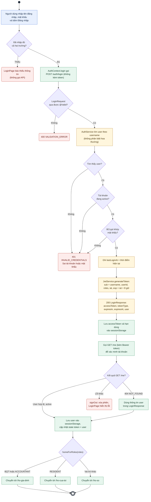

### 9.2 Xác thực JWT và phân quyền cho mỗi request

*Mã nguồn:* api/http.js request() · JwtAuthenticationFilter.doFilterInternal() · SecurityConfig.securityFilterChain() · GlobalExceptionHandler · AuthContext (sự kiện bluemoon:session-expired)

Đây là luồng dùng chung: mọi sơ đồ còn lại đều giả định request đã đi qua luồng này. Vai trò được đọc lại từ DB ở mỗi request nên việc khóa tài khoản, đổi vai trò hay đổi mật khẩu có hiệu lực ngay, không cần chờ token hết hạn.

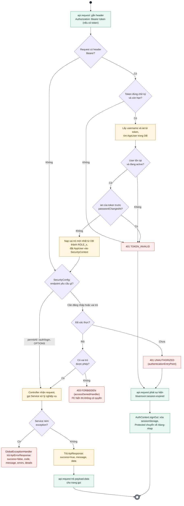

### 9.3 Tạo tài khoản người dùng

*Mã nguồn:* UserForm.jsx · UserController.createUser() · UserService.createUser() — chỉ vai trò BQT

Tài khoản mới luôn có active = true và mustChangePassword = true. Tài khoản có vai trò RESIDENT bắt buộc gắn với một nhân khẩu đang cư trú và mỗi nhân khẩu chỉ có tối đa một tài khoản.

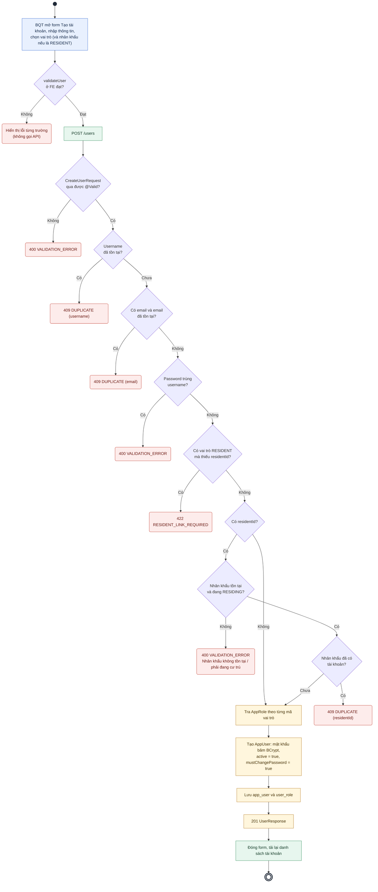

### 9.4 Quản trị tài khoản: đổi vai trò, khóa / mở khóa, đặt lại mật khẩu

*Mã nguồn:* UsersPage.jsx · UserController · UserService.updateUserRoles() / updateUserStatus() / resetPassword() — chỉ vai trò BQT

Lưu ý khi đối chiếu với code: ba kiểm tra "chính mình" dùng SecurityContext.getAuthentication().getName(), trong khi principal do JwtAuthenticationFilter đặt là đối tượng AppUser (không implement UserDetails/Principal). Cần kiểm thử lại các nhánh SELF_LOCKOUT và SELF_RESET_NOT_ALLOWED ở tầng API; hiện phía FE đã chặn bằng isSelf() và canAssignRoles().

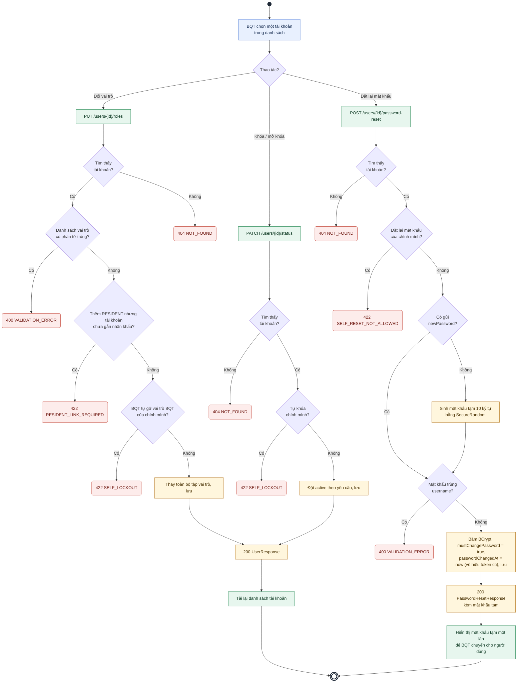

### 9.5 Đổi mật khẩu

*Mã nguồn:* ProfilePage.jsx · MeController.changePassword() · MeService.changePassword()

Sau khi đổi, passwordChangedAt được cập nhật nên mọi token phát hành trước đó bị JwtAuthenticationFilter từ chối. FE chủ động đăng xuất để người dùng đăng nhập lại bằng mật khẩu mới.

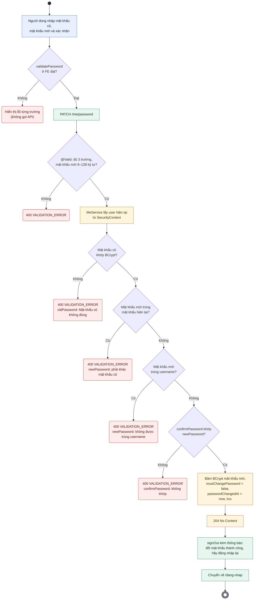

### 9.6 Tạo hộ gia đình kèm chủ hộ

*Mã nguồn:* HouseholdForm.jsx · HouseholdController.createHousehold() · HouseholdService.createHousehold() — chỉ vai trò BQT

Ba bản ghi (household, resident chủ hộ, resident_movement MOVE_IN ban đầu) được tạo trong cùng một transaction: lỗi ở bất kỳ bước nào sẽ rollback toàn bộ.

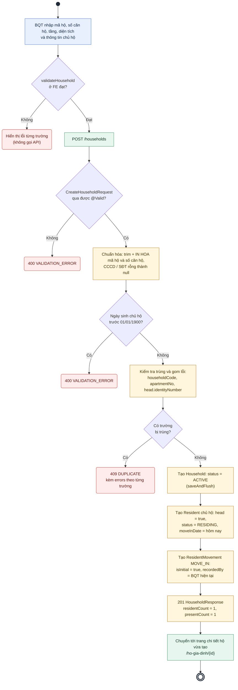

### 9.7 Đổi chủ hộ

*Mã nguồn:* HouseholdDetailPage.jsx · HouseholdController.changeHouseholdHead() · HouseholdService.changeHouseholdHead() — chỉ vai trò BQT

Chủ hộ cũ được bỏ cờ head và flush trước khi gán chủ hộ mới để không vi phạm ràng buộc "mỗi hộ một chủ hộ" trong DB.

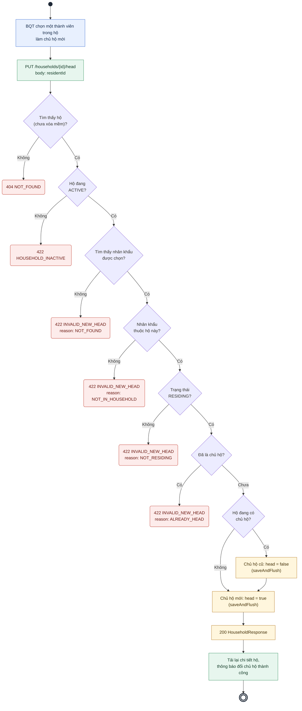

### 9.8 Thêm nhân khẩu vào hộ

*Mã nguồn:* ResidentForm.jsx · ResidentController.createResident() · ResidentService.createResident() — chỉ vai trò BQT

Endpoint này không bao giờ tạo chủ hộ (head luôn = false). Hình thức EXISTING dùng để nhập người đã ở sẵn nên không sinh bản ghi biến động.

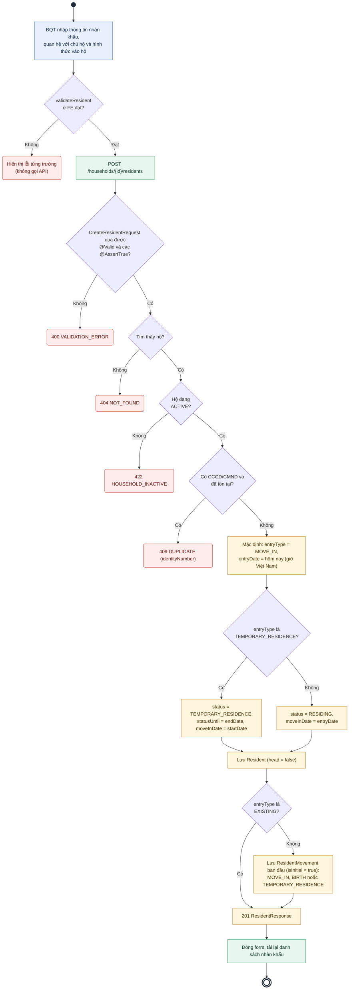

### 9.9 Xóa nhân khẩu (xóa mềm)

*Mã nguồn:* ResidentDetailPage.jsx · ResidentController.deleteResident() · ResidentService.deleteResident() — chỉ vai trò BQT

Chỉ xóa được nhân khẩu nhập nhầm: chưa là chủ hộ, chưa có tài khoản và chưa có biến động nào ngoài bản ghi ban đầu. Các trường hợp khác phải ghi nhận biến động (chuyển đi, qua đời).

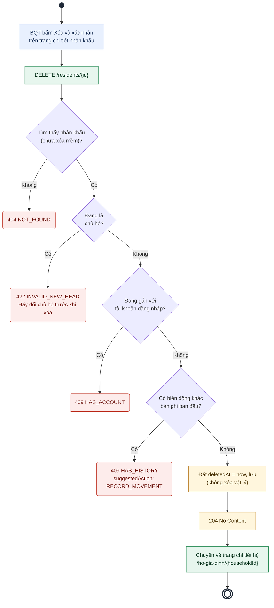

### 9.10a Ghi nhận biến động nhân khẩu — phần 1: kiểm tra hợp lệ

*Mã nguồn:* MovementPanel.jsx (MovementForm) · utils/supplement.js · ResidentController.recordMovement() · ResidentService.recordMovement() bước 1–7 — chỉ vai trò BQT

Bảng chuyển trạng thái hợp lệ: MOVE_OUT và DEATH từ RESIDING / TEMPORARILY_ABSENT / TEMPORARY_RESIDENCE · TRANSFER từ RESIDING / TEMPORARY_RESIDENCE · MOVE_IN từ MOVED_OUT · TEMPORARY_ABSENCE và TEMPORARY_RESIDENCE từ RESIDING · RETURN từ TEMPORARILY_ABSENT. BIRTH chỉ được ghi khi thêm nhân khẩu.

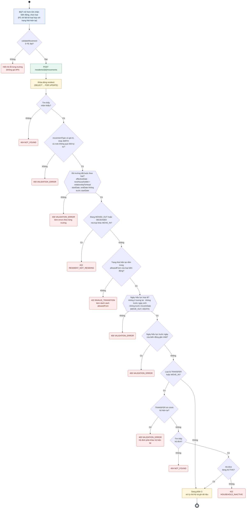

### 9.10b Ghi nhận biến động nhân khẩu — phần 2: xử lý chủ hộ và ghi dữ liệu

*Mã nguồn:* ResidentService.recordMovement() bước 8–11 · MovementPanel.jsx (xử lý HEAD_REQUIRED)

Toàn bộ nằm trong một transaction với dòng resident đã bị khóa. Bản ghi resident_movement chỉ thêm mới (append-only), không sửa hay xóa.

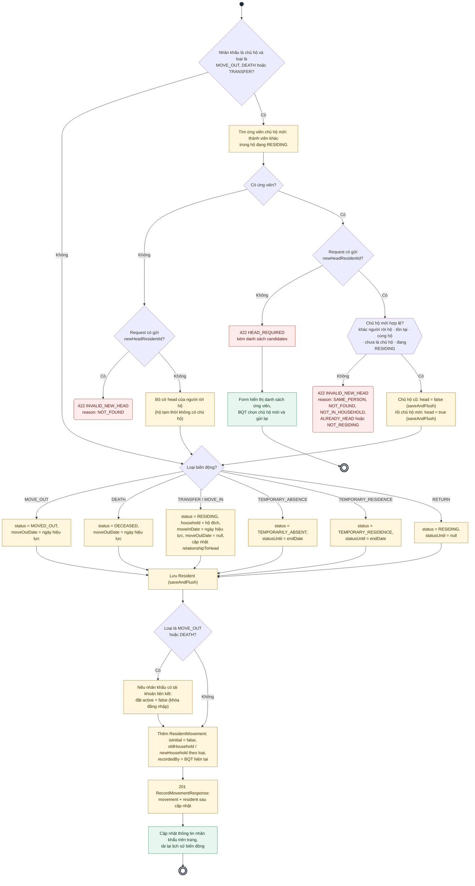

### 9.11 Tìm kiếm nhanh hộ gia đình và nhân khẩu

*Mã nguồn:* SearchPage.jsx · SearchController.search() · SearchService.search() — vai trò BQT, ACCOUNTANT

FE chờ 300 ms sau lần gõ cuối và hủy request cũ bằng AbortController. Mỗi nhóm trả tối đa limit kết quả kèm tổng số để FE biết còn kết quả hay không (hasMore).

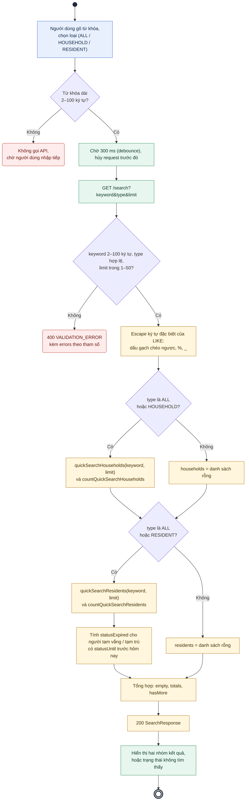

### 9.12 Cư dân gửi đề nghị (cập nhật hồ sơ, tạm vắng, tạm trú)

*Mã nguồn:* MyHouseholdPage.jsx · ResidentRequestForm.jsx · ResidentRequestController.submitRequest() · ResidentRequestService.submit() — chỉ vai trò RESIDENT

Gửi đề nghị không làm thay đổi dữ liệu nhân khẩu: chỉ tạo bản ghi resident_request ở trạng thái PENDING. Với PROFILE_UPDATE, hệ thống chụp lại giá trị hiện tại (beforeValues) để phát hiện dữ liệu đã đổi khi BQT duyệt.

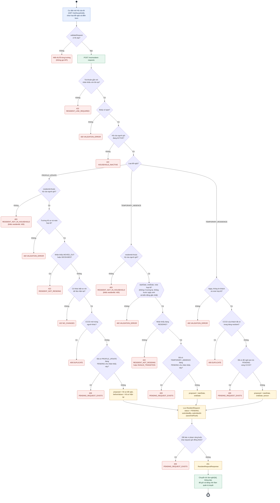

### 9.13 Ban quản trị duyệt đề nghị

*Mã nguồn:* ResidentRequestDetailPage.jsx · ResidentRequestController.approveRequest() · ResidentRequestService.approve() · ResidentService.recordMovement() / createResident() — chỉ vai trò BQT

Việc duyệt và việc áp dụng thay đổi chạy trong cùng một transaction: nếu ghi nhận tạm vắng hoặc tạo nhân khẩu tạm trú thất bại thì đề nghị vẫn giữ trạng thái PENDING.

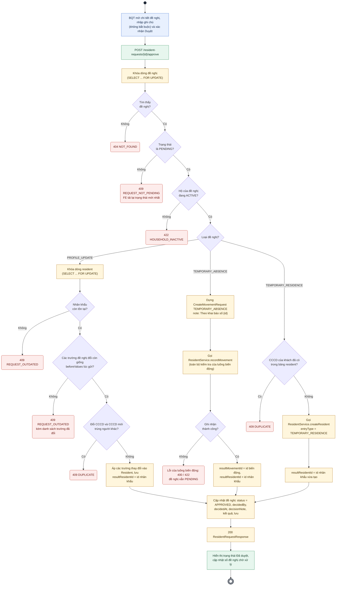

### 9.14 Từ chối đề nghị (BQT) và hủy đề nghị (cư dân)

*Mã nguồn:* ResidentRequestDetailPage.jsx · ResidentRequestService.reject() / cancel()

Cả hai thao tác đều khóa dòng đề nghị trước khi kiểm tra trạng thái, nên khi BQT duyệt và cư dân hủy cùng lúc thì chỉ một bên thành công, bên còn lại nhận REQUEST_NOT_PENDING. Cư dân truy cập đề nghị của người khác nhận 404 thay vì 403 để không lộ sự tồn tại của đề nghị.

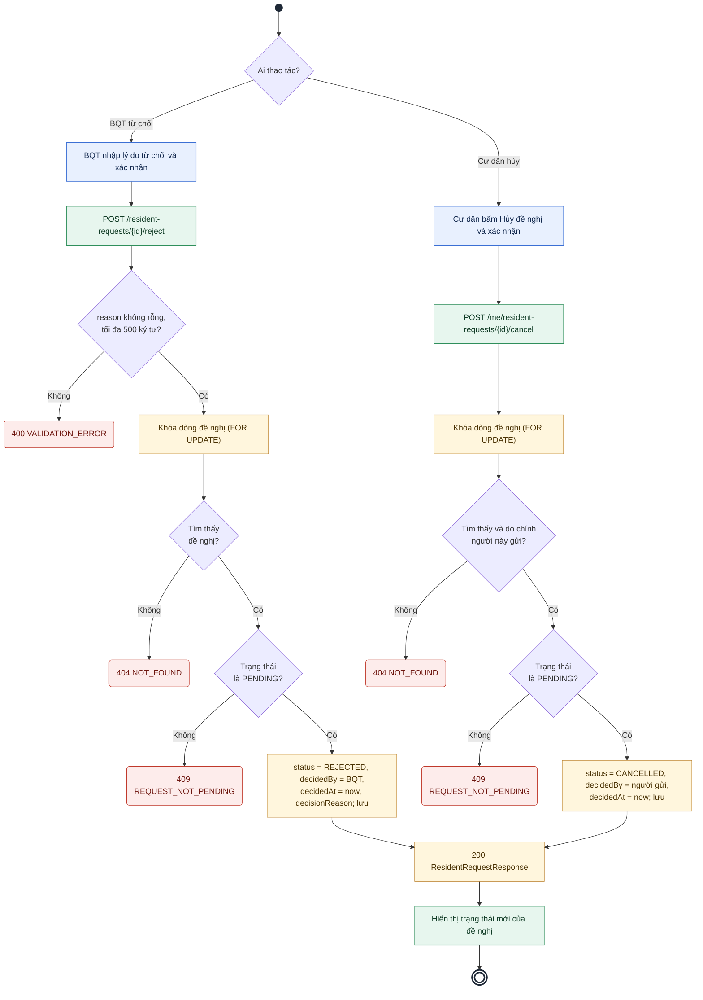

### 9.15 Tạo và cập nhật khoản thu

*Mã nguồn:* FeeForm.jsx · FeeCategoryController.create() / update() · FeeCategoryService.create() / update() — vai trò ACCOUNTANT, BQT

Khoản bắt buộc (MANDATORY) chỉ tính theo diện tích (PER_AREA) hoặc cố định (FIXED) và phải có đơn giá, chu kỳ, hạn nộp. Khoản tự nguyện (VOLUNTARY) luôn là MANUAL, hệ thống tự đặt đơn giá = 0, chu kỳ ONE_TIME, không có hạn nộp. Khi tạo mới, kiểm tra trùng mã chạy ngay sau bước kiểm tra định dạng mã, trước khi trả các lỗi validation khác.

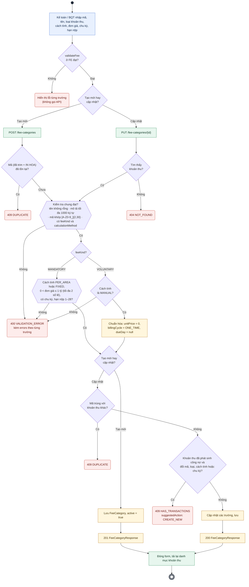

### 9.16 Tính thử phí cho một hộ

*Mã nguồn:* FeePreview.jsx · FeeCalculationController.preview() · FeeCalculationService.preview() — vai trò ACCOUNTANT, BQT

Chỉ tính và trả kết quả để xem trước, không ghi gì vào DB (transaction readOnly). Số tiền làm tròn tới đồng theo HALF_UP.

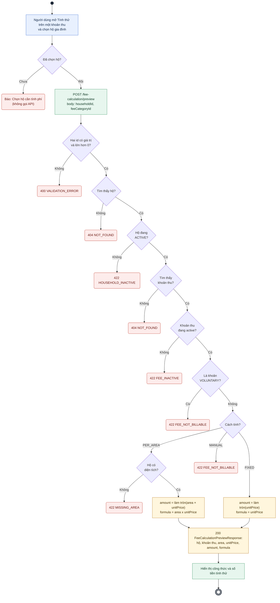

### 9.17 Quản lý kỳ thu: tạo, sửa, xóa

*Mã nguồn:* PeriodForm.jsx · PeriodDetailPage.jsx · BillingPeriodController · BillingPeriodService.create() / update() / delete() — vai trò ACCOUNTANT, BQT

Kỳ thu mới luôn ở trạng thái OPEN và chưa lập danh sách. Sau khi đã lập danh sách khoản phải thu (generatedAt khác null) thì không được sửa hay xóa kỳ nữa.

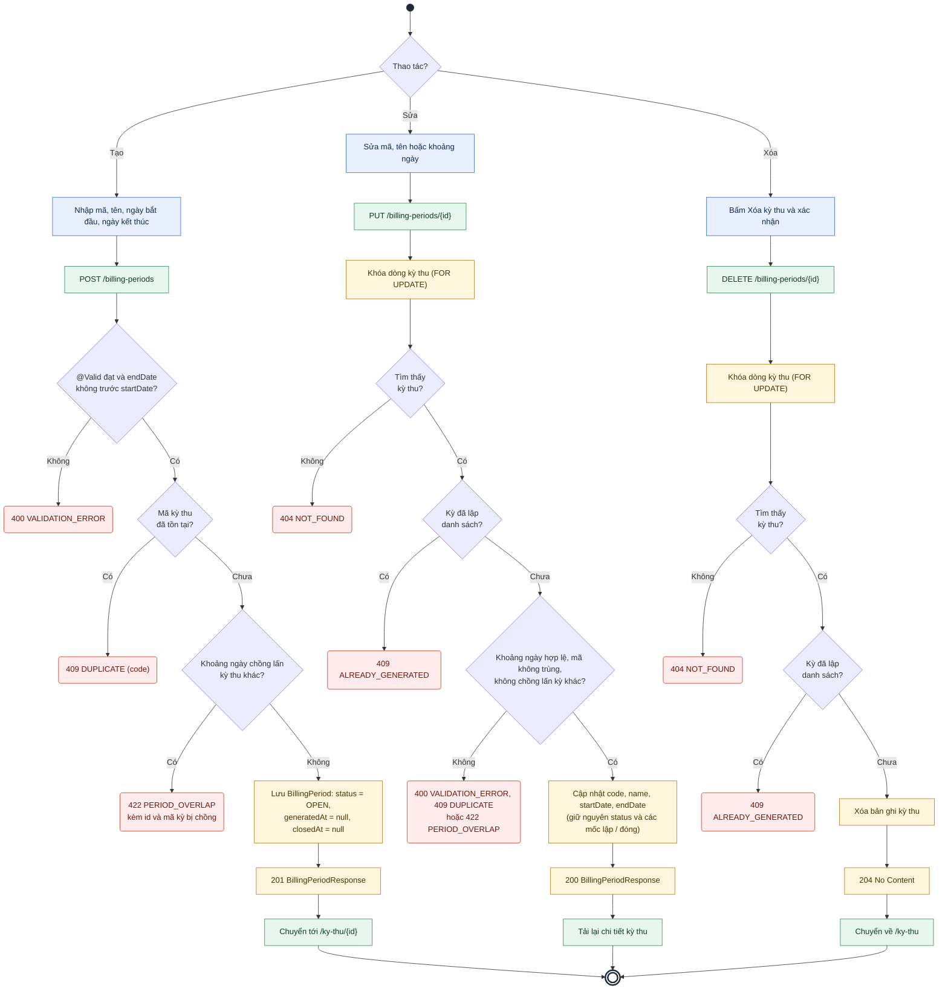

### 9.18 Lập danh sách khoản phải thu cho kỳ thu

*Mã nguồn:* PeriodDetailPage.jsx perform() · BillingGenerationController.generate() · BillingGenerationService.generate() · ReceivableRepository — vai trò ACCOUNTANT, BQT

Khoản thu đủ điều kiện: MANDATORY, đang active, chu kỳ MONTHLY hoặc ONE_TIME chưa từng phát sinh công nợ. Mỗi hộ ACTIVE nhận một khoản phải thu cho mỗi khoản thu đủ điều kiện; khoản PER_AREA bị bỏ qua với hộ chưa có diện tích (MISSING_AREA). Xem trước (dryRun) và lập thật dùng chung một đường xử lý, chỉ khác ở bước ghi.

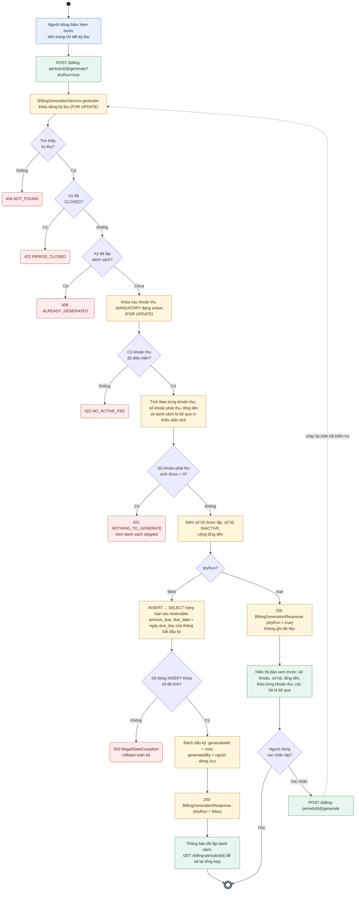

### 9.19 Đóng sổ và mở lại kỳ thu

*Mã nguồn:* PeriodDetailPage.jsx · BillingPeriodController.updateStatus() · BillingPeriodService.updateStatus() — chỉ vai trò BQT

Thao tác có tính idempotent: gửi lại trạng thái đang có sẽ trả 200 mà không thay đổi gì. Kỳ đã CLOSED thì không lập danh sách được nữa (PERIOD_CLOSED).

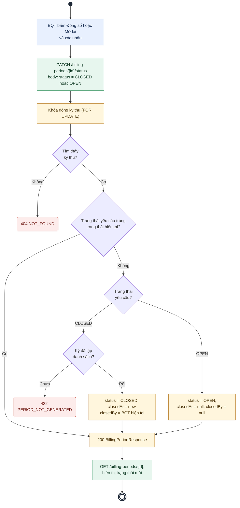