### 10.1 Đăng nhập và khởi tạo phiên

*Mã nguồn:* LoginPage.jsx · AuthContext.login() · AuthController.login() · AuthService.login() · JwtService.generateToken() · MeController.getMe() · UserService.getMe()

POST /auth/login là endpoint duy nhất permitAll. Sau khi nhận token, FE gọi thêm GET /me để lấy hồ sơ đầy đủ (kèm householdId) trước khi coi là đăng nhập thành công.

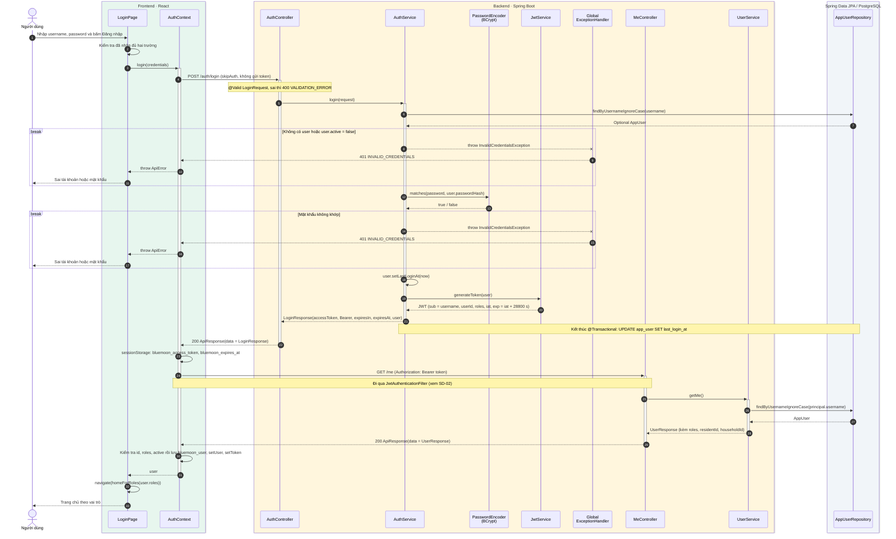

### 10.2 Xác thực JWT và phân quyền cho mỗi request

*Mã nguồn:* api/http.js request() · JwtAuthenticationFilter · JwtService · SecurityConfig · GlobalExceptionHandler · AuthContext

Sơ đồ dùng chung cho mọi API cần đăng nhập. Các sơ đồ sau chỉ ghi chú "xem SD-02" thay vì vẽ lại đoạn này.

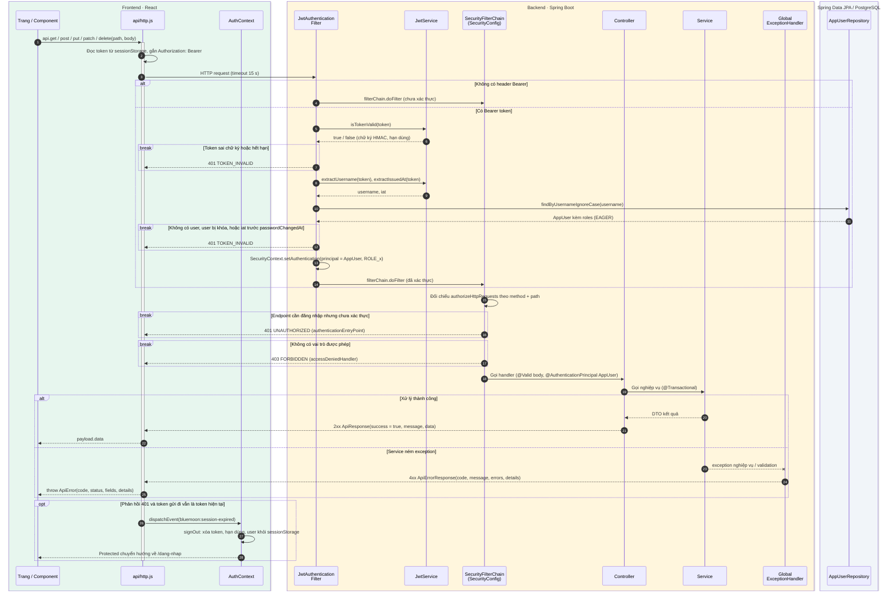

### 10.3 Tạo tài khoản người dùng

*Mã nguồn:* UserForm.jsx · UserController.createUser() · UserService.createUser() — chỉ vai trò BQT

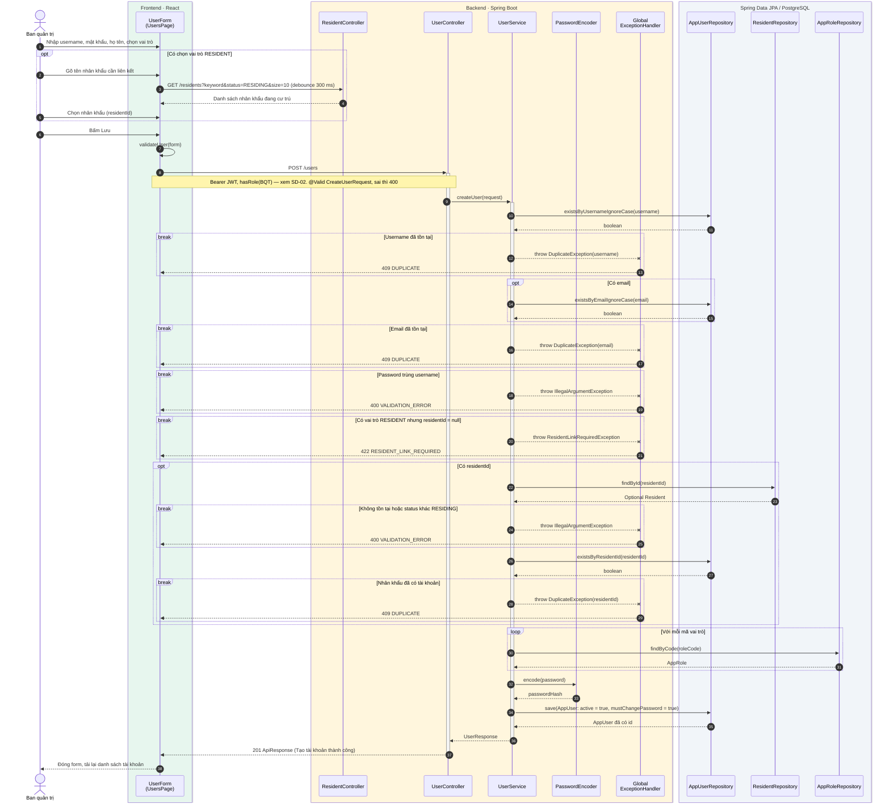

### 10.4 Quản trị tài khoản: đổi vai trò, khóa / mở khóa, đặt lại mật khẩu

*Mã nguồn:* UsersPage.jsx · UserController · UserService.updateUserRoles() / updateUserStatus() / resetPassword() — chỉ vai trò BQT

Cả ba thao tác đều bắt đầu bằng findById (không có thì 404 NOT_FOUND). Tài khoản bị khóa hoặc bị đặt lại mật khẩu sẽ bị từ chối ngay ở request kế tiếp nhờ kiểm tra trong JwtAuthenticationFilter.

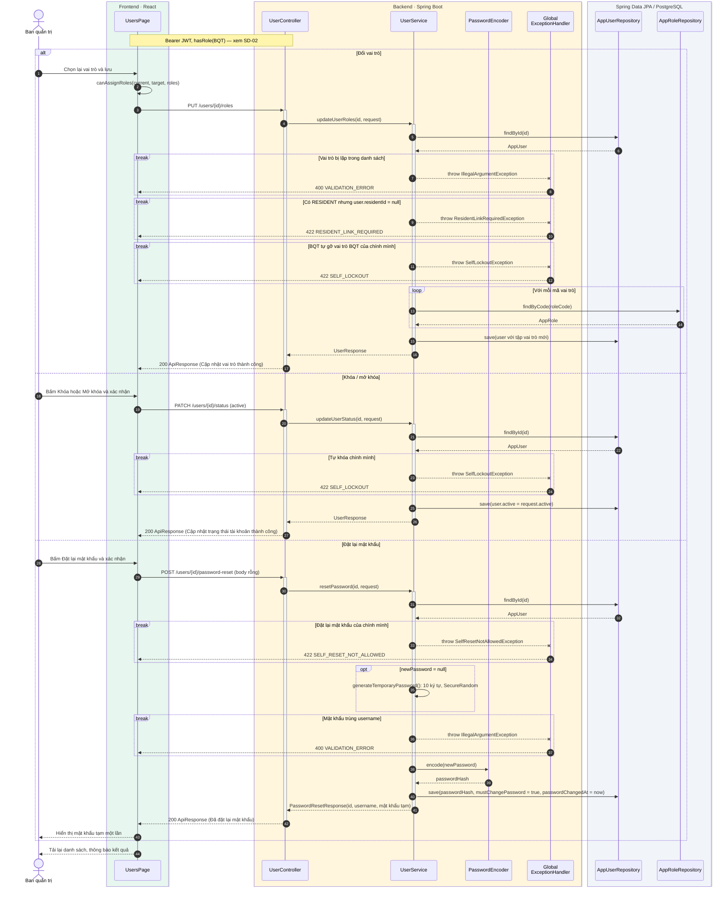

### 10.5 Đổi mật khẩu

*Mã nguồn:* ProfilePage.jsx · MeController.changePassword() · MeService.changePassword()

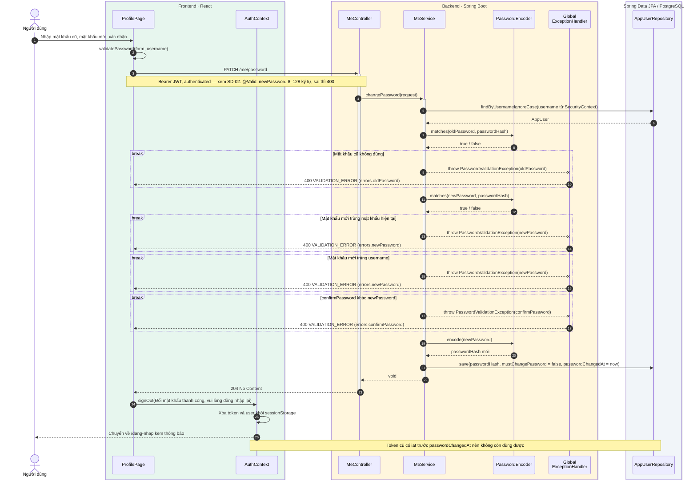

### 10.6 Tạo hộ gia đình kèm chủ hộ

*Mã nguồn:* HouseholdForm.jsx · HouseholdController.createHousehold() · HouseholdService.createHousehold() — chỉ vai trò BQT

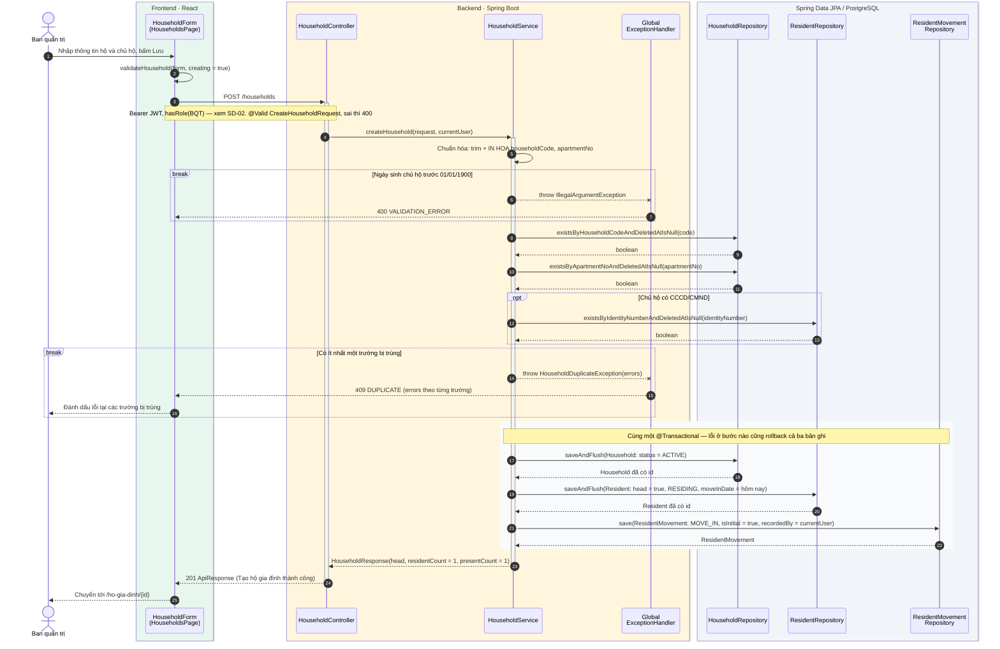

### 10.7 Đổi chủ hộ

*Mã nguồn:* HouseholdDetailPage.jsx · HouseholdController.changeHouseholdHead() · HouseholdService.changeHouseholdHead() — chỉ vai trò BQT

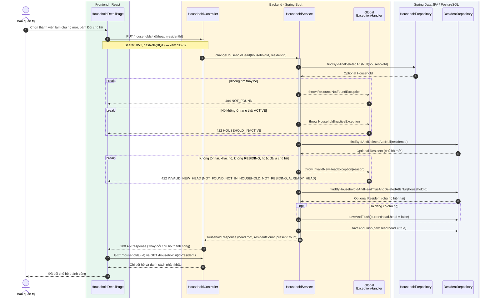

### 10.8 Thêm nhân khẩu vào hộ

*Mã nguồn:* ResidentForm.jsx · ResidentController.createResident() · ResidentService.createResident() — chỉ vai trò BQT

Cũng chính phương thức createResident này được ResidentRequestService.approve gọi lại khi BQT duyệt đề nghị tạm trú (xem SD-13).

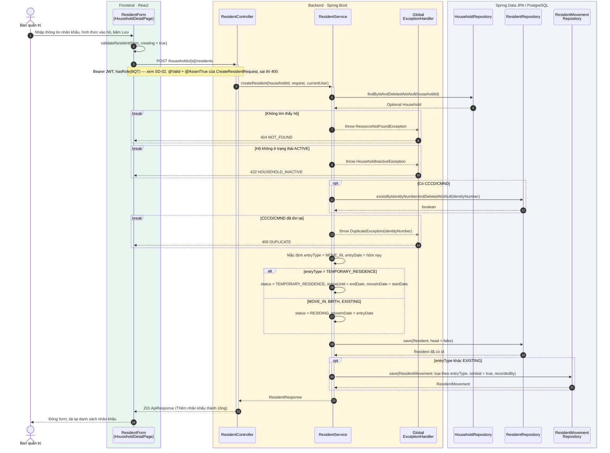

### 10.9 Xóa nhân khẩu (xóa mềm)

*Mã nguồn:* ResidentDetailPage.jsx · ResidentController.deleteResident() · ResidentService.deleteResident() — chỉ vai trò BQT

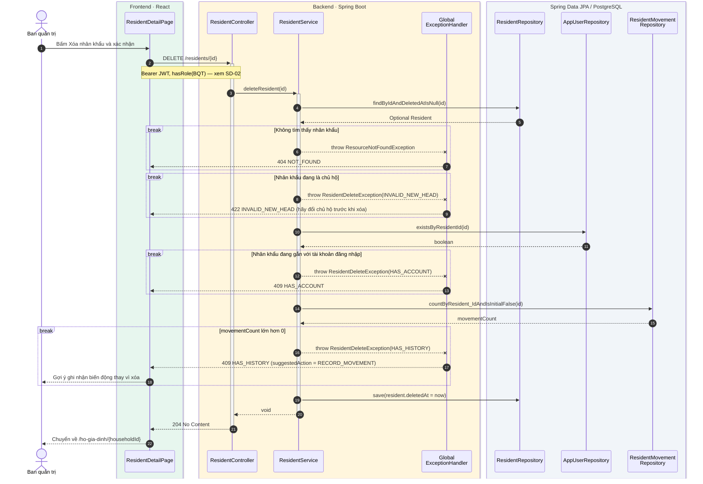

### 10.10 Ghi nhận biến động nhân khẩu

*Mã nguồn:* MovementPanel.jsx (MovementForm) · ResidentController.recordMovement() · ResidentService.recordMovement() — chỉ vai trò BQT

Dòng resident bị khóa bằng SELECT ... FOR UPDATE suốt transaction nên hai biến động đồng thời trên cùng một người sẽ được xử lý tuần tự. Khi chủ hộ rời hộ mà chưa chọn người thay, API trả HEAD_REQUIRED kèm danh sách ứng viên để form hiển thị và gửi lại.

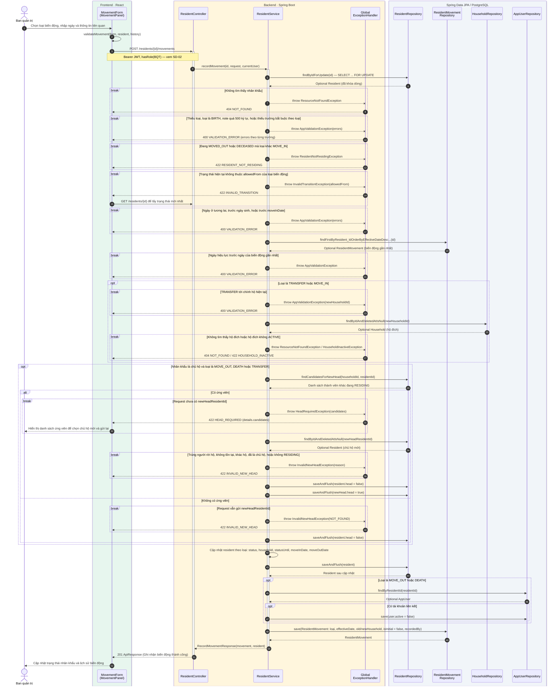

### 10.11 Tìm kiếm nhanh hộ gia đình và nhân khẩu

*Mã nguồn:* SearchPage.jsx · SearchController.search() · SearchService.search() — vai trò BQT, ACCOUNTANT

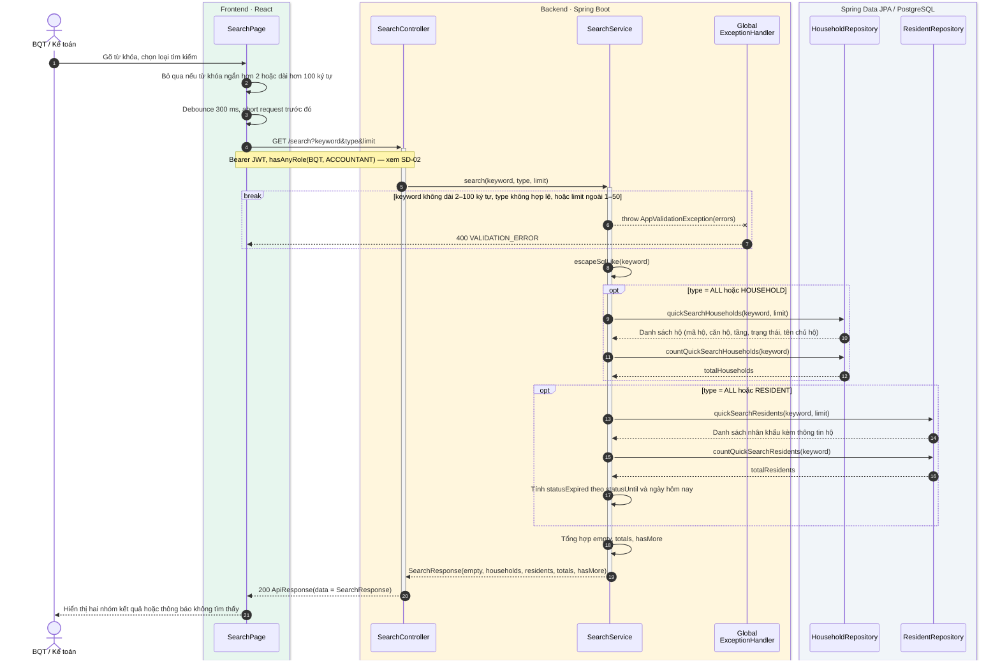

### 10.12 Cư dân gửi đề nghị (cập nhật hồ sơ, tạm vắng, tạm trú)

*Mã nguồn:* MyHouseholdPage.jsx · ResidentRequestForm.jsx · MeController.getMyHousehold() · ResidentRequestController.submitRequest() · ResidentRequestService.getMyHousehold() / submit() — chỉ vai trò RESIDENT

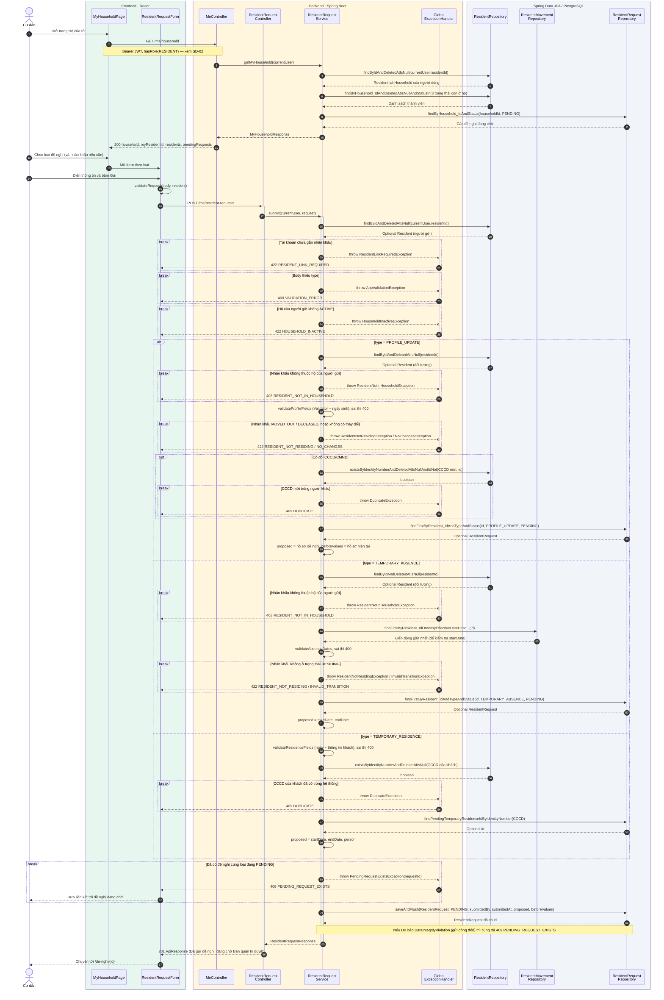

### 10.13 Ban quản trị duyệt đề nghị

*Mã nguồn:* ResidentRequestDetailPage.jsx · ResidentRequestController.approveRequest() · ResidentRequestService.approve() · ResidentService.recordMovement() / createResident() — chỉ vai trò BQT

ResidentRequestService gọi lại ResidentService trong cùng transaction, nên việc duyệt tái sử dụng toàn bộ kiểm tra của luồng ghi nhận biến động (SD-10) và thêm nhân khẩu (SD-08).

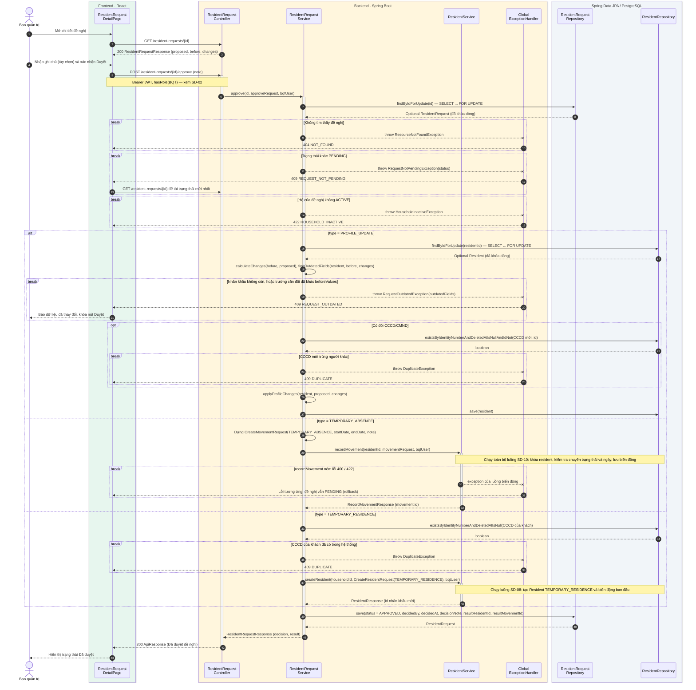

### 10.14 Từ chối đề nghị (BQT) và hủy đề nghị (cư dân)

*Mã nguồn:* ResidentRequestDetailPage.jsx · ResidentRequestController.rejectRequest() / cancelMyRequest() · ResidentRequestService.reject() / cancel()

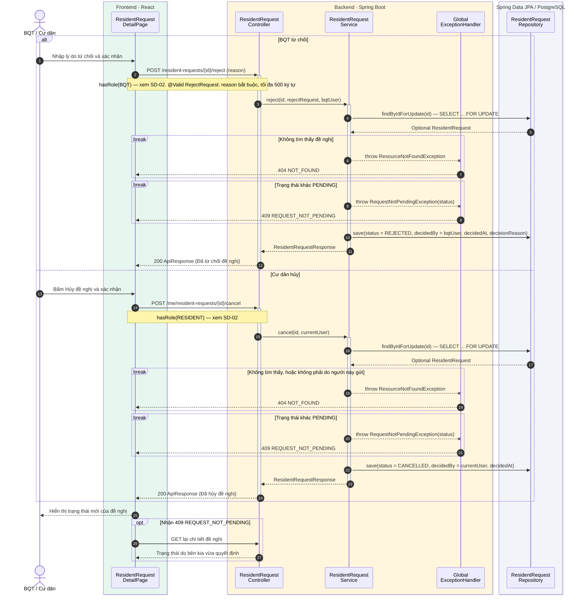

### 10.15 Tạo và cập nhật khoản thu

*Mã nguồn:* FeeForm.jsx · FeeCategoryController.create() / update() · FeeCategoryService.create() / update() — vai trò ACCOUNTANT, BQT

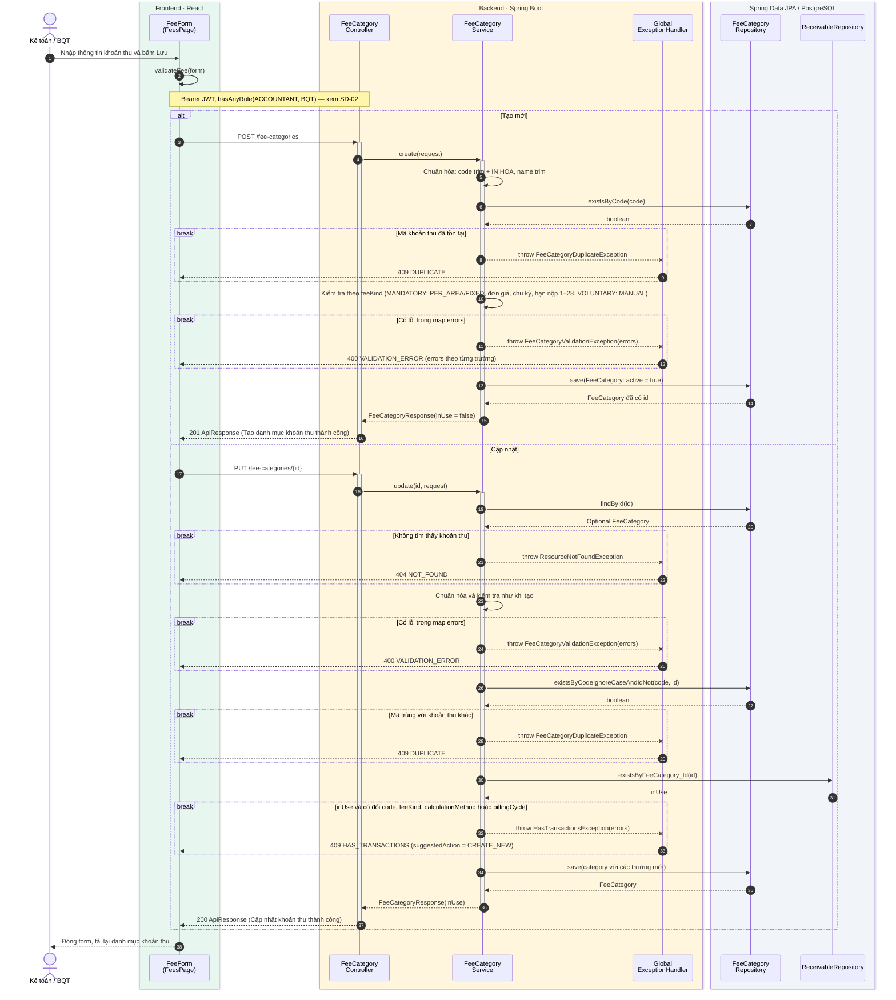

### 10.16 Tính thử phí cho một hộ

*Mã nguồn:* FeePreview.jsx · FeeCalculationController.preview() · FeeCalculationService.preview() — vai trò ACCOUNTANT, BQT

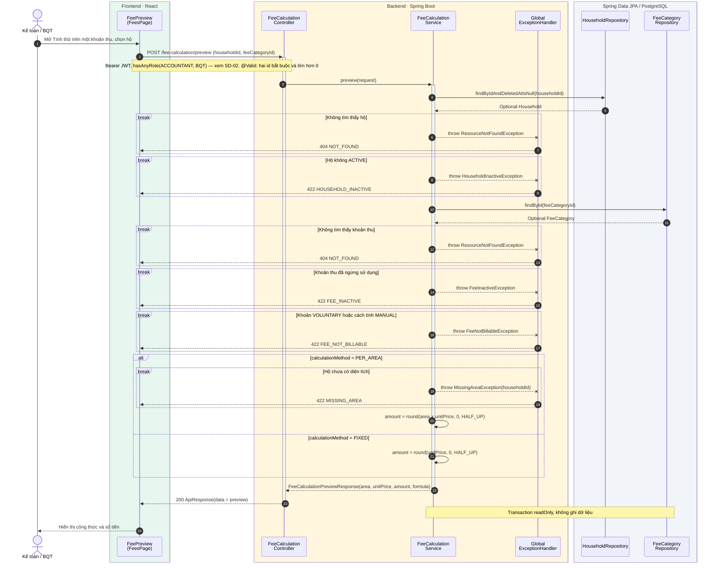

### 10.17 Quản lý kỳ thu: tạo, sửa, xóa

*Mã nguồn:* PeriodForm.jsx · PeriodDetailPage.jsx · BillingPeriodController · BillingPeriodService.create() / update() / delete() — vai trò ACCOUNTANT, BQT

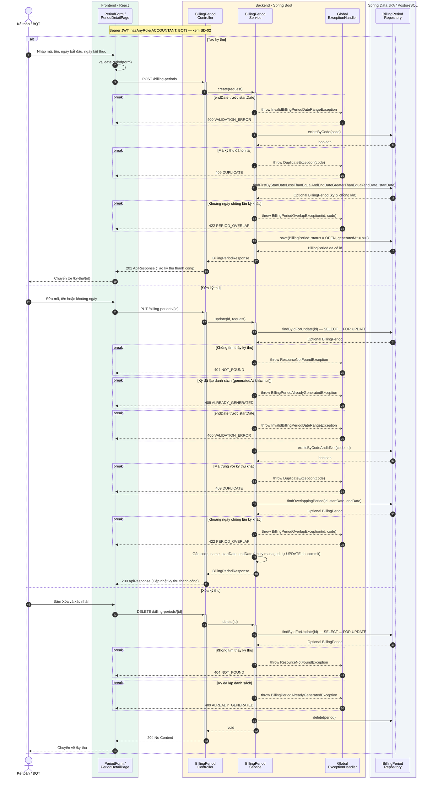

### 10.18 Lập danh sách khoản phải thu cho kỳ thu

*Mã nguồn:* PeriodDetailPage.jsx perform() · BillingGenerationController.generate() · BillingGenerationService.generate() · ReceivableRepository — vai trò ACCOUNTANT, BQT

Hai lần gọi (xem trước và lập thật) đi qua cùng một phương thức generate. Khóa trên kỳ thu và trên các khoản thu MANDATORY bảo đảm hai người bấm cùng lúc không sinh trùng khoản phải thu và khoản ONE_TIME chỉ được tính một lần.

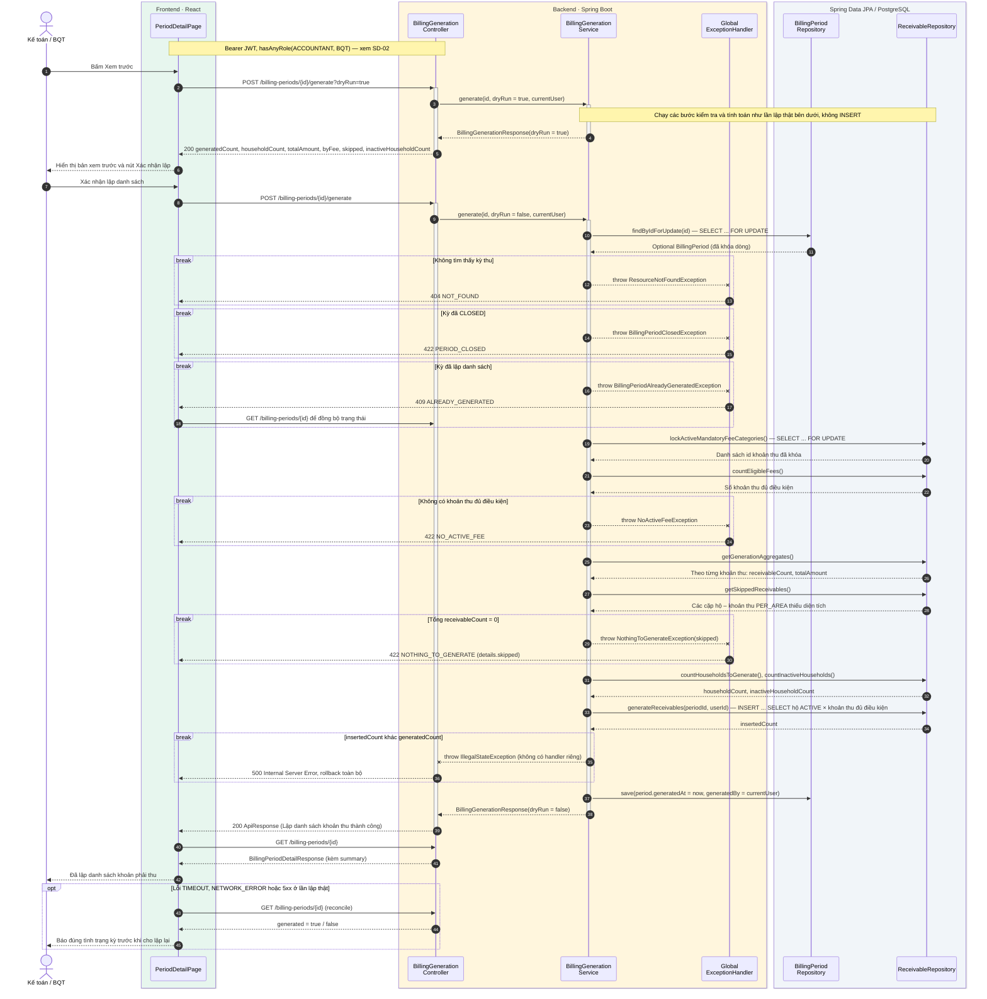

### 10.19 Đóng sổ và mở lại kỳ thu

*Mã nguồn:* PeriodDetailPage.jsx · BillingPeriodController.updateStatus() · BillingPeriodService.updateStatus() — chỉ vai trò BQT

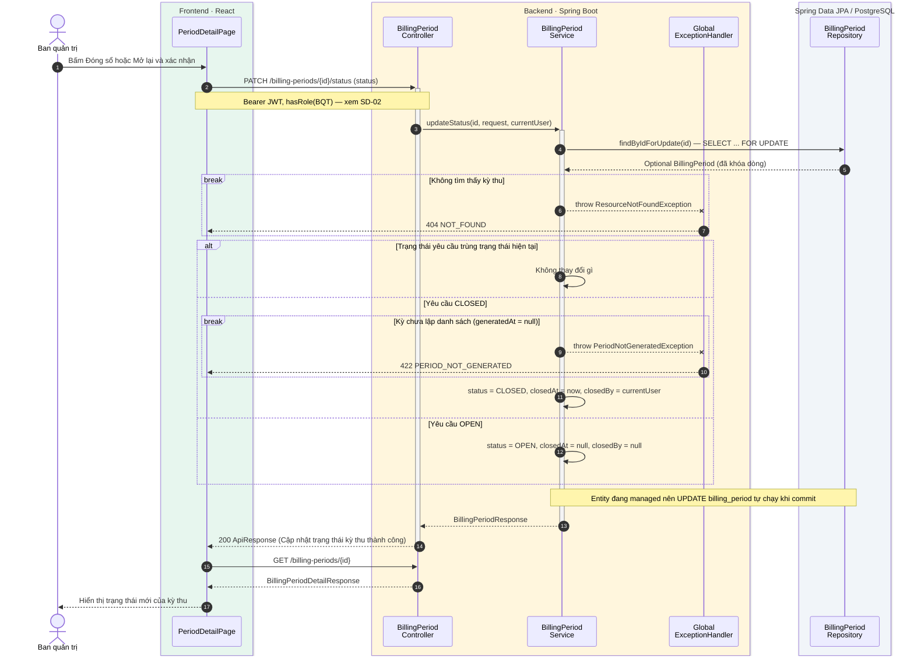
